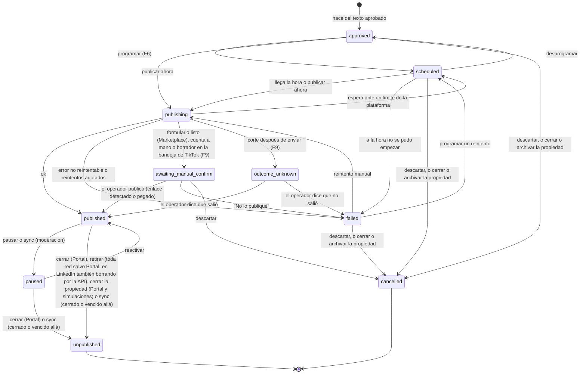

# 01 · Arquitectura

## Vista general

```mermaid
flowchart LR
  subgraph Entradas
    XLSX[Excel / Google Sheets]
    MED[Carpetas de fotos y videos]
  end

  subgraph Interfaces
    WEB[apps/web<br/>Panel React]
    CLI[apps/cli<br/>agentsales]
  end

  subgraph Backend
    API[apps/api<br/>Hono REST]
    WRK[apps/worker<br/>pg-boss]
    CORE[packages/core<br/>dominio + casos de uso]
    CFG[packages/config<br/>env · logger]
  end

  subgraph Adaptadores
    IMP[packages/importers]
    LLM[packages/llm]
    MEDIA[packages/media<br/>sharp · ffmpeg · Playwright]
    TPL[packages/templates<br/>HTML de portada, ficha y texto del reel]
    PUB[packages/publishers]
    DB[packages/db<br/>Drizzle]
    STO[packages/storage<br/>API S3]
    QUE[packages/queue<br/>pg-boss]
  end

  subgraph Externos
    NEON[(Neon<br/>Postgres)]
    R2[(Cloudflare R2<br/>archivos)]
    CL[Claude<br/>CLI o API]
    IG[Instagram API]
    ML[Mercado Libre API<br/>→ Portal Inmobiliario]
    FB[Facebook Marketplace<br/>navegador]
    SOC[X · LinkedIn · Discord · TikTok<br/>posts de marca, F9]
  end

  XLSX --> IMP
  MED --> IMP
  WEB --> API
  CLI --> API
  API --> CORE
  WRK --> CORE
  IMP & LLM & MEDIA & TPL & PUB & DB & STO & QUE -. implementan puertos de .-> CORE
  API & WRK & CLI --> CFG
  CFG --> CORE
  DB --> NEON
  STO --> R2
  LLM --> CL
  PUB --> IG & ML & FB & SOC
  API -. conectar, refrescar, (F4) pausar, reactivar y cerrar, (F6) actualizar y (F9) borrar en LinkedIn (ADR-0014 p.9, ADR-0015 p.8, ADR-0020, ADR-0029) .-> PUB
  API -. encola jobs (desde F1) .-> NEON
  API --> IMP
  API -. el logo de un corredor (./logo, F7-T14) .-> MEDIA
  WRK -. consume jobs .-> NEON
```

## Estilo: puertos y adaptadores

- `packages/core` contiene el **dominio**: entidades, esquemas zod, máquina de estados y casos de uso. No importa librerías de infraestructura.
- Core define **puertos** (interfaces): repositorios (`ListingRepository` y compañía), `MediaStorage`, `MediaFileSource`, `JobQueue`, `LLMProvider`, `MediaProcessor`, `SlideTemplates`, `HtmlRenderer` y `Publisher`. Hoy existen `MediaStorage`, `MediaFileSource`, `MediaRepository`, `JobQueue`, `FieldDefinitionRepository`, `BrokerRepository`, `ListingRepository`, `ImportRunRepository`, `ContentRunRepository`, `ContentRepository`, `PlatformAccountRepository` y `SecretBox` (F3-T03), `PublicationRepository` y `ListingLock` (F3-T04; `PlatformAccountRepository.upsertConnected` suma `revokeOthers` en F3-T13), `Publisher` (F3-T07), `InstagramAuth` (F3-T08), `MercadoLibreAuth` (F4-T03), `UfValueSource` (F5-T07: el valor oficial de la UF; adaptador `createBancoCentralUf` en la subruta `@agentsales/publishers/uf`, con los valores en memoria por fecha), `PlatformCatalogRepository` (F4-T09; el catálogo de Portal, `PortalCatalog`, vive en `packages/publishers`, ADR-0015), `UserRepository`, `SessionRepository`, `InvitationRepository` y `OAuthStateRepository` (F7-T01), `LogoNormalizer` (F7-T14: `createLogoNormalizer` en la subruta `@agentsales/media/logo`), `PasswordHasher` y `SecretTokens` (F7-T03: `createPasswordHasher` con `scrypt` y `createSecretTokens` en `packages/config`, como `SecretBox`), `LLMProvider`, `MediaProcessor`, `SlideTemplates` y `HtmlRenderer` (`packages/core/src/ports/`). `MediaProcessor` (F2-T07) lo implementa `createMediaProcessor` de `packages/media` con sharp y ffmpeg: las fotos (también HEIC, que ffmpeg 8.1 o más nuevo arma desde sus mosaicos) salen rotadas, en sRGB, sin metadatos y en las variantes `thumb`, `ig_4x5` y `pi_4x3`, con su sha256; los parámetros y su versión (`MEDIA_PIPELINE_VERSION`) viven en `packages/media/src/pipeline.ts`. Los videos (F2-T08) se miden con ffprobe, dan su `thumb` y, en la etapa `reel`, el reel de Instagram. Contrato en "Procesador de medios", más abajo. `SlideTemplates` (F2-T09) lo implementa `createSlideTemplates` de `packages/templates` y `HtmlRenderer`, `createHtmlRenderer` de `packages/media`: ver "Plantillas y render". Desde F8 suman `WorkerHeartbeatRepository` (el latido del worker, T12) y `LoginChallengeRepository` (los desafíos del doble factor, T15); `MetaDeletionRepository` (T17) y `TotpProvider` (T15) ya estaban. Desde F9-T04 (ADR-0029) suman `PostRepository`, `PostUploadRepository`, `PlanRunRepository`, `EditorialProfileRepository` y `PostLock` (ver "Contrato de repositorios"), y con las redes, `DiscordWebhooks` (T14), `LinkedInAuth` (T15), `XAuth` (T16), `TikTokAuth` (T26) y `PlatformTokenRefresher` (la renovación de un token que rota, que implementan `XAuth` y `TikTokAuth`; ADR-0029 punto 11).
- Cola (ADR-0005): el adaptador de pg-boss vive en `packages/queue` desde F1-T08 (en F0 estaba en el worker). Implementa `JobQueue` e incluye `QUEUE_SCHEMA` y `checkQueueSchema`. La API, como `producer`, arranca pg-boss de forma diferida en el primer `enqueue`, y su check de `/health` solo consulta que exista el esquema `pgboss`. Ver "Cola de trabajos" más abajo.
- Los demás paquetes son **adaptadores** que implementan esos puertos.
- Las apps (`api`, `worker`, `cli`, `web`) solo **componen** adaptadores y llaman casos de uso.

Esto permite cambiar Claude CLI por la API de Anthropic, o agregar una plataforma nueva, sin tocar el dominio.

## Estructura del monorepo

```
agentsales/
├── apps/
│   ├── api/          Hono REST API; tipos exportados para el cliente RPC
│   ├── web/          React + Vite + Tailwind + TanStack Query + React Router; panel de operación
│   ├── cli/          CLI `agentsales` (commander); usa el cliente RPC de la API
│   └── worker/       Procesa jobs: importación (F1), contenido (F2: medios, renders, reel y textos), publicación y sincronización; desde F9, los medios y textos de posts y el plan de ideas
├── packages/
│   ├── core/         Dominio, esquemas zod, estados, casos de uso, puertos
│   ├── db/           Esquema Drizzle, migraciones y (desde F1) repositorios; desde F6, el respaldo local (`./backup`, sin `pg`: lo usan la CLI y la API); desde F7, los usuarios y sesiones y `auth:admin`
│   ├── storage/      Archivos en Cloudflare R2 (API S3): subir, leer, borrar, URLs prefirmadas
│   ├── importers/    xlsx, carpetas de medios, zip y la carpeta temporal de las cargas del worker (`./staging`, baja de R2 desde F8); desde F7, la planilla de un corredor (`writeBrokerTemplate`); Google Sheets directo, después del MVP
│   ├── queue/        Cola de trabajos (pg-boss): productor `JobQueue`, `createBoss` y check de `/health`
│   ├── llm/          Proveedores (solo transporte): claude-cli, anthropic-api, fake. Los prompts viven en core (ADR-0013)
│   ├── media/        Procesamiento de imagen y video (sharp, ffmpeg) y render de HTML (Playwright); `./logo` (F7-T14): el logo de un corredor, solo con sharp, para la API
│   ├── templates/    Plantillas HTML/CSS de posts (portada, ficha y texto del reel)
│   ├── publishers/   instagram (F3: cliente de la Graph API, OAuth, errores, validación y publisher); mercadolibre (F4: OAuth, usuario, errores, ítems, fotos, catálogo con caché, `validate`, `buildPortalItem`, el publisher de Portal con `preflight`, `createPortalOperations`, y los clientes de paquetes y usuarios de prueba que usan `ml:smoke` y `ml:test-user`); marketplace (F5, subruta `@agentsales/publishers/marketplace` que solo importa el worker: perfil del navegador con candado, lista blanca, evidencia del formulario y la ventana vigilada; ADR-0017); desde F9, las redes de los posts en sus subrutas (`/discord`, `/linkedin`, `/x` y `/tiktok`: cliente, errores y publisher, y el OAuth de LinkedIn, X y TikTok; Discord no tiene OAuth: se conecta con la URL del webhook) y `error-advice.test.ts`, que exige un consejo para cada código de error de las redes (los consejos viven en core, `packages/core/src/publish/error-advice.ts`)
│   └── config/       Variables de entorno validadas (zod), logger pino, redactor de secretos, resumen de errores repetidos y, desde F3, cifrado y firma (crypto.ts); desde F7, contraseñas con scrypt (`password.ts`), tokens de sesión (`secret-tokens.ts`) y el portapapeles (`clipboard.ts`); desde F8, el doble factor (`totp.ts`, RFC 6238 con `node:crypto`), la firma de las vueltas de Meta (`signed-request.ts`) y la elección del archivo de entorno de los scripts (`env-file.ts`, `ENV_FILE`)
├── .github/          CI (GitHub Actions)
├── docs/             Documentación (esta carpeta)
├── data/             Plantillas y datos de prueba (los datos reales no van a git)
└── .claude/          Configuración de Claude Code: skills y subagentes
```

Los paquetes se crean **cuando la fase que los necesita comienza**, no antes (ver `06-roadmap.md`).

## Flujos principales

**Dos sujetos de publicación (F9, ADR-0029).** Lo que se publica es un **aviso** (`Listing`) o un **post** de marca (`Post`): `Subject = { kind: "listing" | "post", id }`. Textos, corridas, publicaciones y medios cuelgan de uno de los dos, y los casos de uso comunes (aprobar, abrir publicaciones, publicar, programar, el reloj, la vigilancia, cancelar, retirar, confirmar y resolver) corren en el candado de su sujeto (`runOnSubject`: `ListingLock` o `PostLock`). Lo propio del aviso (pasar a `active`, `listing_source_hash`, Portal y Marketplace, cerrar por venta, `auto_publish`) nunca toca un post. El recorrido de un post de marca:

```
perfil editorial de la marca (brand edit o Mi marca)
  → idea: plan de la IA (content.plan) o post manual (post create)
  → aceptar la idea (idea → draft) · subir medios (post.media) · pedir textos (post.draft)
  → un texto por red e idioma, revisado (checkPostContent) → el operador edita y aprueba
  → una publicación por cuenta, formato e idioma → programar o publicar (publication.due, publication.publish)
  → published · outcome_unknown (el operador resuelve) · awaiting_manual_confirm (el operador confirma)
```

Las redes de un post (`posts.platforms`, `null` = todas las de la marca) mandan en todo el recorrido: `post.draft` redacta solo para ellas y un texto de una red quitada no se aprueba, no se publica ni se programa (`POST_PLATFORM_EXCLUDED`, ver el flujo 2).

### 1. Carga

```
CLI (import) o panel (Importar), con la planilla y los medios (un zip o una carpeta)
  → POST /imports/uploads → requestImportUpload (core): crea el import_run en awaiting_upload
    y responde una URL prefirmada de PUT por archivo (6 h, con tamaño y sha256; F8, ADR-0025)
  → el cliente sube cada archivo directo a R2 (imports/<id>/…), con avance y reintento
  → POST /imports/:id/start → startImport (core): revisa en R2 que estén todos y encola import.run
  → el worker corre runImport: markRunning
  → readSheet (importers, inyectado): baja la planilla de R2, revisa que no pase de 50 MB
    descomprimida y la lee (xlsx-reader), sin validar ni filtrar
  → importListings (core) filtra EJEMPLO/Borrador y valida contra field_definitions
  → upsert de listings (idempotente por broker + external_ref)
  → openMedia (importers, inyectado): baja de R2 el zip (y lo extrae) o los archivos de la carpeta,
    en un directorio del intento
  → ingestMedia (core): por carpeta, deduplica por sha256, sube a R2 → registra media,
    ordena, elige portada y pasa a ready con `estado_carga = Listo` y al menos una foto (solo desde draft)
  → import_run en succeeded o failed, con reporte de errores y advertencias por fila;
    se borra lo subido (R2 y disco del worker)
```

### 1b. Posts y sus medios (F9-T10, spec F9 §4.5, ADR-0025)

```
CLI o panel (T12 y T17) → POST /api/posts → createPost (core): manual, draft, brief del operador
  → POST /api/posts/:id/uploads con { name, size, sha256 } por archivo → requestPostUploads (core):
    por contenido, `existing` si ya es un medio del post o una URL de PUT (6 h, con tipo, tamaño y
    sha256) a posts/{postId}/original/{sha256}.{ext}, y su fila en post_uploads (pending, 24 h).
    El sha256 es obligatorio hasta 100 MB; sobre eso es opcional (F9-T17, ADR-0025 punto 2: el
    navegador no puede hashear en streaming): sin él, la URL va sin sha256 y la clave es la de la
    subida, posts/{postId}/original/{uploadId}.{ext} (cada pedido es una subida nueva)
  → el cliente sube directo a R2, con avance y reintento (pedir otra vez el mismo archivo reabre su
    subida con la misma clave)
  → POST /api/posts/:id/uploads/complete → completePostUploads (core): un list de R2; cada pendiente
    que llegó con su tamaño queda como medio original del post (único por post y checksum) y
    completed; una grande sin sha256 queda uploaded (aún no es medio: `uploaded` en la respuesta);
    las que faltan siguen pendientes (missing). Si el post tiene medios o subidas uploaded, encola
    post.media
  → el worker, al empezar post.media, corre finalizePostUploads (F9-T17): cada subida uploaded se lee
    de R2 en streaming y se hashea fuera del candado; en el candado, si ese contenido ya es un
    original del post, se borra el objeto nuevo de R2 (fuera del candado; si falla, sigue uploaded y
    el job reintenta) y la subida queda completed; si no, se crea el medio con la clave de la subida
    y queda completed. Un archivo que ya no está en R2 deja la subida abandoned. GET /api/posts/:id
    cuenta las uploaded (`uploadsInReview`): el panel avisa y sondea mientras haya alguna
  → el worker corre processPostMedia: de una foto, thumb e ig_4x5; de un video, thumb, el reel 9:16
    sin texto (3 a 90 s) y x_video, solo lo que falta para la versión del procesador; si el post va
    a Discord y el más liviano de esos videos pesa más de 20 MiB, además discord_video (bajo 19 MiB,
    con otra lectura del original; F9.5 D8)
  → publications.watch (cada hora): closeAbandonedPostUploads borra de R2 lo vencido y lo deja abandoned;
    también las uploaded que llevan más de 24 h así (listStaleUploaded: el worker agotó sus
    reintentos), con la misma revisión en el candado (si ya son un medio, solo completed)
```

### 2. Preparación de contenido (job `content.prepare`, F2)

```
CLI (prepare) o panel (Preparar contenido)
  → requestContentRun (core, con el candado del aviso): crea el content_run en queued y,
    ya confirmado, encola content.prepare
    (si el aviso ya tiene una corrida activa, la devuelve)
  → el worker corre prepareContent, por etapas idempotentes:
    1. media:   mide, pasa HEIC a JPEG, borra metadatos y crea thumb, ig_4x5 y pi_4x3
                (la portada es la del operador: foto_portada o la primera foto)
    2. renders: portada y ficha (plantillas HTML → Playwright → JPEG)
    3. reel:    9:16 con fondo desenfocado, tope de 90 s y el texto de los primeros 2 s
    4. texts:   brief sin datos privados → IA (frases, JSON validado con zod)
                → ensamblado con los datos por código → contents en draft
  → content_run en succeeded o failed, con reporte por etapa
```

En F2 no se crean `publications` (ADR-0012). Desde F3 (ADR-0014) nacen aprobadas del texto aprobado de un canal: al aprobarlo, si hay una cuenta conectada, o al publicar. Detalle en el spec F2 §4.2 a §4.6 y en el spec F3 §4.2.

**Un post (F9-T05, ADR-0029):** `requestContentRun` recibe el aviso (`listingId`) o el post (`postId`) y corre en el candado de su sujeto (`runOnSubject`). Un post pide solo textos (en `draft` o `ready`, con o sin medios; `POST_NOT_READY` si es una idea sin aceptar o está archivado) y su corrida se encola como **`post.draft`**, nunca como `content.prepare` (`enqueueRunOf`); `prepareContent` rechaza una corrida de post sin tocarla (`SUBJECT_NOT_LISTING`).

**Los textos de un post (F9-T11, ADR-0030):** el job `post.draft` corre `draftPost` (core), solo la etapa `texts` (los medios de un post se procesan al subirlos, `post.media`). Lee el post (en `draft` o `ready`), su marca, el perfil editorial de esa marca, sus cuentas y sus medios; las redes son las de `POST_PLATFORMS` con cuenta no desconectada o con cadencia en el perfil (`postPlatforms`; sin ninguna, `POST_NO_PLATFORMS`), y se pide un texto por red **e idioma** del perfil. Desde F9-T20, si el post tiene redes propias (`posts.platforms`, las que sugirió el plan para una idea), solo esas dentro de las de la marca; y siempre sin las que no sirven a su tipo (`kindProblem`: Instagram sin imagen o video, TikTok sin video); sin ninguna, `POST_NO_PLATFORMS`. El brief (`buildSocialBrief`) lleva el perfil, el tono y el tema, y el brief del post **solo si lo escribió el operador**. La IA escribe el texto completo de cada red (JSON validado, `SOCIAL_PROMPT_VERSION`), con el proveedor de la marca, el tope del mes revisado antes de cada llamada y cada llamada anotada en la corrida (el gasto queda por marca: `sumLlmCost` cruza la corrida con el post). Cada texto pasa por `checkPostContent`. Al final, **en el candado del post**, guarda los textos en `draft` con el paso a `succeeded` y deja el estado del post al día (`settlePostStatus`): si la corrida, pedida con `replaceEdits`, reemplazó el único texto aprobado, el post vuelve a `draft`. Reglas de texto y revisión en `docs/04-formato-publicaciones.md` (sección de posts).

```
API o CLI (pedir textos de un post, T12) → requestContentRun (core, con el candado del post)
  → content_run del post en queued y, ya confirmado, se encola post.draft
  → worker: draftPost (core)
    → post + marca + perfil editorial + cuentas + medios (fuera del candado)
    → redes (cuentas o cadencia) × idiomas del perfil
    → brief (perfil, tono, tema; el brief solo si es del operador) → IA, con el tope del mes antes de cada llamada
      → JSON validado: un texto por red e idioma (un reintento) → checkPostContent de cada uno
    → candado del post: contents en draft + content_run en succeeded + settlePostStatus
  → si falla: content_run en failed con el código (no reintentable o último intento)
```

**El plan de ideas (F9-T20, ADR-0030):** `requestPlanRun` (core) valida la marca (alcance y `posts.manage`), las redes (`postPlatforms`), el período y cuántas ideas, revisa el tope de IA del mes, crea el `plan_run` en `queued` (o devuelve el que la marca ya tenía en cola o corriendo) y, ya creado, encola **`content.plan`**. El job corre `runPlan` (core): lee el perfil editorial de la marca, sus posts recientes (`PostRepository.listRecent`: los temas y las ideas descartadas de 60 días) y lo ya planificado en las semanas completas del período (`PostRepository.list` por rango de `planned_at`, del lunes de la primera semana al domingo de la última, `planWeeks`, desde F9-T21: ocupa su cupo semanal también en las semanas parciales del borde), pide las ideas a la IA (JSON validado, `PLAN_PROMPT_VERSION`; el proveedor de la marca, el tope antes de cada llamada y cada llamada anotada en el plan) y verifica cada idea (`checkPlanIdeas`: las que no pasan se descartan al reporte); esa parte, sin repositorios, es `proposePlanIdeas`, que también usa la evaluación de T22. Al final, `PlanRunRepository.markSucceeded` guarda **en una transacción** el reporte y un post `idea` por cada idea válida (`source = ai`, `brief_origin = ai`, `plan_run_id`, `planned_at`, `pillar`, `rationale` y sus redes en `platforms`), sin textos ni publicaciones; un intento repetido no las duplica (y si quien pidió el plan ya no existe, se guardan sin autor). Un plan activo por marca: un índice único parcial en la base (`PLAN_RUN_CONFLICT`), y `requestPlanRun` devuelve el que está en curso. `listPlanRuns` lista los de una marca con su alcance. El operador acepta (`acceptIdea`: `idea → draft` en el candado del post y después `requestContentRun`, igual que pedir los textos de un post), edita (`updatePost`: el brief pasa a ser del operador) o descarta (`discardIdea`: `idea → archived`, y cuenta como descartada para los planes siguientes); algo que no es una idea es `POST_NOT_IDEA` (409). `auto_publish` no se aplica: ninguna idea se publica sin aprobar y programar. **Desde F9-T21** la API lo expone (`POST /plans`, que responde 202 y encola después de crear; `GET /plans?brokerId`; `GET /plans/:id` con el reporte, cada idea con sus textos y su última corrida, y el error del plan con su consejo, `planRunErrorAdvice`; `POST /posts/:id/accept` y `/discard`; `PATCH /posts/:id` también cambia `platforms`), con `posts.manage` y lo de otra marca 404 (`ownedBy` del plan en `app.ts`), y lo usan la CLI (`agentsales plan`, `plan show|list`, `post accept|discard`) y el panel (**Plan**, `/plan`). Las redes del post (`posts.platforms`) mandan en todos los caminos que publican, con una sola regla de core (`requirePostPlatform`, en `preparePostChannelStart`, en la rama de posts de `requireStartableOne` y al aprobar): sin redes pedidas, solo esas; `POST_PLATFORM_EXCLUDED` es 409 al aprobar su texto (`POST /posts/:id/contents/:platform/:language/approve`), al publicar (`POST /posts/:id/publish` con esa red) y al empezar o programar una publicación suya (`POST /publications/:id/publish` y `/schedule`); en `POST /posts/:id/schedule` con esa red pedida sale una fila `skipped` con ese código (200), y sin redes pedidas no se informa (el texto aprobado se revisa primero: una red quitada, pedida a mano y sin texto aprobado da `CONTENT_NOT_APPROVED`, no `POST_PLATFORM_EXCLUDED`); y el reloj deja una programada suya en `failed` con ese código, no reintentable. Sus textos no se borran, y `updatePost` no quita una red con publicaciones pendientes (`POST_HAS_PENDING_PUBLICATIONS`, 409, como archivar). Lo que muestran la CLI y el panel sale de las mismas funciones de core (`postPublishesOn`, `postNetworkGaps`, `ideaNeedsDraft`). `GET /plans` da los 20 planes más recientes (fijo). Reglas del prompt y de las verificaciones en `docs/04-formato-publicaciones.md` (sección del plan).

```
API o CLI (plan, T21) → requestPlanRun (core): marca, redes, período, ideas y tope de IA
  → plan_run en queued y, ya creado, se encola content.plan
  → worker: runPlan (core)
    → perfil editorial + posts recientes de la marca (temas y descartadas de 60 días) + lo ya planificado en las semanas del período
    → brief (perfil, período con sus días, cadencia de lo pedido, lo que no repite) → IA, con el tope antes de cada llamada
      → JSON validado (un reintento) → checkPlanIdeas: cada idea pasa o se descarta al reporte
    → una transacción: plan_run en succeeded con el reporte + un post idea por idea válida
  → si falla: plan_run en failed con el código (no reintentable o último intento), con el gasto anotado
operador: acceptIdea (idea → draft + requestContentRun → post.draft, solo para las redes de la idea), updatePost o discardIdea (→ archived)
```

### 3. Aprobación y publicación (job `publication.publish`, F3, ADR-0014)

```
CLI (approve) o panel (Aprobar)
  → approveContent (core, con el candado del aviso): el texto vigente del canal → approved
  → con cuenta conectada: una publicación por formato (Instagram: post y, con video, reel)
    nace en approved, con content_id y media_ids fijos
CLI (publish) o panel (Publicar)
  → publishListing (core, con el candado): abre las que falten, approved/failed → publishing
    (fija dry_run con PUBLISH_MODE) y, ya confirmado, encola publication.publish
    (una sola: startPublication; las que ya están en publishing se reencolan)
  → el worker corre publishPublication: solo si sigue en publishing
  → checkPublishInput() → publisher.publish()   (withDryRun si publication.dry_run)
    guardando el progreso (contenedores) antes del paso que publica
  → guarda external_id/url → published (el aviso pasa a active si fue en live)
  → error reintentable: pg-boss reintenta con backoff; la publicación sigue en
    publishing y el reintento retoma desde el progreso, sin publicar dos veces
  → error no reintentable o reintentos agotados: failed con causa legible
  → cada transición queda en publication_events
CLI o panel: descartar (cancelPublication: approved/failed → cancelled) y marcar como
  retirada (retirePublication: published → unpublished; en live con la confirmación de que
  se borró a mano; la última en live devuelve el aviso de active a ready)
```

**Sobre un sujeto (F9-T05, ADR-0029):** aprobar, quitar la aprobación y editar reciben el id del texto y corren en el candado de **su** sujeto, el del aviso o el del post (`runOnSubject`, ver "Aprobación"). En un post, aprobar abre una publicación por cuenta conectada de la marca, formato **e idioma** (`planPostPublications`), sin `listing_source_hash` y sin las reglas de Portal y Marketplace, y deja el post en `ready`; quitar la aprobación o editar el último texto aprobado lo devuelve a `draft`. El intento sobre un post es el de abajo (T06), y publicar y programar un post están en el flujo 5 (T07) y en "Textos, aprobación, publicar y programar un post" (T12); `auto_publish` no aplica a los posts. La API de `/contents/:id` (editar, aprobar, quitar la aprobación) es solo de avisos: un texto de post es `CONTENT_NOT_FOR_LISTING` (409) antes del candado, sin escribir nada, con el comando que sirve; desde F9-T12 los textos de un post van por `/posts/:id/contents/:platform/:language` (ver "Textos, aprobación, publicar y programar un post").

```
API (aprobar un texto de post) → approveContent (core, con el candado del post)
  → el texto vigente de la red e idioma → approved; el post → ready
  → por cada cuenta conectada de la marca en esa red: una publicación en approved
    (post, cuenta, formato e idioma), con content_id y media_ids del post fijos
```

**El intento sobre un sujeto (F9-T06, ADR-0029 puntos 8, 9 y 11):** `publishPublication` es el mismo para avisos y posts. Los medios son los del sujeto (`MediaRepository.listBySubject`), el input lleva el idioma de la publicación (`PublishInput.language`) y el texto de cada red (`socialCaption`: los hashtags dentro del texto en Instagram, LinkedIn, X y TikTok; solo el cuerpo en Discord, Portal y Marketplace), y un post nunca pasa a `active`. Antes de llamar a la red, el token se asegura por plataforma (`publishToken`: Portal con `ensureAccessToken`, X y TikTok con `ensureRotatingAccessToken`, las demás con el guardado). Una cuenta en modo `manual` no llama a la red, y un `OUTCOME_UNKNOWN` del publisher deja la publicación en `outcome_unknown` sin reintentar:

```
worker: publishPublication (avisos y posts)
  → cuenta en modo manual (isManualAccount: meta.mode = manual, o la de Marketplace a mano)
      → sin publisher ni credenciales: validate() si su publisher está registrado
      → awaiting_manual_confirm con el texto y los medios listos (progress.manual)
      → el operador: confirmManualPublication (con el enlace) o markNotPublished
  → si no: el publisher guarda "enviando" (sendOnce) y publica UNA vez
      → ok: published
      → corte, reinicio o reencolado con "enviando" sin resultado: OUTCOME_UNKNOWN
          → outcome_unknown (no se reintenta)
          → el operador: resolvePublication "salió" (published, con enlace opcional)
            o "no salió" (failed sin el progreso; reintentar envía desde cero)
```

Tres reglas de la revisión de F9-T06: **"enviando" se suma al progreso** (`sendOnce` lo agrega a lo que el publisher ya guardó en ese intento, `options.progress`, y conserva esas claves también al guardar el resultado; un progreso sin la clave `send` cuenta como "aún no se envió", y un `manual` de un traspaso anterior no se arrastra); **el modo a mano es una lista cerrada** (`MANUAL_MODE_PLATFORMS`: LinkedIn, X, Discord y TikTok, más la cuenta a mano de Marketplace de ADR-0023; en Instagram y Portal un `meta.mode = "manual"` se ignora, porque su enlace no es su id y Portal opera el ítem por su número); y **el camino a mano revisa un envío pendiente** (`pendingSend`, la misma revisión que `sendOnce`): si una cuenta pasó a modo `manual` con un "enviando" sin resultado, la publicación queda `outcome_unknown` en vez de ofrecerse a mano otra vez, y con el resultado guardado se da por publicada. "No lo publiqué" en una cuenta a mano fuera de Marketplace borra el progreso del traspaso, así que si la cuenta vuelve a modo `api` el reintento envía. Desde F9-T07, la espera ante un límite reprograma un post igual que un aviso (flujo 5). Resolver en `dry-run` ignora el enlace, como confirmar.

### 4. Seguimiento (job `publication.sync`, F4; desde F6, la vigilancia de cada hora)

```
publicación de Portal en live (published o paused) → getStatus() fuera del candado
  → dentro del candado: si cambió mientras se leía, PUBLICATION_SYNC_STALE (se reintenta)
  → si no, remote_state con su evento sync y, según la tabla, paused / published / unpublished
pausar, reactivar o cerrar → la plataforma fuera del candado y la transición dentro
  (ADR-0015 reemplaza unpublish() por close(); cerrar el aviso vendido: F6-T08, ADR-0019)
```

### 5. Calendario (job `publication.due`, F6, ADR-0018)

```
CLI (schedule) o panel (Programar)
  → schedulePublication (una) o scheduleListings (una o varias propiedades, con espaciado):
    dentro del candado, la misma revisión que publicar (`start-checks.ts`), salvo el límite del
    día y "un formulario a la vez" de Marketplace; approved/failed → scheduled con la hora (al
    minuto, de 2 min a 60 días) y el modo de la API; una scheduled se reprograma (schedule_changed)
  → nada se encola: lo programado vive en la base
cada minuto y al arrancar, job publication.due → startDuePublications:
  las scheduled vencidas de las últimas 12 h (las más atrasadas esperan al operador, D2), sin
  Marketplace (es un recordatorio), por hora y de a 20 → dentro del candado, la revisión de
  publicar con el modo de la publicación → scheduled → publishing (y se encola después) o
  scheduled → failed con el motivo
```

**Con posts (F9-T07, ADR-0029 punto 4).** El calendario es el mismo para avisos y posts: programar,
desprogramar, el disparo, publicar ahora, descartar y retirar corren dentro del candado **de su
sujeto** (`runOnSubject`: `ListingLock` o `PostLock`) y reciben los dos candados (`SubjectLocks`;
sin `postLock`, una de un post es `SUBJECT_NOT_LISTING`). La revisión de una publicación de un post
(`requireStartableOne`) es la común (sin corridas, el texto aprobado, la cuenta conectada, el modo
compatible) más el post en `draft` o `ready` (`POST_NOT_READY`); las de Portal y Marketplace son
solo de avisos. Programar o publicar un post entero va por red, con todos sus idiomas:
`schedulePost` (una o varias redes a la misma hora, cada red que falla queda `skipped` con su
código) y `publishPost` (una red), con `preparePostChannelStart`. El disparo de cada minuto ve las
dos (`listDue` no filtra por sujeto) con las mismas reglas de atraso y de lote; la de una cuenta en
modo `manual` también se empieza: el intento no llama a la red y la deja `awaiting_manual_confirm`,
lista para publicar a mano (ese es su recordatorio; solo Marketplace no se dispara). La espera ante
un límite de la red (`waitForLimit`) reprograma igual un post que un aviso. Lo propio del aviso
(pasar a `active`, volver a `ready` al retirar la última, cerrar por venta o pausar con la
propiedad, ADR-0019) nunca toca un post. `publishing → cancelled` sigue sin existir: el candado de
`saveProgress` depende de eso.

## Máquina de estados de una publicación

Desde F3 (ADR-0014), lo que se aprueba es el texto de un canal (`contents.status = approved`) y la publicación nace aprobada. Se quitaron `draft` y `pending_approval`.



Para Marketplace (semiautomático) existe además `awaiting_manual_confirm` entre `publishing` y `published`: el formulario queda listo y el operador hace el clic final (ADR-0004, ADR-0017). Si aparece un captcha, una verificación o cualquier pantalla fuera de la lista blanca, el intento se detiene **en `publishing`** y la publicación pasa a `failed`. Desde `awaiting_manual_confirm`, solo la palabra del operador la lleva a `failed` ("No lo publiqué") o el enlace del aviso a `published`; el sistema nunca da por publicado ni por no publicado lo que no vio, así que en Marketplace descartar y quitar la aprobación esperan esa palabra (`MANUAL_CONFIRM_PENDING`, desde F5-T05), aunque la máquina admita `awaiting_manual_confirm → cancelled`. Desde F9 llegan a `awaiting_manual_confirm` también una publicación de una cuenta en modo `manual` (LinkedIn por defecto; el traspaso a mano por cuenta, ADR-0029 punto 9) y el video de TikTok que quedó como borrador en la bandeja del creador; las dos se confirman con el enlace o "No lo publiqué", igual que Marketplace. En todas las redes, descartar una `awaiting_manual_confirm` o quitar la aprobación de su texto responde `MANUAL_CONFIRM_PENDING` (`cancel-publication.ts`, `unapprove-content.ts`), y cerrar o archivar el aviso tampoco la suelta: la transición `awaiting_manual_confirm → cancelled` existe en la máquina, pero ningún caso de uso la usa sin la palabra del operador.

**Resultado dudoso (F9, ADR-0029 punto 8):** `outcome_unknown` es una publicación cuyo intento se cortó después de enviarla a la red, sin saber si salió. No se reintenta sola: el operador la resuelve con `resolvePublication`, "salió" (`published`) o "no salió" (`failed`, desde donde se vuelve a intentar). Es pendiente y activa. Desde F9-T06 la produce el intento con un `OUTCOME_UNKNOWN` del publisher (ver "Contrato de un Publisher"), y, como `awaiting_manual_confirm`, nadie la da por no publicada sin la palabra del operador: descartar, reintentar, programar, quitar la aprobación, publicar el canal y pausar, cerrar o archivar el aviso responden `OUTCOME_UNKNOWN_PENDING` (409, con el `publicationId` en el error). Desde F9-T12 se resuelve con `POST /publications/:id/resolve` y `publications resolve`, y desde F9-T17 en el panel, en el detalle del post ("Sí, salió" o "No salió"); desde F9-T08 la agenda la muestra en su propia clase (`outcome_unknown`, acción `resolve`).

**Calendario (F6, ADR-0018):** `scheduled` es una publicación programada para una hora (`scheduled_at`, que solo tiene valor en ese estado: al salir se borra). Pasar a `scheduled` exige el modo y la hora (`PUBLICATION_MODE_REQUIRED`, `PUBLICATION_SCHEDULE_REQUIRED`): el modo se fija al programar y el disparo lo respeta. Se programa desde `approved` o `failed` (un reintento), se desprograma a `approved`, pasa a `failed` si a la hora la revisión de publicar falla, y vuelve desde `publishing` cuando el intento espera que se libere un límite de la plataforma (F6-T04). Reprogramar no es una transición: `PublicationRepository.reschedule` cambia la hora y el modo de una `scheduled` (condicional en la hora esperada) con un evento `schedule_changed`. Publicar ahora también arranca una `scheduled` (`STARTABLE_STATUSES`).

Estado inicial (`INITIAL_PUBLICATION_STATUSES`): `approved`, siempre desde un texto aprobado (también con `auto_publish` en F6, que aprueba el texto solo).

Estados terminales (`TERMINAL_PUBLICATION_STATUSES`): `unpublished` (estuvo en la plataforma y se bajó) y `cancelled` (nunca llegó a la plataforma). Todos los demás cuentan como **activos** (`ACTIVE_PUBLICATION_STATUSES`), incluido `failed`; por eso un `failed` se reintenta o se cancela antes de crear otra publicación del mismo aviso, cuenta y formato. Los activos que aún no están en la plataforma (`approved`, `scheduled`, `publishing`, `failed`, `awaiting_manual_confirm` y, desde F9, `outcome_unknown`) son **pendientes** (`PENDING_PUBLICATION_STATUSES`): mientras un aviso tenga uno, no se vuelve a preparar su contenido (spec F3, §4.2).

`transition()` no conoce la plataforma: el caso de uso solo lleva a `awaiting_manual_confirm` a publishers con paso manual, y solo pausa en plataformas que lo soportan.

La máquina de estados vive en `packages/core` (`PUBLICATION_TRANSITIONS`, `canTransition`, `transition`) como función pura con tests: toda transición inválida lanza `AppError("INVALID_TRANSITION")`. Cada transición guarda la fila y su evento en una sola transacción, de forma condicional.

## Contrato de un Publisher

Desde F3 (ADR-0014, spec F3 §4.5), ampliado en F4-T13 (ADR-0015 punto 7, spec F4 §4.8):

```ts
interface Publisher {
  readonly platform: Platform;
  readonly formats: readonly PublicationFormat[];          // Instagram: post y reel
  readonly manualConfirm?: true;                           // Marketplace (el clic final es del operador, ADR-0017) y TikTok (borrador, F9-T26)
  validate(input: PublishInput): PublishValidation;        // requisitos de la plataforma
  publish(input: PublishInput, ctx: PublishContext): Promise<PublishOutcome>;
  // Opcionales (Portal; Instagram no los implementa):
  preflight?(input: PublishInput, ctx: PlatformContext): Promise<PublishValidation>; // solo lee y valida (ADR-0016)
  pause?(ref: PublishedRef, ctx: PlatformContext): Promise<RemoteStatus>;
  resume?(ref: PublishedRef, ctx: PlatformContext): Promise<RemoteStatus>;
  close?(ref: PublishedRef, ctx: PlatformContext): Promise<RemoteStatus>;   // reemplaza el unpublish de ADR-0014
  getStatus?(ref: PublishedRef, ctx: PlatformContext): Promise<RemoteStatus>;
  // Desde F6-T07 (ADR-0020), Portal: actualizar un aviso publicado o pausado.
  update?(ref: PublishedRef, ctx: PlatformContext, request: PublishedUpdate): Promise<PublishedUpdateResult>;
  // Desde F9-T19, LinkedIn: borrar lo publicado al retirar (idempotente: lo que no existe ya está borrado).
  remove?(ref: PublishedRef, ctx: PlatformContext): Promise<void>;
}
type PublishedUpdate = { input: PublishInput; text: boolean; listing: boolean };   // qué cambió
type PublishedUpdateResult = { remote: RemoteStatus; progress: unknown; fields: string[] };
type AccessTokenProvider = (opts?: { rejectedToken?: string; signal?: AbortSignalLike }) => Promise<string>;
type PlatformContext = { account: PlatformAccount; accessToken: AccessTokenProvider; signal?: AbortSignalLike };
type PublishContext = Omit<PlatformContext, "accessToken"> & {
  accessToken?: AccessTokenProvider;                        // el intento siempre lo arma; opcional para Instagram
  credentials?: PlatformCredentials;                        // descifradas, solo en memoria; Marketplace no tiene (ADR-0017)
  progress: unknown | null;                                  // lo creado por un intento anterior
  saveProgress(progress: unknown): Promise<void>;           // antes del paso que publica
};
type PublishValidation = { ok: true; notes?: string[] } | { ok: false; issues: PublishIssue[] };
type PublishResult = { externalId: string; externalUrl: string | null; simulated: boolean; notes?: string[]; remote?: RemoteStatus };
type PublishHandoff = { handoff: "manual_confirm"; simulated: boolean; notes?: string[] }; // formulario listo (ADR-0017)
type PublishOutcome = PublishResult | PublishHandoff;         // `DirectPublisher`: solo PublishResult (Instagram, Portal)
type PublishedRef = { externalId: string; progress: unknown | null };
type RemoteStatus = Omit<RemoteState, "checkedAt">;         // core suma checkedAt al guardar
```

**Resultado dudoso y "enviando" (F9-T06, ADR-0029 punto 8, `packages/core/src/publish/outcome.ts`):** el publisher guarda en su progreso "enviando" **antes** de la llamada que publica. Un intento que encuentra ese progreso sin resultado (un corte, un reinicio del worker, el reencolado de las `publishing` al arrancar o por la vigilancia) **no** vuelve a llamar: lanza `OUTCOME_UNKNOWN` (no reintentable) y el intento pasa la publicación a `outcome_unknown` con el motivo en `last_error`, deja el `publish_attempt` con `result: "outcome_unknown"` y devuelve `outcome: "outcome_unknown"` sin relanzar (si la base no responde, relanza reintentable y el reintento vuelve a dar `OUTCOME_UNKNOWN` sin llamar). `sendOnce(ctx, { send, notSent?, now? })` hace las dos cosas para las redes sin idempotencia propia (Discord, LinkedIn, X y TikTok): guarda `{ send: { startedAt } }`, llama **una** vez y guarda `{ send: { startedAt, result } }`; con el resultado guardado lo devuelve sin llamar (el intento anterior publicó y no alcanzó a guardar `published`), y con "enviando" sin resultado o un progreso ilegible da `OUTCOME_UNKNOWN`. Un error de `send` que `notSent` reconoce (un 4xx de validación, un 429) borra el "enviando" y sube tal cual; cualquier otro (un corte, un tope) es `OUTCOME_UNKNOWN`. Las redes de contenido de marca (X, LinkedIn, Discord y TikTok) guardan el progreso genérico (`socialProgressSchema`: el "enviando" o el traspaso a mano) y, al lado, lo suyo (por ejemplo, los medios ya subidos a X y a LinkedIn, para no subirlos dos veces). `OUTCOME_UNKNOWN_CODES` tiene solo el genérico: `IG_PUBLISH_OUTCOME_UNKNOWN` (Instagram, F3) sigue en `failed` porque el panel tiene la salida del operador solo en el detalle de un **post** (F9-T17), no en el de una propiedad: un aviso en `outcome_unknown` no se podría cerrar desde el panel (la API y la CLI sí, desde F9-T12); sumarlo es una línea cuando la sección Contenido de la propiedad tenga "Sí, salió" y "No salió". Portal (`ML_PUBLISH_OUTCOME_UNKNOWN`, que busca el ítem antes de repetir) no cambia.

**`resolvePublication`** (core, F9-T06; la ruta y la CLI, T12): la palabra del operador sobre una `outcome_unknown`, en el candado de su sujeto (`runOnSubject`). "Salió" (`published`) → `published` con el enlace si lo pegó (`parsePublishedUrl`, revisado antes del candado; sin enlace, `external_id` y `external_url` en `null`) y, en un aviso en `live`, el aviso a `active`; "no salió" (`not_published`) → `failed` con `OUTCOME_RESOLVED_NOT_PUBLISHED` y **sin el progreso** (reintentar envía desde cero). Repetir lo mismo no cambia nada (`changed: false`); "salió" con otro enlace sobre una publicada es `PUBLICATION_ALREADY_CONFIRMED`; cualquier otro estado, `INVALID_TRANSITION`.

**Traspaso a mano por cuenta (F9-T06, ADR-0029 punto 9):** `requiresManualConfirm(platform, account?)` responde por la plataforma (Marketplace, siempre) y, con la cuenta, también por una cuenta en modo `manual` (`isManualAccount`: `meta.mode = "manual"` en las redes de `MANUAL_MODE_PLATFORMS`, LinkedIn, X, Discord y TikTok; en Marketplace, la cuenta a mano de F7; en Instagram y Portal, nunca). Con una cuenta a mano el intento no busca publisher ni lee credenciales: arma el input, revisa las reglas (en Marketplace, `validateMarketplaceInput`; en otra red, `validate` de su publisher si está registrado) y pasa a `awaiting_manual_confirm` con el progreso del traspaso (`manualHandoffProgressSchema`: `{ manual: { attempt, simulated, readyAt, media } }`; Marketplace sigue con el suyo). `confirmManualPublication` y `markNotPublished` son genéricos: corren en el candado del sujeto (`SubjectLocks`: sin `postLock`, un post es `SUBJECT_NOT_LISTING`), normalizan el enlace con `parsePublishedUrl` (Marketplace: el número del aviso, `MARKETPLACE_URL_*`; Discord, desde F9-T14: el id del mensaje de `https://discord.com/channels/<servidor>/<canal>/<mensaje>`, el mismo que guarda su publisher, `parseDiscordMessageUrl`, sin red; LinkedIn, desde F9-T15: el URN del post de `/feed/update/<urn>/` (la barra de direcciones) o del enlace largo `/posts/…`; el corto `lnkd.in` no se acepta, el formato que guarda su publisher, `parseLinkedInPostUrl`, sin red; las demás: un enlace `https` sin usuario, clave, puerto, consulta ni fragmento, que también es el `external_id`, `PUBLISHED_URL_REQUIRED` y `PUBLISHED_URL_INVALID`), pasan a `active` solo un aviso, y "no lo publiqué" deja `MANUAL_NOT_PUBLISHED` fuera de Marketplace. El worker no abre ventana para una cuenta a mano de otra red (la descarta y lo registra) y `sweepClosedWindows` solo mira Marketplace. Marketplace y Portal no cambian.

`platformContextOf(ctx)` arma el `PlatformContext` de un intento; si falta `accessToken`, usa `storedAccessToken(credentials)`: entrega el token guardado y falla cerrado ante `rejectedToken` (`ACCESS_TOKEN_REFRESH_UNSUPPORTED`), para no dar por vencida una cuenta sana con un segundo 401. Sin token ni credenciales (Marketplace), uno que falla al pedirlo (`ACCESS_TOKEN_UNAVAILABLE`). Desde F5-T01, un publisher con `manualConfirm` devuelve `PublishHandoff` (el formulario listo, sin datos: el progreso lo arma core), y uno sin la bandera nunca lo devuelve: cualquier mezcla es `INTERNAL_ERROR` (nunca se da por publicado un formulario listo).

**Marketplace en dos tiempos (F5-T05 y T07, ADR-0017):**
- **El intento** (`publishPublication`), si la plataforma deja el clic al operador (`requiresManualConfirm`): antes de llamar al publisher revisa que ninguna otra publicación de la cuenta espere el clic (`MARKETPLACE_FORM_OPEN`) y, en `live`, el límite diario (`countLiveAttemptsSince` desde el inicio del día de Santiago; `MARKETPLACE_DAILY_LIMIT`); no lee credenciales (`usesSessionProfile`); calcula el precio en pesos (`marketplacePrice`: CLP tal cual; UF con `UfValueSource`, ayer y hoy, `ufToClp` con enteros; `UF_SOURCE_NOT_CONFIGURED`, `UF_VALUE_MISSING`, `UF_VALUE_SUSPICIOUS`), también en `dry-run`. Con `handoff`, pasa a `awaiting_manual_confirm` con el progreso del intento (`attempt`, `simulated`, `formReadyAt`, `photos`, `priceClp`, `ufValue`, `ufDate`), deja el `publish_attempt` con `result: "awaiting_manual_confirm"` y devuelve esa salida; si la transición falla, `PUBLISH_RESULT_NOT_SAVED` (reintentable: el worker cierra la ventana y el reintento abre otra).
- **`confirmManualPublication`** (operador o worker, actor `system`): `awaiting_manual_confirm` → `published` con `parseMarketplaceItemUrl` en `live` (`MARKETPLACE_URL_REQUIRED`, `MARKETPLACE_URL_INVALID`; el aviso a `active`), sin enlace en `dry-run`; la misma URL otra vez no cambia nada, otra es `PUBLICATION_ALREADY_CONFIRMED`. **`markNotPublished`**: → `failed` con `MARKETPLACE_NOT_PUBLISHED`.
- **`publishListing` y `startPublication`** repiten como aviso temprano lo que falta (`marketplaceReadiness` → `MARKETPLACE_NOT_READY`), el formulario abierto (también `publishing`, de otros avisos de la cuenta) y el límite, con `MarketplaceStartOptions` (`dailyLimit`, `ufConfigured`); con una publicación del canal esperando, `MANUAL_CONFIRM_PENDING`. Descartar, quitar la aprobación y desconectar Marketplace también responden `MANUAL_CONFIRM_PENDING`. Desconectar Marketplace (`disconnectAccount`) exige `confirmed`, responde `PUBLICATION_IN_PROGRESS` si se está llenando un formulario de la cuenta, encola **primero** el `forget` (`MARKETPLACE_PROFILE_ACTION_PENDING` si la cola ya tiene otra acción esperando, sin tocar la base) y después la deja `revoked`; un login en curso que ve la desconexión posterior a su pedido no conecta. `connectMarketplaceAccount` no revoca otra cuenta del corredor con un formulario esperando (`MANUAL_CONFIRM_PENDING`).
- **El publisher de Marketplace** (`createMarketplacePublisher`, `packages/publishers/src/marketplace/publisher.ts`, F5-T10; en el worker, `createWorkerMarketplacePublisher`): solo en `live`, con un tope de 5 min. Primero arma el plan del formulario (`marketplaceFormPlan`, core: un tipo sin opción o una venta —el formulario real es solo de arriendo— no abre nada). Después:
  1. Lee de R2 las fotos fijadas y las deja en memoria: se adjuntan al formulario como datos, no como archivos, porque Facebook las sube después de adjuntarlas (un archivo ya borrado hacía fallar la subida).
  2. Cierra la ventana vieja de la cuenta y abre el perfil (si sigue tomado a los 30 s, `MARKETPLACE_PROFILE_BUSY`).
  3. Aplica la lista blanca y llena con `fillMarketplaceForm` (`fill.ts`): el tipo de propiedad, dormitorios, baños, precio al mes, la dirección (con un clic corto en la sugerencia del mapa y, si no se puede, el teclado: flecha abajo y Enter, solo sobre la opción resaltada que corresponde), la descripción y los pies cuadrados. Busca los controles por rol y nombre **dentro del formulario**, repite la lista blanca antes de cada paso, deja una pausa fija de 1 s y nunca hace clic en un control con nombre de Siguiente o Publicar (`NEVER_CLICK`). El formulario real no tiene operación ni título.
  4. Sube las fotos con `setInputFiles` y espera a que el contador del formulario diga «Se han adjuntado N fotos».
  5. Guarda la evidencia del formulario y entrega la ventana (`onHandoff` → `hold`).

  La dirección es la de la planilla con la primera sugerencia del mapa (spec F5, D16); sin dirección, la comuna, y si Facebook no la ofrece, una calle sin número de la comuna con una nota. Las notas del llenado viajan en `handoff.notes` y quedan en la bitácora del intento (`publications --events`) y en `fb:smoke --listing`.
  Ante cualquier error cierra la ventana antes de lanzar. Las fotos nunca pasan por el disco. Los controles viven en `selectors.ts` (`FORM_CONTROLS`, por rol y nombre).
- **La ventana en el worker** (`apps/worker/src/marketplace/windows.ts`): el publisher la entrega (`hold`), el job la activa solo con `awaiting_manual_confirm` (si no, la descarta); al ver el aviso confirma, al cerrarse o vencer anota `windowClosedAt` (`updateProgress`, del mismo intento) y cada 5 s relee la publicación para cerrarla si ya no espera. El apagado la cierra antes de cerrar la base y el arranque marca las que quedaron sin ventana (`sweepClosedWindows`).
- **API y CLI (F5-T08 y T11):** `POST /accounts/marketplace/login` llama a `requestMarketplaceLogin` (core: encola `marketplace.profile` con `login` y `requestedAt`; 202 `{ queued, brokerId, requestedAt }`; `MARKETPLACE_PROFILE_ACTION_PENDING` si ya hay otra acción del perfil en cola). La CLI (`accounts connect marketplace`) y el panel esperan mirando `GET /accounts` con `marketplaceLoginOutcome` (core: la sesión revisada o el error de inicio de sesión posteriores al pedido; tope `MARKETPLACE_LOGIN_CLIENT_WAIT_MS`, 11 min) y muestran el error con `marketplaceLoginErrorText`. La vista de la cuenta suma `sessionCheckedAt` y `lastLoginError` (con su texto); Marketplace no tiene vencimiento ni refresco. `POST /accounts/:id/disconnect` lleva siempre cuerpo (`{ confirmed? }`): la CLI pregunta en todas las plataformas y el panel ya lo hacía. `POST /publications/:id/confirm { url? }` y `/not-published` llaman a los casos de uso; el enlace pegado no vuelve en la respuesta de error ni va al log (la API no registra cuerpos y `parseMarketplaceItemUrl` no lo repite), y la CLI lo lee solo de la entrada estándar (`--url-stdin`) y no lo imprime. La vista de la publicación suma `manual` (`marketplaceManualState`, core: el formulario del intento actual, sin el progreso crudo; `windowOpen` si espera, no es simulación y no se anotó el cierre). `publish --platform marketplace` espera el formulario listo y, en vivo con la ventana abierta, el enlace (hasta `MARKETPLACE_CONFIRM_CLIENT_WAIT_MS`, 31 min, o hasta que se cierre la ventana); si no llega, muestra `manualConfirmCommands` (core). Las dos esperas aguantan 30 consultas fallidas seguidas (`MARKETPLACE_WAIT_MAX_POLL_FAILURES`, un reinicio de `pnpm dev`); si la API no vuelve, `publish` igual muestra los dos comandos. Otras reglas en core para la CLI y el panel: `currentMarketplaceLoginError` (el error de inicio de sesión vale si es más nuevo que la última sesión vista), `manualWaitingText` (en qué está el formulario) y `accountDisconnectText` (qué pasa al desconectar). `MARKETPLACE_FORM_OPEN` nombra primero la publicación que espera el clic; si solo hay una llenándose, la CLI pide esperar en vez de ofrecer los dos comandos. Límite conocido: el primer inicio de sesión que falla no tiene cuenta donde anotar el motivo, así que la CLI espera hasta el tope (avisa que se corte con Ctrl+C si se cerró la ventana).

**Marketplace a mano (F7-T15, ADR-0023):**
- **La cuenta a mano** (`connectManualMarketplaceAccount`, core; `POST /accounts/marketplace/manual { broker }`, administrador, 201 `{ account }`): una cuenta de Marketplace con `external_account_id = "manual"`, sin credenciales ni perfil, `meta = { mode: "manual", connectedAt }`. Reemplaza al perfil del corredor (lo revoca; `MANUAL_CONFIRM_PENDING` si espera un clic) y activarla otra vez actualiza la misma fila. `marketplaceAccountMetaSchema` es una unión por `mode` (`profile` o `manual`; una fila de F5 sin `mode` se lee como `profile`); `isManualMarketplaceAccount` la reconoce. La vista de la cuenta suma `marketplaceMode`.
- **El traspaso sin publisher:** con la cuenta a mano, `publishPublication` no llama a ningún publisher ni abre el navegador: arma el precio (con la UF; sin el valor de hoy falla como en F5), revisa las mismas reglas puras del formulario (`validateMarketplaceInput`, que pasó de `packages/publishers` a core: un título de más de 60 caracteres o una foto que no es JPEG dan `PUBLISH_INPUT_INVALID`), anota el intento con la nota `BY_HAND_NOTE` y pasa a `awaiting_manual_confirm` (en simulación y en vivo, con el modo anotado) con `progress.byHand = true`. Sin límite diario ni "un formulario a la vez" (ni en el intento ni en `requireMarketplaceStartable`): el corredor puede tener varios avisos esperando. Confirmar y "No lo publiqué" son los de F5. La vista `manual` suma `byHand` (`windowOpen` siempre `false`) y `manualWaitingText` dice "publícalo tú…"; el worker no vigila ninguna ventana (el job la descarta y `sweepClosedWindows` no marca `windowClosedAt` en una a mano).
- **Reemplazar y desconectar:** activar la cuenta a mano en un corredor con su perfil conectado encola el borrado del perfil (`forget`, como desconectarlo; `MARKETPLACE_PROFILE_ACTION_PENDING` si ya hay otra acción) y no se puede con un formulario llenándose (`PUBLICATION_IN_PROGRESS`) o esperando (`MANUAL_CONFIRM_PENDING`). Desconectar la cuenta a mano no pide confirmación ni borra perfiles (`accountDisconnectText` con el modo); una publicación esperando sí lo impide.
- **El formulario automático solo para corredores propios** (`assertMarketplaceAutomationAllowed`, core, `MARKETPLACE_AUTOMATION_NOT_ALLOWED` 403): conectar el perfil (`requestMarketplaceLogin` y `connectMarketplaceAccount`), el job `marketplace.profile` (no abre la ventana ni anota el error en la cuenta), `fb:smoke` con o sin `--listing` (no abre el perfil; con `--listing` y la cuenta a mano también se detiene), pedir publicar con una cuenta de perfil (`requireMarketplaceStartable`, aviso temprano) y el intento (falla sin abrir nada). `isManualMarketplaceAccount` reconoce la cuenta a mano también por `external_account_id = "manual"`, así una con el `meta` roto nunca abre el perfil.
- **Marketplace en producción (F8-T20, D4, ADR-0024):** el formulario automático no corre en el servidor: `marketplaceAutomationEnabled(env)` (config: todo menos `NODE_ENV=production`) es lo que el ambiente permite, y core lo recibe (`assertMarketplaceAutomationAllowed(broker, automationEnabled)`: ni un corredor propio, con el mismo código `MARKETPLACE_AUTOMATION_NOT_ALLOWED` y un mensaje que dice que en el servidor se publica a mano). Llega como `AppDeps.marketplaceAutomation` (la API lo suma a `marketplace.automation`, que lee `requireMarketplaceStartable`), `marketplaceAutomation` en `connectMarketplaceAccount`, `requestMarketplaceLogin`, `connectManualMarketplaceAccount`, `disconnectAccount` y `PublishPublicationDeps`, y `automation` en `FbSmokeListingDeps`; sin decirlo, en `PublishPublicationDeps` y `MarketplaceStartOptions`, es que no (falla cerrado). En producción: conectar un perfil, pedir su inicio de sesión (`marketplace.profile`), el aviso temprano de publicar con una cuenta de perfil y el intento dan `MARKETPLACE_AUTOMATION_NOT_ALLOWED` sin abrir nada; **pasar una cuenta de perfil a mano** (`POST /accounts/marketplace/manual`) y **desconectarla** no tocan el disco (no encolan `marketplace.profile` `forget` ni piden la confirmación de borrar el perfil: no hay carpeta ni worker que lo atienda); la cuenta a mano publica igual (el traspaso es de core). El worker de producción no registra el publisher `fb_marketplace` (por eso `publishPublication` revisa la regla **antes** de buscar el publisher: el motivo es `MARKETPLACE_AUTOMATION_NOT_ALLOWED`, no `PUBLISHER_NOT_CONFIGURED`), no registra el job `marketplace.profile` (`JobDeps.marketplaceProfile` es `null`) y no limpia la evidencia de Marketplace; el barrido de ventanas al arrancar sí corre (solo escribe en la base, que puede traer formularios de perfil de antes). `fb:smoke --broker` usa la misma regla de core que `--listing` (`FbSmokeDeps.automation`). `loadEnv` rechaza `BROWSER_PROFILES_DIR` con `NODE_ENV=production`. `GET /accounts` informa `connect.marketplace.automation` y el panel, con él apagado, no ofrece iniciar sesión en Facebook, muestra una nota en las cuentas de perfil que quedaron y las pasa a mano sin preguntar (`MarketplaceManualBox`, `AccountCard`); la CLI usa el mismo dato en el texto de `accounts disconnect`.
- **Los ids en los errores** (`MARKETPLACE_FORM_OPEN` y `MANUAL_CONFIRM_PENDING`) salen siempre de la misma cuenta o del mismo aviso, así que son del mismo corredor: nunca entregan una publicación ajena.

Desde F3-T07 (`packages/core/src/ports/publisher.ts` y `packages/core/src/publish/`):
- **`PublishInput`** = `publicationId`, `platform`, `format`, `title` (siempre `null` en Instagram), `caption`, `language` (desde F9-T06, el idioma de la publicación; falta solo en lo armado sin publicación, como `ml:smoke`) y `media` (cada uno con `mediaId`, `kind`, `mime`, `storagePath`, `url` firmada, `bytes`, medidas y `durationS`); desde F4-T13, en Portal y Marketplace (`PUBLISH_LISTING_PLATFORMS`), también `listing` (`PublishListing`: tipo, operación, precio, moneda, región, comuna, dirección, unidad, `showExactAddress` y atributos; nunca `internal_notes` ni `attributes._extra`) y `brokerContact` (nombre, correo y WhatsApp). Antes de firmar, en esas plataformas `buildPublishInput` lee el aviso y **después** su versión (`ListingRepository.getSourceHash`; así una carga que se cruce cambia la versión) y la compara con `publications.listing_source_hash`: si cambió, falta o el aviso ya no existe, `PUBLICATION_LISTING_CHANGED` (no reintentable); sin el corredor, `BROKER_NOT_FOUND`. Instagram no los recibe ni los lee. Lo arma `buildPublishInput`: el caption con `socialCaption` (desde F9-T06: en Instagram, LinkedIn, X y TikTok, el cuerpo y los hashtags, `instagramCaption`; en Discord, Portal y Marketplace, el cuerpo) y los medios de `media_ids` (los del sujeto, `listBySubject`) en su orden, con URLs firmadas nuevas por 1 hora (`PUBLISH_MEDIA_URL_TTL_S`). Un texto que no es el de la publicación (otro id o canal) es `PUBLICATION_CONTENT_MISMATCH`; uno que ya no está aprobado, `CONTENT_NOT_APPROVED`; y un medio fijado que falta, `PUBLICATION_MEDIA_MISSING` (los tres no reintentables, antes de firmar nada). Desde F6-T07, en Portal, `relistOf: { externalId, publicationId }` cuando la publicación tiene `relisted_from` (ADR-0020).
- **`publish` recibe un input que ya pasó `checkPublishInput`** (el intento la corre en `live` y `withDryRun` en `dry-run`); un adaptador puede volver a correrla, porque es pura y barata (el de Instagram lo hace).
- **`checkPublishInput(publisher, input)`** revisa la plataforma, el formato (`publisher.formats`) y `publisher.validate` (un rechazo sin motivos cuenta como rechazo); si algo falla, `PUBLISH_INPUT_INVALID` (no reintentable) con los motivos (`{ code, message }`, en español y sin datos del aviso) en el mensaje y en `details.issues`. En `live` la llama el intento (T11) antes de `publish`; en `dry-run`, `withDryRun`.
- **`withDryRun(publisher)`** (con `dry_run` en la publicación): `publish` corre `checkPublishInput` y, si el publisher tiene `preflight` (desde F4-T13, ADR-0016), lo llama con `platformContextOf(ctx)`: un `ok: false` es `PUBLISH_INPUT_INVALID` con sus motivos (`publishInputInvalid`, como en `live`), y sus `notes` vuelven en el resultado; un error de `preflight` sube tal cual. Devuelve `{ externalId: "dry-run:<publicationId>", externalUrl: null, simulated: true, notes? }` o, si el envuelto tiene `manualConfirm` (que copia), el formulario listo simulado `{ handoff: "manual_confirm", simulated: true, notes: ["Simulación: no se abrió Facebook", …] }` (spec F5 D4: nunca abre el navegador). Nunca llama a `publish` del envuelto ni a `saveProgress`, y no expone `pause`, `resume`, `close`, `getStatus`, `update` (Portal, F6) ni `remove` (LinkedIn, F9-T19).
- **`publishAttemptRecord(input, account)`**: lo que se envió en un intento, o lo que se habría enviado en `dry-run` (formato, título, caption completo, medios con su ruta de R2, tipo, tamaño y medidas, y la cuenta con su `@usuario`; desde F4-T13, en Portal y Marketplace, el aviso enviado —con la dirección y la unidad en `null` si no se muestran— y el contacto con el WhatsApp enmascarado, `maskWhatsapp`: `+56 9 ****5678`). Va en el evento `publish_attempt` de cada intento, en los dos modos (ADR-0014: después de publicada, una corrida nueva puede reemplazar los medios). Nunca va al log y nunca lleva URLs firmadas ni credenciales: se arma campo por campo.
- El de Instagram es `createInstagramPublisher` (`@agentsales/publishers`, F3-T09): recibe el cliente de la Graph API de forma perezosa (validar y simular no lo construyen), revisa el cupo, crea los contenedores, guarda el progreso antes de sondear y otra vez antes de `media_publish` (con la hora del pedido), y retoma desde él sin publicar dos veces (spec F3 §4.4); todo el intento tiene un tope de 12 min. Desde F9-T13 publica igual los posts de una marca (el input no dice de qué sujeto viene): imagen suelta, carrusel o `reel` según `postPublicationPlan`, con el caption de su idioma; el cupo es de la cuenta de Instagram, así que posts y avisos de la misma cuenta lo comparten y, sin cupo, un post se reprograma como un aviso (`IG_PUBLISH_LIMIT` con la señal de espera). Contratos con msw en `packages/publishers/src/instagram/post.test.ts`; la prueba real S1 sigue pendiente (`docs/integraciones/instagram-contenido-propio.md` §13).
- **Cliente de Mercado Libre** (`packages/publishers/src/mercadolibre/`, F4-T03): `createMercadoLibreAuth` (puerto `MercadoLibreAuth` de core) arma la URL de autorización de `auth.mercadolibre.cl` sin PKCE, canjea el código y refresca en `POST /oauth/token` con los parámetros en el cuerpo (nunca en la URL), y lee `GET /users/me` con la cabecera `Bearer`. Devuelve el vencimiento del `access_token` leído de `expires_in`, los permisos y el `refresh_token` (`null` en el canje si no vino; el refresco lo exige, porque el anterior ya no sirve). `mercadoLibreRequest` (`http.ts`) es la base de las llamadas: tope por llamada (30 s por defecto; la API pasa 10 s), señal, y los errores `ML_*` de `mercadoLibreError` (`errors.ts`, spec F4 §4.8): primero por el campo `error` del OAuth, después por el status y, en un 4xx, por las causas que bloquean (`cause[]` en español, sin el `message` de Mercado Libre ni datos del aviso). Un 401 es `ML_AUTH_INVALID` con `httpStatus: 401` (quien llama refresca una vez y repite; lo reconoce `isMercadoLibreTokenRejected`, de core); `invalid_grant`, también `ML_AUTH_INVALID`; `invalid_client` y `unauthorized_client`, `ML_APP_CREDENTIALS_INVALID` (la cuenta no cambia); `invalid_operator_user_id` (autorizó un colaborador), `ML_PERMISSION_DENIED`. El refresco tiene un tope de 10 s aunque el cliente tenga uno mayor (corre dentro del candado de la cuenta) y solo exige el par: sin `user_id` ni `expires_in` válidos no se descarta, y el vencimiento se supone de 1 h. No sigue redirecciones (un 307 reenviaría el formulario con el secret) y no guarda del cuerpo nada con forma de token. Ningún error lleva la URL, el formulario, los tokens ni el secret, y el cliente no escribe logs. Desde F4-T04, la base acepta un formulario, JSON o `multipart` (`RequestBody`) y un `classify` propio, y hay dos clientes más: `createMercadoLibreItems` (crear, leer, cambiar el estado solo a `paused`, `active` o `closed` con el `seller_contact` completo, cargar la descripción, ocultar la dirección y buscar por `seller_custom_field` con `?sku=`; devuelve las advertencias sin bloquear; un id que va en la ruta y no tiene la forma de Mercado Libre es `ML_ID_INVALID`, sin llamar) y `createMercadoLibrePictures` (subida `multipart` con el campo `file`; un 400 sin causas que bloqueen y con `error` vacío o `bad_request` es el límite por minuto, `ML_RATE_LIMITED`; una foto vacía o que no es JPEG ni PNG no se sube). Los ítems también leen la descripción (`getDescription`, para retomar sin repetir el `POST`), validan las fechas (ISO con zona) y rechazan la respuesta de otro ítem. `itemCreationOutcome` dice si un `POST /items` fallido no creó el ítem (4xx salvo 408 y 425, o pedido no enviado) o si no se sabe (hay que buscarlo antes de repetir), y `hasMercadoLibreCause` reconoce 508 y 509. Desde F4-T05, `createMercadoLibreCatalogApi` lee una categoría (hijas y `settings`: título, fotos, descripción, monedas y precios), los atributos de una hoja (obligatorios, condicionales, valores y unidades) y las ubicaciones de clasificados (Chile con sus estados, un estado con sus ciudades, una ciudad con sus barrios), y `createMercadoLibreValidator` llama a `POST /items/validate`: el rechazo del aviso (un 400 o 422 con causas que bloquean) vuelve como resultado (`valid: false` con `issues` de código y motivo en español), no como error. Los dos solo leen o validan (ADR-0016). El catálogo es estricto donde un dato perdido cambiaría el resultado (las hijas de una categoría, los estados y ciudades, los atributos y sus `tags`, que se guardan para no exigir los que completa la categoría) y tolerante en los `settings`, que quedan `null` sin inventar. Ninguno borra: no hay `DELETE` en la base ni la marca de borrado, y un test lo revisa también en el código.
- **Discord** (`packages/publishers/src/discord/`, subruta `@agentsales/publishers/discord`, F9-T14; `docs/integraciones/discord.md` §0): `createDiscordWebhooks` lee un webhook sin publicar (`get`, el puerto `DiscordWebhooks` de core, que usa `connectDiscordAccount` al conectar) y publica un mensaje (`execute`: `POST /api/v10/webhooks/<id>/<token>?wait=true`, JSON sin archivos o `multipart` con `payload_json` y `files[n]`, siempre con `allowed_mentions: { parse: [] }`). `createDiscordPublisher` revisa el input sin red (`validateDiscordInput`: 2.000 caracteres ya con `@everyone`/`@here` neutralizados, hasta 10 archivos, imágenes hasta 20 MiB y 24 MiB en total, y que el mensaje no quede vacío), baja de R2 los medios que caben **antes** de marcar "enviando" (`DISCORD_MEDIA_UNAVAILABLE`, reintentable, si no puede), y publica una vez con `sendOnce`: `notSent` es estricto (`DISCORD_NOT_SENT_CODES`: cualquier 4xx, incluido el 429, o no llegar a conectar); un corte, un tope de tiempo, un 5xx o un 2xx sin el mensaje son `OUTCOME_UNKNOWN`. Un 429 de hasta 10 s se espera y se repite dentro del envío (hasta 2 veces); uno más largo es `DISCORD_RATE_LIMITED` con `waitMinutes` (core reprograma). `DISCORD_WEBHOOK_NOT_FOUND` (404) y `DISCORD_WEBHOOK_INVALID` (401) están en `isAccessRejected`: dejan la cuenta `expired` al primero. El video que no cabe no se adjunta y deja una nota en la bitácora (también en `dry-run`, por `preflight`, que no usa la red). Devuelve el id del mensaje y su enlace (con el servidor de la respuesta o el de `meta.guildId`). Ningún error, nota ni progreso lleva la URL del webhook, y el cliente no escribe logs.
- **LinkedIn** (`packages/publishers/src/linkedin/`, subruta `@agentsales/publishers/linkedin`, F9-T15; `docs/integraciones/linkedin.md` §0): `createLinkedInAuth` implementa el puerto `LinkedInAuth` de core (la URL de autorización con `openid profile w_member_social`, el canje del código en el servidor y `/v2/userinfo`), que usa `connectLinkedInAccount` en la vuelta del OAuth (`apps/api/src/routes/oauth-linkedin.ts`). `createLinkedInApi` habla con `/rest/*` con `Linkedin-Version` y `X-Restli-Protocol-Version`, y sube bytes solo a URLs `https` de `linkedin.com`. `createLinkedInPublisher` revisa el input sin red (`validateLinkedInInput`: texto no vacío y hasta 3.000 caracteres con los escapes, hasta 20 imágenes JPG/PNG/GIF o un video MP4, sin mezclar), sube los medios **antes** de "enviando" (las partes del video se leen de R2 con `Range`) y guarda sus URN en el progreso (`linkedin.media`) para reutilizarlos, y publica una vez con `sendOnce` (`LINKEDIN_NOT_SENT_CODES`: cualquier 4xx o no llegar a conectar; un 5xx, un corte o un 201 sin URN son `OUTCOME_UNKNOWN`). El `commentary` lo escapa `escapeLinkedInText` de core. `LINKEDIN_AUTH_INVALID` (401) está en `isAccessRejected`. Una cuenta en modo `manual` (la de por defecto) nunca llega al publisher. **Retirar borrando (F9-T19):** `createLinkedInOperations({ api })` da `remove` (`deleteLinkedInPost`: `DELETE /rest/posts/{urn}`, un 404 cuenta como borrado, solo URN `share` o `ugcPost`; uno `activity`, el del enlace pegado a mano, es `LINKEDIN_DELETE_UNSUPPORTED` sin llamar); la API lo compone en `operationsFor("linkedin")` (`apps/api/src/portal.ts`, tope de 10 s) y lo usa `retirePublication` con `deleteRemote`.
- **TikTok** (`packages/publishers/src/tiktok/`, subruta `@agentsales/publishers/tiktok`, F9-T26; `docs/integraciones/tiktok.md` §0): `createTikTokAuth` (puerto `TikTokAuth` de core, que también es su `PlatformTokenRefresher`) arma la URL de Login Kit con `client_key`, `user.info.basic,video.upload` y el `state`, canjea y renueva en `POST /v2/oauth/token/` (datos en el cuerpo; la renovación con tope propio de 10 s y el par que puede rotar; solo `invalid_grant` es rechazo) y lee la cuenta en `/v2/user/info/`. `createTikTokContent` hace el init del modo *Upload* (`/v2/post/publish/inbox/video/init/` con `FILE_UPLOAD`), los `PUT` de cada trozo con su `Content-Range` y la consulta del estado. `createTikTokPublisher` tiene paso manual (`manualConfirm`): solo un video (`validateTikTokInput`), lo lee de R2 por trozos con `Range` y lo sube **una vez** con `sendOnce` (hasta el último trozo, todo error es "no enviado"; en el último, solo un 4xx o no conectar), guarda el `publish_id` como resultado y consulta el estado: `SEND_TO_USER_INBOX` devuelve `PublishHandoff` (la publicación queda `awaiting_manual_confirm` y se confirma con el enlace del video, `parseTikTokVideoUrl` de core); `FAILED` borra el progreso; si sigue procesando, `TIKTOK_STILL_PROCESSING` con `waitMinutes` y el reintento solo vuelve a mirar. El tope de 5 pendientes (`TIKTOK_PENDING_LIMIT`) trae `waitMinutes`. Usa siempre `ctx.accessToken` (un `access_token_invalid` pide otro una vez); `TIKTOK_AUTH_INVALID` está en `isAccessRejected`. Ningún error lleva tokens, la `upload_url` ni la URL de R2. La prueba real S6 sigue pendiente.
- **`pnpm ig:smoke [--broker <slug>] [--listing <id_propiedad>]`** (`apps/worker/src/scripts/ig-smoke.ts`, delgado; la lógica en `src/smoke/ig-smoke.ts`, F3-T19): con la cuenta de Instagram conectada, firma por 1 h (`PUBLISH_MEDIA_URL_TTL_S`) la portada renderizada (`rendered`/`cover`) del primer aviso del corredor por `id_propiedad` (o el pedido), crea **un** contenedor de imagen y lo sondea con el ritmo del publisher hasta `FINISHED` (sale con 0) o error (sale con 1, con el código `IG_*` y el código y subcódigo de Meta). **Nunca** publica: recibe el cliente sin `publishContainer` (`media_publish`), en los tipos y al ejecutar (`smokeGraph`), y el contenedor vence solo en 24 h. No depende de `PUBLISH_MODE`: habla con Meta también en `dry-run`, porque no publica. Antes de firmar revisa con `head` que la portada esté en R2 (`STORAGE_NOT_FOUND` si falta), así un objeto faltante no se confunde con un rechazo de la URL. Por defecto elige entre los avisos `ready`, `active` o `paused`; con `--listing`, cualquiera. Lee la base directo (no necesita `pnpm dev`), no escribe en ella y nunca imprime el token ni la URL firmada. Habla con Meta: lo corre el operador.
- Para los tests, `createFakePublisher` (`@agentsales/core/testing`): `validate` y `publish` guionados (progreso, error o resultado por llamada) y registrados. Desde F9-T06, `createSendOncePublisher` (una red sin idempotencia que usa `sendOnce`: publica, se corta, se apaga el worker o falla sin haber enviado) y `createPostPublicationScenario` (una marca con un post, su foto, un texto aprobado por red e idioma y sus cuentas).

## Cola de trabajos

Los jobs del worker (`apps/worker/src/jobs/`):
- Cada job se declara con `defineJob({ name, queue, handler })`, con `name` de `JOB_NAMES` (core):
  - **Datos:** se validan con `JOB_PAYLOADS[name]`, el mismo esquema que usa quien encola. Los datos vienen de la base, escritos por otro proceso, así que son un borde. Si son inválidos, lanza `JOB_PAYLOAD_INVALID`, que no se reintenta.
  - **`queue`:** política de la cola (`policy`, `retryLimit`, `retryDelay`, `retryBackoff`, `expireInSeconds`). Solo el worker la aplica al arrancar, así que el código es la fuente de verdad. Los productores no crean colas.
    - `createQueue` recibe todo.
    - `updateQueue` recibe todo **menos `policy`**, que es inmutable.
  - **Contexto:** el handler recibe `isLastAttempt` (`retryCount >= retryLimit`, de `work` con `includeMetadata`), para dejar el estado de dominio en `failed` antes del último error, y desde F3-T12 `retryCount` (el reintento, para la bitácora de una publicación).
  - **`schedule` (desde F3-T14):** cron opcional (`JobSchedule<N>`: expresión, zona horaria, datos con el tipo de `JOB_PAYLOADS[N]` y `singletonKey`). `registerJobs` lo programa con `schedule` de pg-boss después de crear la cola y registrar su worker (pg-boss exige la cola), con `missed: "skip"`. pg-boss guarda una fila por cola, así que registrarlo en cada arranque la actualiza; si un job deja de tener cron, su fila sigue disparando y hay que borrarla a mano (`unschedule`). Lo usan `tokens.refresh` y, desde F6, `publication.due`, `publications.watch` y `db.backup`.
- **Payloads con solo ids** (`publicationId`, `mediaId`…), nunca secretos ni estado. El handler recarga el estado desde la base y verifica `external_id` y `status` antes de actuar, lo que lo hace idempotente (ADR-0005).
- **Errores:**
  - Un `AppError` no reintentable se registra y el job se da por cerrado. El caso de uso ya dejó el estado de dominio, por ejemplo la publicación en `failed`.
  - Cualquier otro error se propaga y pg-boss reintenta según la política.
  - `batchSize: 1`: un fallo nunca repite jobs ajenos.
- Los handlers son delgados: validan, arman dependencias y llaman un caso de uso de `core`. `buildJobs(deps)` arma la lista con las dependencias que compone `worker.ts` (db, R2, lector de xlsx y staging; desde F2-T11, también plantillas, renderizador, IA y el procesador de cada intento; desde F3-T12, los repositorios de publicaciones y cuentas, este último con el `SecretBox` de `APP_ENCRYPTION_KEY`, y el publisher de Instagram, registrado en los dos modos con su cliente perezoso y sus notas al log; desde F3-T14, Instagram Login para el refresco; desde F4-T18, Portal con `createWorkerPortal` (el publisher y las operaciones para el sync), el refresco de Mercado Libre, la cola para el sync después de publicar y el candado del aviso para el sync).
- **El log de cada intento** lleva los datos del job, que son solo ids: así cada error queda con, por ejemplo, su `importRunId`. Un job puede fijar `errorLogFields` para registrar menos que el error completo: `content.prepare` registra solo el código (el mensaje o la causa pueden traer datos del aviso).
- **Apagado (desde F2-T11, `stopWorker` en `apps/worker/src/shutdown.ts`):** en SIGINT o SIGTERM, el worker dispara el `AbortController` de los handlers, espera a que pg-boss los detenga (`stop` con `graceful`, hasta 30 s) y recién después cierra el Chromium del renderizador (también si detener pg-boss falla), anota el apagado en su latido (desde F8-T12) y cierra la base.
- **El latido (F8-T12, `apps/worker/src/heartbeat.ts`, spec F8 §4.10):** con los jobs registrados, el worker anota en `worker_heartbeats` su proceso (máquina, pid y un sufijo), cuándo arrancó y su latido, al arrancar y cada minuto (`setInterval` con `unref`); un latido que falla no lo corta (se resume en el log). Al arrancar borra los procesos de hace más de una semana; al apagarse en orden anota `stopped_at`. `/health` (administrador) informa `worker` (`workerStatusOf`, core, sobre los 5 procesos más recientes, `listLatest`: encendido si alguno no se apagó en orden y su latido tiene menos de 3 min, desde que arrancó ese, así el worker viejo que se apaga en un despliegue no tapa al nuevo; si ninguno corre, apagado desde el último latido o apagado del más reciente), y `doctor`, `status` y la página Estado del panel lo dicen con `workerStatusText` ("encendido desde…", "apagado desde…"). `tsx watch` (`pnpm dev`) corta al worker sin esperar ese cierre si recibe la señal él solo; con Ctrl+C en la terminal la señal llega a los dos.

### Job `post.media` (F9-T10)
- **Qué hace:** `processPostMedia` (core) sobre los originales de un post, con un procesador y un temporal propios del intento (`createAttemptDir` en `tmp/content/{postId}/…`, que se borra al terminar y, si quedó, al arrancar): arma solo las variantes que faltan para la versión del procesador (las claves llevan `-v{versión}`), así reintentarlo o encolarlo dos veces no repite trabajo. Un original ilegible (`MEDIA_DECODE_FAILED`) queda en `failedMediaIds` y en el log, y los demás siguen; un post archivado o que no existe se salta.
- **Política:** `stately` por `singletonKey = postId` (uno en cola y uno activo: una subida que termina mientras otra vuelta procesa el post deja la siguiente en cola; con `exclusive` se perdería), 2 reintentos con backoff desde 30 s y 30 min por intento. Lo encola `…/uploads/complete`. El log lleva solo conteos, ids y códigos.

### Job `post.draft` (F9-T11)
- **Qué hace:** `draftPost` (core; ver "Flujos principales → 2" y `docs/04-formato-publicaciones.md`) con `isLastAttempt` y la señal de apagado. Las dependencias son del proceso: repositorios, el perfil editorial, el candado del post y los dos proveedores de IA (con `fake`, `SAMPLE_SOCIAL_DRAFT`, que trae todas las redes en los dos idiomas: `socialLlmProviderOptions`). Un corte por apagado deja la corrida en `running` y sube como reintentable; un error no reintentable, o el del último intento, la deja en `failed` con su código (`LLM_BUDGET_EXCEEDED`, `POST_NO_PLATFORMS`, `POST_NOT_READY`, `LLM_OUTPUT_INVALID`…).
- **Política:** `exclusive` por `singletonKey = contentRunId` (`enqueuePostDraft`), 2 reintentos con backoff desde 30 s y 25 min por intento (dos llamadas con el tope máximo de `LLM_TIMEOUT_SECONDS`, 600 s, caben). Los tres intentos y el backoff suman 76,5 min, dentro de las 2 h de `failAbandoned` (un test lo fija). Lo encolan `requestContentRun` con un post y el arranque (`requeueQueuedPostRuns`).
- **Log:** el estado del post, cuántos textos, cuántos con observaciones, cuántas advertencias y la llamada a la IA (proveedor, intentos, duración); de un error, solo el código. Nunca los textos ni el brief.

### Job `content.plan` (F9-T20)
- **Qué hace:** `runPlan` (core; ver "Flujos principales → 2" y `docs/04-formato-publicaciones.md`) con `isLastAttempt` y la señal de apagado. Las dependencias son del proceso: `PlanRunRepository`, `PostRepository`, el perfil editorial, `sumLlmCost`, los dos proveedores de IA (con `fake`, el plan de ejemplo que arma `samplePlanResponse` con lo que pide el prompt: `planLlmProviderOptions`, con la opción `respond` del proveedor `fake` de `packages/llm`) y `newId` (`randomUUID`: el reporte anota el id de cada idea antes de guardarla). Un corte por apagado deja el plan en `running` y sube como reintentable (`PLAN_RUN_ABORTED`); un error no reintentable, o el del último intento, lo deja en `failed` con su código (`LLM_BUDGET_EXCEEDED`, `LLM_UNAVAILABLE`, `LLM_OUTPUT_INVALID`, `DB_UNAVAILABLE`…), con el gasto ya anotado.
- **Política:** la de `post.draft`: `exclusive` por `singletonKey = planRunId` (`enqueuePlanRun`), 2 reintentos con backoff desde 30 s y 25 min por intento. Al arrancar, el worker cierra como `failed` (`PLAN_RUN_ABANDONED`) los planes en `running` de hace más de 105 min (`failAbandonedPlanRuns`: los tres intentos y media hora de margen) y reencola los `queued` (`requeueQueuedPlanRuns`; uno que falla no corta los demás). Lo encolan `requestPlanRun` y ese arranque.
- **Log:** cuántas ideas, cuántas descartadas y sus códigos, cuántas advertencias y la llamada a la IA (proveedor, intentos, duración); de un error, solo el código. Nunca los temas ni el perfil.

### Job `db.backup` y `pnpm db:backup` (F6-T14)
- **Qué hace** (`runBackup`, `packages/db/src/backup/`, subpath `@agentsales/db/backup`, que no carga `pg` ni Drizzle): `pg_dump -Fc --no-owner --no-acl --exclude-schema=pgboss` a `<BACKUP_DIR>/agentsales-AAAAMMDD-HHMM.dump.partial` (hora de Chile; creado vacío con `0600`), `pg_restore --list` para comprobar que se lee y recién entonces lo renombra a `.dump`; borra los `.partial` de un corte y, solo después de un éxito, los más viejos (deja 14; solo archivos con ese nombre). La carpeta es `0700`. Un volcado que falla o no se lee se borra y no desplaza a los buenos. Un candado en la carpeta (`respaldo.lock`, creado con `wx`; uno de más de 15 min se toma) evita que el job y `pnpm db:backup` corran a la vez (`BACKUP_IN_PROGRESS`, que no se anota como falla); por lo mismo, solo se borran los `.partial` de más de 30 min. Si no se pueden borrar los viejos, el respaldo nuevo vale igual (`pruneFailed`). Una guardia de Biome impide que `packages/db/src/backup/` importe `pg`, Drizzle o `../`, y que la CLI y el panel importen la raíz de `@agentsales/db`.
- **Conexión:** por variables de entorno del proceso hijo (`pgEnvFromUrl`: `PGHOST`, `PGUSER`, `PGPASSWORD`, `PGDATABASE`, `PGSSLMODE=verify-full`, `PGSSLROOTCERT=system`; un host `-pooler` pasa al directo), nunca en los argumentos ni en el log. El hijo recibe solo `PATH`, `HOME`, `LANG` y `TMPDIR` del entorno (`childEnv`), no `DATABASE_URL` ni los demás secretos.
- **Herramientas:** `findPgTool` busca en `PG_BIN_DIR` o, sin él, en el `PATH` y en `/opt/homebrew/opt/libpq/bin` (Homebrew `libpq` es keg-only). Sin ellas, `BACKUP_TOOL_NOT_INSTALLED` (no reintentable); cualquier otra falla es `BACKUP_FAILED` (reintentable), con la salida de `pg_dump` redactada en el mensaje.
- **Estado:** `estado-respaldo.json` en la carpeta (`backupStatusSchema`, core: el último bueno con su archivo y la última falla con su código; sin tabla; con el respaldo en R2, en `system/` del bucket principal, abajo). Lo leen `/health` (`backup`, con `stale` a las 48 h) y `doctor`.
- **Job:** cola `exclusive` con clave fija, 1 reintento a los 5 min y 15 min de vida; cron diario a las 13:00 de Chile. Al arrancar, el worker lo encola si el último bueno tiene más de 20 h (`requestBackupIfDue`), salvo que no esté `pg_dump`: entonces lo avisa una vez en el log. El log lleva el archivo y su tamaño; un error, solo su código.
- **`pnpm db:backup`:** el mismo respaldo a pedido, sin `pnpm dev`. Siempre a la carpeta local: no mira `BACKUP_TARGET` (con `ENV_FILE=.env.production`, respalda producción en el Mac).
- **A R2 (F8-T13, spec F8 §4.9, D13):** con `BACKUP_TARGET=r2` (obligatorio con `NODE_ENV=production`) el job vuelca a una carpeta temporal (`mkdtemp`, que se borra al terminar) y `runBackup` le entrega el volcado ya comprobado (`deliver`): `uploadBackup` lo sube con `putStream` y su sha256 a `db/agentsales-AAAAMMDD-HHMM.dump` en el bucket de respaldos (`BACKUP_R2_BUCKET`, una segunda instancia de `MediaStorage` con su propio token, `BACKUP_R2_ACCESS_KEY_ID` y `BACKUP_R2_SECRET_ACCESS_KEY`, en la cuenta de `R2_ACCOUNT_ID`), revisa con `head` que quedó con su tamaño y recién entonces borra los más viejos del bucket (deja 14; solo objetos `db/agentsales-…dump`). Un volcado que no se lee nunca se sube; una subida que falla cuenta como falla del respaldo (con su código, por ejemplo `STORAGE_UNAVAILABLE`, reintentable). El estado (el mismo esquema) va a `system/estado-respaldo.json` del bucket principal (`readStoredBackupStatus`/`writeStoredBackupStatus`, `packages/storage`; `runBackup` recibe dónde guardarlo, `BackupStatusStore`, así `packages/db` no depende del almacenamiento); si el estado anterior no se puede leer, una falla no se anota (no pisa el último bueno). `loadEnv` exige con `r2` el bucket y el token, otros que los de los medios. La API lee el estado de `system/` con una caché de 1 min (`backupStatusReader`, `apps/api/src/backup-status.ts`) y nunca abre el bucket de respaldos: `withoutBackupCredentials` le quita el token de su configuración y de su entorno al arrancar (en Fly los secretos llegan a los dos procesos), con un test que lo revisa en `server.ts`. Con el servidor remoto, `doctor` aconseja los logs del worker en vez de `pnpm db:backup`.
- **`/health`:** suma `database.serverVersion` (`readServerVersion`, `show server_version`, que también sirve de ping) y `backup`; los dos son opcionales en el contrato. `doctor` compara la versión mayor de `pg_dump` con la del servidor (`canDumpServer`: `pg_dump` no vuelca una base más nueva) y avisa si no hay respaldo, si falló o si tiene más de 48 h.

### Job `publication.publish` (F3-T12)

- Corre `publishPublication` (ver "Intento de publicación") con la señal de apagado, `isLastAttempt` y `retryCount`. El publisher de Instagram se registra en los dos modos (lo necesita también una publicación en `dry_run`) y arma su cliente recién al primer intento en `live`; sus notas (`onNote`) van al log con el `publicationId`. Desde F9 el worker registra igual los de Discord, LinkedIn, X y TikTok (`worker.ts`), y la renovación de X y TikTok (`createXAuth` y `createTikTokAuth`, sin el par de la app un token por vencer es `TOKEN_REFRESH_NOT_CONFIGURED`).
- **De a una:** el worker toma un job de `publication.publish` a la vez, así que el carrusel y el reel de un aviso salen uno después del otro (en la prueba en `live`, cerca de 1 min el carrusel de 5 imágenes y 2 min el reel). Mientras tanto la CLI avisa "Sigue en cola o esperando su turno" (F6-T11).
- **Log:** el resultado (`publicación publicada` o `publicación simulada`), los avisos de pasos secundarios con su paso y código, y de un error solo `code` y `retriable`. Nunca tokens, URLs firmadas ni el caption.
- **Al arrancar,** después de crear las colas, reencola todas las publicaciones en `publishing` (desde F9-T06, también las de posts: `listByStatus`, `listDue` y `listStalePublishing` ven los dos sujetos, y quien es solo de avisos filtra por su cuenta). Reencolar no publica dos veces: una con "enviando" sin resultado pasa a `outcome_unknown`. Un job reencolado parte de nuevo con `retryCount = 0`: en la bitácora, `retry` vuelve a 0 con el mismo `attempt`, y no es un intento duplicado.
- **Sin job:** un corte por apagado (`PUBLISH_ABORTED`) o un resultado sin guardar (`PUBLISH_RESULT_NOT_SAVED`) en el último intento dejan la publicación en `publishing` sin job; la recupera el reencolado al arrancar, publicarla de nuevo o, desde F6-T05, la vigilancia de cada hora (`publications.watch`: las `publishing` sin cambios desde hace más de 70 min, salvo Marketplace).
- **Espera ante un límite (F6-T04, ADR-0018 punto 6):** si el error trae la señal genérica `details.waitMinutes` (hoy solo `IG_RATE_LIMITED`, con la espera de la cabecera de uso o 60 min, e `IG_PUBLISH_LIMIT`, 6 h), la plataforma no es de paso manual y la publicación lleva menos de 3 esperas seguidas (`consecutiveLimitWaits`: los `status_changed` a `scheduled` con motivo `rate_limit` desde el último evento de otro actor que `system`; se cuenta el cambio de estado, que se guarda junto con la espera, y no el `publish_attempt`, que puede perderse), el intento pasa `publishing` → `scheduled` con `scheduled_at` = ahora + la espera (subida al minuto, como mucho 24 h), su propio modo, el motivo en `last_error` y el progreso intacto, deja el `publish_attempt` con `result: "rescheduled"` y `retryAt`, y termina bien (`outcome: "rescheduled"`): el job no reintenta y el disparo de cada minuto la retoma a la hora. La cuarta espera seguida sigue el camino de siempre (`failed`). Marketplace nunca espera sola.
- **Resultado dudoso y cuenta a mano (F9-T06):** con `outcome: "outcome_unknown"` registra una advertencia con el código y termina bien (no se reintenta); con `awaiting_manual_confirm` de una red que no es Marketplace descarta la ventana y lo registra con la plataforma.
- **El modo del worker importa al reencolar** (D11): una publicación que quedó en `publishing` en `live` y se reencola con el worker en `dry-run` pasa a `failed` con `PUBLISH_MODE_MISMATCH`, sin publicar nada; se reintenta en `live` y retoma desde su progreso. Por eso "worker listo" registra el `publishMode`.
- Desde F4-T18 también publica Portal: `createWorkerPortal` (`apps/worker/src/portal.ts`) arma el publisher de Portal (registrado en los dos modos, como Instagram) con el catálogo guardado en la base, el validador para `preflight`, el cliente de ítems y las fotos leídas de R2 (`readPictureFrom`); el token lo asegura el intento con `mercadoLibreAuth`. Una de Portal publicada en `live` encola su `publication.sync` en 2 min (si falla, un aviso).

### Job `publication.sync` (F4-T18)

- Corre `syncPublication` (ver "Pausar, reactivar, cerrar y sincronizar") con la señal de apagado. Las operaciones vienen de `createWorkerPortal().operationsFor`, **sin envolver** (`withDryRun` no expone `getStatus`): el sync no mira el `PUBLISH_MODE` del worker. Registra el resultado, el estado remoto y el cambio aplicado, sin tokens ni datos del aviso. Al arrancar, `enqueueLiveSyncs` encola el sync de las de Portal en `live`, `published` o `paused`, con la cuenta conectada.

### Job `content.prepare` (F2-T11)
- **Cola:** `exclusive` (un solo job por `singletonKey = contentRunId`), 2 reintentos con backoff desde 30 s, y expira a los 30 min.
- **Handler:** corre `prepareContent` (core) con `isLastAttempt` y el `signal` de apagado. Cada intento arma su procesador de medios (`createMediaProcessor` sin `threads`: ffmpeg usa todos los núcleos) con su temporal `<workspace>/tmp/content/{contentRunId}/{uuid}/`, que se borra en un `finally` (y el de la corrida, si queda vacío). Lo demás es del proceso: repositorios, R2, plantillas, un renderizador (`createHtmlRenderer`) y los dos proveedores de IA (desde F7-T12: el de `LLM_PROVIDER` para los corredores propios y `anthropic-api` para los demás, `llmProviderFor`; con `fake`, `SAMPLE_CONTENT_DRAFT`; ver "La IA por corredor y su gasto").
- **Corte por apagado:** la corrida queda en `running`, también en el último intento, y el error sube como reintentable (core convierte uno no reintentable en `CONTENT_RUN_ABORTED`). La retoma el siguiente intento de pg-boss; si era el último, un nuevo pedido (`requestContentRun` la reencola) o, pasadas 2 h, la limpieza de abandonadas al arrancar.
- **Sin temporal:** si el worker no puede crear la carpeta del intento (disco lleno, permisos), es `CONTENT_TMP_UNAVAILABLE` (reintentable); en el último intento deja la corrida en `failed`.
- **`auto_publish` (F6-T09, spec F6 §4.10):** al terminar bien una corrida con textos, el handler llama a `autoPublishListing` (core) con el modo del worker (`PUBLISH_MODE`: el único camino en que el worker fija el modo). Si el corredor lo tiene y la propiedad está en `ready` o `active`, por cada canal con cuenta conectada aprueba el texto sin errores (actor `system`) y publica Instagram y Portal (`publishListing`) o deja Marketplace programado para ahora como recordatorio (`scheduleChannel` sin margen, motivo `auto_publish`; el disparo no lo empieza). Con errores en la revisión no aprueba; si al aviso le falta algo para el canal, solo aprueba; ya publicado es "nada que hacer". Nunca hace fallar la corrida: un error queda en el log con su código.
- **Logs:** un error por intento, con `contentRunId` y solo el código. Al terminar, solo conteos (medios, renders, reel, cantidad de advertencias y la llamada a la IA), nunca las advertencias ni la revisión. Un objeto viejo de R2 que no se pudo borrar (`onCleanupFailed`) va al log como `objectPath` (solo ids).
- **Al arrancar:**
  - antes de conectar, borra los temporales de más de 24 h (solo directorios con nombre de uuid);
  - ya conectado, cierra como `failed` (`CONTENT_RUN_ABANDONED`) las corridas `running` con `started_at` de hace más de 2 h (3 intentos de 30 min y media hora de margen);
  - con las colas creadas, reencola **todas** las `queued` de avisos (`enqueueContentRun`, idempotente por `singletonKey`) con la conexión del worker (`jobQueueFromBoss`); una que falla no corta las demás. **Desde F9-T05**, las `queued` de posts las reencola otro barrido como `post.draft` (`requeueQueuedPostRuns`, con `listQueued("post")`), nunca como `content.prepare` (las atiende el job `post.draft`, F9-T11). El cierre de abandonadas (`failAbandoned`) no distingue: también cierra una corrida de post en `running` de hace más de 2 h; `post.draft` cabe en ese plazo con sus reintentos (ver su job);
  - **desde F8-T12**, retoma los `auto_publish` cortados (`resumeCutAutoPublish`, core, `use-cases/resume-auto-publish.ts`; el worker solo lo llama y registra cada resultado con `resumeAutoPublishAtStart`): las corridas `succeeded` con textos y `auto_publish_done_at` en `null`, terminadas hace 12 h o menos. Cada una se anota primero (`markAutoPublishDone`, condicional: un corte a mitad no la repite) y se retoma solo si sigue siendo la última corrida de la propiedad y no hay publicaciones creadas después de que terminó; si no, queda para el operador (la agenda la muestra). El handler anota `auto_publish_done_at` al final de `autoPublishAfter`, también si no aplicaba o falló.

### Job `import.run` (F1-T09)
- **Cola:** `exclusive` (un solo job por `singletonKey = importRunId`), 2 reintentos con backoff desde 30 s, y expira a las 2 h.
- **Pedir y empezar (F8-T04, spec F8 §4.4, ADR-0025):**
  - `requestImportUpload` (core) valida nombres, rutas (sin `..`, absolutas, `\` ni caracteres de control), tamaños y topes (`MAX_IMPORT_UPLOAD_MB` por archivo, también el zip, que nunca pasa de 4 GB; una carpeta hasta 500 archivos y 4 GB en total; la planilla hasta 10 MB), firma una URL de `PUT` por archivo (6 h; la planilla y los archivos de carpeta de hasta 100 MB con su sha256) y crea el run en `awaiting_upload` con su `broker`, `dryRun` y, si es de un corredor, su `broker_id`. Errores: `IMPORT_UPLOAD_INVALID` (400) e `IMPORT_UPLOAD_TOO_LARGE` (413).
  - `startImport` (core) lista `imports/<id>/` en R2 y compara cada archivo con su tamaño: si falta uno, `IMPORT_UPLOAD_INCOMPLETE` (409) con sus nombres y la carga sigue esperando. Si están todos, `markQueued` y encola. Empezar una carga ya en cola la vuelve a encolar con la misma `singletonKey` (pg-boss no duplica un job vivo; así se repara una que quedó sin job por un corte); una en curso o terminada se devuelve como está. Con la cola caída (`QUEUE_UNAVAILABLE`), deja el run en `failed` y borra sus archivos de R2.
  - **Las abandonadas:** `closeAbandonedImports` (core), en cada vuelta de `publications.watch`, cierra como `failed` (`IMPORT_UPLOAD_ABANDONED`) las que llevan más de 24 h en `awaiting_upload` y borra de R2 los objetos de las cargas cerradas o terminadas (y los de cargas que no existen, pasadas 24 h). Nunca toca los de una carga que espera, está en cola o procesando.
- **`runImport` (core), el handler:**
  1. Un run terminal no hace nada.
  2. `markRunning`, lee el xlsx (`readSheet`), corre `importListings`, prepara los medios (`openMedia`), corre `ingestMedia` y deja el run en `succeeded`. Una carga de antes de F8 (rutas locales en `input`) se cierra con `IMPORT_INPUT_LEGACY`, sin leer nada: sus archivos ya no existen.
  3. Con un error no reintentable, o en el último intento, `markFailed` **antes** de relanzar. Si `markFailed` falla, se lanza ese error con el original como `cause`.
  4. Los medios se liberan siempre, y al llegar a un estado terminal se borra lo de la carga en R2 (`imports/<id>/`) y en el disco del worker (`discardInput`).
  5. Si `markSucceeded` no cambia nada (otro intento ya lo dejó terminal), informa `skipped`.
  - Un error que no es `AppError` se normaliza a `INTERNAL_ERROR`, no reintentable y con un mensaje genérico: el run queda en `failed` y el job se cierra.
- **Runs abandonados:** al arrancar, el worker cierra como `failed` (`IMPORT_ABANDONED`) los runs en `running` de hace más de 7 h (`failAbandoned`). Cubre un proceso que murió, o una base caída en el último intento. Los `queued` no se tocan.
- **Política de la cola:** al arrancar, el worker compara la política guardada con la del código, y avisa en el log si difiere (`createQueue` no cambia una cola existente).
- **La carpeta temporal del worker (`@agentsales/importers/staging`, F8-T05), en `<workspace>/tmp/imports/{runId}/`:** ya no hay disco compartido con la API (ADR-0025).
  - Cada intento baja de R2 lo suyo a un directorio propio (`sheet-{uuid}/`, `media-{uuid}/`), que se borra al terminarlo, falle o no. Dos intentos solapados no se pisan.
  - Al bajar, se cuenta cada byte y, si el archivo trae sha256, se verifica: otro tamaño u otro contenido es `IMPORT_FILE_INVALID`; un objeto que ya no está, `IMPORT_FILE_NOT_FOUND`; un corte de R2, `STORAGE_UNAVAILABLE` (reintentable).
  - El zip se extrae y se borra (con 4 GB no caben dos copias); la carpeta se baja archivo por archivo, con una segunda barrera contra rutas que salgan del directorio.
  - **El Excel descomprimido** (`checkXlsxUncompressedSize`, en `readListingsWorkbook`): se suma lo que declara cada entrada (sin descomprimir si ya pasa de 50 MB) y después se descomprime cada una sin guardarla, con `validateEntrySizes` de yauzl, antes de abrirlo con exceljs: `IMPORT_XLSX_TOO_LARGE` (413).
  - **Zip o carpeta con una sola carpeta en la raíz** (macOS → Comprimir "medios"): si ninguna de las carpetas que la carga pide está en la raíz, pero sí dentro de esa única carpeta, la raíz pasa a ser esa carpeta.
  - **Al arrancar,** el worker borra los directorios de más de 24 h (antes de conectarse a la base) y, ya conectado, los de cargas terminadas y los sin carga de más de 10 minutos. Solo toca directorios con nombre de uuid, y un error en uno no corta el barrido.

Para encolar (`packages/queue`, desde F1-T08):
- **Contrato compartido en `core/src/jobs.ts`:** `JOB_NAMES` como tupla `as const` (`system.ping`, `import.run`, desde F2-T02 `content.prepare`, desde F3-T10 `publication.publish`, desde F3-T14 `tokens.refresh`, desde F4-T17 `publication.sync`, cuya cola define F4-T18, desde F5-T04 `marketplace.profile`, desde F6-T01 `publication.due` y `publications.watch`, desde F6-T14 `db.backup`, desde F9 `post.draft` y `post.media`, y desde F9-T20 `content.plan`) y `JOB_PAYLOADS`, esquemas zod por nombre. Así la API, los scripts y el worker comparten el contrato sin repetir literales.
- **Puerto `JobQueue`** en `core/src/ports/job-queue.ts`: `enqueue<N extends JobName>(name: N, data: JobPayload<N>, opts?: { startAfter?: Date; singletonKey?: string }): Promise<string | null>`. Devuelve `null` si ya había un job activo con el mismo `singletonKey`.
- **Adaptador `createJobQueue({ connectionString, onError })`**, sobre pg-boss en rol `producer`:
  - Arranca pg-boss recién en el primer `enqueue`, así la API levanta aunque el esquema `pgboss` no exista. Si el arranque falla, el siguiente `enqueue` lo reintenta.
  - Valida los datos con `JOB_PAYLOADS` antes de conectar (`JOB_PAYLOAD_INVALID`).
  - Cualquier falla de la cola (sin conexión, sin esquema, o una cola que el worker todavía no creó) es `QUEUE_UNAVAILABLE`, reintentable: la API responde 503. Antes, el esquema faltante era `QUEUE_NOT_INITIALIZED`. El mensaje "arranca el worker" solo sale con los errores exactos de pg-boss (sin esquema, esquema viejo, cola inexistente), no con un `database "x" does not exist`.
  - Refresca su caché de colas una vez al día, no cada 60 s, para no mantener Neon despierto (ADR-0007).
  - `stop()` cierra la conexión, también si el arranque está en curso. Después, `enqueue` da `QUEUE_UNAVAILABLE`.
  - Los errores de fondo de pg-boss van a `onError`. La API los resume con `createErrorThrottle` (`@agentsales/config`, el mismo del worker) y llama a `stop()` al apagarse.
- **Deduplicación con `singletonKey`:** depende de la **política de la cola**. En pg-boss 12 solo deduplican `singleton`, `stately`, `exclusive`, `short` y `key_strict_fifo`; con la estándar, `singletonKey` es solo una etiqueta. La política **no se puede cambiar después de crear la cola**: `updateQueue` falla si recibe `policy`, y cambiarla exige borrar la cola. T09 agrega `policy` a `QueuePolicy`, que solo se pasa a `createQueue`, y le da `exclusive` a `import.run`.
- **También en `packages/queue`:**
  - `createBoss({ connectionString, role })`, que usa el worker;
  - `jobQueueFromBoss(boss)` (F2-T11): un `JobQueue` sobre un pg-boss ya arrancado (el del worker, para reencolar al arrancar), con la misma validación y los mismos errores que `createJobQueue`, sin arrancarlo ni detenerlo;
  - `QUEUE_SCHEMA`;
  - `checkQueueSchema`, el check de `/health`, que solo lee el catálogo.
- **Conexión:** el paquete no depende de `@agentsales/db`, porque los adaptadores no dependen entre sí. Quien lo usa pasa la conexión ya convertida con `toPgConnectionString`.

Política objetivo por cola (cada fase la confirma en su spec):

| Cola | Unicidad | Reintentos | Backoff | Expira |
|---|---|---|---|---|
| `system.ping` (F0) | — | 0 | no | 60 s |
| `import.run` (F1) | `singletonKey = importRunId`; en el último intento deja el run en `failed` | 2 | sí, desde 30 s | 2 h (videos grandes) |
| `content.prepare` (F2-T11) | `exclusive`, `singletonKey = contentRunId`; en el último intento deja la corrida en `failed`, salvo un corte por apagado. Reemplaza a `media.process` (ADR-0012, enmienda de ADR-0005) | 2 | sí, desde 30 s | 30 min (video, render e IA) |
| `publication.publish` (F3-T12) | `exclusive`, `singletonKey = publicationId`; en el último intento deja la publicación en `failed`; al arrancar se reencolan las `publishing`; registra solo el código y si se reintenta; un límite con señal de espera la reprograma (F6-T04) | 3 (desde F6-T04: 1, 2 y 4 min) | sí, desde 60 s | 15 min (cada intento se corta a los 12 min, `PUBLICATION_ATTEMPT_MAX_MS`, desde F4-T18: así un intento de Portal nunca se cruza con su reintento, que podría crear dos ítems; el corte queda en `publishing` y el reintento retoma) |
| `publication.sync` (F4-T18) | `exclusive`, `singletonKey = publicationId` (`enqueueSync`); lo encolan el intento de Portal en `live` (2 min después de publicar), el arranque (Portal en `live`, `published` o `paused`, con la cuenta conectada), las operaciones con una respuesta perdida (30 s) y la API a pedido (T19); solo lee de la plataforma, así que corre aunque el worker esté en `dry-run`; `PUBLICATION_SYNC_STALE` en el último intento se registra como información (la publicación se vuelve a leer en el próximo sync: Actualizar, el arranque o la vigilancia de cada hora); cada intento se corta a los 90 s (`PUBLICATION_SYNC_MAX_MS`). Desde F6-T05 lo encola también `publications.watch` cada hora (`enqueueLiveSyncs`, que vive en core y comparte con el arranque) | 2 | sí, desde 60 s | 2 min |
| `marketplace.profile` (F5-T04) | `stately`, `singletonKey = brokerId` (uno activo y uno en cola: un `forget` espera detrás de un login en curso en vez de perderse; un tercer pedido se rechaza con `null`): `login` (abre la ventana del perfil y espera hasta 10 min a que el operador inicie sesión a mano; conecta la cuenta sin credenciales o anota `lastLoginError`) y `forget` (cierra las ventanas del corredor y borra la carpeta del perfil y su candado, solo dentro de `BROWSER_PROFILES_DIR`; con el perfil abierto por otro proceso, `MARKETPLACE_PROFILE_BUSY`) nunca se cruzan; no mira `PUBLISH_MODE` (no publica, ADR-0017 punto 7) | 0 | — | 15 min |
| `publication.due` (F6-T03, ADR-0018) | `exclusive`, `singletonKey` fijo (`publication.due`): la vuelta del arranque (`enqueuePublicationDue`) y el cron de cada minuto (`* * * * *`, `America/Santiago`, `missed: "skip"`) no se pisan ni se acumulan; corre `startDuePublications` (las `scheduled` vencidas de las últimas 12 h, de avisos y, desde F9-T07, de posts en el candado del post, sin Marketplace, de a 20) y registra solo ids y códigos; una vuelta sin nada que hacer no escribe en el log | 0 (el minuto siguiente es el reintento) | — | 2 min |
| `publications.watch` (F6-T05, ADR-0018 punto 8) | `exclusive`, `singletonKey` fijo (`publications.watch`); cron cada hora (`0 * * * *`, `America/Santiago`, `missed: "skip"`), sin vuelta encolada al arrancar (el arranque ya corre directo `enqueueLiveSyncs` y `requeuePublishingPublications`); corre `watchPublications`: el sync de Portal en vivo y el reencolado de las `publishing` sin cambios desde hace más de 70 min (`STALE_PUBLISHING_MS`), **salvo Marketplace** (D7); registra solo conteos, ids y códigos | 1 | no, 60 s | 5 min Desde F7-T12, también `purgeExpiredAuth` (core): borra las sesiones vencidas o sin uso y los `state` de Mercado Libre vencidos; registra solo conteos, y si falla solo lo advierte. Desde F8-T05, también `closeAbandonedImports` (core): cierra las cargas sin terminar de subir en 24 h y borra de R2 lo que quedó de las cargas cerradas o terminadas; si falla solo lo advierte. Desde F9-T07 ve avisos y posts por igual: excluye por plataforma (Marketplace), no por sujeto; reencolar un post no lo publica dos veces (el "enviando" lo lleva a `outcome_unknown`, y una cuenta a mano solo lo deja listo) |
| `db.backup` (F6-T14) | `exclusive`, `singletonKey` fijo (`db.backup`): el del arranque (si el último bueno tiene más de 20 h y está `pg_dump`) y el cron (13:00, `America/Santiago`, `missed: "skip"`) no se pisan; además, un candado en la carpeta (`respaldo.lock`) para no cruzarse con `pnpm db:backup` (`BACKUP_IN_PROGRESS`); `BACKUP_FAILED` se reintenta, `BACKUP_TOOL_NOT_INSTALLED` no; un corte por apagado es `BACKUP_ABORTED` y no se anota como falla; registra el archivo y su tamaño, y un error solo con su código | 1 | no, 5 min | 15 min |
| `post.media` (F9-T10) | `stately`, `singletonKey = postId` (uno activo y uno en cola); lo encola `…/uploads/complete`; al empezar revisa las subidas grandes sin sha256 (`finalizePostUploads`, F9-T17); registra solo conteos, ids y códigos | 2 | sí, desde 30 s | 30 min |
| `post.draft` (F9-T11) | `exclusive`, `singletonKey = contentRunId` (`enqueuePostDraft`); en el último intento deja la corrida en `failed`, salvo un corte por apagado; al arrancar se reencolan las `queued` de posts (`requeueQueuedPostRuns`) | 2 | sí, desde 30 s | 25 min (dos llamadas a la IA) |
| `content.plan` (F9-T20) | `exclusive`, `singletonKey = planRunId` (`enqueuePlanRun`); en el último intento deja el plan en `failed`, salvo un corte por apagado; al arrancar se cierran los `running` de más de 105 min (`PLAN_RUN_ABANDONED`) y se reencolan los `queued`; registra solo conteos y códigos | 2 | sí, desde 30 s | 25 min (dos llamadas a la IA) |
| `tokens.refresh` (F3-T14; Mercado Libre desde F4-T08; X y TikTok desde F9-T16 y T26) | `exclusive`, `singletonKey` fijo (`tokens.refresh`): el job del arranque y el del cron (12:00, `America/Santiago`) no se pisan ni se acumulan; falla con `TOKENS_REFRESH_INCOMPLETE` si una cuenta falló por algo pasajero, y el reintento salta las ya refrescadas | 3 | sí, desde 60 s | 5 min |

Con el worker apagado (ADR-0007), los jobs con `startAfter` vencido corren al arrancar y los cron del período apagado se pierden. El calendario no depende de eso: lo programado vive en la base y la regla de atrasadas (12 h, D2, ADR-0018) decide al encender.

`queue: ok` en `/health` significa que la cola se inicializó alguna vez, **no** que el worker esté corriendo.

## Contratos HTTP compartidos (ADR-0011)

- **Entidades de dominio** (`listing`, `broker`, `importRun`, `importReport`; desde F2-T02, `contentRun`, `contentRunReport` y `content`; y desde F2-T03, `media`) y `healthReportSchema`: en `packages/core`. La vista HTTP de un medio es `mediaItemSchema`, en `contracts` (ver "Proyecciones"), y la de un medio de un canal (render, variante o reel), `contentMediaSchema` (F2-T12).
- **Contratos HTTP:** en la salida `@agentsales/api/contracts` (`apps/api/src/contracts/`). Incluye:
  - el cuerpo de error (`errorBodySchema`);
  - los parámetros (`idParamSchema`: uuid);
  - los filtros (`listingQuerySchema`);
  - los cuerpos (`listingStatusBodySchema`; desde F2-T12, `contentRunRequestBodySchema` y `contentEditBodySchema`; desde F6-T10, los del calendario y el seguimiento: ver el seguimiento de ADR-0011);
  - los formularios y cuerpos de importación (`importUploadFormSchema`, `localImportBodySchema`);
  - los sobres de respuesta (`listingListResponseSchema`, `listingDetailResponseSchema`, `brokerListResponseSchema`, `importRunResponseSchema` e `importRunListResponseSchema`; desde F2-T12, `contentRunRequestResponseSchema`, `contentRunResponseSchema`, `listingContentResponseSchema` y `contentEditResponseSchema`, con las vistas `contentRunViewSchema`, `contentCheckSchema`, `contentViewSchema` y `contentMediaSchema`; desde F3-T13 y T14, los de cuentas; desde F3-T15, los de aprobar y publicar, con las vistas `publicationViewSchema`, `listingPublicationSchema` y `publicationEventViewSchema`; la cabecera `CLIENT_HEADER` se retiró en F7-T10). Las fechas llegan como texto ISO y se vuelven `Date` (`z.coerce.date`).
  - desde F7: `loginBodySchema`, `meResponseSchema`, `userViewSchema`, `userLinkResponseSchema`, `usageResponseSchema`, `brokerCreateBodySchema`, `brokerPatchBodySchema`, `brokerDetailResponseSchema`, `marketplaceManualBodySchema` y `accountListQuerySchema`;
- **Frontera:** Biome la limita a `zod`, `@agentsales/core` e imports de `./` (no `../`, que sale al código del servidor), y un test (`apps/api/test/contracts-boundary.test.ts`) prueba que rechaza `@agentsales/config`, `node:*` y `hono`.
- **Validación de entrada:** `validated(target, schema)` (`apps/api/src/validation.ts`, sobre `hono/validator`). Un valor inválido es `REQUEST_INVALID` (400), con los campos en el mensaje.
- **Importación (F1-T11; desde F8-T06, subidas directas a R2, `apps/api/src/routes/imports.ts`):** ningún archivo pasa por la API (ADR-0025).
  - **`POST /imports/uploads` (sesión):** JSON con la planilla (`name`, `size`, `sha256`), los medios (`{ kind: "zip", name, size }` o `{ kind: "folder", name, files: [{ path, size, sha256? }] }`, opcional), `broker` y `dryRun` (`importUploadRequestSchema`). Llama a `requestImportUpload` y responde `201` con la carga en `awaiting_upload` y `uploads: [{ kind, name, url, headers }]`: un `PUT` a `url` con exactamente esas cabeceras (el `Content-Length` lo pone el cliente). El corredor de la carga sale como en F7 (`brokerOf`). `/imports/uploads` también calza con `/imports/:id`: `app.ts` la exime de la revisión de dueño.
  - **`POST /imports/:id/start` (sesión, con la revisión de dueño de `/imports/:id/*`):** `startImport` y `202` con la carga en `queued`; si falta un archivo, `409 IMPORT_UPLOAD_INCOMPLETE`; con la cola caída, `503`.
  - **Se quitaron** `POST /imports` (`multipart`) y `POST /imports/local` (con su `localImports` y el staging compartido): la CLI sube igual que el panel, también contra la API local.
  - **`GET /imports` (las 50 más recientes) y `/imports/:id`:** muestran `input` solo con nombres de archivo (`importInputSummary`, core), nunca claves de R2 ni rutas; las cargas de antes de F8 se siguen leyendo. La lista va sin `report` (`importRunSummarySchema`), y en el detalle `report` puede ser `null`.
  - **`AppDeps`:** `importRuns`, `queue`, `storage` (con `signedUploadUrl`, `list` y `delete`), `newId` y `maxUploadBytes` (`MAX_IMPORT_UPLOAD_MB`, el tope de cada archivo).
  - **El panel (F8-T07, `apps/web/src/api/upload.ts`):** calcula el sha256 con Web Crypto (la planilla y los archivos de carpeta de hasta 100 MB; el zip va solo con su tamaño), sube con `XMLHttpRequest` (por el avance), de a 3 archivos y hasta 3 intentos por archivo (1 s, 2 s) si el fallo es pasajero, y empieza la carga. Cancelar corta las subidas y no la empieza. Una carpeta se elige con `webkitdirectory`: se saltan los ocultos y `__MACOSX`, y las rutas quedan relativas a la carpeta elegida. El `PUT` y el hash se inyectan (`UploadDepsContext`): los tests usan un R2 en memoria.
  - **La CLI (F8-T09, `apps/cli/src/upload.ts`):** calcula el sha256 de la planilla y de cada archivo de la carpeta en streaming (el zip, solo su tamaño), sube con `node:http(s)` en streaming con `Content-Length`, de a 4 y con el mismo reintento (un 4xx no se reintenta: firma, largo o contenido), y muestra el avance de a 25 % por la salida de errores. Nunca imprime las URLs firmadas.
- **Rutas (F1-T10):**
  - `GET /listings` (filtros exactos, también `externalRef` desde F1-T12, con la portada como URL firmada; desde F2-T12, la miniatura `thumb` de la portada si existe, con `listCovers` y `listVariants`: dos consultas para toda la lista);
  - `GET /listings/:id` (con sus medios en orden y URLs firmadas, y desde F1-T13 `fields`: las etiquetas de sus atributos; desde F2-T12, cada original con `thumbUrl` y sus medidas, en una consulta con `listBySubject`);
  - `POST /listings/:id/status` (`changeListingStatus`; desde F6-T10 reemplaza al `PATCH` de F1: la acción, el motivo al cerrar y la confirmación; ver "Calendario y seguimiento");
  - `GET /brokers`.

  Van en `apps/api/src/routes/`, montadas con `.route()`. `AppDeps` recibe puertos de core (`listings`, `brokers`, `media`, `fieldDefinitions` y `storage.signedReadUrl`; desde F2-T12, `contentRuns` y `contents`), no adaptadores.
- **Rutas de contenido (F2-T12, `apps/api/src/routes/content.ts`):**
  - `POST /listings/:id/content-runs` (`requestContentRun`): `202` con `{ contentRun, reused }`;
  - `GET /content-runs/:id`: estado, etapa, reporte y error;
  - `GET /listings/:id/content` (`getListingContent`): el texto vigente de cada canal con su revisión (`checks`), el carrusel, las fotos de Portal y Marketplace y el reel con URLs firmadas, y la última corrida;
  - `PATCH /contents/:id` (`editContent`): el texto con su revisión.

  La vista del texto no lleva `rawOutput`, `llmProvider` ni `llmModel` (solo `promptVersion`), y la de la corrida tampoco: su `report.llm` sale sin `provider` ni `model` (`contentRunView`). De la revisión solo salen los `checks`: el contexto con lo privado del aviso (`ContentCheckContext.private`) se queda en el servidor. Los esquemas usan `CONTENT_CHECK_CODES` y `CONTENT_CHECK_SEVERITY_LEVELS` de core. La revisión al leer usa `loadCheckContext` (`packages/core/src/content/check-context.ts`), el mismo que arma el contexto de la corrida. Las URLs se firman en la API (R2 es privado, ADR-0007), como en `/listings`.
- **Páginas del panel** (`apps/web/src/routes.tsx`, cada una con `React.lazy`): `/` (Estado), `/propiedades`, `/propiedades/:id`, `/importar`, `/importar/:id`, `/cuentas` (F3-T17), `/seguimiento` (F6-T13) y, desde F7, `/entrar` e `/invitacion` (fuera del layout), `/corredores`, `/corredores/:id` y `/mi-marca` (ver Seguridad); desde F9-T17, `/contenido` y `/contenido/:id`; desde F9-T18, `/calendario`; y desde F9-T21, `/plan`. Cuando se mira una marca (`kind = brand`, F9-T01; `useScopedBrokerKind`), el menú esconde Propiedades e Importar (`listings: true` en `layout/Layout.tsx`); Contenido, Plan y Calendario se ven para marcas y corredores.
  - **Contenido (F9-T17, `pages/PostsPage.tsx`, `pages/PostDetailPage.tsx`, `components/posts/`, `queries/posts.ts`):** en el menú para marcas y corredores. La lista pide `GET /posts` con el corredor o marca del selector del administrador (el panel guarda el `slug`; la API de posts filtra por id, `useScopedBrokerId`) y el estado (`?estado=`; sin él, todos menos los archivados), y crea un post (el administrador con "Todos" elige la marca). El detalle (`usePost`) se vuelve a pedir cada 2 s solo mientras algo sigue en curso (`postInProgress`: una corrida de textos, una publicación publicándose, un medio sin sus variantes o un archivo grande que el worker revisa, `uploadsInReview` de la API), con el tope de `RUN_WAIT`. Tiene: pedir los textos (`POST /posts/:id/draft`, con "reemplazar también los editados o aprobados"); **una pestaña por red e idioma** con el texto y sus hashtags editables (`PATCH /posts/:id/contents/:platform/:language`), el conteo de `postTextLength` (core, la misma función de la revisión: X ponderado, LinkedIn con sus escapes, Discord con las menciones neutralizadas) y el aviso del costo de un enlace en X y la casilla «Permitir un enlace en X» (`PATCH /posts/:id` con `xLinkAllowed`), una vista previa simple (`joinedPostText` y las miniaturas), la revisión con su mensaje (`Checks`) y aprobar o quitar la aprobación; los medios con avance, cancelar y reintentar (`api/post-upload.ts`: sha256 con Web Crypto hasta 100 MB, sin él sobre eso) y "procesando…" mientras faltan variantes; publicar una red por pedido (`POST /posts/:id/publish`, como la API) y programar las redes elegidas en hora de Chile (`ScheduleForm`, `POST /posts/:id/schedule`); una red sin cuenta conectada de la marca (`platformsWithoutAccount`, `components/posts/PostPublishing.tsx`; mientras no se saben las cuentas, ninguna) aparece con Publicar desactivado, queda fuera de Programar (desactivado si no queda ninguna) y lleva el motivo y un enlace a Cuentas, porque la API daría `ACCOUNT_NOT_CONNECTED` (ensayo de la demo de F9; en la CLI, `post approve` sugiere conectar la cuenta en vez de publicar); y cada publicación con su estado, reintentar, desprogramar o descartar, **resolver** una `outcome_unknown` ("Sí, salió" con el enlace opcional o "No salió", `POST /publications/:id/resolve`) y **confirmar** una `awaiting_manual_confirm` (LinkedIn, TikTok) con su enlace o "No lo publiqué". Publicar y reintentar vuelven a leer el modo de la API justo antes y, en vivo o si no se sabe, piden confirmar (`LiveConfirmButton`). El enlace que se pega no queda en la caché. La agenda enlaza cada post a su página.
  - **Perfil editorial (F9-T17, `components/posts/EditorialProfileForm.tsx`):** una sección en Mi marca (el corredor) y en la página de cada corredor (el administrador): idiomas (principal y segundo), público, líneas (clave, nombre, descripción y peso), hechos y cosas que evitar (uno por línea), cadencia por red (posts por semana, días, horas y, con dos idiomas, horas entre ellos) y hashtags. `PUT /brokers/:id/editorial-profile` con el perfil completo; los `issues` de `EDITORIAL_PROFILE_INVALID` se muestran junto a su campo (`pillars[1].key` en su línea, `cadence.x.hours` en su red). Un número mal escrito se marca antes de enviar (JSON no tiene `NaN`).
  - **Sección Contenido del detalle (F2-T14, `apps/web/src/components/content/`):** "Preparar contenido" y "Rehacer imágenes" (`texts: false`), con una confirmación si hay textos editados a mano (`CONTENT_EDITED` → rehacer solo imágenes o reemplazar); el avance por etapa; el error de la última corrida; y pestañas por canal: Instagram (carrusel deslizable, caption con "ver más" medido con `instagramCaption`, reel), Portal Inmobiliario y Marketplace (título, descripción y fotos 4:3), cada una con su revisión editorial (errores en rojo, advertencias en ámbar y un punto en la pestaña si hay errores). La galería usa `thumbUrl` (las fotos HEIC se ven) y el `poster` de los videos. Los botones se desactivan con `canPrepareContent` (core, el mismo que usa `requestContentRun`) y mientras hay una corrida en curso, que puede haber pedido la CLI.
  - **Edición de textos (F2-T15, `components/content/TextEditor.tsx`):** "Editar" en cada pestaña (título y descripción en Portal y Marketplace; texto y hashtags en Instagram), con un contador que mide lo mismo que la revisión: `contentLength` (core, la misma función de `TOO_LONG`) sobre el texto recortado, y los hashtags normalizados con `normalizeHashtags` (core, la misma de `editContent`) (`content/editor.ts`). Cada pestaña conserva su borrador (los tres paneles quedan montados) y, si una preparación reemplaza el texto mientras se edita, el borrador se conserva y se elige entre guardarlo sobre el texto nuevo o descartarlo. Guarda con `PATCH /contents/:id` (`useEditContent`), y la revisión nueva llega con la respuesta: el panel nunca corre `checkContent` (necesitaría lo privado del aviso). Mientras se regeneran los textos, "Editar" se bloquea con el motivo, y un editor abierto conserva lo escrito sin poder guardar. `CONTENT_NOT_CURRENT` y `CONTENT_RUN_ACTIVE` se explican, el primero con "Recargar el contenido". Regenerar textos sobre una edición se confirma antes de pedir ("se reemplazará tu edición") y envía `replaceEdits`.
  - **Sondeo de corridas (`apps/web/src/queries/run-poll.ts`):** `usePolledRun` (con la regla de "terminada" de cada corrida: `isTerminalImportRun` o `isTerminalContentRun`) y `pollStop` (`RUN_WAIT`: cada 2 s, aviso a los 20 s, tope de 2 h y de 3 fallas seguidas) los comparten las cargas (`useImportRun`) y las preparaciones (`useContentRun`). Cuando una preparación termina mientras se mira, se vuelven a pedir el contenido, el detalle y la lista (miniaturas nuevas).
- **La propiedad manda (F6-T08, ADR-0019, spec F6 §4.8):** el estado de la propiedad se cambia con una **acción** (`LISTING_ACTIONS`, core), y cada una sale de ciertos estados (`LISTING_ACTION_FROM`, `canDoListingAction`):
  - `ready` (lista) desde `draft`, con al menos una foto;
  - `pause` desde `ready` o `active` → `paused`;
  - `resume` desde `paused` → `active` si le queda algo publicado en vivo, si no `ready`;
  - `close` desde `ready`, `active` o `paused` → `closed`, con su motivo (`close_reason`: vendida, arrendada o retirada; `CLOSE_REASON_REQUIRED`);
  - `reopen` desde `closed` o `archived` → `active` o `ready`, como reanudar (el motivo se borra);
  - `archive` desde `draft`, `ready`, `paused` o `closed` → `archived`.

  `LISTING_MANUAL_TRANSITIONS` es la misma tabla vista por estados (a dónde se puede ir a mano desde cada uno). `changeListingStatus` (core) orquesta las publicaciones en **tres fases**: (1) dentro del candado valida la acción (`INVALID_TRANSITION`), que nada se esté publicando ni espere el clic final (`PUBLICATION_IN_PROGRESS`, `MANUAL_CONFIRM_PENDING`), que archivar no deje nada publicado ni pausado, ni siquiera simulado (`LISTING_HAS_LIVE_PUBLICATIONS`: primero se cierra), el modo (una de Portal en vivo con la API en simulación: `PUBLISH_MODE_MISMATCH`) y la confirmación (`LISTING_ACTION_NOT_CONFIRMED`: cerrar siempre; pausar y archivar si hay algo que cambiar), y suelta lo pendiente (pausar desprograma; cerrar y archivar descartan `approved`, `failed` y `scheduled`); (2) fuera del candado llama a Portal con `operatePublication` (`keepListing`: no devuelve la propiedad a `ready`; `byListing`: marca la pausa, así reanudar solo reactiva lo que pausó la propiedad); (3) dentro del candado relee la propiedad (si cambió, `INVALID_TRANSITION`) y sus publicaciones (las mismas revisiones y lo pendiente nuevo), baja las simulaciones de Instagram y Marketplace al cerrar, y cambia la propiedad (`ListingRepository.changeStatus` con `closeReason`, condicional). Si no hay nada que hacer en Portal, la fase 3 va en la misma transacción. Instagram y Marketplace en vivo no tienen API para bajar: al cerrar vuelven como `manualTasks` (el operador los borra y los marca retirados; la regla, derivada y sin tabla, es `isManualTask` en `core/src/tracking/manual-tasks.ts`, que usarán también la agenda y el seguimiento). Un fallo de Portal detiene todo: lo aplicado queda, la propiedad no cambia y repetir la acción lo salta.
- La API tipa sus respuestas y valida su entrada con esos esquemas. La CLI y el panel validan con los mismos esquemas lo que reciben.
- **Lo único que el panel importa de la API en tiempo de ejecución es `@agentsales/api/contracts`.** De la raíz de `@agentsales/api` solo importa `import type { AppType }`, porque en tiempo de ejecución arrastraría el servidor. Biome no distingue `import type`, así que lo revisa un test (`apps/web/src/api-imports.test.ts`).
- **Clientes HTTP de la CLI y el panel:** cada uno tiene el suyo a propósito (`apps/cli/src/api-client.ts` y `apps/web/src/api/client.ts`). Difieren en el transporte: la CLI va por puerto y reconoce `ECONNREFUSED`; el panel va por el proxy `/api`, trata un 5xx sin JSON como `UNREACHABLE` y deja pasar las cancelaciones. Compartirlos exigiría una salida de runtime con `hono/client`, fuera de lo que permite ADR-0011. Los dos deben mantener la misma semántica: `code` y `status` del error, `TIMEOUT`, `UNEXPECTED_RESPONSE`, la respuesta validada con `contracts` y, desde F3-T16, `Content-Type: application/json` en un pedido que cambia algo y va sin cuerpo (sin él, el CSRF da 403 con la cookie del panel; desde F7-T16 no aplica con `Bearer`, y la CLI lo mantiene porque es inofensivo; desde T17, también el panel) y, desde F4-T20 (CLI) y F4-T22 (panel), los `issues` del error, en `PORTAL_NOT_READY` y, desde F5-T08, `MARKETPLACE_NOT_READY`, y el `publicationId` de `MANUAL_CONFIRM_PENDING` y `MARKETPLACE_FORM_OPEN`. Desde F7 cada uno manda su sesión (la CLI, `Authorization: Bearer`; el panel, la cookie), y el actor de la bitácora sale de ella. Solo el panel tiene `UPLOAD_TIMEOUT_MS` (10 min), para el logo: desde F8 las cargas suben directo a R2 (`upload.ts` en cada cliente), y la CLI solo manda `multipart` para el logo (hasta 5 MB, con el tope de 30 s de `API_TIMEOUT_MS`).
- **Textos para el operador** (desde F7, también `ONBOARDING_STEP_TEXT`, `ONBOARDING_OWNER_TEXT`, `userStateText` y `llmSpendText`, y el parseo de un monto en dólares `parseUsdAmount`, que usan la CLI y el panel; `LISTING_STATUS_TEXT`, `OPERATION_TEXT`, `IMPORT_RUN_STATUS_TEXT`, `IMPORT_BROKER_OUTCOME_TEXT`, `IMPORT_ROW_OUTCOME_TEXT`; desde F2-T13, `PLATFORM_TEXT`, `CONTENT_RUN_STATUS_TEXT`, `CONTENT_RUN_STAGE_TEXT`, `CONTENT_STATUS_TEXT`, `CONTENT_REEL_OUTCOME_TEXT`, `contentRunProgressText` (la etapa mientras corre, si no el estado), `RUN_QUEUED_WARNING_TEXT` y, desde F2-T14, `LISTING_NOT_PREPARABLE_TEXT` con `canPrepareContent` y `PREPARABLE_LISTING_STATUSES`) y formatos (`formatPrice`, `formatListingPrice`, `formatNumber`, `describeAttributes`, `importReportIssues`): en core, compartidos por la CLI, el panel y las plantillas de F2. También la espera de una corrida, sea una carga o una preparación de contenido (`RUN_WAIT` en `run-wait.ts`, que hasta F2-T13 era `IMPORT_WAIT`: cada 2 s, aviso a los 20 s, tope de 2 h y de 3 fallas seguidas), para que la CLI y el panel no diverjan. Desde F3-T16, también `PUBLICATION_STATUS_TEXT`, `PUBLICATION_FORMAT_TEXT` (desde F4-T20, `publicationFormatText`: en Portal el formato es "aviso"), `publicationModeText`, `PUBLISH_ATTEMPT_RESULT_TEXT`, `PUBLICATION_ACTOR_TEXT` y `PLATFORM_ACCOUNT_STATUS_TEXT`.
- **CLI de aprobación, publicaciones y cuentas (F3-T16):**
  - `approve <propiedad>` intenta aprobar el texto vigente de cada canal (o el de `--platform`) e informa cada uno; los que tienen errores los rechaza la API (`CONTENT_HAS_ERRORS`), con qué hacer. `--undo` quita la aprobación de los aprobados. Un canal que falla no corta los demás, y sale con 1.
  - `publish <propiedad>` lee el `publishMode` de `/health` y, en `live`, pide confirmación (`--yes` la salta; sin terminal interactiva, no publica). Publica el canal y espera el carrusel y el reel a la vez con `GET /publications/:id` (`waitForRun` con un `PublishWait` que junta las dos); el aviso de "sigue en cola" usa el predicado `isQueued`: las que empezaron ahora siguen en `publishing` y sin cambios en `updatedAt` (las reencoladas no cuentan, porque ya estaban en curso). Es una heurística: con la plataforma lenta, el primer contenedor puede tardar más de 20 s. La cabecera muestra el modo de cada una ("modo mixto" si difieren). Sale con 1 salvo que todas queden `published`, o si deja de esperar. Un 503 explica que quedaron en curso y que el worker las retoma.
  - `publications [<propiedad>] [--events]` (sin propiedad, todas las que tienen), `publications cancel <id>` y `publications retire <id> [--yes]`: retirar lee antes `GET /publications/:id` y, si está publicada en vivo, pregunta si se borró a mano y manda `removedByHand: true` (en otro estado no pregunta: la API explica por qué no se puede). Desde F9-T19, `--delete` pregunta si borrar (es definitivo; `--yes` no pregunta) y manda `deleteRemote: true` (LinkedIn en modo `api`); `RETIRE_DELETE_UNSUPPORTED`, `LINKEDIN_DELETE_UNSUPPORTED` y `PUBLISH_MODE_MISMATCH` dicen que se borre a mano y se retire sin `--delete`. La bitácora se lee con `publishAttemptPayloadSchema`.
  - `accounts`, `accounts connect instagram --broker <slug> --token-stdin` (lee el token de la entrada estándar, `pbpaste | …`, hasta 16 kB; desde una terminal sin tubería pide la tubería; un pegado con espacios o de más de 4096 caracteres es `TOKEN_INVALID`; nunca lo muestra) y `accounts refresh <id> [--force]`. Sin `--token-stdin`, solo si la API ofrece el OAuth, imprime y abre `connect.instagram.startUrl` de `GET /accounts` con `?broker=` (desde T17). El comando de conexión lo arma `tokenStdinCommand` (core), el mismo que muestra el panel.
  - Desde F4-T20 (adelantado): `accounts connect mercadolibre --broker <slug>` pide a la API el enlace de autorización (`POST /accounts/mercadolibre/authorize-url`), lo imprime y lo abre; con `--url-stdin` lee la dirección de vuelta pegada (`pbpaste | …`, exige tubería, hasta 8 kB, sin espacios), revisa que sea la registrada (`connect.mercadolibre.redirectUri` de `GET /accounts`: `URL_NOT_REDIRECT`), saca `code` y `state` (`error` en la dirección es `OAUTH_DENIED`; sin alguno, `URL_INCOMPLETE`) y llama a `POST /accounts/mercadolibre/connect`. Nunca muestra la dirección ni el código.
  - Desde F4-T20, Portal: `publish <propiedad> --platform portal` publica el aviso (en `live`, la confirmación dice que usa un cupo); `PORTAL_NOT_READY` muestra la lista de `issues` del error (un motivo por línea con su columna), no además el `message`, que repite los mismos motivos, y `approve --platform portal` muestra `portalReadiness` como advertencia. `publications pause|resume|close <id>` leen antes la publicación (su modo, para preguntar) y su propiedad (para las sugerencias); `close` de un aviso de Portal en `live`, publicado o pausado, pregunta (`--yes` la salta) y manda `{ confirmed: true }`; en otro caso no pregunta y la API explica por qué no. Si el pedido se corta después de salir (`TIMEOUT` de los 30 s de la CLI, también a mitad de la respuesta, o una conexión cortada sin respuesta; no `ECONNREFUSED`), no reintenta: responde `OPERATION_UNCONFIRMED` ("pudo haberse aplicado") con `publications <propiedad>` y `publications sync <id>`. `publications sync <id>` no espera la lectura: dice si quedó pedida o si ya había una programada (`queued: false`); si se corta, "no se supo si quedó pedida" (repetirla no duplica: la cola es `exclusive`). Los mensajes de la API para `ML_ABORTED` y `ML_CONFLICT` no nombran botones ni comandos: cada interfaz pone su salida. La tabla de `publications` suma "EN MERCADO LIBRE" (`remoteStatusText`) y "VENCE" (`stopTime`) cuando hay alguna de Portal, y debajo el motivo de las que pausó Mercado Libre; la bitácora marca los cambios que vinieron de una lectura. En Portal el formato se nombra "aviso" (`publicationFormatText`, core). `ApiCallError.issues` lleva los `issues` del `ErrorBody`.
  - El cliente (`api-client.ts`) manda la sesión de `agentsales login` (`Authorization: Bearer`, F7) en toda petición y `Content-Type: application/json` en un pedido que cambia algo y va sin cuerpo (antes de F7-T16, sin él el CSRF daba 403; con `Bearer` ya no aplica); confirmar (Ctrl+C es un "no"), leer la entrada estándar y abrir el navegador van en `Terminal` (`context.ts`), que los tests reemplazan. `--platform` se lee con `platformOption` (`commands/shared.ts`).
- **CLI de contenido (F2-T13):** `agentsales prepare <propiedad>` pide la preparación y la espera con `waitForRun` (`apps/cli/src/commands/wait-run.ts`, la misma espera de `import`), mostrando la etapa, y termina con el resumen de la corrida y la revisión editorial de los textos vigentes (sale con 1 si la corrida falló o si deja de esperar, como `import`; una revisión con errores no cambia el código). `CONTENT_EDITED` y `LISTING_NOT_READY` se explican con qué hacer (`--no-texts`, `--replace-edits`). `agentsales content <propiedad> [--platform] [--json]` muestra los textos con su revisión; los nombres cortos de `--platform` se traducen con `PLATFORM_SHORT_NAMES` (core). Las dos resuelven la propiedad por `id_propiedad` como `listing` (`resolveListingId`, `commands/shared.ts`).

## Tipos alcanzables desde `AppType`

La CLI y el panel importan `type AppType = ReturnType<typeof createApp>`, que arrastra la firma de `createApp(deps: AppDeps)` y todo tipo que se alcance desde ahí. Por eso:
- En esos tipos no puede aparecer pino, drizzle, pg-boss, `@hono/node-server` ni `NodeJS.*`.
- **Globales que Node también define** (`File`, `Blob`, `ReadableStream`): se nombran como tipo (`z.custom<File>`), no se infieren de su valor. `z.instanceof(File)` toma la clase de `node:buffer` al compilar la API, y el panel la recibe como `import("node:buffer").File`; la guardia de `process` no lo ve. Lo detectan un test que rechaza `z.instanceof(` en `apps/api/src/contracts` (`contracts-boundary.test.ts`) y el formulario de Importar, que deja de compilar (F1-T14).
- Se usan los puertos de `core` o tipos mínimos locales. Por ejemplo, `AppLogger` en vez del `Logger` de pino.
- TypeScript puede compilar el panel contra el **código fuente** de la API, no solo contra sus `.d.ts`; pasa, por ejemplo, en un clon limpio. Por eso la regla vale para todo módulo de `apps/api/src` alcanzable desde `index.ts`: no puede importar `@agentsales/config`, `node:*` ni usar `NodeJS.*`. Solo `server.ts`, el punto de entrada, y lo que únicamente él importa (`version.ts` y, desde F7, `request-context-node.ts`) componen lo que depende de Node. Un test (`apps/api/test/contracts-boundary.test.ts`) recorre los imports desde `index.ts` y falla si alguno importa `node:*` o `@agentsales/config`. La excepción es `src/testing/` (`@agentsales/api/testing`): es una salida aparte, solo para tests, que `index.ts` no importa. Las utilidades puras que comparten, como `redactText`, viven en `core`.
- El panel tiene una guardia (`apps/web/src/no-node-types.ts`): si se filtran los tipos de Node, `tsc -b` falla. La CI la ejerce en un clon limpio.

## Contrato de repositorios

- El puerto vive en `packages/core/src/ports/` y devuelve **entidades de core**, validadas con su esquema zod (ADR-0011). Una fila que no calza con el esquema, por ejemplo un jsonb corrupto, es un `AppError` no reintentable (`FIELD_DEFINITION_INVALID`…), no un `ZodError`.
- La implementación Drizzle vive en `packages/db/src/repositories/` y recibe `SchemaDatabase`: sirve con node-postgres en las apps y con PGlite en los tests. No usa nada propio del driver.
- **Errores (`withDbErrors`):**
  - Un fallo de conexión es `AppError("DB_UNAVAILABLE", { retriable: true })`: la API responde 503 y el job reintenta.
  - Otro error de una consulta es `DB_QUERY_FAILED`, no reintentable, con el SQLSTATE en `details`.
  - En los dos casos, `cause` es un **resumen sin datos** del error del driver (`safeDriverError`): un mensaje fijo y solo `code`, `constraint`, `table`, `column` y `schema`. El `DrizzleQueryError` lleva los parámetros de la consulta, y el error de pg lleva la fila en `detail`; los dos terminarían en los logs con datos de clientes.
  - `sqlStateOf` lee el SQLSTATE a través de la cadena de `cause`.
- **Conflictos:** un `create` que choca con un único (`slug`, `(broker_id, external_ref)`, o los de `media`: `media_original_listing_checksum_unique` y `media_storage_path_unique`) es `BROKER_CONFLICT`, `LISTING_CONFLICT` o `MEDIA_CONFLICT`, **reintentable**, porque dos intentos del job pueden solaparse y el reintento reclasifica la fila o encuentra el medio. Desde F2-T02, una segunda corrida activa del mismo aviso es `CONTENT_RUN_CONFLICT`, también reintentable: quien la pide busca la activa con `findActive`. Desde F2-T03, `upsertDerivative` da `MEDIA_CONFLICT` si choca con `media_processed_parent_variant_unique`, `media_rendered_listing_variant_unique` o la clave de otro medio, o si el vigente se borró mientras se reemplazaba. Un `update` de un id que no existe es `*_NOT_FOUND`.
- **`MediaRepository.arrange`:**
  - `checkArrangement` (core) rechaza ids repetidos, más de una portada o un `sortOrder` inválido (`MEDIA_ARRANGE_INVALID`), y un id que no es original del aviso da `MEDIA_NOT_FOUND`. En los dos casos no cambia nada.
  - En Postgres va en una transacción que bloquea el aviso (`FOR NO KEY UPDATE`): dos `arrange` del mismo aviso se serializan, y queda una sola portada sin deadlocks. PGlite no puede probar la concurrencia, porque tiene una sola conexión; el rollback sí está probado.
- **`MediaRepository.upsertDerivative` y `deleteDerivative` (F2-T03):**
  - `checkDerivative` (core) rechaza una variante que no es de su rol, un padre que no corresponde al rol o un tipo que no calza (el reel es video; lo demás, imagen): `MEDIA_DERIVATIVE_INVALID`, sin cambiar nada.
  - El padre de una variante debe ser un original del mismo aviso y corredor, y el aviso de un render debe existir y ser del corredor: si no, `MEDIA_NOT_FOUND`.
  - En Postgres va en una transacción que bloquea el original (o el aviso, si es un render) con `FOR NO KEY UPDATE`, así dos intentos solapados reemplazan de a uno. PGlite no puede probar la concurrencia.
  - El vigente se reemplaza en su lugar y se devuelve la clave anterior (`previousPath`) para borrarla de R2. `deleteDerivative` devuelve la clave borrada y nunca borra un original.
  - `get(id)` lee cualquier medio (por ejemplo, el logo) y `listVariants(ids, variante)` trae una variante de varios originales en una consulta (las miniaturas de la lista de avisos).
- **`BrokerRepository.findById`** (F2-T10): el corredor de un aviso, para preparar su contenido.
- **`PlatformAccountRepository` (F3-T03):** `createPlatformAccountRepository(db, { secretBox })` cifra las credenciales al guardar (`upsertConnected`, `updateToken`) con la AAD `platform:broker_id:external_account_id`, armada solo en el repositorio, y las descifra solo en `getCredentials`. La entidad nunca las lleva (trae `hasCredentials`). Desde F5: una cuenta de Marketplace se conecta sin credenciales (`checkConnectedCredentials`) y `mergeMeta(id, meta)` mezcla `meta` a un nivel sin tocar estado ni credenciales (el `lastLoginError` de Marketplace).
  - `upsertConnected` crea o actualiza por `(broker_id, platform, external_account_id)` (un `ON CONFLICT DO UPDATE` que conserva `created_at`) y deja la cuenta en `connected`, también si estaba desconectada. Con `revokeOthers` (F3-T13), en la misma transacción bloquea la fila del corredor (`FOR NO KEY UPDATE`: las conexiones de un corredor van de a una) y deja `revoked` y sin credenciales a las demás cuentas del corredor en esa plataforma, también las `expired` o `error`; no toca otras plataformas ni otros corredores.
  - Condicionales, como `ListingRepository.changeStatus`: `updateToken` solo escribe si la cuenta sigue `connected` y con credenciales (si no, `ACCOUNT_NOT_CONNECTED`), y `changeStatus(id, from, to)` devuelve `false` si la cuenta ya no está en `from`. `updateToken` mezcla `meta` en la base (`||` de jsonb, a un nivel) y no cambia el estado. `disconnect` pasa a `revoked` y borra las credenciales.
  - Validación en los dos repositorios: credenciales vacías o con otra forma son `CREDENTIALS_INVALID` (sin el valor en el error) y `meta` se guarda como JSON (`normalizeAccountMeta`: sin `undefined`, las fechas como texto).
  - Errores: `BROKER_NOT_FOUND` (la FK, por su nombre; en el doble en memoria, solo si recibe `brokers`), `ACCOUNT_NOT_FOUND`, `ACCOUNT_NOT_CONNECTED`, `CREDENTIALS_UNREADABLE` (otra clave, otra AAD, alteradas u otra forma) y `PLATFORM_ACCOUNT_ROW_INVALID`.
  - El doble en memoria guarda las credenciales sin cifrar y simula un cifrado ilegible con `corruptCredentials`.
- **`PublicationRepository` (F3-T04):** `create` hace nacer la publicación en `approved` con su evento (`null` → `approved`); `transition(id, { from, to, changes }, event)` es condicional (solo desde `from` y si la máquina lo permite; si no, `INVALID_TRANSITION` sin escribir) y guarda la fila y su evento `status_changed` en una transacción. `changes` lleva `dryRun`, `incrementAttempts`, `externalId`, `externalUrl`, `publishedAt`, `lastError`, `progress` y, desde F4-T01, `remoteState`. **`setRemoteState(id, remoteState, event?)`** (F4-T01, ADR-0015) guarda lo que informó la plataforma sin cambiar el estado, en cualquier estado, con su evento `sync` opcional (solo ese tipo) en la misma transacción (`checkRemoteState`: `PUBLICATION_REMOTE_STATE_INVALID`). `create` recibe `listingSourceHash` (obligatoria desde F4-T16). Nace en `dry_run = true`, y pasar a `publishing` exige fijar el modo (`changes.dryRun`; si falta, `PUBLICATION_MODE_REQUIRED`). `saveProgress` solo con la publicación en `publishing` (`PUBLICATION_NOT_PUBLISHING`). **`countLiveAttemptsSince(accountId, since)`** (F5-T05: los `publish_attempt` en `live` de las publicaciones de una cuenta, para el límite de Marketplace). **`updateProgress(id, { from, attempts }, progress)`** (F5-T01, ADR-0017) reemplaza el progreso solo si la publicación sigue en ese estado y en ese intento (`PUBLICATION_PROGRESS_STALE` si no), sin eventos: Marketplace anota `windowClosedAt` en `awaiting_manual_confirm` sin pisar un intento posterior. Los dos adaptadores revisan los datos (evento, progreso, modo) antes que el estado, así dan el mismo error. El progreso se valida antes de escribir con el esquema de su plataforma (`checkPublicationProgress`: `PUBLICATION_PROGRESS_INVALID`), así nunca queda una fila ilegible; el `payload` de un evento, con `normalizeEventPayload`. La bitácora y las publicaciones se ordenan por `created_at`, que se escribe con `clock_timestamp()`: dentro de una transacción `now()` sería la misma hora para todo. `updated_at` también con `clock_timestamp()`. Errores: `PUBLICATION_CONFLICT` (único por formato), `PUBLICATION_REFERENCE_INVALID` (una FK que no existe al crear), `PUBLICATION_NOT_FOUND`, `PUBLICATION_EVENT_INVALID`, `PUBLICATION_ROW_INVALID` y `PUBLICATION_EVENT_ROW_INVALID`.
- **`PublicationRepository` desde F6 (ADR-0018 y ADR-0020):** `changes.scheduledAt` (obligatoria al pasar a `scheduled`, junto con `dryRun`; se borra al salir); `reschedule(id, { expectedAt, at, dryRun }, event)` y `replacePublishedSource` (condicionales: `INVALID_TRANSITION` y `PUBLICATION_STALE`); `listDue({ now, since, excludePlatforms, limit })` (el disparo), `listStalePublishing({ before, excludePlatforms })` (la vigilancia) y `listForTracking({ listingIds, postIds?, since })` (la matriz y la agenda; los posts desde F9-T08); `create` acepta `relistedFrom` (`PUBLICATION_CONFLICT` por el único parcial).
- **`ListingLock` (F3-T04, ADR-0014):** `createListingLock(db, { secretBox })` abre una transacción, bloquea la fila del aviso (`FOR NO KEY UPDATE`) y entrega a `fn` los repositorios atados a ella (`LockedRepositories`: corredores, avisos, medios, corridas, textos, publicaciones y cuentas). Las transacciones de los repositorios pasan a ser savepoints. Si `fn` falla, se deshace todo; un aviso que no existe es `LISTING_NOT_FOUND`. `fn` no encola ni llama afuera: quien llama encola después, ya confirmado. Un `run` anidado sobre el mismo aviso se espera a sí mismo (en Postgres y en memoria): no se anida. El doble en memoria (`createInMemoryListingLock`) serializa por aviso, pero no deshace nada (el rollback se prueba en PGlite). **Desde F9 (regla simétrica con `PostLock`):** un candado nunca se anida con el del otro sujeto (ni un `PostLock` dentro de un `ListingLock` ni al revés), y `fn` trabaja solo con el sujeto de su candado. `MediaRepository.arrange(subject)` bloquea la fila de su sujeto, así que dentro de un candado solo se usa con ese mismo sujeto: los repositorios que entregan los dos candados lo comprueban (`lockedMedia`, core) y con otro sujeto dan `LOCK_SUBJECT_MISMATCH`, no reintentable, sin tocar nada.
- **El sujeto: un aviso o un post (F9-T04, ADR-0029):** `contents`, `content_runs` y `publications` tienen `listing_id` y `post_id` con exactamente uno (`CHECK`). Core nunca ve las dos columnas: `Subject = { kind: "listing" | "post", id }` (`packages/core/src/subject.ts`) y los repositorios lo arman al leer con `subjectFieldsOf` (una fila sin uno solo no valida: `*_ROW_INVALID`). Las entidades `Content`, `ContentRun` y `Publication` traen `subject` y, como atajo de lo anterior a F9, `listingId` (`subject.id` si es un aviso, `null` en un post); `Content` y `Publication` suman `language` (`LANGUAGES`, validado al leer porque en la base es texto) y `Publication`, `costUsd`. Lo que recibía el id de un aviso recibe un `Subject` (desde F9-T08, nunca el id suelto: un aviso es `listingSubject(id)`): `ContentRunRepository.findActive`/`latest`, `ContentRepository.listCurrent` (uno por red e idioma, en el orden de `PLATFORMS` y `LANGUAGES`), `MediaRepository.listOriginals`/`arrange`, `PublicationRepository.listBySubject` y `MediaRepository.listBySubject` (que absorbieron el `listByListing` de F2 y F3). Los `create` reciben `listingId` o `postId` (`SubjectInput`; `NewListingPublication` o `NewPostPublication`), y los textos nuevos, `language` (por defecto `es`). Los únicos de posts dan los mismos códigos que los de avisos: `content_runs_one_active_per_post` → `CONTENT_RUN_CONFLICT`, `publications_one_active_per_post_format` (por post, cuenta, formato **e idioma**) → `PUBLICATION_CONFLICT`, `media_original_post_checksum_unique` → `MEDIA_CONFLICT` y `contents_run_platform_language_unique` → el `skipped` de `markSucceeded`. Un medio de un aviso y de un post a la vez es `MEDIA_SUBJECT_INVALID`, y un render de un post, `MEDIA_DERIVATIVE_INVALID`. De los barridos, `listAutoPublishPending` sigue solo con avisos (`auto_publish` no aplica a posts) y `listQueued(kind)` lista las corridas en cola de avisos (por defecto) o de posts (`requeueQueuedPostRuns`); desde F9-T06 y T07, `listByStatus`, `listDue` y `listStalePublishing` ven los dos sujetos (el reencolado al arrancar, el reloj y la vigilancia trabajan sobre un sujeto). Los caminos que todavía son solo de avisos piden el aviso con `listingIdOf(subject)`: un post ahí es `SUBJECT_NOT_LISTING` (no reintentable, 500), nunca un id que no es de un aviso.
- **Posts, subidas, planes y perfil editorial (F9-T04):** los repositorios solo leen y escriben; las reglas viven en sus casos de uso de core (ver "Perfil editorial", "Posts manuales y sus medios" y el plan de ideas en el flujo 2). `PostRepository` (`create` manual, `draft` y `briefOrigin = operator` por defecto; `list(filters, scope)` con el alcance de ADR-0022, por `brokerId`, `status` y `planned_at` en `[from, to)`, ordenado por `planned_at` con los sin fecha al final; `update` y `archive`, idempotente; `POST_NOT_FOUND`, `POST_REFERENCE_INVALID`, `POST_ROW_INVALID`). `PostUploadRepository` (nace `pending`; `markCompleted` y `markAbandoned` condicionales; `listExpired(now)`; `POST_UPLOAD_CONFLICT` por la clave; desde T10, `reopen(id, expiresAt)` la vuelve a `pending` desde cualquier estado). `PlanRunRepository` (cambios de estado condicionales como los de `ContentRunRepository`, y `addLlmUsage` con la fila bloqueada; desde T20, `markSucceeded` guarda también las ideas como posts en la misma transacción, `listQueued` y `failAbandoned`). Desde T20, `PostRepository` suma `NewPost.id` opcional, el filtro `planRunId` de `list` y `listRecent(brokerId, since, limit)` (creados o planificados desde `since`, los más nuevos primero). `EditorialProfileRepository` (`get` y `upsert` del perfil completo; los idiomas y, desde T09, la forma de la cadencia se validan al leer; las reglas al escribir, en "Perfil editorial"). `sumLlmCost` suma las corridas de avisos, las de posts (`left join` con `listings` y `posts`, el corredor del que exista) y los planes (`plan_runs`), con un `UNION ALL` y la suma por corredor; `runs` cuenta las tres.
- **`PostLock` (F9-T04, ADR-0029):** `createPostLock(db, { secretBox })`, con las reglas de `ListingLock`: una transacción que bloquea la fila del post (`FOR NO KEY UPDATE`) y entrega `PostLockedRepositories` (corredores, posts, subidas, medios, corridas, textos, publicaciones y cuentas, sin `withCredentialsLock`); si `fn` falla se deshace todo, `POST_NOT_FOUND` si no existe, sin red ni cola dentro, sin anidar (ni con el candado de un aviso, en ningún orden) y solo con su propio post (`arrange` de otro sujeto es `LOCK_SUBJECT_MISMATCH`). El bloqueo es de una fila de `posts`, no un advisory lock: su espacio de llaves nunca choca con el del aviso. El doble en memoria (`createInMemoryPostLock`) tiene sus propias colas. En la API, `AppDeps.postLock` firma los eventos con el usuario del pedido (`withPostEventUser`), y el dueño de una corrida, un texto o una publicación se resuelve por su sujeto (el corredor del aviso o del post); `/posts/:id/*` ya pasa por el dueño del post.
- **`BrokerRepository.setLogo`:** valida que el medio sea un original sin aviso del mismo corredor (`MEDIA_NOT_FOUND`); la base solo tiene la FK.
- **`BrokerRepository.setAutoPublish` (F6-T09):** activa o apaga `auto_publish` (`BROKER_NOT_FOUND` si no existe) y devuelve el corredor; `update` (la hoja Corredor) nunca lo toca.
- **Alcance en las listas (F7-T02, ADR-0022):** `ListingRepository.list(filters, scope)`, `ImportRunRepository.list(limit, scope)`, `PlatformAccountRepository.list(scope)` y `BrokerRepository.list(scope)` reciben el `AccessScope` de core (obligatorio desde F7-T08: el worker pasa `ALL_SCOPE`) y filtran en SQL por `broker_id`. Un corredor no ve las cargas con `broker_id` nulo.
- **`BrokerRepository.setSettings` (F7-T02):** `operatorOwned` y `llmMonthlyCapUsd` (`undefined` = no tocar, `null` quita el tope), solo del administrador.
- **Gasto de IA (F7-T02):** `ContentRunRepository.addLlmUsage(id, call)` suma una llamada a `llm_usage` dentro de una transacción con la fila bloqueada (`FOR UPDATE`), en cualquier estado de la corrida (`CONTENT_RUN_NOT_FOUND` si no existe); `sumLlmCost({ from, to, brokerId? })` da el gasto por corredor de las corridas creadas en el rango (el mes de Chile, `chileMonthRange`). `ContentRepository.listCurrentMany(listingIds)` trae los vigentes de varios avisos en una consulta (`DISTINCT ON (listing_id, platform)`).
- **Usuarios, sesiones e invitaciones (F7-T01, ADR-0021):** `createUserRepository`, `createSessionRepository`, `createInvitationRepository` y `createOAuthStateRepository` (`packages/db/src/repositories/users.ts`). `UserRepository.create` da `USER_EMAIL_TAKEN` con un correo repetido; `recordLoginFailure` suma y bloquea en una sola sentencia; la entidad nunca trae el hash (`hasPassword`), que solo sale por `findCredentials`. `SessionRepository.findByTokenHash` trae la sesión con su usuario en una consulta. `InvitationRepository.issue` borra el enlace anterior sin usar en la misma transacción y `consume` es condicional. `OAuthStateRepository.markUsed` es un `INSERT … ON CONFLICT DO NOTHING`: `false` la segunda vez. Los eventos de la bitácora guardan `userId` (`PublicationEventInput.userId`, por defecto `null`).
- **`MetaDeletionRepository` (F8-T17, ADR-0027):** la excepción a "cada repositorio, sus tablas": `eraseInstagramUser` cambia en una transacción `platform_accounts`, `publications`, `publication_events` y `meta_deletion_requests` (el código que recibe Meta significa "ya borrado"). Una columna nueva con datos de Instagram en esas tablas se suma ahí y a su contrato (`packages/db/test/meta-deletion.test.ts`).
- **Proyecciones:** `ListingImportRecord` (id, `external_ref`, `status` y `source_hash`) es una proyección para la carga, sin esquema. La entidad completa es `listingSchema`, que devuelven `ListingRepository.list` y `get`. `MediaRecord` también es una proyección sin esquema, la de la carga (solo originales). Desde F2-T03, la entidad completa es `mediaSchema` (core: rol, variante, padre y medidas), que devuelve `MediaRepository.listBySubject`; una fila que no calza es `MEDIA_ROW_INVALID`. La API expone `mediaItemSchema` (sin `storagePath` ni `checksum`, con la URL firmada), definido en `contracts`.
- **Ids:** son uuid. La API los valida con zod antes de llamar al repositorio; con otro formato, el adaptador de Postgres da `DB_QUERY_FAILED` (22P02) y los dobles en memoria, `null` o `*_NOT_FOUND`.
- Hay un doble en memoria con la misma semántica en `@agentsales/core/testing`, que solo se importa desde tests. Los dos se prueban con los mismos fixtures, por ejemplo `fieldDefinitionOrderFixture`.
- `FieldDefinitionRepository.list` devuelve las definiciones activas e inactivas. La precedencia (la del corredor sobre la global) y el filtro de `active` los resuelve core con `resolveEffectiveDefinitions`, que usan `buildListingValidator` y `listingFields` (core, desde F2-T05: las efectivas sin las fijas y solo las que tienen valor en `attributes`), con el que arman los `fields` del detalle de la API y el brief de la IA.

## Importación de propiedades (`importListings`, core)

- `importListings(deps, { runId, input })` recibe la hoja ya leída (`ListingSheetInput`) y un `import_run` ya creado. `dry_run`, el origen (`source`) y el `--broker` (`input.broker`) salen **del run**: es una sola fuente de verdad, así un run de simulación nunca escribe. Los pasos:
  1. Resuelve el corredor con `parseBrokerSheet` (hoja Corredor) o con `--broker`. `--broker` gana sobre el slug de la hoja, y la hoja actualiza ese corredor. Los errores son `BROKER_INVALID` (el detalle queda en el reporte, con `headers: null`) y `BROKER_NOT_FOUND`.
  2. Arma el validador con las definiciones del corredor.
  3. Por fila, `ignored`, `failed`, `created`, `updated` o `skipped`, comparando `source_hash`: el sha256 del JSON canónico de `{ core, attributes, control }`. `sha256` se inyecta, porque core no usa `node:crypto`. Si cambia esa composición, o un valor por defecto del validador, cada aviso sale `updated` una vez.
- **Estado:** un aviso nuevo nace en `draft` y la importación nunca cambia `status`. El paso a `ready` lo hace la ingesta de medios (F1-T07), con el `control` que devuelve cada fila.
- **Registro:** los contadores y el reporte (`importReportSchema`) se guardan en el run, también con `dry_run`, que solo lee y reporta lo que pasaría.
- **Errores de escritura:** un error no reintentable al escribir una fila la deja `failed`, con un motivo genérico, y la carga sigue. Uno reintentable (`DB_UNAVAILABLE`, `*_CONFLICT`) se propaga para que el job reintente.
- **Reintentos:** reintentar es seguro, porque todo se escribe por `external_ref`: lo ya creado sale `skipped`.

## Ingesta de medios (`ingestMedia`, core)

- `ingestMedia(deps, { runId, imported, source })` corre después de `importListings`, en el mismo run, con su resultado (`imported`).
  - `source` es el `MediaFileSource` de la carga, o `null` si no se pasaron medios; lo compone el job.
  - `dry_run` sale del run: solo lee y reporta lo que se subiría.
- **Logo:**
  - `_marca/<logo>` se sube a `brokers/{brokerId}/brand/{sha256}.{extension}`.
  - No se resube si ya existe (`findByStoragePath`), y se asigna con `setLogo`.
  - Las advertencias van a `broker.warnings`.
- **Por fila** `created`, `updated` y `skipped` (así, agregar fotos sin tocar el Excel las sube):
  1. **Carpeta y deduplicación:** lista `carpeta_medios`, o `id_propiedad` si viene vacía. Deduplica por sha256 contra los originales del aviso y dentro de la carpeta.
  2. **Subida:** sube a `brokers/{b}/listings/{l}/original/{sha256}.{extension}`, con el sha256 para que R2 verifique el contenido, y después inserta en `media`. Si falla entre medio, el reintento sobrescribe la misma clave.
  3. **Orden y portada:** fija orden y portada con `arrange`, solo si algo cambió.
     - El orden es el natural de la carpeta, y lo que ya no está se conserva al final.
     - La portada es `foto_portada` si es una foto de la carpeta; si no, la primera foto de la carpeta.
     - Si la carpeta no trae fotos, se conserva la portada guardada. `media` no guarda el nombre original, así que `foto_portada` solo se resuelve contra la carpeta.
     - **Sin carpeta legible** (no se pasaron medios, o `MEDIA_FOLDER_*`): no toca orden ni portada. Solo cuentan las fotos que el aviso ya tenía, para el estado.
  4. **Estado:** con `estado_carga = Listo` y al menos una foto, `promoteToReady`, que solo pasa de `draft` a `ready`. Con `Listo`, sin fotos y en `draft`, deja una advertencia. En `dry_run`, un aviso nuevo cuenta como `draft`.
- **Errores:**
  - Un problema de una carpeta (`MEDIA_FOLDER_*`) o de un archivo es una advertencia de su fila. De un archivo: `MEDIA_FILE_UNREADABLE`, o `STORAGE_CONTENT_MISMATCH` si cambió mientras se subía.
  - Lo demás se propaga para que el job reintente: `STORAGE_UNAVAILABLE`, `DB_UNAVAILABLE`, `MEDIA_CONFLICT`, y también `STORAGE_ERROR` de credenciales.
  - No hay reintentos por archivo: la deduplicación evita volver a subir lo que ya terminó.
- **Advertencias:** usan un texto fijo por código, por ejemplo "el archivo cambió mientras se subía", nunca el mensaje del error, que puede traer la clave interna en R2.
- **Reporte:** el de `importListings` más `media` (`filesUploaded`, `filesExisting`, `filesSkipped`, `filesFailed`, sin el logo) y las advertencias. Se guarda con `recordMediaResult`, que no toca contadores ni estado.

## Lector de Excel (`packages/importers`)

- `readListingsWorkbook(ruta | bytes)` lee la hoja **Propiedades** (encabezados en la fila 1) y la hoja **Corredor** (vertical, con las columnas `Campo` y `Tu valor`). Busca las hojas y las columnas sin mayúsculas ni tildes.
- Devuelve `{ headers, rows: [{ rowNumber, raw }], broker }`, con **todas** las filas no vacías y su número real de fila en Excel. **No valida ni filtra:** eso es del validador y de `importListings`.
- **Celdas:** aplana las de exceljs cuando puede: fórmula → su resultado guardado, hipervínculo → el texto visible (no la URL), texto enriquecido → texto plano. Lo que no sabe aplanar, incluidos los errores de Excel (`#REF!`), pasa tal cual y el validador lo marca `FIELD_VALUE_INVALID` en cualquier campo.
- **Casos especiales:**
  - las celdas combinadas que no son la principal se leen vacías;
  - una fórmula sin resultado guardado (un Excel generado por script) se lee vacía;
  - en `link_video`, un hipervínculo con el texto "Ver video" no sirve, porque se lee el texto: hay que escribir la URL.
- **Contrato:** entrega `ListingSheetInput` (core) y las claves de cada fila son propiedades propias, así que un encabezado como `constructor` o `__proto__` no se pierde.
- **Mensajes de error:** llevan solo el **nombre** del archivo, nunca la ruta.
- Topes: 10 MB y 1000 filas de datos. Los errores son `IMPORT_FILE_NOT_FOUND` o `IMPORT_FILE_INVALID` (no es xlsx, excede un tope, falta la hoja Propiedades o la hoja Corredor no tiene sus columnas).

## Lectores de medios (`packages/importers`)

- **`createMediaFolderSource(rootDir, { maxVideoBytes })`** implementa `MediaFileSource` (core). `list(folder)` recibe la carpeta **relativa** a la raíz (`carpeta_medios`, `id_propiedad` o `_marca`) y devuelve `{ files, skipped }`.
  - **Carpeta:**
    - Si sale de la raíz o viene vacía, `MEDIA_FOLDER_INVALID`: `carpeta_medios` viene del Excel.
      - Se verifica en el texto de la ruta y después con `realpath`, así una carpeta enlazada (`root/link -> ../afuera`) tampoco sale.
      - Un enlace que apunta dentro de la raíz sí vale.
    - Si no existe, `MEDIA_FOLDER_NOT_FOUND`.
    - Si no se puede leer, o el disco falla con un archivo (`EIO`, `EMFILE`), `MEDIA_FOLDER_UNREADABLE`. Un archivo sin permiso, o que desapareció, solo se omite (`unreadable`).
    - Ninguno de los tres es reintentable.
  - **Archivos:**
    - No recorre subcarpetas ni sigue enlaces simbólicos (`O_NOFOLLOW`).
    - Ignora sin advertencia los ocultos, `__MACOSX`, `Thumbs.db` y `desktop.ini`.
  - **Tipo:**
    - Se decide por la extensión, sin mayúsculas: jpg, jpeg, png, webp, heic, mp4 y mov.
    - Se verifica con la firma de los primeros 16 bytes.
    - HEIC, mp4 y mov comparten la caja `ftyp`. Se distinguen por la marca: las de HEIF son HEIC, las de AVIF y audio (`avif`, `M4A `…) no son video, y cualquier otra es video.
    - `extension` es la canónica (`jpeg` → `jpg`), para la clave en R2.
  - **Omitidos:** cada archivo omitido va a `skipped` con su motivo (`MEDIA_SKIP_REASONS`). Un video sobre `maxVideoBytes` se omite sin calcular su hash.
  - **Aceptados:**
    - El sha256 se calcula en streaming.
    - El orden es natural (`naturalOrder`: `Intl.Collator("es", { numeric: true })`). Con empate, decide la comparación binaria, para no depender del orden del sistema de archivos.
    - `open()` vuelve a leer el archivo, y un fallo es `MEDIA_FILE_UNREADABLE`, que `putStream` deja pasar.
    - Si el archivo cambia entre `list` y `open`, `putStream` lo detecta: el cambio de largo lo ve el adaptador, y un contenido distinto del mismo largo lo rechaza R2 con el sha256 (`ChecksumSHA256`, F1-T07b).
- **`extractZip(zipPath, destDir, { maxEntries, maxTotalBytes })`**, con yauzl, entrada por entrada:
  - **Topes:** 2000 entradas (leídas del directorio central, antes de escribir) y 4 GB descomprimidos. Los bytes se suman con lo declarado antes de escribir cada entrada, y `validateEntrySizes` corta si una entrada trae más de lo que declara.
  - **Zip-slip:** yauzl rechaza los nombres absolutos o con `..` (también con `\`), y además `entryTargetPath` verifica que el destino quede dentro de `destDir`, antes de decidir si la entrada se omite. Un zip con una entrada así se rechaza completo.
  - **Se omiten**, y se cuentan en `skipped`: los enlaces simbólicos y otras entradas especiales, `__MACOSX/` y los ocultos. `.` y `..` no cuentan como ocultos: `./p/foto.jpg` se extrae.
  - **Conflictos del propio zip:** se detectan antes de escribir, sin distinguir mayúsculas. Son nombres repetidos, o un archivo y una carpeta con el mismo nombre.
  - **Escritura:** con `wx`, así que no pisa archivos ni escribe a través de un enlace.
  - **Errores:**
    - `IMPORT_FILE_NOT_FOUND`;
    - `IMPORT_FILE_INVALID`: no es zip, corrupto, cifrado, tope superado, ruta hostil, nombres demasiado largos, repetidos o en conflicto;
    - `IMPORT_EXTRACT_FAILED`: el disco, o un `destDir` que ya tenía esos archivos.

    Ninguno es reintentable, y llevan el nombre del zip, no la ruta.
  - **Limpieza:** lo que alcanzó a escribir antes de un error lo borra quien llama.

## Validador de filas (`buildListingValidator`, core)

- Se construye desde las definiciones (ADR-0006): agregar un campo es insertar una fila, sin cambiar código.
- **Configuración inválida:** si con las definiciones no se puede armar un `listing`, lanza `FIELD_CONFIG_INVALID` al construirse, una vez por carga. Pasa en estos casos:
  - falta `id_propiedad`, `precio` o `moneda`;
  - una `key` no está en snake_case (`_extra` queda reservada);
  - un `is_core` no tiene destino en `CORE_FIELD_TARGETS`, o una `key` de destino fijo no es `is_core` (así `notas_internas` nunca termina en `attributes`);
  - un destino tiene otro tipo;
  - una opción de un campo mapeado (`operacion`, `moneda`, `estado_carga`) no tiene equivalente;
  - hay un enum sin opciones;
  - un campo que no es `number` tiene rango, su mínimo es mayor que su máximo o un extremo no es un número finito (F2-T01);
  - dos campos leen la misma columna.
- **Por fila:** `validate(row)` empareja los encabezados sin mayúsculas, tildes ni espacios extra, y normaliza cada celda según su tipo.
  - Una columna opcional ausente no hace fallar la fila, y una obligatoria ausente es `FIELD_REQUIRED`.
  - Un número fuera del rango de su definición (`minValue`, `maxValue`, extremos incluidos) es `FIELD_NUMBER_INVALID`, con el rango en el motivo ("debe estar entre 0 y 50", o "debe ser al menos 0" si solo hay mínimo). Las reglas fijas de un destino (el precio mayor que 0) se aplican además del rango. Desde F2-T01.
  - Acumula los errores (`FieldIssue`: columna, `key`, código y motivo) sin detenerse en el primero. La fila la agrega quien llama.
  - `fieldIssueSchema` es el contrato zod de ese error, porque viaja en el reporte y por HTTP.
- **Salida:** `core` (columnas de `listings`), `control` (`estado_carga`, `carpeta_medios`, `foto_portada`) y `attributes` (con `_extra` para las columnas desconocidas).
- **Encabezados y filas ignoradas:**
  - `checkHeaders(headers)` revisa los encabezados una vez por hoja: desconocidos, obligatorios faltantes y repetidos. Ignora los vacíos.
  - `isIgnored(row)` marca la fila `EJEMPLO` y las de `Borrador`.
- **`schema`:** es el esquema zod por `key` que usa `validate`. No lo reemplaza, porque no empareja columnas ni arma `_extra`.
- Es código puro: sin red, base ni archivos.

## Contrato de almacenamiento de archivos

```ts
interface MediaStorage {
  put(path: string, body: Uint8Array, contentType: string): Promise<void>;   // sobrescribe
  putStream(path: string, body: AsyncIterable<Uint8Array>,
            options: { contentType: string; contentLength: number; sha256?: string }): Promise<void>; // sobrescribe
  get(path: string): Promise<Uint8Array>;                                     // STORAGE_NOT_FOUND si no existe
  getStream(path: string, options?: { signal?: AbortSignalLike }): Promise<AsyncIterable<Uint8Array>>; // F2-T03
  head(path: string): Promise<{ size: number; contentType: string | undefined } | null>; // null si no existe
  delete(path: string): Promise<void>;                                        // idempotente
  signedReadUrl(path: string, ttlSeconds?: number): Promise<string>;
  signedUploadUrl(path: string, options: { contentType: string; contentLength: number;
                  sha256?: string; ttlSeconds: number }): Promise<{ url: string; headers: Record<string, string> }>; // F8-T03
  list(prefix: string): Promise<{ path: string; size: number; lastModified: Date }[]>;                      // F8-T03
}
```

- Implementación: `packages/storage` (Cloudflare R2 vía API S3, ADR-0007).
- Errores como `AppError`: `STORAGE_NOT_FOUND`, `STORAGE_UNAVAILABLE` (reintentable), `STORAGE_ERROR` y `STORAGE_CONTENT_MISMATCH` (solo `putStream`; del archivo, no de R2).
- `put` trabaja con el archivo completo en memoria. `putStream` lo sube **en streaming, en un solo PUT** (no multiparte), para videos de hasta `MAX_VIDEO_MB`, con tipos de ES2023 y nada de Node en core (spec F1, D3):
  - Es un solo `PutObject` con `Content-Length`, sin `@aws-sdk/lib-storage`, porque R2 acepta hasta unos 5 GB en un PUT.
  - Usa un cliente S3 aparte, **sin reintentos**: un stream no se puede rebobinar. Reintenta el job, que vuelve a abrir el archivo. La versión actual del SDK ya no reintenta streams, así que `maxAttempts: 1` es defensivo.
  - Sin el checksum por defecto del SDK: con él, el stream viaja en `aws-chunked`, con un CRC32 al final y sin `Content-Length`. La integridad en tránsito la da TLS.
  - **Verificación del contenido (F1-T07b):** con `sha256` (hex), el adaptador lo manda como `ChecksumSHA256` en base64, sin `ChecksumAlgorithm`. El SDK deja el header tal cual, sin `aws-chunked`, y R2 recalcula el sha256 de lo recibido. Si no calza, responde `BadDigest` sin guardar el objeto (`STORAGE_CONTENT_MISMATCH`). Un `sha256` mal formado es `STORAGE_ERROR`. Detalle en `docs/integraciones/r2-checksums.md`.
  - Si el stream trae más o menos bytes que `contentLength`, es `STORAGE_CONTENT_MISMATCH`, no reintentable: se aborta la petición, sin dejarla colgada. Un `contentLength` inválido es `STORAGE_ERROR` (un bug de quien llama).
  - Si falla la lectura del origen, un `AppError` del lector pasa tal cual, con su código y si es reintentable; cualquier otro error es `STORAGE_ERROR`.
  - `pnpm storage:check` lo verifica contra R2: 1 MB en trozos de 64 KB, con el sha256 correcto y con el de otro contenido, que debe rechazarse sin dejar el objeto.
- `signedUploadUrl` (F8-T03, ADR-0025) firma un `PUT` para subir directo desde el panel o la CLI, sin hablar con R2: con el cliente de streams (`WHEN_REQUIRED`; con el de siempre el SDK firmaría un CRC32 del cuerpo vacío), con `content-type` y `content-length` firmados como cabeceras y el sha256 como cabecera `x-amz-checksum-sha256` (no en la URL). Devuelve las cabeceras que el cliente debe mandar tal cual. Un `PUT` con otro largo, otro tipo o sin el sha256 no calza con la firma (403); con otro contenido, R2 debería responder `BadDigest` (400): `pnpm storage:check` lo prueba contra R2 (verificado el 2026-10-18: 400 con otro contenido, 403 con otro largo; `docs/integraciones/r2-checksums.md` §10c) y revisa la regla de CORS del bucket con un `OPTIONS` desde el origen del panel. `list` recorre las páginas de `ListObjectsV2` y devuelve las rutas en orden.
- `getStream` (F2-T03) lee un objeto en streaming, para los videos que procesa ffmpeg (spec F2 §4.2). Pedir un objeto inexistente es `STORAGE_NOT_FOUND`. Un corte durante la lectura sale del iterable como `STORAGE_UNAVAILABLE`, reintentable: lo convierte `readBody`, y el reintento es de quien llama. La conexión se libera al leer hasta el final, ante un error, al dejar de iterar, con `return()` aunque no se haya leído nada (`streamFromBody`) o al disparar `signal` (`AbortSignalLike`, el tipo mínimo de core que cumple el `AbortSignal` de Node). R2 sin cuerpo es `STORAGE_UNAVAILABLE`, no un archivo vacío. `pnpm storage:check` lo verifica contra R2: el mismo 1 MB llega en varios trozos con el mismo sha256.

## Contrato del proveedor de IA

```ts
interface LLMProvider {
  readonly name: LlmProvider;
  generateStructured(req: {
    system: string;
    prompt: string;
    jsonSchema: Record<string, unknown>;   // draft-07, sin largos ni topes
    signal?: AbortSignalLike;
  }): Promise<{ data: unknown; model: string; usage?: LlmTokenUsage }>;
}
```

Implementado en F2-T04 (`packages/core/src/ports/llm-provider.ts`; `signal` es `AbortSignalLike`). Core valida `data` con el esquema zod estricto y reintenta una vez si no calza. Sin imágenes en F2. Errores: `LLM_UNAVAILABLE`, `LLM_TIMEOUT` y `LLM_ABORTED` (reintentables), y `LLM_AUTH_REQUIRED`, `LLM_RATE_LIMITED`, `LLM_OUTPUT_INVALID` y `LLM_NOT_CONFIGURED` (no reintentables; desde F7, `LLM_RATE_LIMITED` de la API sí es reintentable: el SDK ya esperó lo que pudo y lo reintenta el job, mientras el de la CLI es el límite del plan, que dura horas); desde F7, `LLM_ACCOUNT_LIMIT` (la cuenta de Anthropic sin saldo o en su tope de gasto) y `LLM_REQUEST_REJECTED` (otro 4xx de la API), también no reintentables. `packages/llm` arma el proveedor con `createLlmProvider` según `LLM_PROVIDER`.

**Uso (F7-T11):** `usage` trae los tokens de entrada sin caché, escritura y lectura de caché, salida y el `request-id`. `anthropic-api` lo informa siempre; `claude-cli`, si el sobre trae `usage`; `fake`, nunca. Una respuesta cobrada que termina en `LLM_OUTPUT_INVALID` (`refusal`, `max_tokens` o un texto que no es JSON) lleva `usage` y `model` en `details`, para anotarla igual.

**La IA por corredor y su gasto (F7-T12, spec F7 §4.7):**
- `llmProviderFor(broker, { own, api })` (core): un corredor propio (`operatorOwned`) usa el proveedor de `LLM_PROVIDER` (el plan del operador); los demás, la API con la clave del operador. Con `fake`, todos. Sin `ANTHROPIC_API_KEY`, `LLM_NOT_CONFIGURED` con lo que falta. El worker compone los dos (`apiLlmOptions`, `null` sin clave).
- `generateContentDraft` llama a `beforeCall` antes de cada llamada y a `onUsage` en cuanto vuelve cada una (también la del reintento y la que falla después; si `onUsage` falla en un error de la IA, sube el de la IA); `prepareContent` la suma a la corrida con `ContentRunRepository.addLlmUsage(id, llmCallCost(...))`. `llmCallCost` estima el costo con `LLM_PRICES` (core, tabla `LLM_PRICE_TABLE`, fecha de la página de precios): solo `anthropic-api` cuesta; el plan y `fake`, 0 (`priceTable: null`, también un modelo sin precio). Haiku 5.5 cobra un segundo tramo sobre 100.000 tokens de prompt (con la caché); la escritura de caché, 1,25× la entrada. Un modelo de la API sin precio en la tabla se estima con el más caro (`LLM_UNKNOWN_MODEL_PRICE_TABLE`), así el tope sigue frenando; `doctor` lo avisa (`anthropic_model`). Los costos van en micro-dólares (`roundUsd`).
- **El tope del mes** (`brokers.llm_monthly_cap_usd`, nulo = sin tope): `assertLlmBudget` lo revisa al pedir una corrida con textos (`requestContentRun`, dentro del candado: 409 `LLM_BUDGET_EXCEEDED`) y otra vez en el worker antes de **cada** llamada, con el corredor releído y el reloj `clock` (otra corrida pudo gastar entre medio, o el tope cambió): las imágenes se hacen y la corrida queda `failed` en `texts` con ese código. Una llamada puede pasarse un poco del tope (su costo se sabe después).
- **El gasto del mes** (`monthlySpend`): por corredor del alcance, las corridas **creadas** en el mes de Chile (también las que fallaron). `GET /usage?month=AAAA-MM` (sesión; por defecto el mes de hoy) lo da con el tope y las corridas; el corredor ve el suyo. Es una estimación: manda la consola de Anthropic.
- `/health` (detalle del administrador) informa `llmKeyMissingBrokers` (`brokersNeedingApiKey`, core): los corredores no propios cuando falta la clave (vacía con `fake` o con clave; `null` sin base). `doctor` lo muestra como advertencia (`anthropic_api`).

- `claude-cli`: invoca `claude -p --output-format json --json-schema …` como subproceso, sin herramientas, con `--safe-mode`, en un directorio vacío del temporal del sistema (fuera del repo) y con un entorno mínimo (sin `ANTHROPIC_API_KEY`). Corre en su propio grupo de procesos: al vencer `LLM_TIMEOUT_SECONDS` o con `signal`, SIGINT, SIGTERM y SIGKILL. Usa el plan Max. **Solo para uso propio.** `pnpm llm:smoke` hace una llamada real con datos inventados. El sobre se clasifica primero por sus campos y después por el texto de `result` (nunca por `errors`). `doctor` revisa la sesión con el mismo entorno mínimo y solo cuenta la del plan. Detalle en `docs/integraciones/claude-code-cli.md`.
- `anthropic-api` (F7-T11, `packages/llm/src/anthropic-api.ts`): `@anthropic-ai/sdk` 0.134.0 con `ANTHROPIC_API_KEY` y `ANTHROPIC_MODEL` (por defecto `claude-sonnet-5-5`), salida estructurada con `output_config.format` (`json_schema`, el mismo esquema sin topes de la CLI) y `effort: "low"`, `max_tokens` 16.000, `LLM_TIMEOUT_SECONDS` como plazo **total** de la llamada (con los reintentos y las esperas del SDK) y `signal`. El SDK reintenta 2 veces lo pasajero (429, 5xx, 529, conexión), salvo el tope de gasto de la cuenta y una espera de más de 60 s: `retryGuard` envuelve `fetch` y les pone `x-should-retry: false`. Errores: 401/403 → `LLM_AUTH_REQUIRED`; 402, 429 `enforced_spend_limit_reached` o el 400 del límite propio → `LLM_ACCOUNT_LIMIT`; otro 429 → `LLM_RATE_LIMITED` (con `retryAfter`); 5xx y conexión → `LLM_UNAVAILABLE`; otro 4xx → `LLM_REQUEST_REJECTED`; el tope → `LLM_TIMEOUT`; `signal` → `LLM_ABORTED`. Obligatorio para los corredores que no son del operador (ADR-0003). Ningún test llama a la API: el adaptador recibe un `fetch` falso, y `vitest.config.ts` apunta `ANTHROPIC_BASE_URL` a un puerto cerrado. `pnpm llm:smoke --provider anthropic-api [--model <id>]` hace una llamada real corta e imprime los tokens y el costo estimado (nunca la clave).
- `fake`: devuelve siempre el dato configurado (`LLM_PROVIDER=fake`). Los tests de core usan `createInMemoryLlmProvider` (`@agentsales/core/testing`), con respuestas en orden.

El prompt, el esquema de salida, el ensamblado y la revisión editorial viven juntos en `packages/core/src/content/` (ADR-0013), y cada `content` guarda `prompt_version`. Desde F2-T05: `buildContentBrief` (lo que ve la IA), `buildContentPrompt` (`CONTENT_PROMPT_VERSION`: `listing-content-v1`, `listing-content-v2` desde F4-T12, que no pone la dirección en Portal, y `listing-content-v3` desde F9.5-T05, que reescribe el estilo para que no suene a IA; con los datos como JSON escapado en un bloque delimitado), `contentDraftSchema` y `CONTENT_DRAFT_JSON_SCHEMA` (la misma forma sin topes, para el proveedor), `generateContentDraft` (valida y reintenta una vez) y `assembleContents`. `SAMPLE_CONTENT_DRAFT` es el borrador que devuelve el proveedor `fake`. Desde F2-T06: `checkContent` (la revisión editorial, pura y calculada al leer), `buildContentCheckContext` (brief, contacto y lo privado del aviso, que no sale del servidor) y `hasContentErrors`, con las listas de términos en `check-terms.ts`. Desde F4-T12, en Portal: `ADDRESS_EXPOSED` siempre (también con la dirección visible; incluye el número de la calle) y `CONTACT_IN_TEXT` (teléfono, correo o web en el texto), detalle en el doc 04.


## Evaluación del prompt (`pnpm eval:content`, F2-T16)

- **`evaluateListingContent`** (core): el mismo camino que la etapa `texts` de una corrida, porque los dos usan `draftListingTexts` (`content/draft-texts.ts`: brief → IA → ensamblado → revisión), con el contexto de `loadCheckContext` y **sin escribir nada**. Devuelve los textos de los 3 canales con su revisión, las advertencias de la IA, el modelo, los intentos y `hasErrors` (`hasContentErrors`).
- **`pnpm eval:content [--broker <slug>] [--provider fake|anthropic-api] [--model <id>]`** (la API desde F7-T11: compara modelos con la clave del `.env` e imprime el costo estimado al final) (`apps/worker/src/scripts/eval-content.ts`, delgado; la lógica en `src/eval/run-eval.ts`): evalúa los avisos `ready` del corredor (por defecto `agentsales-pruebas`, ordenados por `id_propiedad`) con el proveedor del `.env` o el `fake`. Imprime la revisión por aviso y canal, deja los textos en `tmp/eval/<fecha y hora local>/<id_propiedad>.md` (fuera de git; nombres seguros y únicos) y sale con 1 si algún texto tiene errores o algún aviso no se pudo evaluar (un error de la IA se informa por aviso y sigue con los demás). Con la CLI de Claude gasta cuota del plan: lo corre el operador. Ctrl+C dispara un `AbortController` que corta la llamada en curso (la CLI corre en su propio grupo de procesos y no recibe la señal de la terminal) y no pide más avisos; los errores salen como `✗ CÓDIGO: mensaje`, sin pila.

## Evaluación del plan y los textos de posts (`pnpm eval:social`, F9-T22)

- **`pnpm eval:social [--provider fake|claude-cli|anthropic-api] [--model <id>] [--profile <nombre>] [--ideas N] [--strict] [--out]`** (`apps/worker/src/scripts/eval-social.ts`, delgado; la lógica en `src/eval/run-social-eval.ts` y los perfiles de prueba, inventados, en `src/eval/social-profiles.ts`): por cada perfil corre el plan con `proposePlanIdeas` y redacta los textos de sus primeras `N` ideas aceptadas (3 por defecto) con `draftPostTexts`, con el mismo brief y la misma revisión que `post.draft`. **No usa la base**: no recibe repositorios ni se conecta (con `--provider fake` ni siquiera lee el `.env`). Cuenta ideas repetidas (los descartes `REPEATED_TOPIC`, `DISCARDED_TOPIC` y `DUPLICATE_IN_PLAN`) y parecidas (advertencia, por palabras en común), afirmaciones fuera del perfil (en las ideas y en los textos), largos, problemas de escape, menciones masivas y los descartes por motivo; imprime el costo estimado del plan y de los textos por separado y en total. `--out` deja el informe JSON (con los textos) en `tmp/eval-social/`. Los proveedores son los del worker (`planLlmProviderOptions` y `socialLlmProviderOptions`). Sale con 1 si hubo fallas, un corte o problemas que llegan al operador (textos con errores o escapes); las ideas que el plan descarta son estadística, salvo con `--strict` (detalle en `04-formato-publicaciones.md`). Un error de la IA queda en su perfil y sigue con el siguiente, salvo los que no se arreglan reintentando (`LLM_AUTH_REQUIRED`, `LLM_NOT_CONFIGURED`, `LLM_RATE_LIMITED`, `LLM_ACCOUNT_LIMIT`, un corte) o una excepción inesperada (`INTERNAL_ERROR`), que lo detienen conservando el informe parcial y lo gastado. Ctrl+C corta la llamada en curso, como `eval:content`.

## Corrida de contenido (`requestContentRun` y `prepareContent`, F2-T10)

- **`requestContentRun`** (core) pide una corrida: valida el aviso (`ready`, `paused` o `active`, con fotos), devuelve la activa si hay (y la reencola, en cola o corriendo: un corte en el último intento la deja sin job), revisa las ediciones a mano (`CONTENT_EDITED` salvo `replaceEdits`) y encola `content.prepare` con `singletonKey`. Con la cola caída, la corrida nueva queda en `failed`. Desde F3-T06 (ADR-0014) la revisión y la creación corren dentro de `ListingLock` y el job se encola **después** de confirmar; con publicaciones pendientes es `PUBLICATION_PENDING` (también una corrida de solo imágenes, que reemplazaría los medios fijados), y un texto `approved` cuenta como editado para `CONTENT_EDITED`. Con el candado ya no hay carrera de `create`: el camino `CONTENT_RUN_CONFLICT` → `findActive` se quitó.
- **`prepareContent`** (core, handler del job): cuatro etapas idempotentes. Cada una rehace solo lo que falta, comparando las claves de R2, que son determinísticas (`variantPath`, `renderPath` y `reelPath`, en `packages/core/src/content/media-keys.ts`).
  - `media`: medidas antes que variantes.
  - `renders`: la clave sale de `renderInput`, con las imágenes por su sha256 (`slideKeyInput`); se descargan solo si cambió.
  - `reel`: con el primer video; borra el de otro video. Un video corto no se vuelve a descargar. Si el reel o la portada no se pueden rehacer, se borra el anterior: mejor ninguno que uno con datos viejos.
  - `texts`: el mismo contexto (`buildContentCheckContext`) para la IA, el ensamblado y la revisión.
- **Avisos y errores:**
  - Los avisos de foto chica y de largo del reel se calculan en cada corrida desde las medidas guardadas, con la posición del medio (`Foto 2: …`) y sin claves de R2.
  - Un medio ilegible es un aviso; sin ninguna foto procesada, `CONTENT_NO_PHOTOS`.
  - Un error no reintentable, o el último intento, deja la corrida en `failed` con el reporte hasta donde llegó, salvo que el worker se esté apagando (`signal`).
- **Composición** (para leer, F2-T12): `composeCarousel` (portada, fotos y ficha, hasta 10 elementos), `composePhotoSet` (`pi_4x3`, la portada primero) y `composeReel`.
- **Datos de las plantillas:** salen de una lista fija de campos (`slides-data.ts`), nunca de la dirección.

## Corredores: alta, marca, logo y planilla (F7-T13 y T14, spec F7 §4.6)

- **Crear** (`createBroker`, core; `POST /brokers`, administrador): el `slug` (minúsculas, números y guiones) y la marca con las reglas de la hoja Corredor (`normalizeBrokerBrand`: nombre, marca y color primario obligatorios, colores HEX en mayúsculas, el secundario toma el primario si falta, correo válido, Instagram sin `@`, hashtags con `#` y sin repetidos), más si es propio y su tope de IA. `BROKER_INVALID` (400; sus `issues` salen en el cuerpo del error: `BROKER_FIELD_INVALID`, el campo de la API y el motivo en español con su etiqueta) o `BROKER_SLUG_TAKEN` (409, también si otra alta gana la carrera). Responde `{ broker, onboarding }`.
- **Editar** (`updateBroker`, core; `PATCH /brokers/:id`, sesión): la marca, con `brand.edit` (el corredor, la suya; el slug no cambia); `operatorOwned`, `llmMonthlyCapUsd` y `autoPublish`, con `broker.settings` (solo el administrador; el corredor recibe 403 `FORBIDDEN` sin que nada cambie). El cuerpo es estricto (un campo desconocido es 400). La marca, los ajustes y `autoPublish` se escriben por separado (repetir el pedido completa uno cortado).
- **Ver** (`GET /brokers/:id`) con la **lista de alta** (`onboardingSteps`, core, pura): marca y colores, logo, WhatsApp (Portal lo exige), un usuario activo con su contraseña, Instagram, Mercado Libre y Marketplace conectados; cada paso con `done`, quién lo hace si falta (`broker` o `admin`) y qué falta. Una marca (`kind = brand`, F9) tiene la suya: marca, perfil editorial (`editorial`: al menos una línea y un hecho; la ruta lo lee solo para una marca), usuario y al menos una red de `POST_PLATFORMS` conectada (`networks`, lo hace la marca salvo Discord, que conecta el administrador). Los pasos salen de un `switch` exhaustivo sobre `kind` (un `kind` nuevo no compila sin sus pasos) y la ruta lee siempre el perfil (una fila): decide `onboardingSteps`. El Instagram de un corredor lo hace el corredor (ADR-0028). Los textos, con `onboardingStepText` y `onboardingOwnerText` ("lo hace la marca" en una marca). El contrato valida la clave de cada paso con `z.enum(ONBOARDING_STEPS)` (`onboardingStepSchema`, `apps/api/src/contracts/index.ts`), así que una CLI o un panel más viejos que la API rechazan un paso nuevo antes de llegar al texto: la CLI y el panel deben ser de la misma versión que la API. Que `onboardingStepText` devuelva la clave de un paso que no conoce sirve solo dentro de la misma versión.
- **El logo** (`setBrokerLogo`, core; `POST /brokers/:id/logo`, multipart `logo`): más de 5 MB es 413 (`bodyLimit` antes de leer el multipart y otra vez en core); `LogoNormalizer` (puerto; `createLogoNormalizer` en la subruta `@agentsales/media/logo`, solo sharp) acepta PNG, JPEG o WebP por el contenido (SVG, HEIC, GIF o un archivo dañado: 415 `LOGO_INVALID`), lo rota, le quita los metadatos y lo deja en PNG de hasta 1024 px por lado. Se guarda en R2 como medio del corredor (`brokers/<id>/brand/<sha256>.png`) y en `brokers.logo_media_id`; el mismo logo no se resube. Lo ya preparado no se rehace.
- **La planilla** (`GET /brokers/:id/template.xlsx`): `writeBrokerTemplate` (`packages/importers`, exceljs) abre `data/plantillas/plantilla_propiedades.xlsx` y llena la columna «Tu valor» de la hoja Corredor con `brokerTemplateValues` (core), sin el logo (una carga sin logo no lo cambia); las demás hojas, la fila de ejemplo y las validaciones quedan como en la plantilla.
- **Permisos en core:** `createBroker` exige `brokers.create`, `updateBroker` `brand.edit` y `broker.settings`, y `setBrokerLogo` `brand.edit` (reciben el usuario). Desde ADR-0028, `instagram.connect` (el corredor, solo con su corredor) guarda el inicio del OAuth de Instagram en `/oauth/instagram/start`, que es de sesión; la ruta y `access.ts` son la primera barrera.
- **La hoja Corredor y Mi marca:** escriben los mismos campos y **manda la última** que se guarde. La planilla que se baja viene con la marca vigente, así que volver a cargarla no deshace lo editado; una planilla vieja sí lo haría (la guía del operador lo advierte desde T18).
- **Alcance:** `ownedBy` en `/brokers/:id/*` (el corredor solo llega al suyo; el de otro es 404 como uno que no existe), y la planilla y el logo exigen además `brand.edit`.

## Perfil editorial (F9-T09, spec F9 §4.3 y §4.10)

- **Qué es:** lo único que la IA sabe de una marca (ADR-0030, punto 1): idiomas, público, líneas de contenido, hechos que puede afirmar, cosas que evitar, cadencia por red y hashtags. Uno por corredor o marca (un post cuelga de cualquiera, ADR-0029). `packages/core/src/editorial-profile.ts`.
- **Reglas al escribir** (`normalizeEditorialProfile`, pura; no solo al leer): `languages` 1 o 2 de `LANGUAGES` sin repetir (el primero es el principal); `audience` hasta 500 caracteres (vacío es `null`); `pillars` hasta 12, con clave única (minúsculas, números y guiones, la de `posts.pillar`), nombre, descripción y peso de 0 a 100, y al menos uno mayor que 0 si hay líneas; `facts` y `avoid` hasta 50 frases (300 y 200 caracteres), sin vacías ni repetidas; `cadence` solo por redes de `POST_PLATFORMS` (instagram, x, linkedin, discord y tiktok; nunca Portal ni Marketplace), con 0 a 21 posts por semana, días `mon`…`sun` (ordenados), hasta 8 horas `HH:MM` en hora de Chile (ordenadas) y de 1 a 48 horas entre idiomas (6 por defecto, P4); `defaultHashtags` hasta 30, un `#` cada uno, solo letras, números y `_`, sin repetir sin importar mayúsculas. Ningún texto lleva saltos de línea ni caracteres de control. Lo que no sirve es `EDITORIAL_PROFILE_INVALID` (400) con sus `issues` en el cuerpo del error (`EDITORIAL_PROFILE_FIELD_INVALID`, el campo como `pillars[1].key` o `cadence.x.hours` y el motivo en español), sin escribir nada. `EDITORIAL_LIMITS` tiene los topes.
- **Casos de uso:** `getEditorialProfile` (`broker.view`) y `saveEditorialProfile` (`brand.edit`: el administrador o el usuario de ese corredor; sin permiso nuevo). Los dos revisan el alcance primero (`scopeOf`/`inScope`: lo de otro corredor es `BROKER_NOT_FOUND`, también con un cuerpo inválido), después el permiso (`FORBIDDEN`) y que el corredor exista. El corredor es siempre el de la ruta ya verificada. Guardar reemplaza el perfil entero (`upsert`).
- **API (ADR-0011):** `GET /api/brokers/:id/editorial-profile` y `PUT` (cuerpo `editorialProfileBodySchema`, estricto: un `brokerId` o un campo desconocido es 400). Responden `{ profile }` (`editorialProfileViewSchema`). **Un corredor sin perfil guardado recibe el perfil vacío por defecto** (español, sin líneas, hechos ni cadencia) con `updatedAt: null`, no un 404: el panel y la CLI muestran el formulario para llenarlo. Las dos rutas están en la tabla de permisos (`session`) y pasan por `ownedBy` en `/brokers/:id/*`.
- **Leerlo sin usuario** (la IA en el worker, T11 y T20): `editorialProfileView(brokerId, await editorialProfiles.get(brokerId))` da el guardado o el vacío. El brief de la IA nunca lleva el perfil de otra marca ni `internal_notes`.
- **CLI:** `agentsales brand show [--broker <slug>] [--json]` y `agentsales brand edit [--broker <slug>] [--file <perfil.json>] [opciones]` (`apps/cli/src/commands/brand.ts`). `edit` lee el perfil vigente, le aplica el archivo (los campos que trae) y después las opciones, y manda el perfil completo; sin `--broker`, usa la única marca que ve el usuario (el corredor, la suya). `show --json` da los campos que `--file` carga de vuelta.

## Posts manuales y sus medios (F9-T10, spec F9 §4.2, §4.5 y §4.10)

- **Casos de uso** (`packages/core/src/use-cases/posts.ts`): `createPost` (`source = manual`, `briefOrigin = operator`, `draft`, `kind` por defecto `text`, `createdBy` el usuario), `listPosts` (el alcance de la sesión, con `brokerId`, `status` y `[from, to)` de `planned_at`), `getPost`, `updatePost` (tema, brief, `kind`, línea, fecha planificada y, desde F9-T20, las redes `platforms`; editar el brief lo deja `operator`, ADR-0030 punto 1; desde F9-T21, quitar una red con publicaciones pendientes es `POST_HAS_PENDING_PUBLICATIONS`, 409, con sus ids) y `archivePost` (idempotente). Un post cuelga de **cualquier** corredor o marca (ADR-0029, punto 1). Todos revisan primero el alcance con `scopeOf`/`inScope` (lo de otro corredor es `POST_NOT_FOUND`; un `brokerId` ajeno al crear o al filtrar, `BROKER_NOT_FOUND`) y después `posts.manage` con `can` (`FORBIDDEN`). Las escrituras van dentro de `PostLock`. El tema es obligatorio (hasta 200 caracteres) y el brief hasta 5.000 (vacío es `null`): lo demás es `POST_INVALID` (400). La línea (`pillar`) tiene que ser una clave de `pillars` del perfil editorial del corredor. Un post archivado no se edita ni recibe medios (`POST_ARCHIVED`, 409), y uno con publicaciones pendientes (`PENDING_PUBLICATION_STATUSES`) no se archiva (`POST_HAS_PENDING_PUBLICATIONS`, 409): primero se cancelan o resuelven (T07 y T12).
- **Subidas** (`post-uploads.ts`, ADR-0025, con `POST_UPLOAD`): mismos tipos que la carga (`POST_MEDIA_TYPES`: JPEG, PNG, WebP, HEIC, MP4 y MOV, por extensión; el tipo va en la URL firmada y que el contenido calce lo descubre el worker) y sus topes (cada archivo, `MAX_IMPORT_UPLOAD_MB`; un video, además, `MAX_VIDEO_MB`), hasta 20 archivos por pedido y 20 medios por post (contando lo pendiente). **A diferencia de la carga, cada archivo de hasta 100 MB trae su sha256**: es su identidad (sobre 100 MB es opcional desde F9-T17 y lo calcula el worker: ver el flujo 1b). Va en la clave (`posts/{postId}/original/{sha256}.{ext}`), así el mismo contenido con dos nombres es una sola subida, uno ya guardado responde `existing` sin URL, y pedir otra vez uno pendiente o abandonado reabre su fila (`PostUploadRepository.reopen`, vence de nuevo a las 24 h). El sha256 también va firmado en la URL, y **no se recalcula al procesar**: R2 rechaza un `PUT` con otro contenido (lo verifica `pnpm storage:check`), así que el de la clave es el del objeto. Las URLs duran 6 h y la subida vence a las 24 h. `completePostUploads` revisa con un solo `list` del prefijo de originales y, dentro del candado, crea los medios en el orden pedido (después de los que ya tenía); si el post tiene medios, encola `post.media` (también si no había nada nuevo: repara un encolado que falló; si la cola falla es 503 y los medios quedan).
- **Limpieza** (`closeAbandonedPostUploads`, en `publications.watch` cada hora, `postUploadCleanup`): todo dentro del candado del post: vuelve a leer la subida, comprueba que siga pendiente y vencida y que su objeto no sea ya un medio (si lo es, la marca `completed`), y recién entonces la borra de R2 y la deja `abandoned`. Es la única llamada a R2 dentro de un candado (una, idempotente): hecha afuera, un `complete` o un pedido intercalado dejaría un medio sin su objeto. Si el borrado falla, la transacción no escribe nada y la subida vuelve en la vuelta siguiente.
- **Variantes** (`processPostMedia`, job `post.media`): de una foto, `thumb` e `ig_4x5` (sin `pi_4x3`); de un video, `thumb`, el reel 9:16 **sin texto** (`overlayPng: null`; desde 3 s y cortado a 90 s) y `x_video`, el video reducido para X (`X_VIDEO_SPEC`: cabe en 1280×720, 720×1280 o 720×720 sin ampliar ni recortar, H.264 High 4:2:0 a 30 fps con GOP cerrado, AAC si el original tiene audio, con la duración completa y desde 0,5 s: no se corta, el límite de X lo revisa T16 al publicar). El máximo de 1280×1024 de X es **NO VERIFICADO** (`docs/integraciones/x.md` §5.3). Claves: `posts/{postId}/processed/{variante}/{sha256}-v{versión}.jpg|.mp4` (`postVariantPath` y `postVideoPath`, `content/media-keys.ts`). Agregar el reel sin texto y `x_video` no cambió nada de lo existente: `MEDIA_PIPELINE_VERSION` sigue en `1`. Discord: si el post va a Discord (`postPublishesOn`) y el más liviano entre `x_video` e `ig_reel` pesa más de 20 MiB (`DISCORD_FILE_MAX_BYTES`), `processPostMedia` pide aparte `discord_video` (F9.5-T10, D8 de F9.5; `DISCORD_VIDEO_SPEC`): cabe en 720p sin ampliar, con la duración completa, AAC a 64 kbps y un bitrate de video calculado desde la duración para quedar bajo el tope (`DISCORD_VIDEO_MAX_BYTES`, 19 MiB; parámetro del procesador para probar con un video corto) en una pasada con `-b:v` = `-maxrate` y un búfer de 1 s, menos un margen del contenedor. Bajo 500 kbps de video no se arma (se vería ilegible: un video de más de unos 4 minutos con audio; el cálculo es de core, `discordVideoBitrateKbps` y `DISCORD_VIDEO_RATE`, así que `post.media` no lee el original si por su duración ya sabe que no se puede), y si el resultado igual pasa del tope se descarta. Solo se arma del primer video del post, y una falla de esa pasada deja un aviso en el log (`onDiscordVideoMissing`) sin marcar el original como ilegible. La publicación de Discord fija `discord_video` si existe y, si no, la más liviana entre `x_video` e `ig_reel` (`discordVideo`, en `open-publications.ts`); el publisher la adjunta solo si pesa hasta 20 MiB (D8). Sin `discord_video`, un video que no cabe deja el texto solo, como antes. Agregar `discord_video` tampoco sube `MEDIA_PIPELINE_VERSION`.
- **API** (ADR-0011, `apps/api/src/routes/posts.ts`): `GET /api/posts` (`postQuerySchema`: `brokerId`, `status`, `from` y `to` en ISO con zona), `POST /api/posts` (`createPostBodySchema`, estricto), `GET /api/posts/:id` (el post y sus originales con URL, miniatura y `variants`, `postMediaItemSchema`), `PATCH /api/posts/:id` (`updatePostBodySchema`), `POST /api/posts/:id/archive`, `POST /api/posts/:id/uploads` (`postUploadRequestSchema`; 201 con `upload` o `existing` por archivo, en el orden pedido) y `POST /api/posts/:id/uploads/complete` (`completed`, `missing` y los medios). Todas `session` en la tabla de permisos, y las de `/posts/:id/*` pasan por `ownedBy` (lo ajeno es 404 antes de validar el cuerpo). `POST_UPLOAD_TOO_LARGE` es 413. La CLI es de T12 (abajo) y el panel, de T17 (**Contenido**, en "Contratos HTTP compartidos").

## Textos, aprobación, publicar y programar un post (F9-T12, spec F9 §4.10)

- **API** (`apps/api/src/routes/posts.ts`, contratos en `contracts/index.ts`): `POST /api/posts/:id/draft` (`postDraftBodySchema`: `replaceEdits` opcional; 202 con la corrida, como `/listings/:id/content-runs`, y se sigue en `GET /content-runs/:id`), `PATCH /api/posts/:id/contents/:platform/:language` (`contentEditBodySchema`; un título es `CONTENT_TITLE_INVALID`) y `POST …/approve` y `…/unapprove` (las mismas respuestas que `/contents/:id`, con `portalReadiness` y `marketplaceReadiness` en `null`), `POST /api/posts/:id/publish` (`postPublishBodySchema`: **una** red, todos sus idiomas; 202 como publicar un canal) y `POST /api/posts/:id/schedule` (`postScheduleBodySchema`: `at` ISO con zona y `platforms` opcional; una fila por red, `postScheduleResponseSchema`). `:platform` es una red de `POST_PLATFORMS` y `:language`, `es` o `en` (`postContentParamSchema`; otra cosa es 400). Las rutas de `/posts/:id/*` revisan `posts.manage` en core (`assertPostAccess`) además de `ownedBy`; las de un texto lo buscan con `postContentId` (el vigente de esa red e idioma; sin él, `CONTENT_NOT_FOUND` con qué hacer) y llaman a `editContent`, `approveContent` y `unapproveContent` con `postReview` (el perfil de la marca: la misma revisión que la corrida). El modo de publicar y programar es el de la API (D11). `GET /api/posts/:id` suma los textos vigentes por red e idioma con su revisión (`getPostContent`, core), la última corrida y todas las publicaciones del post. `contentViewSchema` y `publicationViewSchema` suman `language` (`es` por defecto, para un servidor anterior).
- **Resultado dudoso:** `POST /api/publications/:id/resolve` (`publicationResolveBodySchema`: `outcome` `published` o `not_published` y `url` opcional, que nunca vuelve en un error ni va al log) llama a `resolvePublication` y responde como `confirm` (`changed`). `confirm`, `not-published`, `publish` (reintentar o publicar ya una por su id), `schedule`, `unschedule` y `cancel` de `/publications/:id/*` ya servían para una publicación de post (el candado de su sujeto); `LLM_OUTPUT_INVALID` es 502 (un fallo del modelo, no del cliente).
- **CLI** (`apps/cli/src/commands/post.ts`): `post create|list|show|upload|draft|edit|approve|publish|schedule|archive`, con `--platform` de las redes de posts (`postPlatformOption`; las de avisos siguen con `platformOption`) y `--language`. `upload` calcula el sha256 de cada archivo en streaming, sube con `uploadAll` (exactamente las cabeceras firmadas, de a 4, con reintento y avance) y llama a `complete` hasta que no falte ninguno de los suyos (lo que falta se vuelve a subir, hasta 3 vueltas). `draft` espera la corrida con `waitForRun`, como `prepare`. `publish` y `schedule`, en vivo, preguntan antes. `publications resolve <id> --published [--url-stdin]|--not-published` y `publications retry <id>` (publicar ya o reintentar por el id, para un aviso o un post; en vivo pregunta) completan los comandos que la agenda sugiere para posts (`post show`, `publications resolve`, `confirm`, `not-published`, `retry`, `schedule --publication` y `unschedule`). Los errores de posts se muestran con su consejo (`postHint`).

## Cuentas conectadas (`connectAccount` y `disconnectAccount`, F3-T13)

- **`connectAccount`** (core): el corredor por su slug (`BROKER_NOT_FOUND`), y el acceso de una de dos formas:
  - **token del panel de Meta** (`POST /accounts/connect-token`, D4: Meta no acepta `http://localhost`): sin canje, los permisos quedan `null` (desconocidos) y el vencimiento se estima a 60 días (`tokenExpiryEstimated`);
  - **código del OAuth** (`GET /oauth/instagram/callback`, para F8 con HTTPS): canje por el token largo y exige el permiso de publicar (`IG_PERMISSION_DENIED`).
  Después lee `/me` y guarda la cuenta con `upsertConnected(..., { revokeOthers: true })`: en la misma transacción, con el corredor bloqueado, desconecta las demás cuentas del corredor en la plataforma (una conectada por corredor y plataforma, también si se conectan dos a la vez). Reconectar la misma cuenta actualiza su fila. Con el token del panel, un token rechazado dice "genera uno nuevo con Generate token".
- **Panel: Cuentas** (`/cuentas`, `pages/AccountsPage.tsx` y `components/accounts/`, F3-T17; no sondea, salvo mientras espera un inicio de sesión de Marketplace (F5-T12): vuelve a pedir las cuentas al volver a la pestaña): por corredor, su cuenta de Instagram con el estado, el vencimiento (estimado o real; en ámbar con 10 días o menos, en rojo si venció), la última renovación y los permisos ("desconocidos" con el token del panel), y Desconectar con confirmación. Sin cuenta conectada, o con la conectada por vencer o vencida, Conectar o Reconectar: el enlace directo a `startUrl` solo si `oauth` es `true` (F8, con HTTPS); en F3, el comando de la CLI con `--token-stdin` (`tokenStdinCommand`) para copiar, con los pasos en orden (el comando lee el token del portapapeles, así que se copia y se pega antes de copiar el token) (D4). `startUrl` se valida como URL `http(s)` en el contrato, porque la CLI la abre y el panel la enlaza. La vuelta del OAuth (`?conectada=instagram` o `?error=`) se muestra con un texto por código (`OAUTH_REDIRECT_ERRORS` y los `IG_*` conocidos); un código desconocido o con otra forma no se muestra tal cual.
  - Desde F4-T21, Mercado Libre: cada corredor muestra dos bloques, Instagram y "Mercado Libre (Portal Inmobiliario)", con las mismas tarjetas (`AccountCard`: el `nickname` tal cual, el vencimiento siempre estimado, el `user_type` como tipo y los `scopes` como permisos; sin renovar, "se renueva sola cada 7 días mientras el worker corre"). Sin cuenta conectada, o por vencer o vencida, `MercadoLibreConnectBox` muestra los dos pasos de la CLI para copiar (`mercadoLibreConnectCommands`, core, los mismos que imprime la CLI: el que abre el enlace y el que pega la dirección de vuelta) y la dirección de retorno (`connect.mercadolibre.redirectUri`); sin el par de la app (`configured: false`), dice que faltan `ML_APP_ID` y `ML_CLIENT_SECRET` en vez de los pasos. Copiar es `CopyCommand`, compartido con el comando de Instagram.
  - Desde F5-T12, Facebook Marketplace: un tercer bloque con `AccountCard` (sin vencimiento ni permisos: "Sesión vista" y, si es posterior, el último inicio de sesión fallido con `currentMarketplaceLoginError`; vencida dice que la sesión se cerró) y siempre `MarketplaceConnectBox` (con una conectada, "Iniciar sesión de nuevo": sin vencimiento que avise, una sesión cerrada en Facebook no se ve hasta publicar): "Iniciar sesión en Facebook" encola el login (`useMarketplaceLogin`), queda deshabilitado mientras espera, y la espera mira `GET /accounts` cada 2 s con `marketplaceLoginOutcome` (`useMarketplaceLoginWait`, con la regla pura `loginWaitStep`: el mismo tope y tolerancia que la CLI; su clave queda fuera de `accountKeys.all` para que otra invalidación no la reinicie), además del comando de la CLI para copiar. Desconectar dice qué se borra (`accountDisconnectText`) y manda `confirmed: true` solo después de la pregunta.
- **`connectMercadoLibreAccount`** (core, F4-T06, spec F4 §4.2): el corredor (`requireBroker`, compartido con Instagram), el canje del código pegado (exige `offline_access` y `write`, `ML_PERMISSION_DENIED`, y el `refresh_token`, `ML_UNEXPECTED_RESPONSE`), `/users/me` (el mismo `user_id` del canje, o `ML_UNEXPECTED_RESPONSE`; sitio `MLC`, o `ML_SITE_MISMATCH`) y `upsertConnected(..., { revokeOthers: true })` con el par cifrado, `token_expires_at` a 180 días (el horizonte estimado del `refresh_token`) y la `meta` de Mercado Libre (`accessTokenExpiresAt` incluido). La API lo expone sin túnel: `POST /accounts/mercadolibre/authorize-url { broker }` devuelve la URL de `auth.mercadolibre.cl` con un `state` firmado (10 min, con `platform: "mercadolibre"` y el corredor), y `POST /accounts/mercadolibre/connect { broker, code, state }` verifica el `state` (firma, vencimiento, plataforma y corredor: `OAUTH_STATE_INVALID`) **antes** de llamar a Mercado Libre. Sin el par de la app, las dos responden `MERCADOLIBRE_NOT_CONFIGURED` (503) sin llamar. El cliente de la API tiene un tope de 10 s por llamada. Al conectar, `ML_AUTH_INVALID` pide el enlace de nuevo y `ML_REQUEST_REJECTED` sugiere revisar `ML_REDIRECT_URI`. Desde F4-T06, el `state` de Instagram también lleva su plataforma, y `verifyOAuthStateData` (`routes/oauth.ts`; hasta F8-T17 también `verifyOAuthState`) revisa el de las dos: firma, vencimiento, plataforma y corredor. Desde F7-T10 el de Mercado Libre es de un solo uso (y desde F8-T17 el de Instagram: además de su cookie, la vuelta anota el nonce en `oauth_states_used` antes de canjear, y una vuelta repetida es `OAUTH_STATE_INVALID` sin llamar a Instagram): el nonce se gasta antes del canje (`oauth_states_used`, `OAUTH_STATE_USED`, 400); si el canje falla por red, se pide otro enlace. Tras un rechazo al conectar (permisos o sitio), la autorización queda dada en Mercado Libre aunque AgentSales no guarde nada.
- **`disconnectAccount`**: `revoked` y sin credenciales; la fila queda (la referencian sus publicaciones). En Marketplace, además, `confirmed`, `MANUAL_CONFIRM_PENDING` y el borrado del perfil (ver "Marketplace en dos tiempos"). Desde F5-T08 la ruta lleva cuerpo siempre (`{ confirmed? }`): la CLI (`accounts disconnect`) y el panel preguntan antes y mandan `confirmed: true`.
- **OAuth** (`apps/api/src/routes/oauth.ts`): `start` firma el `state` (`createStateSigner`, 10 min) y lo deja en una cookie `HttpOnly`, `SameSite=Lax`, `Path=/oauth` (`Secure` si la URI de retorno es `https`); `callback` exige que el `state` de la URL sea el de la cookie y siga válido antes de llamar a Instagram, borra la cookie siempre (sirve una vez; desde F8-T17 además anota el nonce en `oauth_states_used`, así la misma URL con la cookie guardada tampoco canjea dos veces) y vuelve al panel (`/cuentas?conectada=instagram` o `?error=<código>`: `OAUTH_DENIED`, `OAUTH_STATE_INVALID`, `OAUTH_CODE_MISSING`, `INSTAGRAM_NOT_CONFIGURED`, `BROKER_NOT_FOUND` o el código de Instagram), sin datos de la cuenta ni el código en la URL.
- **La vuelta automática de Mercado Libre (F8-T19, D20):** con el dominio (`ML_REDIRECT_URI` = `<PUBLIC_URL>/api/oauth/mercadolibre/callback`, `connect.mercadolibre.automatic`), el panel ofrece un botón en vez de los dos pasos de la CLI. `POST /accounts/mercadolibre/authorize-url` (administrador) firma el `state` (10 min, `platform: "mercadolibre"` y el corredor) y **pone su cookie**, `__Host-agentsales_oauth_ml` con HTTPS (`agentsales_oauth_state_ml` en desarrollo: `HttpOnly`, `SameSite=Lax`, `Path=/`, sin `Domain`, 10 min; `mercadoLibreStateCookieName`), y el panel abre la URL en esa pestaña (`navigation.ts`). `GET /api/oauth/mercadolibre/callback` (pública: llega desde Mercado Libre sin la cookie `Strict`; fuera del CSRF como el resto de las vueltas) exige que el `state` de la URL sea igual al de la cookie, esté firmado, vigente, sea de Mercado Libre (el de Instagram no sirve) y **no usado** (se anota en `oauth_states_used` antes de canjear: una vuelta repetida, aun con su cookie, es `OAUTH_STATE_INVALID` sin llamar a Mercado Libre); borra la cookie siempre, canjea con `connectMercadoLibreAccount` (el corredor sale del `state`, nunca de la consulta) y vuelve al panel: `/cuentas?conectada=mercadolibre&proveedor=mercadolibre` o `?error=<código>&proveedor=mercadolibre` (`OAUTH_DENIED`, `OAUTH_STATE_INVALID`, `OAUTH_CODE_MISSING`, `MERCADOLIBRE_NOT_CONFIGURED` o el código de Mercado Libre: `ML_AUTH_INVALID`, `ML_PERMISSION_DENIED`, `ML_SITE_MISMATCH`…), sin el código ni los tokens en la URL; un canje que falla deja un `warn` con el código del error y sus `details` (lo que dijo la plataforma: status, tipo, subcódigo; nunca el código de autorización ni tokens), también en la vuelta de Instagram, para distinguir en producción una clave equivocada de una dirección que no coincide. El pegado de la dirección (`POST /accounts/mercadolibre/connect` y `accounts connect mercadolibre --url-stdin`) sigue en desarrollo, donde la dirección (`.test`) no llega a ningún servidor; el panel lo ofrece solo si `automatic` es falso. Con el dominio la conexión es solo con el botón del panel: la vuelta redirige a `/cuentas` y no deja ninguna dirección con error que pegar, así que `accounts connect mercadolibre` (sin `--url-stdin`) lo dice y sale con 1 (`connect.mercadolibre.automatic`, error `MERCADOLIBRE_USE_PANEL`) sin pedir el enlace. `automatic` exige la app configurada, HTTPS y que `ML_REDIRECT_URI` termine en `/oauth/mercadolibre/callback`. El panel (`OAuthReturn`) lee `proveedor` (sin él o con otro valor, Instagram) para decir de cuál es el aviso.
- **Las redes de los posts en Cuentas (F9-T19):** `GET /accounts` trae siempre `connect.x`, `connect.linkedin` y `connect.tiktok` (`{ configured, startUrl }`; `x` y `tiktok` dejaron de ser opcionales y `AppDeps.tiktok` es obligatorio, con `configured: false` sin el par de la app). El panel (`AccountsPage`) suma por corredor o marca Discord (`DiscordConnectBox`: solo el comando de la CLI con `--webhook-stdin`, la URL del webhook nunca se pega en el panel; administrador), LinkedIn, X y TikTok (`OAuthConnectBox`: el enlace `startUrl?broker=<slug>`, con `linkedin.connect`, `x.connect` y `tiktok.connect`; sin el par, qué anotar en `.env`; si el host del inicio no es el del panel, lo avisa). `AccountCard` muestra el modo (`publishingMode`) y el tope de X. `OAUTH_PROVIDERS` suma `x` y `OAUTH_REDIRECT_ERRORS`, `X_NOT_CONFIGURED`. La CLI (`accounts`) dice las redes que faltan con su comando, y `accounts connect` explica las variables cuando falta la app. El consejo de cada error de las redes vive en `publicationErrorAdvice` (core); `packages/publishers/src/error-advice.test.ts` lee el código de cada red y falla si un código no tiene consejo.
- **Vista HTTP** (`accountView`): nunca credenciales; de `meta` solo lo que muestra el panel (en Mercado Libre, desde F4-T06, `userType` como tipo de cuenta y `scopes` como permisos; en Marketplace, desde F5-T08, `sessionCheckedAt` y `lastLoginError` con su texto, sin vencimiento ni refresco; `GET /accounts` suma `connect.mercadolibre` con `configured` y la dirección de retorno). `GET /accounts` dice además si el panel puede ofrecer el OAuth (`connect.instagram.oauth`: par de la app y URI `https://`) y, desde F3-T17, dónde empieza (`connect.instagram.startUrl`: `/api/oauth/instagram/start` en el host y la ruta de `INSTAGRAM_REDIRECT_URI`, que la cookie del `state` distingue; la CLI y el panel le suman `?broker=`), y `OAUTH_REDIRECT_ERRORS` (contratos) lista los códigos de la vuelta al panel. El log de la API no registra cuerpos ni queries, así que el token y el código no llegan al log.
- `server.ts` compone el repositorio de cuentas con el mismo `SecretBox` que el candado, `createInstagramAuth` (sin el par de la app, `/me` funciona igual y solo el OAuth queda deshabilitado), `createMercadoLibreAuth` (desde F4-T06: con el par de `.env`, `configured` si están los dos y un tope de 10 s, `MERCADOLIBRE_API_TIMEOUT_MS`) y la URL del panel (`http://localhost:<WEB_PORT>`). Un `POST` sin cuerpo (antes de F5-T08, desconectar; hoy, por ejemplo, descartar) va con `Content-Type: application/json`: sin él, el CSRF lo trata como un formulario.

## Token de Mercado Libre (`withCredentialsLock` y `ensureAccessToken`, F4-T07)

- **`PlatformAccountRepository.withCredentialsLock(id, fn)`** (ADR-0015): una transacción con `SET LOCAL lock_timeout` de 10 s que bloquea la fila de la cuenta con `FOR NO KEY UPDATE` (no choca con el `FOR KEY SHARE` de la FK de `publications`: aprobar y publicar no esperan; comprobado en Neon con dos conexiones), exige la cuenta `connected` con credenciales, las descifra y entrega a `fn` la cuenta, las credenciales y `save` (como `updateToken`, en la misma transacción). Si `fn` falla, no queda nada guardado. El tope vencido es `ACCOUNT_LOCK_TIMEOUT`, reintentable. El doble en memoria serializa por cuenta y deshace lo guardado si `fn` falla. Es la única excepción a "nada externo dentro de un candado" (una llamada de refresco de 10 s), y nunca se anida con el `ListingLock`.
- **`refreshMercadoLibreToken(deps, accountId, { shouldRefresh, signal })`** (core): el núcleo del refresco, que comparten `ensureAccessToken` y el refresco por plataforma (T08). Entra al candado y pregunta a `shouldRefresh` con la cuenta y el token releídos; si refresca, guarda el par, `tokenRefreshedAt`, `accessTokenExpiresAt` y `token_expires_at` (ahora + 180 días) **antes** de devolver el token (`outcome: "refreshed"`; `"kept"` si no hacía falta). Sin el par de la app (`mercadoLibre: null`), `MERCADOLIBRE_NOT_CONFIGURED` sin llamar. `expired` (`invalid_grant`) y `error` (sin `refreshToken`, o un refresco de otro `user_id`, cuyo par se descarta) se marcan **dentro** del candado con `LockedCredentials.markProblem`, y el error se lanza después: quien esperaba ya no llama a Mercado Libre. Credenciales ilegibles también dejan la cuenta en `error` (fuera del candado, con `onWarning` si no se puede guardar). La red, el tope, `ML_APP_CREDENTIALS_INVALID` y el candado ocupado no la cambian. Riesgo aceptado: si Mercado Libre rotó el par y no se guarda (el proceso muere, el guardado o el `COMMIT` fallan, o la respuesta se pierde por el tope), el próximo refresco da `invalid_grant` y hay que reconectar.
- **`ensureAccessToken(deps, accountId, { rejectedToken?, signal? })`** (core): un `access_token` vigente de una cuenta de Portal. Con más de 30 min de vida (`meta.accessTokenExpiresAt`, leído aparte del resto de la `meta`) lo devuelve sin bloquear. Si no, refresca con el núcleo si sigue por vencer. Después de un 401, quien llama pasa el token rechazado: se refresca aunque parezca vigente, pero solo si el guardado sigue siendo ese (dos 401 a la vez, o uno que llega tarde, no rotan el par de nuevo). La señal solo evita empezar un refresco (`ML_ABORTED`, sin llamar); uno ya enviado no se corta, porque perdería el par que Mercado Libre ya rotó: lo acota el tope de 10 s (desde la revisión de F4-T08). La espera del candado la acota el `lock_timeout`. `LockedRepositories.platformAccounts` (el candado por aviso) no expone `withCredentialsLock`: el tipo impide anidarlos.
- **Token que rota, al publicar (F9-T06, ADR-0029 punto 11):** `ensureRotatingAccessToken(deps, accountId, { rejectedToken?, signal? })` (core) hace lo mismo para las plataformas de `ROTATING_TOKEN_PLATFORMS` (X, token de 2 h; TikTok, de 24 h) con la renovación de cada una (`PlatformTokenRefresher`, puerto de core: `refresh(refreshToken)` e `isRejected(error)`, que implementará su cliente en `packages/publishers`, F9-T16 y T26). Mismas reglas (`accessTokenStillFresh`, 30 min; el candado de credenciales; `rejectedToken`); sin la renovación de la plataforma, `TOKEN_REFRESH_NOT_CONFIGURED` sin llamar; con la señal disparada, `TOKEN_REFRESH_ABORTED` (reintentable); un refresh token rechazado deja la cuenta `expired` dentro del candado y es `TOKEN_REFRESH_REJECTED`. Guarda el par, `tokenRefreshedAt`, `accessTokenExpiresAt` y `token_expires_at` (el vencimiento del refresh token, si la plataforma lo informa). El intento lo pasa en `ctx.accessToken` (`rotatingAccessTokenProvider`, con `PublishPublicationDeps.tokenRefreshers`) y las credenciales del contexto van sin el `refreshToken`. Desde F9-T26 el job `tokens.refresh` y el refresco a pedido lo usan para TikTok (`refreshRotating` en `refresh-account-tokens.ts`, con `RefreshAccountTokensDeps.tokenRefreshers`): sin `force`, solo si al `access_token` le quedan 30 min o menos (`not_due` si no); con `force`, pasando el guardado como rechazado; un `TOKEN_REFRESH_REJECTED` es el resultado `expired`. X se suma en T16 con esta misma función.
- **Reserva del gasto de X (`PublicationRepository.reserveCostUsd`, F9.5-T08):** `reserveCostUsd(id, accountId, costUsd, { limitUsd, since })` reemplaza en `requireXBudget` (core, `publish-publication.ts`, solo en `live`) el par `sumCostUsdSince` + `setCostUsd`. En una transacción con `SET LOCAL lock_timeout` de 10 s: **primero** bloquea la fila de la cuenta con `FOR NO KEY UPDATE` (el mismo candado que `withCredentialsLock`; tampoco choca con el `FOR KEY SHARE` de la FK de `publications`) y **después**, en sentencias nuevas (otra foto en READ COMMITTED), lee la publicación (`publishing` y de esa cuenta), suma el `cost_usd` del mes como `sumCostUsdSince` (sin ella) y lo anota con la condición `status = 'publishing'` solo si cabe; si no, `X_SPEND_LIMIT_REACHED` sin anotar nada. Una sola sentencia `UPDATE … WHERE (SELECT sum…)` no basta: en READ COMMITTED dos a la vez ven la misma suma. El tope del candado es `ACCOUNT_LOCK_TIMEOUT`, reintentable (puede esperar a una renovación del token de X, que toma la misma fila). La liberación ya existía: una publicación `failed` o `cancelled` no está en `COST_COUNTED_STATUSES` y deja de contar. Sin red dentro de la transacción y sin anidarse con otro candado. Las pruebas de contrato corren en PGlite, que tiene una sola conexión y serializa las transacciones: ahí la carrera no se reproduce, y el candado se apoya en el comportamiento de Postgres. El candado de credenciales se comprobó en Neon con dos conexiones; **el de la reserva no** (usa la misma fila y el mismo modo, pero falta probarlo así).

## Catálogo de Portal (`createPortalCatalog`, F4-T09)

- **Formas en core** (`packages/core/src/portal/catalog.ts`): `portalCategorySchema`, `portalAttributeSchema` (y `portalAttributesSchema`, nunca vacío) y `portalLocationSchema`. Son lo que devuelve el cliente de T05 (`MercadoLibreCategory` y compañía son alias de esos tipos), lo que se guarda en `platform_catalog.data` y con lo que se lee de vuelta. También `normalizePortalName` (sin tildes, mayúsculas ni apóstrofos; la puntuación como espacio), `normalizePortalRegion` (además sin "Región de/del"), `PORTAL_LOCATION_ALIASES` (región → estado; comuna → ciudad y, si corresponde, barrio) y `PORTAL_CATALOG_TTL_MS` (7 días). Los ids de Mercado Libre (`MLC1459` y `CL`) son constantes de publishers (`MERCADOLIBRE_REAL_ESTATE_CATEGORY_ID`, `MERCADOLIBRE_COUNTRY_ID`).
- **`PlatformCatalogRepository`** (puerto de core; `createPlatformCatalogRepository` en `packages/db`, `createInMemoryPlatformCatalogRepository` en `@agentsales/core/testing`, con una suite de contrato común): `get(platform, key)` y `put(entry)`, que reemplaza la clave. No interpreta `data` ni decide si venció. Una entrada sin la forma `tipo:id` es `PLATFORM_CATALOG_ROW_INVALID` (500).
- **`PortalCatalog`** (`packages/publishers/src/mercadolibre/catalog.ts`): lo usan solo el publisher de Portal y `ml:smoke`, así que vive en publishers (seguimiento de F4-T09 en ADR-0015). Cada llamada recibe el contexto `{ accessToken, signal }`: el proveedor de token lo arma core (`accessTokenProvider(deps, accountId)`, con `ensureAccessToken`), y el catálogo no conoce repositorios de cuentas.
  - **`leafCategory(path)`:** baja desde `MLC1459` por los nombres de `path` (normalizados), solo por esas categorías. Un nombre que no está o que calza con dos hijas, o una última categoría sin `listingAllowed === true`, es `PORTAL_CATEGORY_NOT_FOUND` (con `reason`: `missing`, `ambiguous`, `not_leaf` o `empty`).
  - **`attributes(leafId)`:** los atributos de la hoja.
  - **`category(id)` y `locationNode(level, id)`** (desde F4-T10): una categoría o un nivel de ubicación (`country`, `state`, `city`) por su id, con la misma caché. Los usa `ml:smoke` para recorrer el árbol y las regiones; el publisher usa los de arriba.
  - **`location({ region, commune })`:** la región entre los estados de Chile (por nombre o por alias) y la comuna entre las ciudades de ese estado (por nombre; si no, por alias, que puede nombrar un barrio de la ciudad y entonces baja esa ciudad). No recorre las ciudades de la región buscando barrios. Sin calce (o con dos), `PORTAL_LOCATION_NOT_FOUND` con la región, la comuna y el nivel.
  - **Caché:** cada nodo bajado se guarda (`category:<id>`, `attributes:<hoja>`, `location:<id>`) y sirve hasta 7 días (una fecha de bajada futura cuenta como vencida). Una entrada que no calza con su esquema cuenta como ausente. Si Mercado Libre falla por algo reintentable (red, límite de llamadas, el candado del token) y hay una copia vencida, se usa y se avisa (`onNote`: `PORTAL_CATALOG_STALE`); un corte pedido (`ML_ABORTED`) no la usa. Si guardar falla, se usa lo bajado y se avisa (`PORTAL_CATALOG_NOT_SAVED`).
  - **Token rechazado** (`withMercadoLibreToken`, `mercadolibre/token.ts`; el segundo 401 lo reconoce `isMercadoLibreRejectedAfterRefresh` de core, que comparten el catálogo, `ml:smoke` y el publisher de T14): después de un 401 (`isMercadoLibreTokenRejected`) pide otro con `rejectedToken` y repite la llamada una vez; un segundo 401 sube marcado (`ML_AUTH_INVALID` con `details.reason: "rejected_after_refresh"`, `MERCADOLIBRE_REJECTED_AFTER_REFRESH`), que `isMercadoLibreTokenRejected` ya no reconoce: nadie más arriba vuelve a refrescar, y el caso de uso que lo recibe deja la cuenta `expired` (T16 y T17). Los alias se leen solo con llaves propias de la tabla. Ninguna nota ni error lleva el token.

## Del aviso al ítem de Portal (F4-T11)

- **Tabla de campos** (`packages/core/src/portal/fields.ts`): `portalCategoryPath(tipo, operación)` da los nombres del árbol bajo Inmuebles (`["Departamentos", "Venta", "Propiedades usadas"]`; sin subtipo en locales, terrenos, bodegas, estacionamientos y parcelas en arriendo; nunca `Proyectos` ni `Arriendo Temporal`). `PORTAL_ATTRIBUTE_FIELDS` dice, por campo del Excel, el atributo de Mercado Libre, la forma (número, m², CLP, Sí/No, mascotas, orientación, antigüedad) y dónde es obligatorio por tipo y operación (lo leído con `ml:smoke`). `portalSellerContact` convierte el WhatsApp chileno a `56` + 9 dígitos. `portalFieldHasValue` y `portalPrice` son la única regla de "el dato sirve" y del precio para las dos revisiones, y `PORTAL_ISSUE_MESSAGES` sus textos compartidos. Un test de `packages/db` ata la tabla a las definiciones de campos (ADR-0006).
- **`portalReadiness(listing, broker)`** (core, pura, sin catálogo): `{ ready: true }` o los motivos, cada uno con el campo del Excel que hay que completar, sin datos del aviso en el texto. La usan aprobar (advertencia), la vista del contenido y publicar (`PORTAL_NOT_READY`, T16).
- **`buildPortalItem(input, { leaf, attributes, location }, { pictures, now })`** (`publishers/mercadolibre/item.ts`, pura): el cuerpo de `POST /items` (o de `validate`), la descripción aparte, el `sellerContact` del progreso y advertencias. Revisa contra la hoja real (obligatorios que no completa la categoría, título, descripción, fotos, moneda y unidades) y solo envía lo de la tabla y los fijos (`CMG_SITE` siempre, aunque la hoja lo traiga `hidden`). `resolvePortalItemCatalog` baja la hoja, sus atributos y la ubicación con el catálogo (T14 y T15).

## Publisher de Portal (`createPortalPublisher`, F4-T14)

`packages/publishers/src/mercadolibre/publisher.ts`: `validatePortalInput` (pura) y `publish`, que sube las fotos (bytes por `readPicture`, que arma el worker), crea el ítem y carga la descripción aparte, guardando el progreso (`portalProgressSchema`) antes de cada paso que crea algo. Antes de subir nada arma el ítem con las fotos por URL (`buildPortalItem`): un aviso que la revisión local rechaza no gasta subidas. **Retoma sin duplicar:** con `itemId`, ni arma ni crea (termina la descripción, leyéndola antes, y lee el ítem); con `createRequestedAt` y sin `itemId`, nunca repite `POST /items`: lo busca por `seller_custom_field` (sin estado y, si no aparece, con `not_yet_active` y `paused`), confirma que sea de la publicación y, si no hay exactamente uno, `ML_PUBLISH_OUTCOME_UNKNOWN`. Una respuesta que dice que no se creó (`itemCreationOutcome`), o un fallo antes de que el pedido salga (el token, el candado, un corte antes de enviar), deja crear de nuevo; ante 508 o 509, vuelve a subir las fotos una vez. Cada llamada al cliente refresca una vez ante un 401 (`withMercadoLibreToken`); el `rejected_after_refresh` del catálogo sube tal cual. El resultado lleva `remote` (el estado del ítem) para el `remote_state` (T16).

**`preflight` y operaciones (F4-T15).** `preflight` (lo llama `withDryRun`, ADR-0016) revisa el input, baja la hoja, sus atributos y la ubicación, arma el ítem con las fotos por su URL firmada (`buildPortalItemWithSources`, la misma revisión de `publish`) y pregunta a `POST /items/validate`: un rechazo o un motivo propio es `{ ok: false, issues }`; sin cupo (`ML_NO_QUOTA`), `{ ok: true, notes }` con la advertencia (D14); siempre anota que las fotos no se subieron. Nunca sube fotos, crea ni cambia ítems. Las operaciones viven en `createPortalOperations({ items })` (`mercadolibre/operations.ts`), al que delega el publisher y que la API compone sola (con el cliente de 10 s): pausar, reactivar y cerrar mandan el estado con el `seller_contact` guardado al crear (sin el progreso del ítem o sin el contacto, `PORTAL_PROGRESS_UNUSABLE` sin llamar); `getStatus` lee el ítem y, si está pausado con `moderation_penalty`, el motivo de la última moderación (`reason`, con texto propio; si esa lectura falla por la red o un permiso, el estado vuelve sin motivo, pero un problema del acceso sube). Las notas fijas de `preflight` van primero y las advertencias llevan el código y el `cause_id`, nunca el `message` de Mercado Libre.

**Actualizar y republicar (F6-T06 y T07, ADR-0020).**
- **Cliente de ítems:** suma `update` (`PUT /items/{id}` con lo que cambia, siempre las fotos que quedan por `id` y el `seller_contact` completo; sin fotos, `ML_BODY_INVALID` sin llamar; un 409 de bloqueo optimista se repite una vez tras 3 s), `updateDescription` (`PUT /items/{id}/description?api_version=2`) y `relist` (`POST /items/{id}/relist` con `{ price, quantity: 1, listing_type_id }`; devuelve el ítem nuevo, y el mismo id es `ML_UNEXPECTED_RESPONSE`). El ítem leído suma `categoryId`, `pictureIds` y `parentItemId`. `ml:smoke` bloquea las tres escrituras nuevas (`ML_SMOKE_WRITE_BLOCKED`).
- **`update` de las operaciones** (`createPortalOperations({ items, catalog })`; la API arma el catálogo con su caché en la base): arma el ítem con `buildPortalItem` (el texto aprobado vigente, la propiedad de hoy y las fotos del progreso) y manda el título y la descripción si cambió el texto, y el precio y los atributos si cambió la propiedad; nunca las fotos ni la categoría. Devuelve el progreso con el `seller_contact` enviado. Sin catálogo, `PUBLISHER_NOT_CONFIGURED`.
- **Republicar en el publisher:** con `input.relistOf` (lo pone `buildPublishInput` cuando la publicación tiene `relisted_from` y la anterior salió en vivo con un ítem), en vez de `POST /items` llama a `relist` sobre el ítem anterior: revisa el ítem armado antes, guarda `relistRequestedAt` antes de enviar y nunca repite el pedido. Si no se supo cómo terminó, el reintento busca el ítem nuevo por el `seller_custom_field` del anterior (`relistOf.publicationId`: el ítem republicado lo hereda hasta reponerlo) y se queda con el único cuyo `parent_item_id` es el anterior; si no hay exactamente uno, `ML_PUBLISH_OUTCOME_UNKNOWN`. Solo un rechazo del aviso o de la petición (`ML_ITEM_REJECTED`, `ML_REQUEST_REJECTED`) guarda `relistRejected` y el reintento publica un ítem nuevo; un problema de la cuenta o del paquete (acceso, permiso, sin cupo) deja republicar de nuevo. Con el ítem nuevo guarda su id y sus fotos (si no trae, sube las de la publicación) y lo repone con `update` (título, precio, atributos, contacto y `seller_custom_field` = la publicación nueva), y recién entonces guarda `relistRestocked`: un corte antes hace que el reintento **solo** reponga. El paso 3 carga la descripción (o la reemplaza si trae otra). Las fotos del ítem republicado son las del anterior: pueden no ser las `media_ids` de la publicación nueva.
- **Casos de uso (core):** `updatePortalPublication` (síncrono en la API, como pausar o cerrar: la plataforma fuera del candado, `replacePublishedSource` dentro con `manual_edit`, `PORTAL_NOTHING_TO_UPDATE`, `PORTAL_UPDATE_NEEDS_RELIST` si el tipo o la operación no son los enviados al publicar, `UPDATE_NOT_CONFIRMED` y `PUBLISH_MODE_MISMATCH` en vivo, un sync a los 30 s) y `relistPublication` (una publicación nueva con `relistedFrom` desde el texto aprobado y la propiedad de hoy, a `publishing` con el modo de la API; `RELIST_NOT_ALLOWED`, `RELIST_NOT_CONFIRMED` y `PUBLISH_MODE_MISMATCH` según §4.7 del spec F6). `portalExpiry` (puro) da los días de calendario en hora de Chile hasta el `stop_time`, con aviso a los 7 días (`PORTAL_EXPIRY_NOTICE_DAYS`).

## Pausar, reactivar, cerrar y sincronizar (F4-T17)

`packages/core/src/use-cases/{pause,resume,close}-publication.ts` delegan en `operatePublication` (`publication-operations.ts`); `sync-publication.ts` es el sync. Dependen de las operaciones por plataforma (`operationsFor(platform)`, un `Pick<Publisher, "pause" | "resume" | "close" | "getStatus" | "update" | "remove">` sin envolver: la API compone `createPortalOperations` sin fotos ni catálogo; `update` lo suma F6-T07 y `remove`, F9-T19, con `createLinkedInOperations` para retirar. Tener operaciones no implica pausar ni cerrar: eso lo decide `OPERATION_PLATFORMS`) y del token de Portal (`accessTokenProvider`, con `mercadoLibre` y `platformAccounts.withCredentialsLock`).
- **Operaciones** (síncronas en la API, spec F4 §4.9): solo Portal (`OPERATION_PLATFORMS`; Instagram es `OPERATION_NOT_SUPPORTED` y se retira). Revisan el estado (`INVALID_TRANSITION`) y **el modo lo decide `publication.dryRun`** antes de pedir las operaciones: una de `dry-run` se cambia en simulación sin llamar; una de `live` exige la API en `live` (`PUBLISH_MODE_MISMATCH`) y, al cerrar, `confirmed` (`CLOSE_NOT_CONFIRMED`). En `live` llaman a la plataforma **antes y fuera** del `ListingLock`; dentro, la transición condicional desde el estado leído, con el evento (`mode`, `operation`, `remote`) y el `remote_state`. Al cerrar la última publicada o pausada en `live`, el aviso vuelve a `ready` (`listingBackToReadyIfLast`, que comparte retirar). Un error reintentable de la plataforma (la respuesta pudo perderse con el cambio aplicado) o un guardado que falla después de que respondió piden un sync (`requestSync`): primero marcan la publicación (`setRemoteState` con lo que tenía, que sube `updatedAt`: un sync que ya estaba leyendo queda viejo y relee) y después encolan `publication.sync` en 30 s (`enqueueSync`, clave = la publicación; `null` = ya había uno, `SYNC_ALREADY_QUEUED` a `onWarning`). Si un sync ya dejó la publicación en el estado pedido, la operación termina bien.
- **Sync** (`syncPublication`, job `publication.sync`; la cola y su política son de T18): solo Portal en `live`, `published` o `paused` (si no, `skipped`); solo lee, así que corre en cualquier modo. Guarda el `updatedAt` antes de `getStatus` y, dentro del candado, si el releído no es igual lanza `PUBLICATION_SYNC_STALE` (reintentable, sin aplicar nada: no deshace lo que hizo el operador). Si no, guarda `remote_state` con un evento `sync` y aplica `syncTarget`: `closed`/`expired`/`deleted` → `unpublished` (y el aviso a `ready` si era la última); procesando fotos → nada; `paused` desde `published` → `paused`; `active` desde `paused` → `published`; lo demás solo se guarda.
- **Acceso rechazado:** `expireAccountIfRejected` (`platform-auth.ts`) deja la cuenta `expired` ante `IG_AUTH_INVALID` o `ML_AUTH_INVALID`; la comparten el intento, las operaciones y el sync.
- **Retirar** (F3) no aplica a Portal: `RETIRE_NOT_SUPPORTED` (409), con el mensaje de usar Cerrar.

## `pnpm ml:smoke` (F4-T10)

`apps/worker/src/smoke/ml-smoke.ts` (lo compone `scripts/ml-smoke.ts`, sin `pnpm dev`): con la cuenta de Mercado Libre conectada, recorre todo el árbol de Inmuebles (tope de 400 categorías) y revisa que cada hoja se encuentre por sus nombres; baja los estados y las ciudades de Chile y revisa la forma de sus ids; ubica los avisos del corredor; pregunta a `POST /items/validate` por un aviso de prueba y sus variantes; lee la búsqueda de ítems sin `status` (con `include_filters`) y los paquetes de publicación. **Nunca** sube fotos, crea ni cambia ítems: recibe solo `searchItems` del cliente de ítems (`smokeItems`) y no recibe el de fotos. Escribe en la base el catálogo y, si lo renueva, el par de tokens (con el candado). Un 401 que se repite después de refrescar se informa y sale con 1, **sin** marcar la cuenta `expired` (si el refresco mismo es rechazado, `invalid_grant`, `ensureAccessToken` sí la deja `expired`, como cualquier refresco). En `validate`, sin cupo (`ML_NO_QUOTA`, 402) o un rechazo son resultados; un permiso negado, una caída o una respuesta rara son errores del smoke (sale con 1). El recorrido se corta tras 3 categorías seguidas con error. Compara la tabla de obligatorios de Portal (core) con cada hoja que usa AgentSales y muestra las diferencias (`tableCheck`). El informe completo va a `tmp/ml-smoke/` (fuera de git); la salida no lleva tokens ni el WhatsApp del corredor (enmascarado).

### `pnpm ml:smoke --listing <id_propiedad>` (F4-T23)

`apps/worker/src/smoke/ml-smoke-listing.ts`: arma el aviso real de una propiedad con las mismas piezas que publicar, sin revisar la aprobación del texto, la versión del aviso ni `portalReadiness` (eso lo hacen publicar y el panel; el texto vigente de Portal, las fotos de `publicationPlan`, `signPublishMedia` y `assemblePublishInput` de core, la parte pura de `buildPublishInput`; con `seller_custom_field` `ml-smoke-<aviso>`, nunca el de una publicación) y llama a `preflight` del publisher de `createWorkerPortal`, armado con **escrituras que lanzan** `ML_SMOKE_WRITE_BLOCKED` sin llamar (`readOnlyItems`, `NO_PICTURES`, `NO_PICTURE_BYTES`). Informa "aceptaría" (204), "no verificado" (sin cupo: `PORTAL_NO_QUOTA_NOTE`, D14; no es un 204), los motivos de un rechazo, o un 402 con causas que bloquean (`ML_ITEM_REJECTED` lanzado). El informe (`tmp/ml-smoke/ml-smoke-listing-*.json`) lleva el cuerpo que se mandó a `validate` (`recordingValidator`) sin contacto, dirección ni URLs (`redactedBody`), para confirmar con el paquete lo abierto en T10 y T11. Una prueba de punta a punta (`jobs/publication-publish-portal.test.ts`) corre el job de publicar con una de Portal en `dry_run` y los clientes reales contra msw (`test/mercadolibre-sim.ts`): solo lecturas y `POST /items/validate`.

### `pnpm fb:smoke --broker <slug> [--menus]` y `pnpm fb:smoke --listing <id_propiedad> [--diagnostico …]` (F5-T03 y T10)
- **Sin `--listing`** (`apps/worker/src/smoke/fb-smoke.ts`): abre el perfil con ventana, espera hasta 10 min a que el operador inicie sesión a mano y, con el formulario a la vista (lista blanca), guarda la captura y el árbol **del formulario** y `summary.json` en `tmp/fb-smoke/`. Con `--menus`, guarda además `captura-N.aria.yml` cada vez que el operador aprieta Enter con un menú del formulario abierto a mano (`captureOpenLists`). No llena nada ni hace clic.
- **Con `--listing`** (`apps/worker/src/smoke/fb-smoke-listing.ts`):
  - **Arma el input con las piezas de `ml:smoke --listing`:** `publicationPlan`, `marketplaceReadiness`, `marketplacePrice` y `assemblePublishInput`, con `fb-smoke-<listing.id>` en vez de una publicación.
  - **Exige** el texto de Marketplace aprobado y la cuenta conectada.
  - **El límite:** solo lee `countLiveAttemptsSince`, así que se niega con el límite alcanzado, pero no suma al límite ni deja eventos.
  - **Antes de llenar:** pregunta s/N (o `--yes`).
  - **Llena** con el publisher sin envolver, con un `closeAccountWindows` que no hace nada y un `onHandoff` local.
  - **Espera** a que el operador cierre la ventana; Ctrl+C la cierra.
  - **Evidencia:** queda en `tmp/fb-smoke/fb-smoke-<id>/`, que el barrido de 7 días no limpia: `formulario.*` al terminar, y ante una falla `control-faltante.*` y `listas-abiertas.aria.yml` (las listas desplegadas, que Facebook dibuja fuera del formulario).
  - **`--diagnostico <variantes>`** (`errores`, `sin-evidencia`, `sin-fotos`, `lento`; solo para investigar un fallo): el publisher recibe `diagnostics` (`skipEvidence`, `watchPage`), `fill` recibe `skipPhotos` y la pausa de `lento`, y `watchPageProblems` (`packages/publishers/src/marketplace/diagnostics.ts`) anota en `errores-de-la-pagina.txt` los errores sin atrapar de la página y las respuestas de error y pedidos fallidos a Facebook, con método, ruta sin consulta y código; nunca cuerpos ni datos del operador o del aviso.

  Lee la base y R2 sin escribir en ellos. No mira `PUBLISH_MODE` (ADR-0017 punto 7): lo corre el operador.

### `pnpm ml:test-user --broker <slug>` (F4-T25)

`apps/worker/src/smoke/ml-test-user.ts` (lo compone `scripts/ml-test-user.ts`, con `pbcopy`): crea **un** usuario de prueba de Mercado Libre Chile (`createMercadoLibreTestUsers`, `POST /users/test_user`) con el token de la cuenta real conectada al corredor (`accessTokenProvider`; un 401 se refresca y se repite una vez, porque no creó nada). Se niega si la cuenta ya es de prueba (`meta.testUser`), revisa el portapapeles antes de crear y deja la clave solo ahí: nunca en la salida, un log, un error ni la base. Si el `POST` salió y no se sabe cómo terminó (`itemCreationOutcome` en `unknown`: red, 5xx, 408, 425, un corte en vuelo, otra forma), avisa que el usuario pudo crearse y no repite el pedido; un error del token o del refresco, antes del `POST`, no creó nada. Un 401 que se repite después de refrescar se informa sin marcar la cuenta `expired` (como `ml:smoke`); un refresco rechazado sí la deja `expired` (ADR-0015 punto 4). `meta.testUser` se lee con `mercadoLibreAccountMetaSchema` (uno que no calza es `ACCOUNT_META_UNREADABLE`). No mira `PUBLISH_MODE`: es una escritura en Mercado Libre que corre solo el operador, como conectar la cuenta.

## Refresco de tokens (`refreshAccountToken` y `refreshAccountTokens`, F3-T14 y F4-T08)

`refreshAccountToken` (core) refresca una cuenta `connected` de Instagram, de Portal y, desde F9, de X y TikTok con la **política de su plataforma** (ADR-0015, punto 2); Marketplace, LinkedIn (60 días sin renovación: se reconecta) y Discord (el webhook no vence) son `ACCOUNT_REFRESH_UNSUPPORTED` y una cuenta no conectada, `ACCOUNT_NOT_CONNECTED` (los dos 409).

- **X y TikTok** (`refreshRotating`, F9-T16 y T26; ADR-0029 punto 11): la misma `ensureRotatingAccessToken` que usa el intento al publicar, con el candado de credenciales y la renovación de cada red (`PlatformTokenRefresher`). Sin `force`, solo si al access token le quedan 30 min o menos (`not_due` con `refreshableAt`); con `force`, renueva aunque esté fresco. Un `invalid_grant` deja la cuenta `expired` (`token_rejected`); sin el par de la app, `TOKEN_REFRESH_NOT_CONFIGURED` (503) sin cambiarla.

- **Token que no vence** (F9-T02): si `meta.tokenNeverExpires` es `true` (un system user de Meta), no se refresca nunca, tampoco con `force`: `skipped` con `reason: "never_expires"` y `refreshableAt: null`, antes de descifrar y de llamar a la plataforma (un rechazo dejaría vencida una cuenta sana). Al reescribir las credenciales, los dos refrescos solo cambian el token (o el par) y conservan lo demás (`{ ...actual, accessToken }`).

- **Instagram** (`refreshInstagram`, sin cambios desde F3-T14):
  1. Un token vencido deja la cuenta en `expired` sin llamar a Instagram (`token_expired`).
  2. Con menos de 24 h desde el último refresco no se refresca, tampoco con `force` (`too_recent`, con `refreshableAt`). El último refresco es `meta.tokenRefreshedAt` o, si es `null` (token del panel), `meta.connectedAt`. Esas dos fechas se leen con un esquema propio, aparte del resto de `meta`: una `meta` que no calza con `instagramAccountMetaSchema` se refresca con un aviso (`ACCOUNT_META_UNREADABLE`) pero conserva las 24 h; solo sin ninguna de las dos fechas se refresca sin ese tope (Instagram lo revisa).
  3. Con más de 30 días de vigencia no se refresca, salvo con `force` (`not_due`). Sin vencimiento guardado, o con uno estimado (`meta.tokenExpiryEstimated`: token del panel aún sin refrescar), sí: el token pudo generarse antes de conectarlo, así que se refresca en cuanto pasan las 24 h y se conoce el vencimiento real.
  4. Refresca y guarda con `updateToken` el token nuevo (cifrado por el repositorio), el vencimiento real y, en `meta`, `tokenRefreshedAt` y `tokenExpiryEstimated: false`. Los permisos no cambian: el refresco no los devuelve.
- **Errores de Instagram:**
  - un 190 (`IG_AUTH_INVALID`) deja la cuenta en `expired` (`token_rejected`) y es un resultado, no un error;
  - credenciales ilegibles la dejan en `error` y suben (`CREDENTIALS_UNREADABLE`, 500);
  - cualquier otro error (red, cupo, base) sube **sin cambiar la cuenta**.
  `updateToken` es condicional: una cuenta desconectada mientras se refrescaba no revive. Al marcarla `expired` o `error`, el resultado lleva la cuenta releída; si guardar el estado falla, la cuenta sin cambiar y un aviso (`ACCOUNT_STATUS_NOT_SAVED`).
- **Mercado Libre** (`refreshMercadoLibre`, F4-T08), con el núcleo `refreshMercadoLibreToken` (el candado de credenciales y el guardado del par, los mismos de `ensureAccessToken`; nada copiado):
  1. Sin mínimo: con `force` (el refresco a pedido) siempre refresca.
  2. Sin `force`, solo con 7 días o más desde el último refresco (`MERCADOLIBRE_REFRESH_AGE_MS`; `meta.tokenRefreshedAt` o, si es `null`, `meta.connectedAt`, con el mismo esquema aparte de Instagram; sin ninguna, refresca). Si no, `skipped` (`not_due`, con `refreshableAt`) sin tomar el candado ni pedir el par de la app. La regla se revisa **otra vez dentro del candado** con la cuenta releída: si otro la refrescó mientras se esperaba (el núcleo responde `kept`), también es `skipped`; dos lotes o pedidos a la vez refrescan una sola vez.
  3. `token_expires_at` (el horizonte estimado del `refresh_token`) no deja la cuenta `expired` sin preguntar: se intenta y Mercado Libre decide.
  4. El núcleo guarda el par completo, `tokenRefreshedAt`, `accessTokenExpiresAt` y `token_expires_at` = ahora + `MERCADOLIBRE_REFRESH_TOKEN_DAYS` (180), y conserva `tokenExpiryEstimated: true`.
  - **Errores:** un rechazo (`ML_AUTH_INVALID`: `invalid_grant`, ya marcado `expired` dentro del candado) es un resultado (`expired`, `token_rejected`, con la cuenta releída), como el 190. Los demás suben: sin el par de la app, `MERCADOLIBRE_NOT_CONFIGURED` (503) sin llamar ni cambiar la cuenta; credenciales ilegibles o sin `refreshToken`, con la cuenta en `error` (`CREDENTIALS_UNREADABLE` o `CREDENTIALS_INVALID`, 500); un refresco de otro `user_id`, `ML_UNEXPECTED_RESPONSE` (502) con la cuenta en `error`; la red, el tope o el candado ocupado (`ACCOUNT_LOCK_TIMEOUT`, 503, reintentable), sin cambiarla. Con la señal ya disparada, `ML_ABORTED` sin llamar; una fecha de refresco futura espera como mucho 7 días desde ahora.
- **Lote** (`refreshAccountTokens`): las cuentas de Instagram, de Portal, de X y de TikTok conectadas con credenciales, sin `force`, cada una con su política. Una que falla no corta las demás, y el informe lleva solo ids y códigos. Sin el par de Mercado Libre (`mercadoLibre: null`), las de Portal a las que les toca van a `failed` con `MERCADOLIBRE_NOT_CONFIGURED` (no reintentable) sin cambiar, y el lote sigue con Instagram. Con la señal de apagado no empieza otra cuenta.
- **Job `tokens.refresh`** (`apps/worker/src/jobs/tokens-refresh.ts`):
  - el worker lo encola al arrancar (`enqueueTokensRefresh`) y lo programa todos los días a las 12:00 de Chile, con `missed: "skip"` (el worker corre solo con `pnpm dev`; un cron perdido lo cubre el arranque);
  - el worker arma Instagram Login siempre, también sin `INSTAGRAM_APP_ID` o `INSTAGRAM_APP_SECRET`, como la API: el refresco solo usa el token (el par lo necesita el canje del OAuth), así que una cuenta conectada con el token del panel no vence por falta del par;
  - Mercado Libre, en cambio, exige el par también para refrescar: el worker arma `createMercadoLibreAuth` (tope de 10 s) solo con `ML_APP_ID` y `ML_CLIENT_SECRET`, y si no, pasa `null` (F4-T08);
  - registra cuántas se refrescaron, las vencidas (con un aviso para reconectarlas) y las fallidas, sin tokens; las que fallaron por algo que un reintento no arregla (`MERCADOLIBRE_NOT_CONFIGURED`, credenciales que no sirven) van además en un aviso aparte; los avisos van con id y código;
  - la expiración de 5 min no corta el handler (solo lo hace la señal de apagado): si un intento se pasara y pg-boss lo reintentara, los dos podrían refrescar la misma cuenta. **Desde F8-T12** el lote tiene un presupuesto de 4 min (`TOKENS_REFRESH_BUDGET_MS`, `budgetMs` de `refreshAccountTokens`): pasado ese tiempo no empieza otra cuenta, y las que faltan quedan en `deferred` (en el log, con sus ids) para la siguiente corrida, que las toma porque a las ya refrescadas no les toca.
- **A pedido** (`POST /accounts/:id/refresh` `{ force? }`, síncrono, seguimiento de ADR-0014 punto 9):
  - responde una unión por `outcome` (`accountRefreshResponseSchema`): `refreshed`; `skipped` con `reason` (`too_recent`, `not_due` y, desde F9-T02, `never_expires`) y `refreshableAt` (`null` con `never_expires`); o `expired` con `reason` (`token_expired`, `token_rejected`); los valores vienen de core (`TOKEN_REFRESH_OUTCOMES` y los motivos);
  - los `IG_*` tienen su HTTP (§4.8 del spec F3), y los avisos van al log de la API con id y código;
  - con Mercado Libre (F4-T08): la ruta pasa `mercadoLibre.auth` solo si `configured`; un rechazo es `200` con `expired` (no el 400 de conectar), y el candado ocupado es `503 ACCOUNT_LOCK_TIMEOUT`;
  - `AppDeps.now` fija el reloj en los tests.
- **También en `dry-run`:** refrescar llama a la plataforma con cualquier `PUBLISH_MODE`, como conectar: no publica nada (en Mercado Libre, rota el `refresh_token` real; ADR-0016).
- **El token viaja en la URL** del refresco (`refresh_access_token`, como lo documenta Meta). Esa URL no sale del cliente de Instagram: ni los errores ni los logs la llevan.

## Aprobación (`approveContent` y `unapproveContent`, F3-T05)

- **Antes del candado** (`beforeContentLock`, `content/locked-content.ts`): el texto, su aviso y las definiciones de campos, que `LockedRepositories` no trae y pide la revisión editorial. **Dentro** (`lockedCurrentContent`): el texto vigente, su aviso y el contexto de su revisión, con los repositorios de la transacción. Lo comparten aprobar, quitar la aprobación y (desde T06) editar.
- **Sobre un sujeto (F9-T05, ADR-0029):** `runOnSubject(deps, subject, fn)` (`packages/core/src/subject-lock.ts`) elige el candado: `ListingLock` para un aviso y `PostLock` para un post, y entrega `LockedSubject` (`kind`, el sujeto y los repositorios de **ese** candado; lo común, `SubjectLockedRepositories`, sin bifurcar). Mismas reglas que los candados: sin red ni cola dentro, sin anidar y solo con su sujeto. `postLock` es opcional en las dependencias: quien no lo tiene (por ejemplo `auto_publish`, solo de avisos) recibe `SUBJECT_NOT_LISTING` con un post, antes de tomar un candado. `beforeContentLock` devuelve el sujeto (un post no lee definiciones de campos) y `lockedCurrentContent` la parte común (el texto existe, es de ese sujeto y es el vigente de su red **e idioma**) más lo propio del sujeto (`LockedContent`): en un aviso, el aviso y su revisión editorial; en un post, el post y su revisión (`review`: `checkPostContent`, F9-T11, con el perfil editorial de la marca que `beforeContentLock` lee **antes** del candado a través de `postReview`, y la marca y los medios leídos en el candado; quien no pasa `postReview` recibe `POST_REVIEW_UNAVAILABLE` con un texto de post, nunca una revisión vacía). `settlePostStatus` deja el post en `ready` con algún texto vigente aprobado y en `draft` sin ninguno (una `idea` o un `archived` no cambian). En un post: aprobar exige `draft` o `ready` (`POST_NOT_READY`); un título es `CONTENT_TITLE_INVALID` y los hashtags valen en todas sus redes. `planPostPublications` abre una por cuenta conectada de la marca, formato e idioma (`postPublicationPlan`: en Instagram, desde F9-T13, una imagen va como imagen suelta con el `ig_4x5` de su primera foto, un carrusel con los `ig_4x5` de 2 a 10 fotos en su orden (con menos de 2 procesadas, `CONTENT_NOT_READY`) y un video como `reel` con su `ig_reel`, y un texto solo no se publica; en las demás redes, un texto solo va sin medios salvo en TikTok, una imagen o un carrusel con sus `ig_4x5` y un video con su `ig_reel`; Portal y Marketplace no publican posts, `CONTENT_PLATFORM_INVALID`; las variantes propias de las otras redes llegan con T14 a T16), y `createPostPublications` revisa antes de escribir que la publicación, su texto y sus medios sean del mismo post y del mismo idioma (`postPublicationMatchesSubject`; si no, `PUBLICATION_SUBJECT_MISMATCH`, no reintentable). `channelPublications` recibe el sujeto (`listBySubject`).
- **`approveContent`** (ADR-0014): revisa que el texto sea el vigente, que el aviso esté en `ready`, `active` o `paused`, que no haya una corrida activa, que la revisión no tenga errores y arma el plan de publicaciones (`planPublications`); **recién después** escribe: el texto a `approved` y las publicaciones (`createPublications`). Así un rechazo no deja nada a medias, aunque el candado en memoria no deshaga. Aprobar de nuevo es idempotente.
- **`planPublications`**: una publicación por cuenta **conectada** del corredor en el canal y por formato (`publicationPlan`: Instagram, `post` con `composeCarousel` y, si hay reel, `reel`; Portal y Marketplace, `post` con `composePhotoSet`), con `content_id` y `media_ids` fijos. Un formato con una publicación activa en esa cuenta no se abre: si es de este texto, ya está; si es de otro, va en `skipped`. Con cuentas y sin medios, `CONTENT_NOT_READY`.
- **`unapproveContent`**: revisa y después escribe: deja el texto en `edited` y cancela sus publicaciones que se pueden descartar; con una en `publishing`, `PUBLICATION_IN_PROGRESS` sin cambiar nada. Las publicadas no cambian.
- **`editContent`** (desde F3-T06) usa los mismos pasos: dentro del candado, un texto con una publicación activa (pendiente o `published`) es `CONTENT_LOCKED`, y uno aprobado sin publicaciones activas se edita y vuelve a `edited`. Con el candado, la ventana de F2 (un pedido de textos entre la revisión y el guardado de una edición) se cerró.
- Los dos devuelven el texto con su revisión (`CheckedContent`), lo que cambió (`created` y `skipped`, o `cancelled`) y `publications`: todas las del canal, leídas en el candado (para la API y la CLI). El actor (`operator` o `cli`) queda en la bitácora.

## Publicar, descartar y retirar (F3-T10)

- **Piezas comunes** (`use-cases/publication-start.ts`): el aviso tiene que estar en `ready` o `active`, sin corridas activas; `startOne` pasa una publicación `approved` o `failed` a `publishing` con el modo de la API (`dry_run`, D11), suma 1 a `attempts` (las veces que se pidió publicarla: los reintentos de la cola no lo suben), borra el `last_error` anterior y conserva `progress`; `requireCompatibleMode` no deja reintentar en `dry-run` algo que ya empezó en `live` (`PUBLISH_MODE_LOCKED`); `enqueuePublication` encola con `singletonKey` y `enqueuePublications` intenta todas aunque una falle.
- **`publishListing`** (el canal): dentro del candado revisa el aviso, la corrida, que el texto vigente esté aprobado y que haya una cuenta conectada, planifica las que faltan (`planPublications`) y recién después escribe: abre las nuevas y pasa a `publishing` las pendientes de cuentas conectadas. Las de una cuenta desconectada se informan (`stranded`) y las que ya estaban en `publishing` se reencolan (`requeued`). Encola **después** del candado.
- **`startPublication`** (una): lo mismo sobre su propio texto (el fijado al nacer); una en `publishing` se reencola sin cambiarla.
- **Portal, antes de pasar a `publishing`** (desde F4-T16, `requirePortalPublishable`): las definiciones de campos se leen **antes** del candado (`portalDefinitionsBeforeLock`, por eso las dos reciben `listings` y `fieldDefinitions`; una carga que cambie una definición entre esa lectura y el candado es una carrera aceptada, como al aprobar: la revisión usaría la definición anterior, y `buildPortalItem` no depende de ellas); dentro, se vuelve a revisar el texto aprobado (`CONTENT_HAS_ERRORS` si una regla nueva le marca un error: quitar la aprobación y corregir) y lo que pide Portal (`portalReadiness` → `PORTAL_NOT_READY` con `details.issues`). Antes de eso, en las plataformas que publican el aviso, una publicación que ya existía tiene que ser de la versión de hoy (`requireCurrentListingVersion`, desde F4-T19; sin versión también cuenta como cambiada, como en el intento) → `PUBLICATION_LISTING_CHANGED`. Al abrir publicaciones, `createPublications` fija la versión del aviso (`listing_source_hash`, leída dentro del candado; obligatoria en `NewPublication`). Aprobar en Portal devuelve `portalReadiness` como advertencia. Instagram no cambia.
- **Si la cola no está** (`QUEUE_UNAVAILABLE`, 503): las publicaciones quedan en `publishing` (con `details.publicationIds` de las que no alcanzaron a encolarse). A diferencia de las cargas y las corridas, que quedan en `failed`, aquí basta con volver a publicar (las reencola) o con arrancar el worker, que reencola todas las `publishing`.
- **`cancelPublication`** y **`retirePublication`** también corren en el candado (desde F9-T07, el de su sujeto: aviso o post), porque cambian qué está pendiente y el estado del aviso. Retirar en `live` exige la confirmación de que se borró a mano (`REMOVAL_NOT_CONFIRMED`) y, si era la última publicada en `live`, devuelve el aviso de `active` a `ready` (`listingBackToReady`). **Desde F9-T19**, `deleteRemote` (no junto con `removedByHand`: `RETIRE_OPTIONS_INVALID`) borra en la red **antes y fuera** del candado con el `remove` de `removal.operationsFor(platform)` y el token guardado (`storedAccessToken`): solo con la publicación en `live` y la API en `live` (`PUBLISH_MODE_MISMATCH`; una publicación de `dry-run` se retira sin llamar), publicada (si no, `INVALID_TRANSITION`) y con la cuenta conectada (si no, `ACCOUNT_NOT_CONNECTED`). `RETIRE_DELETE_UNSUPPORTED` (409), sin llamar, si la red no tiene `remove`, tiene token que rota (`ROTATING_TOKEN_PLATFORMS`: X y TikTok, hasta que retirar use `ensureRotatingAccessToken`), la cuenta está en modo `manual` o la publicación no tiene su id en la red (`externalId`); el `remove` de LinkedIn también se niega con un URN `activity` (el del enlace pegado a mano): `LINKEDIN_DELETE_UNSUPPORTED`. Un acceso rechazado deja la cuenta `expired`. Borrar es idempotente: si la transición falla después, repetir vuelve a borrar sin error. El evento lleva `removedByApi: true`. El paso a `active` al publicar en `live` lo hace el intento (T11), con su propio cambio condicional.
- **Errores** (409 salvo los "no existe"): `LISTING_NOT_READY`, `CONTENT_RUN_ACTIVE`, `CONTENT_NOT_APPROVED`, `ACCOUNT_NOT_CONNECTED`, `PUBLISH_MODE_LOCKED`, `NOTHING_TO_PUBLISH` (con los formatos ocupados por un texto anterior en `details.skipped`), `PUBLICATION_IN_PROGRESS`, `REMOVAL_NOT_CONFIRMED` e `INVALID_TRANSITION`; `LISTING_NOT_FOUND` y `PUBLICATION_NOT_FOUND` (404).

## API de aprobación y publicaciones (F3-T15)

- **Rutas** (`apps/api/src/routes/content.ts` y `publications.ts`, spec F3 §4.8), cada una sobre su caso de uso de core, con el candado y la cola que compone `server.ts`:
  - `POST /contents/:id/approve` y `/unapprove` (200): el texto con su revisión, lo que cambió (`created` y `skipped`, o `cancelled`) y todas las publicaciones del canal;
  - `GET /listings/:id/publications` (200): todas las del aviso. Las pendientes traen sus medios con URL de lectura temporal (en el reel, el MP4), firmados una vez por medio; las demás, `media: []`, porque una corrida posterior a publicar puede reemplazar la imagen en el mismo medio (lo enviado queda en `publish_attempt.sent`);
  - `GET /publications/:id` (200): una sola, sin medios, para sondear sin volver a firmar miniaturas;
  - `POST /listings/:id/publish` `{ platform }` y `POST /publications/:id/publish` (202, porque encolan): `started`, `requeued`, `created`, `skipped` y `stranded`, o la publicación y si solo se reencoló;
  - `POST /publications/:id/cancel` y `/retire` `{ removedByHand?, deleteRemote? }` (200; `deleteRemote` desde F9-T19, con el tope de las operaciones), con `listingBackToReady`;
  - `GET /publications/:id/events` (200): la bitácora.
  Los `POST` sin cuerpo (`approve`, `unapprove`, `publish` de una, `cancel`) van con `Content-Type: application/json`, como desconectar: sin él, el CSRF los trata como un formulario (403 con la cookie del panel; con `Bearer` no aplica desde F7-T16).
- **El modo sale del `PUBLISH_MODE` de la API**, nunca del cuerpo (zod descarta un `dryRun` que llegue): `dry-run` pide simulaciones y `live` en vivo (D11).
- **Actor de la bitácora (desde F7-T10, spec F7 §4.3):** el canal sale de la sesión (`actorOf`): `cli` con la sesión de la CLI, `operator` con la del panel; el worker escribe `system`. La persona la anota `withEventUser` (`apps/api/src/request-context.ts`): `authenticate` corre cada pedido con su usuario en el puerto `RequestContext` (`AppDeps.requestContext`; `server.ts` lo compone con `AsyncLocalStorage` en `request-context-node.ts`), y el candado de la app (`createApp` envuelve `deps.lock`) pone ese `userId` en cada evento que se escribe dentro de él; toda escritura de la API pasa por el candado porque `AppDeps.publications` es de solo lectura; así core no lleva el usuario por cada caso de uso. `GET /publications/:id/events` devuelve `userName` (el nombre de cada persona), y la CLI y el panel lo muestran con `publicationActorText` ("Vinny (panel)"). Se retiró `X-AgentSales-Client`.
- **Vista** (`publicationView`, `routes/publication-views.ts`): sin `progress` ni `externalId`, y sin URLs de lo que se envía a la plataforma (las firma el intento, en el worker, y no se guardan); `startedLive` (`dryRun: false` con progreso) anticipa `PUBLISH_MODE_LOCKED`. Las miniaturas del listado sí son URLs de lectura temporales, como las del contenido. El detalle de los eventos se filtra al leer: un `publish_attempt` pasa por `publishAttemptPayloadSchema` (descarta lo que no conoce), un cambio de estado deja solo sus claves conocidas (desde F6, también `scheduledAt`, `unscheduled`, `due`, `byListing` y `action`), `schedule_changed` y `manual_edit` pasan por sus esquemas (de `manual_edit`, sin lo leído de la plataforma) y `sync` va vacío. La CLI y el panel los describen con `publicationEventDetail` (core).
- **Solo lectura fuera del candado:** `AppDeps.publications` es `Pick<PublicationRepository, "get" | "listBySubject" | "listEvents" | "listByStatus" | "listForTracking">` (las dos últimas desde F6); los cambios de estado van dentro del candado, con sus repositorios (ADR-0014). En los tests, quien trae sus publicaciones trae también su candado.
- **HTTP de los errores (F9-T06):** `OUTCOME_UNKNOWN_PENDING` es 409 (con `publicationId`, como `MANUAL_CONFIRM_PENDING`), `PUBLISHED_URL_REQUIRED` y `PUBLISHED_URL_INVALID` son 400 y `TOKEN_REFRESH_NOT_CONFIGURED` es 503. La vista de una publicación (`publicationViewAt`) lleva `listingId` y `postId` (uno de los dos en `null`), así `GET /publications/:id` responde también con la de un post.
- **HTTP de los errores:** `CONTENT_HAS_ERRORS`, `CONTENT_NOT_READY`, `CONTENT_NOT_APPROVED`, `PUBLICATION_IN_PROGRESS`, `PUBLICATION_CONFLICT`, `NOTHING_TO_PUBLISH`, `REMOVAL_NOT_CONFIRMED` y `PUBLISH_MODE_LOCKED` son 409 (`CONFLICTS` en `errors.ts`); `PUBLICATION_EVENT_INVALID`, `PUBLICATION_REFERENCE_INVALID` y `PUBLICATION_PROGRESS_INVALID` son 500 (datos que arma el servidor); `QUEUE_UNAVAILABLE` es 503 (la publicación queda en `publishing` y se reencola publicando otra vez o al arrancar el worker). Desde F4-T19, Portal: `PORTAL_NOT_READY` (con `issues` en el cuerpo del error, lo único de `details` que sale), `PORTAL_CATEGORY_NOT_FOUND`, `PORTAL_LOCATION_NOT_FOUND`, `PUBLICATION_LISTING_CHANGED` (también al publicar, al instante), `RETIRE_NOT_SUPPORTED`, `OPERATION_NOT_SUPPORTED`, `PUBLISH_MODE_MISMATCH`, `CLOSE_NOT_CONFIRMED`, `PORTAL_PROGRESS_UNUSABLE`, `PUBLICATION_NOT_PUBLISHED`, `PUBLICATION_SYNC_STALE`, `ML_ITEM_REJECTED` y `ML_CONFLICT` son 409; `PUBLISHER_NOT_CONFIGURED` y `ML_ABORTED` (con su propio mensaje: "se revisará el estado"), 503; `ML_UNAVAILABLE`, 503 y `ML_RATE_LIMITED`, 429; `PUBLICATION_REMOTE_STATE_INVALID`, 500; `ML_AUTH_INVALID` sigue siendo 400 también en las operaciones (la cuenta ya quedó `expired`: se reconecta). Desde F5-T08, Marketplace: `MARKETPLACE_NOT_READY` (con `issues`), `MARKETPLACE_DAILY_LIMIT`, `MARKETPLACE_FORM_OPEN` y `MANUAL_CONFIRM_PENDING` (estos dos con `publicationId`), `PUBLICATION_ALREADY_CONFIRMED`, `DISCONNECT_NOT_CONFIRMED` y `MARKETPLACE_PROFILE_ACTION_PENDING` son 409; `MARKETPLACE_URL_INVALID` y `MARKETPLACE_URL_REQUIRED`, 400; `MARKETPLACE_PROFILE_BUSY`, 503; `ACCESS_TOKEN_UNAVAILABLE`, `ACCOUNT_CREDENTIALS_REQUIRED`, `ACCOUNT_CREDENTIALS_NOT_ALLOWED`, `MARKETPLACE_PROFILE_PATH_INVALID` y `MARKETPLACE_SESSION_ID_INVALID`, 500 (errores del servidor; por su sufijo caerían en 503 o 400). Los de la UF solo viajan en `last_error`, pero tienen su HTTP por si llegaran: sin token, con uno rechazado o sin el valor de hoy, 503; un valor ilegible o fuera de rango, 502.
- **Rutas de Portal (F4-T19):** `POST /publications/:id/pause`, `/resume` y `/close` (`{ confirmed: true }` en `live`) son síncronas (200, con la publicación y `listingBackToReady`): llaman a Mercado Libre con un tope de 15 s (`OPERATION_TIMEOUT_MS`; la señal no corta la espera del candado de credenciales ni un refresco ya enviado, así que el peor caso es de unos 25 s más la base, bajo los 30 s de la CLI) y con las operaciones de `createApiOperations` (`apps/api/src/portal.ts`: solo el cliente de ítems, 10 s por llamada, sin envolver). `POST /publications/:id/sync` (`requestPublicationSync`, core) encola la lectura (202, `queued: false` si ya había una programada); una simulación o una que no está publicada ni pausada es `PUBLICATION_NOT_PUBLISHED` (409). Cerrar exige un cuerpo JSON (`{}` o `{ confirmed: true }`): sin `Content-Type` el CSRF responde 403 antes de la ruta. `ML_ABORTED` y `ML_CONFLICT` de las operaciones salen con un mensaje propio ("revisará el estado"), y `ML_NO_QUOTA` es 409. La vista de la publicación suma `remoteState`; la del contenido y aprobar, `portalReadiness`.

## Calendario y seguimiento en la API y la CLI (F6-T10 y T11)

- **Rutas nuevas** (spec F6 §4.13; los cuerpos y respuestas en `contracts`):
  - `POST /publications/:id/schedule { at }` (programar o reprogramar; el modo es el de la API ahora, D11; un `dryRun` en el cuerpo se ignora) y `/unschedule`. `at` viaja como texto ISO con zona (`z.iso.datetime({ offset: true })`: el cliente `hc` tipa el cuerpo con la salida del validador), la ruta lo vuelve `Date` y core lo recorta al minuto;
  - `POST /schedule { listingIds, platforms?, at, spacingMinutes? }` (`routes/schedule.ts`): un resultado por propiedad y canal, `scheduled` o `skipped` con el código, y las `notes`;
  - `POST /listings/:id/status { action, reason?, confirmed? }` (reemplaza al `PATCH`): `{ listing, changed, manualTasks }`; las llamadas a Portal comparten un solo tope de `OPERATION_TIMEOUT_MS` para toda la acción;
  - `POST /publications/:id/update { confirmed? }` (síncrona, como cerrar) y `/relist { confirmed? }` (202, la publicación nueva);
  - `GET /tracking?broker=&archived=` y `GET /agenda?broker=` (`routes/tracking.ts`): las propiedades del alcance de la sesión (`?broker` filtra al administrador por el slug) y sus publicaciones de `listForTracking` (las activas y las terminadas de los últimos 30 días), armadas por `trackingRow` y `agendaItems` (core, puras, `core/src/tracking/`). La matriz trae la portada como en `/listings` (`coverPaths`). La agenda suma el estado del respaldo (`healthDetails.backupStatus`) y, para los corredores con `auto_publish`, lo que **espera tu revisión** y lo **aprobado sin publicar**. La regla vive en core (`pendingReviewsOf`, con `autoPublishApplies`, `connectedPlatforms` y `autoPublishContents`, las mismas de `autoPublishListing`): la ruta solo carga las cuentas y los textos vigentes de las propiedades sobre las que actúa (los textos vigentes en una sola consulta, `listCurrentMany`, desde F7-T09, y el `now` de la ruta en `publicationViewAt`). La ventana de 30 días es `TRACKING_WINDOW_MS` (core);
  - `PATCH /brokers/:id { autoPublish }` (desde F7-T13, también la marca y los ajustes del administrador: ver "Corredores").
  - **desde F9-T18,** `GET /calendar?from=&to=&broker=` (`routes/tracking.ts`, contrato `calendarQuerySchema`/`calendarResponseSchema`): lo programado y lo ya publicado de avisos **y posts** del alcance en `[from, to)` (ISO con zona; de hasta 43 días, `CALENDAR_MAX_RANGE_MS`: la vista mensual de seis semanas más el cambio de hora; al revés o más largo, 400 `REQUEST_INVALID`; `?broker` como en la agenda: ajeno o inexistente, 404). Carga todos los avisos y posts del alcance (también archivados: lo que salió sigue en su día; sin las ideas) y sus publicaciones de `listForTracking` desde `from`, y `calendarEntries` (core, pura, `core/src/tracking/calendar.ts`) las pone por su hora: una `scheduled` por `scheduledAt` (se puede mover) y una con `publishedAt` por esa hora (solo se mira); lo demás (aprobada, publicándose, fallida) no va. Cada entrada trae red, formato, idioma, estado, modo, el estado de la programada (`schedule`), el aviso o el post con su título (el `id_propiedad` o el tema), el `slug` de su corredor y el enlace `https`. Mover una fecha no tiene ruta propia: es `POST /publications/:id/schedule` (`schedulePublication`, el mismo caso de uso de F6, con `ownedBy`).
- **`/health`** suma `autoPublishBrokers` (los slugs con `auto_publish`; `null` si la base no respondió, sin consultar, y con el mismo tope de los checks): con `pnpm dev` la API y el worker comparten `PUBLISH_MODE`, así que en vivo `status`, `doctor` y el panel lo destacan en rojo, y avisan si no se pudo saber.
- **La vista de una publicación** suma `relistedFrom`, `schedule` (`scheduleState` a la hora del pedido: `upcoming`, `due` u `overdue`), `errorAdvice` (`publicationErrorAdvice`) y `expiry` (Portal, `portalExpiry`).
- **La agenda** (`AGENDA_KINDS`, en ese orden; con posts y las clases de F9-T08 descritas más abajo: resultado dudoso, tareas a mano fuera de Marketplace y cuentas por reconectar): atrasadas, te toca (Marketplace), atascadas, falladas (con el consejo), tareas a mano, esperan tu revisión, aprobadas sin publicar, Portal por vencer (7 días, o vencido sin republicar), próximas (7 días) y el respaldo. Cada ítem trae su acción (`AGENDA_ACTIONS`: un Portal vencido que todavía figura publicado pide `sync`; republicar, solo si está cerrado y la propiedad lista o activa) y campos con tipo (`code`, `advice`, `daysLeft`, `expired`, `stale`): la CLI la traduce a un comando (`agendaCommands`, con el id del aviso, que no se repite entre corredores) y el panel a un texto con qué hacer y el enlace al detalle. La matriz usa los mismos nombres de la vista para el error (`lastError` y `errorAdvice`).
- **Posts en la agenda y el seguimiento (F9-T08, spec F9 §4.2, §4.6 y §4.7):** `GET /agenda` y `GET /tracking` cargan, con el mismo alcance (`listScope`: lo ajeno no aparece), las propiedades, los posts en `draft` o `ready` (`archived` también con `?archived=1`; las ideas no tienen publicaciones) y, en la agenda, las cuentas (`PlatformAccountRepository.list`). `listForTracking` trae las publicaciones de los dos. La agenda (`agendaItems`) ordena **posts y avisos juntos** (por clase, hora y título); cada ítem suma `postId`, `title` (el `id_propiedad`, **el tema del post** o el nombre de la cuenta), `accountId` y `brokerSlug`. Lo que depende de la propiedad (tareas a mano de una cerrada, `auto_publish`, Portal) no aplica a un post. Clases nuevas: **`outcome_unknown`** (acción `resolve`, con su código y consejo; la CLI da `publications resolve <id> --published` y `--not-published`, que llegan con F9-T12), **`manual_task` con `confirm`** para una publicación en `awaiting_manual_confirm` fuera de Marketplace (una cuenta a mano, LinkedIn: la hora es `progress.manual.readyAt`; la CLI da `publications confirm <id> --url-stdin` y `not-published`; la de Marketplace sigue su flujo de F5) y **`token_expiring`** ("Cuentas por reconectar", acción `reconnect`): una cuenta de `NON_RENEWING_TOKEN_PLATFORMS` (hoy LinkedIn) conectada o vencida, con `token_expires_at` a 7 días de calendario o menos (`accountTokenExpiry`, `core/src/tracking/token-expiry.ts`), salvo `meta.tokenNeverExpires`; la CLI da `accounts connect linkedin --broker <slug>` (F9-T19). El comando de un post es `agentsales post show <id>` (lo crea F9-T12) más lo que se hace por el id de la publicación (desprogramar, reprogramar, resolver, confirmar). El seguimiento suma `posts` (`trackingPostRow`): una fila por post con su tema, su estado y una celda por red (`POST_PLATFORMS`), con la más reciente de cada formato **e idioma** (cada celda suma `language`); la CLI la muestra en una segunda tabla y el panel, la agenda y, desde F9-T18, el calendario (`GET /calendar`, más abajo).
- **CLI** (spec F6 §4.9 y T11):
  - `schedule <propiedad…> --at "AAAA-MM-DD HH:MM" [--platform …] [--spacing <min>]` y `schedule --publication <id> --at …`, en hora de Chile (`parseChileTime`: una hora que no existe por el adelanto del reloj se rechaza; una repetida toma la primera vez); en vivo pregunta; `unschedule <id>`;
  - `agenda [--broker] [--json]` (cada ítem con sus comandos) y `tracking [--broker] [--archived] [--json]` (la matriz en una tabla);
  - `listing ready|pause|resume|reopen|archive <propiedad>` y `listing close <propiedad> --reason vendida|arrendada|retirada`; `publications update|relist <id>`; `brokers auto-publish <slug> on|off` (pregunta siempre; en vivo avisa en rojo). Lo que la API pide confirmar (`LISTING_ACTION_NOT_CONFIRMED`, `UPDATE_NOT_CONFIRMED`, `RELIST_NOT_CONFIRMED`) se pregunta con su motivo y se repite con `confirmed` (`withConfirmation`); `--yes` confirma de una;
  - `publish` avisa "en cola o esperando su turno" (`PUBLICATION_QUEUED_WARNING_TEXT`): el worker publica de a una.
- **El panel** usa estas rutas desde T12 y T13 (ver "Panel: calendario, Portal y seguimiento"). `parseChileTime`, `formatChileTime` y `chileInputValue` viven en core (`chile-time.ts`): los comparten la CLI y el selector del panel.

## Panel: calendario, Portal y seguimiento (F6-T12 y T13)

- **Programar** (`components/publications/ScheduleForm.tsx`): un `<input type="datetime-local">` leído como hora de Chile (`parseChileTime`; una hora que no existe se explica sin enviar nada; por defecto la primera hora en punto a más de una hora, y al reprogramar la hora que tenía si sigue en el futuro), el modo a la vista y, en vivo o si no se sabe el modo, una segunda confirmación ("Sí, programar en vivo"). Como Publicar (D11), en simulación vuelve a leer `/health` justo antes de enviar: si la API pasó a vivo, pide confirmar. La confirmación es solo del cliente (la API fija el modo y no la pide), como la de la CLI. Lo usan:
  - cada publicación (`PublicationItem`): Programar una aprobada o fallida; en una programada, la hora en Chile, Reprogramar, Desprogramar y Publicar ahora (con la confirmación en vivo de reintentar), "Atrasada" (más de 12 h) y, en Marketplace, "Te toca";
  - el canal (`PublicationsPanel`): "Programar <canal>" junto a Publicar (`POST /schedule` con esa propiedad y ese canal);
  - el lote (`BatchSchedule`, en Propiedades): casillas en cada tarjeta (fuera del enlace), los canales (ninguno: todos los que tengan texto aprobado), el espaciado y el resultado por propiedad y canal.
- **Portal** en `PublicationItem`: "Actualizar aviso" (publicada o pausada) y "Republicar" (con `canRelist`, la regla de core que usa también la agenda: cerrada, sin una republicación viva y la propiedad lista o activa). "Programar" de una publicación se bloquea como Publicar (`publishBlockedReason`). Se piden sin confirmar y, si la API responde `UPDATE_NOT_CONFIRMED` o `RELIST_NOT_CONFIRMED`, se muestra su motivo y se repite con `confirmed`. "Vence en N días" (7 o menos) y "venció" salen de `expiry`. El botón de leer el estado sigue siendo "Actualizar".
- **El consejo del error** (`errorAdvice`) va bajo el mensaje de una fallida: "Qué hacer: …".
- **Calendario (F9-T18, `/calendario`, `pages/CalendarPage.tsx`, `components/calendar/calendar.ts`, `queries/calendar.ts`, en el menú para marcas y corredores):** la semana (lunes a domingo) o el mes (las semanas completas que lo cubren) de `?vista=semana|mes&dia=AAAA-MM-DD` (hoy en Chile si falta), con anterior, Hoy y siguiente. Los días son de Chile: el rango que se pide va de la medianoche de Chile del primer día a la del día siguiente al último (`chileDateStart`, core; la semana del cambio de hora dura una hora más o menos) y cada entrada va al día de Chile de su hora (`chileDateOf`). Cada una muestra la hora, la red y el formato (y el idioma en un post), el título con enlace a la propiedad o al post, el estado, "atrasada", simulación o en vivo, el corredor (el administrador mirando "Todos") y "Ver" si salió. "Mover" (solo en una programada) abre `ScheduleForm` con la hora que tenía y llama a `POST /publications/:id/schedule` (`useMovePublication`): el mismo selector de programar, que vuelve a leer el modo y en vivo pide confirmar, y que no envía una hora que no existe en Chile. El selector de corredor del administrador filtra (`?broker`). Se relee cada 60 s con la pestaña a la vista, y su llave cuelga de `trackingKeys`: lo que cambia una publicación en Propiedades o Contenido también lo refresca.
- **Seguimiento** (`/seguimiento`, `pages/TrackingPage.tsx`, en el menú): la agenda (`Agenda`, una sección por clase en el orden de `AGENDA_KINDS`, con qué hacer y el enlace al detalle) y la matriz (`TrackingMatrix`: una fila por propiedad, con el enlace al detalle en la fila, una columna por plataforma, con "Mostrar archivadas"; el enlace del aviso solo si es `https`). Relee cada 60 s solo con la pestaña a la vista (`TRACKING_REFETCH_MS`, `refetchIntervalInBackground: false`); la matriz con `staleTime` de 30 s (firma una portada por fila).
- **La propiedad** (`components/listing/ListingActions.tsx`, en el detalle): Marcar como lista, Pausar, Reanudar, Vendida, Arrendada, Retirada, Reabrir y Archivar, solo las que salen de su estado (`canDoListingAction`). Cerrar se confirma siempre; pausar y archivar, si la API lo pide (`LISTING_ACTION_NOT_CONFIRMED`, con su motivo). Al terminar, el estado, lo que cambió y las tareas a mano. Al cancelar una confirmación, el foco vuelve al botón que la abrió (se busca por su nombre: el botón se desmonta mientras se confirma), como en `PublicationItem`.
- **`auto_publish`** (`components/accounts/AutoPublishToggle.tsx`, en Cuentas, por corredor): activarlo pide confirmar, en rojo con la API en vivo o si no se sabe el modo ("publicará sin tu revisión"); apagarlo no pregunta. El banner suma, con la API en vivo, "Publicación automática EN VIVO" con los corredores, o que no se pudo saber.

## Panel: aprobar y publicar (F3-T18)

- **Dónde:** la sección Contenido del detalle (`components/content/` y `components/publications/`). Cada pestaña lleva `ApprovalBar` (insignia "Aprobado", Aprobar o Quitar aprobación, con el motivo si no se puede; desde F5-T13, el texto con su aprobación es `ApprovableText`) y `PublicationsPanel` (Portal desde F4-T22, Marketplace desde F5-T13) (Publicar el canal y cada publicación con su estado, modo, enlace, error, miniaturas de las pendientes y la bitácora).
- **Reglas desde el panel** (`components/publications/publications.ts`, puras y testeadas): con publicaciones pendientes no se prepara ni se rehacen imágenes (D3); un texto con una publicación activa no se edita; no se aprueba con errores en la revisión (`hasContentErrors`), con cualquier corrida en curso (también la de solo imágenes) o con el aviso fuera de `ready`, `active` o `paused`; no se quita la aprobación con una publicación en curso; no se publica fuera de `ready` o `active` (`canPublishListing`, en core desde T18, la misma regla que `requirePublishableListing`); no se reintenta ni se publica el canal en simulación si una ya empezó en vivo (`startedLive`, que la API calcula con `hasStartedLive` de core, la misma regla de `requireCompatibleMode`). La API vuelve a revisar todo al pedir; esto solo explica antes.
- **Confirmaciones:** Publicar el canal y Reintentar una piden confirmación si la API está en vivo, y también si no se sabe el modo (el botón queda desactivado hasta conocerlo). En simulación, justo antes de pedir se vuelve a leer `/health` sin caché (`useFreshPublishMode`): si la API pasó a vivo, se confirma igual (D11: el modo lo fija la API al pedir). Descartar y Marcar como retirada también se confirman (en vivo, con la casilla "ya la borré a mano", que manda `removedByHand: true` y se reinicia al cancelar); el foco va a la opción segura y vuelve al botón al cerrar. "Volver a encolar" aparece en una `publishing` (la reencola sin cambiar su modo: la salida para un job perdido o una cola caída). El enlace "Ver en Instagram" solo si es `https`.
- **Sondeo** (`usePublicationPoll`, `queries/publications.ts`): `GET /publications/:id` cada 2 s mientras está en `publishing`, con `usePolledRun`. `PolledRun` se generalizó: el tope de 2 h cuenta desde `startedAt`, que da quien sondea (`createdAt` para corridas y cargas; para una publicación, el más reciente entre `updatedAt` y la hora del clic, porque puede llevar días aprobada y reencolarla no cambia `updatedAt`). La consulta lleva la versión del listado (`updatedAt`): un reintento hecho desde otra pestaña o la CLI empieza un sondeo nuevo en vez de quedarse con el resultado anterior; las fallas se cuentan por consulta. Al terminar y después de cada acción vuelve a pedir el listado del aviso, las bitácoras abiertas y el aviso; el texto, solo al aprobar o quitar la aprobación (ADR-0007).
- **Bitácora:** se pide al abrirla; quién hizo cada cambio sale de `publicationActorText` (desde F7, con el nombre de la persona: "Vinny (panel)") y el detalle de un intento se lee con `publishAttemptPayloadSchema`. Desde F4-T22 marca los cambios que vinieron de leer Mercado Libre (`sync` y `remoteStatus` del cambio de estado; la API no expone `subStatus` ni el motivo, así que un vencido sale "cerrado") y las lecturas (`sync`), como la CLI.
- **Portal (F4-T22):** la pestaña Portal suma, arriba, lo que le falta al aviso (`portalReadiness` de la vista del contenido, solo en esa pestaña) y, abajo, `PublicationsPanel` con `platform="portal_inmobiliario"`. Publicar se bloquea si falta algo o si el texto aprobado tiene errores en su revisión (calculada al leer; `readinessPublishBlockedReason`, antes `portalPublishBlockedReason`: Quitar aprobación queda a mano); en vivo, la confirmación dice que usa un cupo. Cada aviso (`PublicationItem`) muestra el formato con `publicationFormatText` ("aviso"), "Ver en Portal Inmobiliario", el estado en Mercado Libre (`remoteStatusText`), el vencimiento (`stopTime`, hora de Chile) y el motivo si lo pausó Mercado Libre; en vez de Marcar como retirada: Pausar, Reactivar, Cerrar (con confirmación; en vivo dice que es irreversible y manda `{ confirmed: true }`) y Actualizar (solo en vivo; dice si ya había una lectura programada y vuelve a pedir el listado a los 8 s, `SYNC_REFRESH_MS`). Cerrar (o retirar) la última en vivo avisa que la propiedad volvió a lista; el aviso lo muestra `PublicationsPanel`, porque la publicación pasa a "Descartadas y retiradas" y su tarjeta se vuelve a montar. Qué botones tiene cada aviso sale de `availablePublicationOperations` (core, la misma regla que usan los casos de uso y la CLI para preguntar al cerrar). Una pausa de Mercado Libre se reconoce por `remote_state.reason` (el texto propio de la moderación); una que Mercado Libre haga sin moderación se ve como "pausado", igual que una del operador (límite conocido). En Portal, los textos dicen "ciérrala" donde Instagram dice "retírala" (`retireVerb`). Si un pedido sobre un aviso se corta (`TIMEOUT` o `UNREACHABLE`), el panel no invita a repetir: "pudo haberse aplicado; usa Actualizar o recarga", como `OPERATION_UNCONFIRMED` de la CLI. Errores: `ApiError.issues` (la misma semántica que la CLI) y `ErrorAlert` muestra la lista de `PORTAL_NOT_READY` con un encabezado corto, no además el mensaje; `ML_AUTH_INVALID` y `ACCOUNT_NOT_CONNECTED` enlazan a Cuentas; `ML_ABORTED` y `ML_CONFLICT` sugieren Actualizar; `PUBLISH_MODE_MISMATCH` dice que la publicación y la API no están en el mismo modo; `CLOSE_NOT_CONFIRMED` (página desactualizada) pide recargar; `PUBLISHER_NOT_CONFIGURED` apunta a `ML_APP_ID` y `ML_CLIENT_SECRET`. La lista de lo que falta es `ReadinessIssueList` (antes `PortalIssueList`; la pestaña y `ErrorAlert`, también para Marketplace), y la nota de la hoja Corredor sale solo si falta o no sirve el WhatsApp.
- **Marketplace (F5-T13):** la pestaña Marketplace (`components/content/MarketplacePanel.tsx`) suma arriba lo que le falta al aviso (`marketplaceReadiness`, con `marketplaceIssuesHint`: la planilla, las fotos o `BCCH_API_TOKEN`), el texto con su aprobación (`ApprovableText`, compartido con las otras pestañas), las fotos 4:3, `PublicationsPanel` con `platform="fb_marketplace"` (Publicar se bloquea si falta algo; en vivo, la confirmación dice que se abre Chromium y que el operador hace Siguiente y Publicar) y el **plan B** (copiar título y descripción, el precio con `planBPrice`: en pesos con la UF usada si una publicación **activa** tiene el formulario, y si no el de la planilla, con "sin convertir" solo si está en UF; y abrir cada foto, solo con URL `https`). Una publicación que espera el clic final muestra `MarketplaceConfirm` (`components/publications/`): `manualWaitingText` (core), el precio (`marketplacePriceText`), el enlace para pegar con "Lo publiqué" (en vivo se revisa antes con `isMarketplaceItemUrl`; en simulación no hace falta) y "No lo publiqué" (con confirmación: no se deshace); mientras la ventana sigue abierta (`manual.windowOpen`), se vuelve a pedir solo el listado de publicaciones del aviso cada 5 s, con la pestaña a la vista y hasta `MARKETPLACE_CONFIRM_CLIENT_WAIT_MS` (`useManualWaitRefresh` y `manualWaitDue`). Descartar no aparece y Quitar aprobación se bloquea mientras espera (`unapproveBlockedReason`); publicada, su enlace, el precio y Marcar como retirada (en vivo, "Ya la borré a mano en Facebook Marketplace"). `ErrorAlert` lista los `issues` de `MARKETPLACE_NOT_READY` y orienta `MANUAL_CONFIRM_PENDING`, `MARKETPLACE_FORM_OPEN` (con `publicationId`, los dos comandos de `manualConfirmCommands` para copiar: puede ser de otra propiedad) y `MARKETPLACE_DAILY_LIMIT`. En vivo, las confirmaciones de publicar y reintentar dicen que se abre Chromium y que el operador hace Siguiente y Publicar.

## Intento de publicación (`publishPublication`, F3-T11)

- Es el handler del job `publication.publish` (`apps/worker/src/jobs/publication-publish.ts`, F3-T12, que registra sus avisos con el paso y el código): recibe los repositorios, el almacenamiento, los publishers por plataforma (`publishers`) y el `PUBLISH_MODE` del worker (`workerMode`).
- Recarga la publicación y sigue solo si está en `publishing` (si no, `skipped`). **El modo lo decide la publicación** (D11): `dry_run` se simula con `withDryRun`; una pedida en `live` con el worker en `dry-run` queda en `failed` con `PUBLISH_MODE_MISMATCH`, sin llamar a la plataforma.
- La cuenta tiene que estar `connected` y sus credenciales legibles (`CREDENTIALS_UNREADABLE` pasa la cuenta a `error`); arma el input (`buildPublishInput`), lo revisa en `live` (`checkPublishInput`) y publica con el progreso guardado y `saveProgress`. Desde F4-T13 el intento recibe también `brokers` (el contacto del input de Portal y Marketplace) y pasa en el contexto `accessToken`: en Instagram, `storedAccessToken`; en Portal (desde F4-T16), `accessTokenProvider` (`ensureAccessToken`, fuera del candado del aviso: lo refresca si vence y después de un 401), con `mercadoLibre` (el refresco, o `null` sin el par de la app) y `platformAccounts.withCredentialsLock` en las dependencias, y las credenciales del contexto **sin** el `refreshToken`. Un `ML_AUTH_INVALID` que llega al intento (también el 401 repetido del catálogo, del publisher o de `preflight`) pasa la cuenta a `expired`, como `IG_AUTH_INVALID`.
- Éxito: `published` con `external_id`, `external_url`, `published_at` y, si la plataforma lo informó (`PublishResult.remote`, Portal), `remote_state` con `checkedAt`, en la misma transición (uno que no calza con `remoteStateSchema` se avisa con `onWarning`, paso `remote_state`, y la publicación queda `published` igual); en `live`, después de guardar, el aviso pasa de `ready` a `active` (condicional). Guardar va aparte de publicar: si falla, el medio ya salió, así que la publicación sigue en `publishing` (`PUBLISH_RESULT_NOT_SAVED`, reintentable) y el reintento la reconoce por el progreso. La bitácora y el `active` no cortan el intento (si fallan, `onWarning`), y un paso del job sobre una `published` en `live` vuelve a intentar el `active`. Error: con la señal disparada no toca nada (`PUBLISH_ABORTED`, reintentable); si no, un reintentable antes del último intento deja la publicación en `publishing` y relanza, y uno no reintentable o el último intento la deja en `failed` con su motivo. `IG_AUTH_INVALID` pasa la cuenta a `expired`.
- Cada intento deja **un** evento `publish_attempt` (`publishAttemptPayloadSchema`: `{ mode, attempt, retry, result, error?, sent?, notes? }`, con `notes` = las advertencias del intento desde F4-T13, limpias con `scrubMessage` y como mucho 20, con `sent` = `publishAttemptRecord`, sin URLs firmadas ni tokens), salvo un corte por apagado. `last_error` y la bitácora pasan por `scrubMessage` (`redact.ts`: secretos, claves de R2 y rutas de disco), igual que el error de una corrida de contenido.
- **Sobre un sujeto (F9-T06):** ver "El intento sobre un sujeto" en el flujo 3. Un `OUTCOME_UNKNOWN` no expira la cuenta ni espera un límite: va directo a `outcome_unknown`.
- Los tests usan `createPublicationScenario` y `createFakePublisher` (`@agentsales/core/testing`); los de posts, `createPostPublicationScenario` y `createSendOncePublisher`.

## Procesador de medios (`MediaProcessor`, F2-T07)

```ts
interface MediaProcessor {
  readonly version: string;   // MEDIA_PIPELINE_VERSION: va en la clave de R2 de cada variante
  processImage(input: Uint8Array, opts: { mime: string; variants: ImageVariant[] }, signal?: AbortSignalLike):
    Promise<{ measurements: MediaMeasurements; outputs: ImageOutput[] }>;
  processVideo(input: AsyncIterable<Uint8Array>, opts: { reel: { overlayPng: Uint8Array | null } | null; xVideo?: boolean }, signal?: AbortSignalLike):
    Promise<{ measurements: MediaMeasurements; thumb: ImageOutput; reel: VideoOutput | null; xVideo: VideoOutput | null }>;
}
```

- Lo implementa `createMediaProcessor({ ffmpegPath, ffprobePath, workDir, threads? })` de `packages/media`. El reel (F2-T08) sale en 1080×1920 con fondo desenfocado, el texto los primeros 2 s (sin texto si `overlayPng` es `null`: el de un post, F9-T10), H.264 y AAC, `moov` al inicio y sin edit lists (`REEL_SPEC`); queda en el temporal hasta que se sube con `open()`. Desde F9-T10, con `xVideo` también el video reducido para X (`X_VIDEO_SPEC`, ver "Posts manuales y sus medios"). El worker crea uno por intento con el directorio temporal del intento y lo borra en un `finally`: el puerto no tiene `dispose`. Core solo ve bytes y streams.
- Errores: `MEDIA_DECODE_FAILED` (el archivo no se puede leer: advertencia de ese medio, la corrida sigue), `MEDIA_TOOL_NOT_INSTALLED` (falta ffmpeg o ffprobe, o es anterior a 8.1; no reintentable, con el comando para instalarlo) y `MEDIA_ABORTED` (reintentable: se cortó con `signal` y ffmpeg terminó).
- El procesador no devuelve advertencias: las de tamaño de una foto y de largo del reel las calcula core desde las medidas guardadas (`photoSizeWarnings` y `reelWarnings`, `packages/core/src/media-checks.ts`), en cada corrida. Un video de menos de 3 s no da reel; uno de más de 90 s se corta.
- Los tests de core usan `createInMemoryMediaProcessor` (`@agentsales/core/testing`), con la misma semántica (salidas deterministas por entrada, `CORRUPTO…` ilegible, reel con los topes de 3 y 90 s).

## Plantillas y render (`SlideTemplates` y `HtmlRenderer`, F2-T09)

- **Datos:** `CoverData`, `SpecSheetData` y `ReelOverlayData` son de core; sus imágenes son `SlideImage` (JPEG, PNG o WebP, con bytes) o, para calcular la clave de R2 sin descargar, `SlideImageRef` (`slideKeyInput`) (`packages/core/src/ports/slide-templates.ts`). Traen los textos ya formateados (`UF 5.800`, `72,5 m²`), los íconos de cada dato (`SLIDE_ICONS`) y la marca del corredor. No tienen campo de dirección.
- Los tests de core usan `createInMemorySlideTemplates` y `createInMemoryHtmlRenderer` (`@agentsales/core/testing`).
- **`createSlideTemplates()`** (`packages/templates`): arma HTML autocontenido para la portada y la ficha (1080×1350) y el texto del reel (1080×1920, transparente).
  - Inter (OFL, `@fontsource/inter`) va incrustada como `data:`; los íconos son SVG propios.
  - Los datos se escapan, y los colores inválidos se reemplazan.
  - `TEMPLATES_VERSION` entra en las claves de R2 de los renders y del reel.
- **`createHtmlRenderer({ timeoutMs?, executablePath? })`** (`packages/media`, Playwright; por defecto 30 s y el Chromium que pide Playwright):
  - Un Chromium por proceso, que se abre al primer render, se vuelve a abrir si se cae y se cierra con `close()` (el worker al apagarse, después de cortar los renders en curso).
  - Cada render usa un contexto nuevo: sin red (todas las peticiones se cortan), sin JavaScript de la página, y espera las fuentes.
  - Salida: JPEG de calidad 90 o PNG transparente, con su sha256. Un solo tope de 30 s para todo el render; el corte con `signal` responde aunque Playwright no se interrumpa.
  - Errores: `RENDER_BROWSER_NOT_INSTALLED` (no reintentable, con el comando para instalarlo), `RENDER_TIMEOUT` y `RENDER_ABORTED` (reintentables) y `RENDER_FAILED`.
- **`chromiumStatus()`** (`@agentsales/media/tools`): la ruta del Chromium que pide el Playwright instalado (y su `chromium_headless_shell`, que es el que dibuja). La usa `doctor`, que carga Playwright solo al revisar.

## Build, imagen y despliegue (F8-T10 y T11, spec F8 §4.7, ADR-0024)

- **Build sin tests** (`pnpm build`): `tsc -b tsconfig.build.json` compila la API, el worker y los paquetes que usan, cada uno con su `tsconfig.build.json` (solo `src`, sin `*.test.ts` ni `src/testing`, a `dist/`, con su propio `tsbuildinfo`), y después `vite build` del panel. No corre el `tsc -b` del panel, que compilaría los proyectos con sus tests.
- **La imagen** (`Dockerfile`, Node 26 sobre Debian 13 fijado por digest): en una etapa instala con `pnpm fetch` y `--offline`, compila, revisa que en `dist` no haya tests ni dobles y deja solo las dependencias de producción; en otra agrega ffmpeg estático (el mismo de la CI, por sha256), `pg_dump` 18 de PGDG (la clave fijada por sha256) y el Chromium de Playwright con sus librerías. Corre como `node` en `/app`, con `NODE_ENV=production`, `API_HOST=0.0.0.0`, `API_PORT=8080` y `PG_BIN_DIR`. `.dockerignore` deja afuera `.env*`, `data/muestras/`, `tmp/`, los perfiles, las dependencias y los builds del Mac.
- **La CI** (`image` en `.github/workflows/ci.yml`) construye la imagen en cada PR sin publicarla, revisa que no traiga secretos ni datos reales y que ffmpeg, `pg_dump` y Chromium respondan, la arranca sin secretos (la base no existe) y pide `/api/health/live` y `/api/health`, y abre `/entrar` con el Chromium de la misma imagen (`.github/scripts/panel-csp.mjs`, con `--host-resolver-rules` para mandar el `Host` de `PUBLIC_URL`): falla con un error de la CSP o si el panel no monta.
- **El panel y la CSP:** zod se configura sin `eval` (`apps/web/src/zod-config.ts`, `jitless`) en el mismo trozo del bundle que zod (`manualChunks` de `vite.config.ts`): así se aplica antes de que core cree sus esquemas y la CSP (`script-src 'self'`) no anota la prueba de `new Function` de zod.
- **Fly.io** (`fly.toml`): una app en `gru` con los procesos `api` (`[http_service]` con `auto_stop_machines = "stop"`, sin mínimo encendido, y el chequeo `GET /api/health/live`, que solo dice que el proceso responde, sin base ni R2) y `worker` (sin servicio, reinicio `on-failure`, 2 GB hasta medir el pico); `kill_signal = "SIGTERM"` y `kill_timeout = 45`; `release_command` corre `db:migrate` compilado con la imagen nueva antes de reemplazar nada. Lo no secreto va en `[env]` (`PUBLISH_MODE = "dry-run"`, D9); los secretos los pone el operador.
- **Desplegar** (`.github/workflows/deploy.yml`, `workflow_dispatch`): se niega fuera de `main`, con `check` o `image` sin éxito sobre ese commit, o sin `FLY_API_TOKEN`; despliega con `flyctl deploy --remote-only --ha=false --image-label sha-<commit>`. La entrada `instance` elige la instancia (D19 de F9, T27): `principal` por defecto (`fly.toml` y el Environment `production`); otra usa `--config fly.<instancia>.toml` y el Environment `production-<instancia>`, y el flujo se niega si su archivo falta o repite la app, el dominio, el `Host` del chequeo o el bucket de respaldos de la principal. Solo lo dispara el operador (D8). Guía: `docs/10-despliegue.md`.

## Seguridad

- Tokens de plataformas cifrados en reposo con AES-256-GCM (puerto `SecretBox` de core; `createSecretBox`, `packages/config/src/crypto.ts`, F3-T02, que las apps inyectan en el repositorio): formato `v1.<iv>.<cifrado>.<tag>` en base64url, IV aleatorio de 12 bytes y AAD que ata el cifrado a su cuenta. Un texto alterado, otra clave u otra AAD dan `CREDENTIALS_UNREADABLE` (no reintentable: se reconecta la cuenta).
- Las claves de 32 bytes se derivan de `APP_ENCRYPTION_KEY` con HKDF-SHA256 (sal fija `agentsales/hkdf/v1`), una por propósito (`KEY_PURPOSES`): credenciales, `state` del OAuth, desde F8-T15 la clave del doble factor y desde F8-T17 el hash del `user_id` de los pedidos de Meta (`metaUserId`) (`createSecretBox(clave, KEY_PURPOSES.totp)`: no abre credenciales, ni al revés). El `state` se firma con HMAC-SHA256 (`createStateSigner`), con nonce y vencimiento, y uno alterado o vencido es `OAUTH_STATE_INVALID`.
- `redactText` (core) oculta también el `code` de un OAuth (solo como parámetro: `status code=500` queda), los secretos de un cuerpo de formulario (`client_secret=…&code=…`) y los valores sensibles de un JSON (`"access_token": "…"`); la clave `code` de los objetos del log queda visible, porque son los códigos de error. Desde F4-T02 oculta además los tokens de Mercado Libre donde aparezcan (`APP_USR-…` y `TG-…`: el `access_token`, el `refresh_token` y el `code`), también sueltos en un mensaje (`Bearer APP_USR-…`) o bajo una clave que no es sensible (`"code": "TG-…"`). Desde F9-T02 oculta el token del final de la URL de un webhook de Discord (`discord.com/api/webhooks/<id>/<token>`, también con las barras codificadas o escapadas; el id queda visible) y cualquier `Bearer <token>`; el log oculta además entera la clave `webhookUrl`.
- Nunca se loguean tokens, contraseñas ni `.env`.
- **Las redes de los posts (F9, spec §4.7 y §4.13):** el OAuth de LinkedIn, X y TikTok firma el `state` con la plataforma y la marca, en su cookie (`__Host-agentsales_oauth_li`, `_x` y `_tt` con HTTPS; `agentsales_oauth_state_li`, `_x` y `_tt` en desarrollo), y es de un solo uso (`oauth_states_used`); el verificador de PKCE de X va solo en esa cookie firmada, nunca en la base ni en la URL. El inicio (`GET /oauth/<red>/start`) pide sesión; la vuelta (`GET /oauth/<red>/callback`) es pública en la tabla de permisos (llega desde la red sin la cookie de sesión `Strict`) y, por ser `GET`, el CSRF no la toca: la protegen el `state` y su cookie. Los permisos de core suman `posts.manage` (posts, planes y textos) y uno de conexión por red (`linkedin.connect`, `x.connect`, `tiktok.connect`, como `instagram.connect`: el corredor conecta solo la suya); conectar Discord, renovar, desconectar, el modo (`accounts mode`) y el tope de X (`accounts spend-limit`) son del administrador. La URL del webhook de Discord es un secreto: solo entra por la entrada estándar de la CLI (`--webhook-stdin`), nunca por el panel, y va cifrada como un token. El texto de la IA nunca sale con `@everyone`/`@here` ni con menciones que no estén en las fuentes (`checkPostContent`), y Discord manda siempre `allowed_mentions: { parse: [] }`.
- El bucket de R2 es privado; se usan URLs prefirmadas de corta duración para que Instagram descargue los medios.
- La base de datos solo acepta conexiones con credenciales y TLS. `.env` usa `sslmode=require` y el cliente lo convierte en `verify-full`, que además verifica el certificado (`toPgConnectionString`, también para pg-boss). Neon no expone su API HTTP de datos.
- Marketplace: la sesión del corredor vive en un perfil de navegador local por corredor, **fuera del proyecto** (`BROWSER_PROFILES_DIR`, por defecto `~/.agentsales/browser-profiles`; `loadEnv` rechaza una ruta relativa y `resolveBrowserProfilesDir` una dentro del proyecto), con permisos `0700` y un candado de archivo por perfil (`MARKETPLACE_PROFILE_BUSY`). El sistema nunca guarda su contraseña y la base no guarda credenciales de Marketplace (ADR-0017): de las cookies solo se lee el id de `c_user`. La evidencia del formulario es solo del formulario (sin la barra de Facebook), y en una pantalla de inicio de sesión o verificación no se captura nada.
- **Sesión (F7-T04, ADR-0021):** el middleware `authenticate` (`apps/api/src/auth.ts`) lee la cookie `agentsales_session` del panel (`HttpOnly`, `SameSite=Strict`, `Path=/`, 30 días; con HTTPS, `__Host-agentsales_session` y `Secure`, F8-T02) o el `Authorization: Bearer` de la CLI, resuelve la sesión (`resolveSession`, core) y deja en el contexto el usuario, su alcance (`scopeOf`) y el canal. La **tabla de permisos** (`apps/api/src/access.ts`, `ROUTE_ACCESS`) clasifica cada método y ruta en `public`, `session` o `admin`; un test recorre `app.routes` y falla con una ruta sin clasificar, y una que no está en la tabla pide sesión. Sin sesión: 401 `AUTH_REQUIRED`; un corredor en una ruta del administrador: 403 `FORBIDDEN`; la base caída: 503 (nunca 401), salvo en las rutas públicas, que siguen sin sesión. Son `admin`: `/users/*`, `POST /brokers`, conectar, Marketplace a mano, renovar y desconectar cuentas, y `GET /oauth/instagram/start`; lo demás es `session` con el alcance. `/health` muestra el detalle (checks, versión, respaldo, `autoPublishBrokers`, `llmKeyMissingBrokers` y, desde F8-T12, `worker`) solo al administrador; a los demás, `status` y `publishMode`.
- **Usuarios (F7-T05):** `/auth/login`, `/auth/logout`, `/auth/me`, `/auth/invitations/accept` y `/users` (crear con su enlace, restablecer, desactivar y reactivar, solo el administrador). El enlace lleva el token en el fragmento (`<panel>/invitacion#<token>`) y se entrega una vez. `pnpm auth:admin` (`packages/db/src/auth-admin.ts`, sobre `ensureAdmin` de core) crea o restablece al administrador directo en la base y deja el enlace en el portapapeles (`copyToClipboard` de config), sin imprimirlo.
- **Límites por IP (F8-T14, ADR-0026, D14):** `apps/api/src/rate-limit.ts`, en memoria (una sola instancia de la API; no es un puerto de core). Ventanas fijas por clave (`createRateLimiter`, con un tope de 50.000 claves: borra las vencidas y, si no alcanza, primero las del tope general; una IPv6 cuenta por su /64, `rateLimitKeyOf`): `POST /auth/login` y `/auth/login/totp` comparten 10 por minuto y 50 por hora por IP; `POST /auth/invitations/accept`, 10 por hora; toda la API, 300 por minuto por IP (`rateLimitByIp`, antes de leer la sesión) y, con sesión, también por usuario (`rateLimitByUser`, después de `authenticate`). Al pasarse, 429 `RATE_LIMITED` con `Retry-After` en segundos. La IP sale de `CLIENT_IP_HEADER` (en Fly, `Fly-Client-IP`) o del socket (`getConnInfo`); `X-Forwarded-For` nunca cuenta sin configurarla (`clientIpResolver`). `rateLimit` es obligatorio en `createApp` (`null` solo en los tests que no los prueban) y `CLIENT_IP_HEADER` es obligatoria en producción. El bloqueo por usuario de F7 sigue aparte.
- **Doble factor (F8-T15 y T16, ADR-0026, D15):** TOTP del RFC 6238 con `node:crypto` (`createTotpProvider`, config: SHA-1, 6 dígitos, 30 s, ±1 paso, comparación en tiempo constante; el puerto `TotpProvider` en core). Casos de uso en `core/src/use-cases/auth/totp.ts`: `startTotpSetup` (una clave nueva cifrada, todavía sin activar, y el enlace `otpauth://`; sin código QR), `confirmTotpSetup` (un código la activa, entrega 10 códigos de recuperación una vez, guarda solo sus hashes y cierra las demás sesiones), `disableTotp` (pide un código, y uno equivocado cuenta para el bloqueo; cierra las demás sesiones), `verifySecondFactor` (6 dígitos con un paso que solo avanza, `advanceTotpStep`, o un código de recuperación que sirve una vez) y `totpStatus`. Entrar es en dos pasos: con el doble factor activo, `login` responde `{ totpRequired: true, challenge, expiresAt }` (el contrato `loginStepResponseSchema`) con un desafío (`login_challenges`, 5 min, solo su hash) y `loginWithTotp` (`POST /auth/login/totp`) abre la sesión; sus fallos cuentan para el bloqueo y el desafío se gasta solo al entrar. Rutas: `GET /auth/totp`, `POST /auth/totp/setup`, `/confirm` y `/disable` (sesión; la clave y los códigos van con `Cache-Control: no-store`). Empezar y activar son condicionales en la base (`startTotp` no pisa uno activo; `enableTotp` exige la misma clave que se revisó). Restablecer un usuario y `pnpm auth:admin` lo quitan al usar el enlace (`acceptInvitation` con propósito `reset`). `/health` (administrador) suma `adminsWithoutTotp` y `doctor` recomienda activarlo. El panel lo activa en **Mi cuenta** (`/cuenta`; la clave y los códigos viven solo en el estado de la página, las mutaciones con `gcTime: 0` y `reset()`) y pide el código al entrar; la CLI lo pide en `login` (sin mostrarlo, hasta 3 intentos con el mismo desafío).
- **Las vueltas de Meta (F8-T17, spec §4.11, D18):** `POST /api/meta/deauthorize` (quitar la app) y `POST /api/meta/data-deletion` (borrar los datos) son públicas y van fuera del CSRF (`isServerToServer`): llegan de Meta como formulario con `signed_request` (`<firma>.<carga>` en base64url) y las protege la firma, HMAC-SHA256 de la carga con la clave de la app. La verifica `createSignedRequestVerifier` (`packages/config/src/signed-request.ts`, con `node:crypto`; la inyecta `server.ts` como `verifyMetaSignature`, porque la ruta entra en `AppType`) con `INSTAGRAM_APP_SECRET` o `FACEBOOK_APP_SECRET` (cuál firma con Instagram Login es NO VERIFICADO: se acepta cualquiera; sin ninguna, todo se rechaza). Una firma inválida, sin `signed_request` o con otro algoritmo responde 400 `META_SIGNATURE_INVALID` sin tocar nada; el cuerpo tiene un tope de 16 KB (413). El `user_id` (con alcance de la app) se compara con el `external_account_id` de las cuentas de Instagram (`MetaDeletionRepository`, puerto de core; `meta-deletion-requests.ts` en db). Quitar la app desconecta esas cuentas (`revoked`, sin credenciales; `handleMetaDeauthorize`). Borrar los datos (`handleMetaDataDeletion`) hace, en una transacción, lo de `meta_deletion_requests` en `docs/02-modelo-datos.md` y responde `{ url, confirmation_code }`, con `url` = `<panelUrl>/api/meta/data-deletion/<código>` (el código lo genera `SecretTokens` y del `user_id` se guarda solo un HMAC con clave, `createMetaUserIdHasher`); un `user_id` que no calza recibe igual su código sin borrar nada. `GET /api/meta/data-deletion/:code` (pública) es una página HTML corta con el estado, sin JavaScript (usa `/legal/legal.css`, por la CSP) y con `Cache-Control: no-store`; un código que no existe es 404. Los logs dicen cuántas cuentas cambiaron, nunca el `user_id`; ninguna es un `warn` (así se nota si el `user_id` de Meta no es el de `/me`). No se revisan `expires` ni `issued_at`: repetir un pedido capturado vuelve a desconectar (o anota otro pedido con 0 cuentas), un riesgo aceptado.
- **Páginas públicas (F8-T18, D19):** términos, privacidad y cómo borrar los datos son HTML estático en `apps/web/public/legal/` (Vite los copia a `dist`; la API los sirve sin sesión, con la CSP, como cualquier archivo del panel): el revisor de Meta no corre JavaScript. Sin scripts ni estilos en línea (la hoja es `legal.css`); el panel los enlaza desde Entrar e Invitación (`AuthShell`) con `<a>` comunes. Son borradores hasta que el operador los apruebe.
- **En internet (F8-T01 y T02, ADR-0024):** la API va bajo **`/api` en los dos modos**: `server.ts` sirve `createServerApp` (`apps/api/src/server-app.ts`, fuera de `index.ts` porque usa `node:*`), que monta la app con `mountApi` (`new Hono().route("/api", app)`; `AppType` no cambia) y, en producción, el panel compilado (`apps/web/dist`: los archivos de `assets/` con caché `immutable`, lo demás con `no-cache`, y una ruta del panel que no es archivo devuelve `index.html`; un `/api/x` que no existe es el 404 JSON). Vite pasa `/api` sin quitarlo y la CLI llama a `<dirección>/api`. La tabla de permisos compara sin el prefijo (`routePathOf`). Con `PUBLIC_URL`, los hosts y orígenes salen de `internetAccess` (solo su host: ni la IP de la máquina ni otro nombre), el panel y las vueltas de los OAuth de ella, y la API escucha en `API_HOST`. **Sin CORS:** el panel es del mismo origen y la API no responde `Access-Control-Allow-*` a nadie (cierra la restricción de ADR-0021). **Cookies con HTTPS:** `__Host-agentsales_session` (`sessionCookieName`; con HTTPS no se lee la cookie sin prefijo, que pudo poner otro subdominio de `agentpey.com`) y `__Host-agentsales_oauth_ig` para el `state` de Instagram y `__Host-agentsales_oauth_ml` para el de Mercado Libre (F8-T19), las tres con `Path=/`. El inicio del OAuth (`instagramStartUrlOf`) sale de la ruta de la URI de retorno (`…/callback` → `…/start`). **Cabeceras** (`secureHeaders` en `createServerApp`): HSTS de un año solo con HTTPS, una CSP propia (`default-src 'self'`, sin scripts en línea; `img-src`, `media-src` y `connect-src` también con el origen de R2 de las URLs prefirmadas, `r2BucketOrigin`), `nosniff`, `Referrer-Policy: same-origin`, `X-Frame-Options: DENY` y `frame-ancestors 'none'`. `GET /health` y, desde F8-T11, `GET /health/live` (el chequeo de Fly: solo que el proceso responde, sin base ni R2) no pasan por `hostGuard` (el chequeo del proveedor puede llegar por la IP); `/health` informa `environment` también sin sesión, y los dos van al log en `debug`; `/api/meta/*` (las vueltas de Meta, F8-T17) no pasa por el CSRF.
- En el Mac, la API escucha en `127.0.0.1`. Como eso no protege del navegador del propio operador (cualquier página abierta puede apuntar a `127.0.0.1:8787`):
  - rechaza cualquier `Host` que no sea local (defensa contra DNS rebinding): `127.0.0.1` o `localhost` en `API_PORT` o `WEB_PORT`;
  - `originGuard` (F7, D11): una escritura con un `Origin` que no es el del panel se rechaza siempre, y una con la cookie de sesión exige el `Origin` del panel (403 `ORIGIN_NOT_ALLOWED`); con `Bearer` (la CLI, que no manda `Origin`) no aplica;
  - aplica `csrf()` de Hono: formularios y `multipart` solo desde el origen del panel; desde F7-T16, con `Authorization: Bearer` no aplica (la CLI sube el logo como `multipart` y no manda `Origin`; un sitio ajeno no puede poner esa cabecera sin CORS).
- **Cada corredor lo suyo (F7-T08 a T10, ADR-0022):** las listas filtran en SQL con el alcance de la sesión (`requestScope`, y `listScope` para `?broker=<slug>`: el administrador filtra; un corredor que pide otro recibe 404); las rutas con id pasan por `ownedBy` (`apps/api/src/scope.ts`, montado en `createApp` una vez por prefijo, `/x/:id/*`, que también calza con `/x/:id`), que para un corredor sube hasta el dueño del recurso y responde el mismo 404 que un id inexistente si es de otro o si el id no es un uuid (falla cerrado; el administrador pasa sin consultar). `POST /schedule` rechaza el lote entero si una propiedad es ajena. `GET /listings` devuelve una proyección (sin notas internas, dirección, unidad ni atributos). La carga de un corredor nace con su `broker_id` e `input.broker` = su `slug`: como el `slug` explícito manda, su hoja Corredor solo actualiza la marca del suyo, y el job falla con `BROKER_MISMATCH` (sin crear corredores) si resolviera otro. La agenda del corredor no trae el respaldo. El `state` de Mercado Libre sirve una vez (`oauth_states_used`, `OAUTH_STATE_USED`).
- **La CLI (F7-T06):** `agentsales login` guarda el token en `~/.agentsales/cli-session.json` (carpeta `0700`, archivo `0600`, fuera del proyecto) y cada pedido lo manda como `Bearer`. **El servidor (F8-T08, spec F8 §4.5, `apps/cli/src/server.ts`):** `login --api https://<dominio>` guarda también la dirección (`apiUrl`, su origen) y toda llamada va a `<dirección>/api`; la dirección sale de `AGENTSALES_API_URL`, la guardada o la API local del `.env` (`http://127.0.0.1:<API_PORT>`), en ese orden, y una sesión de F7 (sin `apiUrl`) es local. Solo `https://`, salvo `localhost` y `127.0.0.1` (`localhost` se guarda como `127.0.0.1`), y sin ruta ni usuario (`API_URL_INVALID`; una dirección inválida no salta a otra; una guardada inválida no impide usar `AGENTSALES_API_URL`). El cliente no sigue redirecciones. El token solo viaja al servidor que lo emitió (`tokenFor`): con `AGENTSALES_API_URL` apuntando a otro, la CLI va sin sesión, `login` entra sin el token anterior y cierra la sesión anterior en su propio servidor, y `logout` cierra en el servidor de la sesión (`clientTarget` y `logoutTarget`). Un fallo de un servidor remoto no sugiere `pnpm dev` ni `API_PORT` (`ApiCallError.remote`). `whoami` y `status` dicen el servidor; `doctor` remoto revisa Node, el servidor, el ambiente (`/health` `environment`: el remoto debe ser `production`; la API del Mac en `production` es un error) y lo de `/health`, sin el `.env` ni ffmpeg, Chromium, `pg_dump` o Claude del Mac (son del servidor). **Desde F7-T16:** `users list|invite|reset|disable|enable` (el enlace va al portapapeles con `copyToClipboard` del `Terminal`, nunca a la pantalla ni a un error; si el portapapeles falla, sale con 1 y sugiere `users reset`), `brokers create|edit|show|logo|template` (la lista de alta con quién hace cada paso; `template` no pisa un archivo sin `--force`), `usage [--month]` y `accounts connect marketplace --broker <slug> --manual`. Lo que es del administrador, a un corredor le responde "Esto lo hace el administrador". **El panel (F7-T07):** `/entrar` y `/invitacion#<token>` fuera del layout; cualquier 401 `AUTH_REQUIRED` avisa (`session-events.ts`) y el layout lleva a `/entrar?volver=<página>`. **El alcance (F7-T17):** `scope/broker-scope.ts` (con `BrokerScopeProvider.tsx`) da el rol (`useRole`, de `/auth/me`) y el corredor elegido por el administrador en el selector del menú (`BrokerSelector`, "Ver corredor": "Todos" o uno; dura la pestaña, en `sessionStorage`); `useBrokerFilter` lo pasa como `?broker` a Propiedades, Seguimiento (agenda y tabla) y Cuentas (`GET /accounts?broker=`, nuevo), y un corredor elegido que ya no existe no filtra. Lo que se muestra sale de `can` de core (`useCan`: `brokers.create`, `users.manage`, `accounts.manage`, `broker.settings`) y de `marketplaceAutomationAllowed`, no del rol a mano. El corredor no ve el selector ni **Corredores** (ve **Mi marca**), ni en Cuentas conectar, renovar, desconectar, la publicación automática o Marketplace a mano (`AccountCard` con `manage`), ni el selector de Importar (carga lo suyo). **Las páginas (F7-T18):** **Corredores** (`/corredores`: la lista con el gasto del mes y el tope, y crear), su detalle (`/corredores/:id`: marca y ajustes, logo y planilla, usuarios con invitar, restablecer, desactivar y reactivar, el enlace una sola vez con su botón de copiar, `OneTimeLink`, y la lista de alta) y **Mi marca** (`/mi-marca`: la marca sin los ajustes del administrador, logo, planilla, gasto y lista de alta). En Cuentas, un corredor no propio ofrece **Activar Marketplace a mano** en vez del inicio de sesión del perfil; en la pestaña Marketplace de una propiedad, una publicación a mano (`manual.byHand`) muestra el plan B arriba y abierto como el flujo principal.

## Decisiones

Las decisiones de arquitectura están en `docs/adr/`. Antes de cambiar algo de esta página, se escribe o actualiza un ADR.
