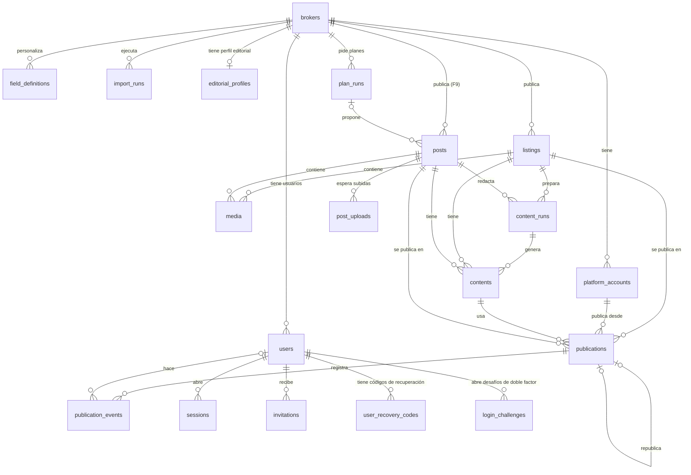

# 02 · Modelo de datos

Base de datos: Postgres en Neon (plan gratis, conexión directa). Esquema en `packages/db` con Drizzle; este documento es la referencia conceptual. Si difieren, **manda el código** y este documento se actualiza en la misma tarea.

Convenciones: tablas y columnas en inglés `snake_case`; `id uuid default gen_random_uuid()` (salvo `platform_catalog`, que usa la llave `(platform, key)`); `created_at` y `updated_at` en `timestamptz` (UTC); enums de Postgres para estados. Los valores de cada enum salen de las tuplas de `packages/core` (`PLATFORMS`, `PUBLICATION_STATUSES`…); el tipo de Postgres se llama como la columna en singular y con prefijo de la tabla cuando es ambiguo (`platform`, `listing_status`, `publication_status`, `publication_format`, `platform_account_status`, `field_type`, `operation`, `currency`, `media_kind`, `media_role`, `content_status`, `listing_source`, `close_reason`, `import_run_status`, `content_run_status`; desde F7, `user_role`, `session_client` e `invitation_purpose`; desde F9, `broker_kind` y, en la migración `0015`, `post_status`, `post_kind`, `post_source`, `brief_origin`, `plan_run_status` y `post_upload_status`). Los idiomas (`contents.language`, `publications.language`, `editorial_profiles.languages`) son texto, validado con `LANGUAGES` de core. **Un valor nuevo de un enum se agrega siempre con `ALTER TYPE … ADD VALUE`** (desde F9: nunca recrear el tipo como la `0006`, que se detiene si la tabla tiene filas), al final de la tupla de core, y ninguna migración usa en la misma transacción un valor recién agregado (el migrador de drizzle aplica las pendientes en una sola transacción). Las columnas son `NOT NULL` salvo las marcadas `null`. Todas las tablas tienen `created_at` y `updated_at`, salvo `publication_events` (inmutable, salvo el borrado a pedido de Meta de ADR-0027: solo `created_at`) y, desde F7, `sessions` e `invitations` (solo `created_at`) y `oauth_states_used` (ninguna), y desde F8 `worker_heartbeats` y `meta_deletion_requests` (ninguna: llevan sus propias horas), `user_recovery_codes` y `login_challenges` (solo `created_at`). `updated_at` lo fija la base (`now()`, la hora de inicio de la transacción) al crear y en cada `update` de Drizzle (`$onUpdate`); un SQL crudo o un `onConflictDoUpdate` lo fija explícitamente (como `seed.ts`). Excepción: `publications` y `publication_events` usan `clock_timestamp()` (la hora real, no la del inicio de la transacción), para ordenarse dentro del candado y para que el sync de F4 compare `updated_at` por igualdad. Las claves foráneas no borran en cascada (los avisos se archivan; borrar un corredor entero sigue un orden en una transacción, ADR-0035), salvo `publication_events → publications` y, desde F7, `sessions` e `invitations → users` (desde F8, también `user_recovery_codes` y `login_challenges → users`); `publication_events.user_id`, `invitations.created_by` y, desde F9, `posts.created_by` quedan en `null` al borrar el usuario. Valores por defecto relevantes: `listings.status = draft`, `listings.show_exact_address = false`, `publications.attempts = 0`, `brokers.auto_publish = false`, `brokers.kind = broker`, `field_definitions.active = true` (`required` e `is_core` en `false`, `sort_order` en `0`), `media.sort_order = 0`, `media.is_cover = false`, `contents.status = draft`, `import_runs.status = queued`, `import_runs.dry_run = false`, `content_runs.status = queued`, `content_runs.texts = true`, `import_runs.rows_* = 0`, y desde F9 `contents.language = es`, `publications.language = es`, `posts.status = draft`, `posts.source = manual`, `posts.brief_origin = operator`, `plan_runs.status = queued`, `post_uploads.status = pending` y `editorial_profiles.languages = {es}`; los arreglos (`fixed_hashtags`, `hashtags`, `media_ids`) y los jsonb `meta`, `attributes`, `payload` e `input` empiezan vacíos, e `import_runs.report`, `content_runs.report`, `publications.progress`, `publications.remote_state` y `publications.listing_source_hash` empiezan en `null`. `publications.status` no tiene default: se crea con uno de `INITIAL_PUBLICATION_STATUSES` (solo `approved`, ADR-0014).

## Diagrama

Desde F9 (ADR-0029), `content_runs`, `contents` y `publications` cuelgan de **un** sujeto: un aviso (`listing_id`) o un post (`post_id`), nunca de los dos ni de ninguno (`CHECK (num_nonnulls(listing_id, post_id) = 1)`). Un medio cuelga de un aviso, de un post o de ninguno (el logo del corredor: `<= 1`). Las demás reglas de sujeto (un aviso solo de un corredor `kind = broker`; un post de cualquiera) son de core, no de la base.

## Tablas

### brokers — corredor o vendedor
| Columna | Tipo | Notas |
|---|---|---|
| id | uuid PK | |
| slug | text unique | ej. `vp-propiedades` |
| name | text | Nombre de la persona |
| brand_name | text | Aparece en los posts |
| logo_media_id | uuid null | FK a `media` |
| primary_color, secondary_color | text | HEX |
| whatsapp, email, instagram_handle, website | text null | |
| tone | text null | Guía de tono para la IA |
| fixed_hashtags | text[] | |
| auto_publish | boolean default false | Si es true, al terminar una corrida de textos se aprueba lo que no tiene errores y se publica solo (F6-T09, ADR-0019; Marketplace queda como recordatorio). Solo lo cambian el panel y la CLI (`BrokerRepository.setAutoPublish`), nunca la hoja Corredor |
| live_enabled | boolean not null default false | La segunda llave del modo en vivo (F9.5-T22, ADR-0036; migración `0020`): una publicación sale de verdad solo con `PUBLISH_MODE=live` en el servidor **y** esta columna en `true` **y** `operator_owned`. Nace `false` (también en las filas que ya había y en el seed). La cambia solo el administrador (`BrokerRepository.setLiveEnabled`, `brokers live <slug> on|off`), solo en un corredor propio y repitiendo el `slug` para encender; si el corredor deja de ser propio, se apaga. Una versión anterior a la `0020` la ignora |
| operator_owned | boolean default false | Corredor propio del operador (F7, spec §4.7, ADR-0023): su IA usa `LLM_PROVIDER` (el plan del operador) y puede usar el formulario automático de Marketplace; los demás, la API de Anthropic y Marketplace a mano. La migración `0009` marcó `true` los que ya existían. Lo cambia solo el administrador (`BrokerRepository.setSettings`) |
| llm_monthly_cap_usd | numeric(10,2) null | Tope de gasto de IA del mes de Chile, en dólares (F7, spec §4.7); `null` = sin tope. Solo el administrador (`setSettings`) |
| kind | enum `broker_kind` default `broker` | `broker` (corredor con propiedades) o `brand` (una marca que solo publica posts), F9 y ADR-0029 (migración `0014`; los que ya existían quedaron `broker`). Se fija al crear (`agentsales brokers create --kind brand`, `POST /brokers`) y no lo cambian la hoja Corredor ni `update`. Solo dice qué ve el panel (en una marca, sin Propiedades, Importar, Portal, Marketplace ni la publicación automática) y **no decide permisos**; podrá sumar valores (`org`, `office`) con `ALTER TYPE … ADD VALUE` |

**Borrar un corredor de verdad** (F9.5-T14, ADR-0035; `agentsales brokers delete <slug> --confirm <slug>`, `DELETE /api/brokers/:id`, solo el administrador): `BrokerPurgeRepository.purge` (`packages/db/src/repositories/broker-purge.ts`) borra en **una transacción** todo lo suyo, en este orden (las FK no borran en cascada): `publication_events` y `publications` de sus avisos y posts, `contents`, `content_runs`, `brokers.logo_media_id` a `null`, `media` (originales, variantes, renders y logos), `post_uploads`, `posts`, `plan_runs`, `editorial_profiles`, `listings` (los valores de sus campos van en `attributes`), `platform_accounts` (con sus credenciales cifradas), `field_definitions` propias, `import_runs`, y de sus usuarios `sessions`, `invitations`, `user_recovery_codes` y `login_challenges` (a la vista, aunque irían en cascada), `users` y, al final, `brokers`. Antes de borrar toma (`FOR UPDATE`) la fila del corredor y, antes de leer las publicaciones, sus `listings`, `posts`, `platform_accounts` y `users`: un `INSERT` concurrente con FK a cualquiera de ellos espera el borrado y después falla, sin dejar huérfanos. Después toma sus publicaciones y se niega (`BROKER_HAS_ACTIVE_PUBLICATIONS`) si alguna está `publishing`, `scheduled`, `awaiting_manual_confirm` u `outcome_unknown`. Las claves de R2 (los `storage_path` de sus medios y los `object_path` de sus subidas) se juntan **antes**; el caso de uso las borra **después** del commit, junto con lo que haya bajo `brokers/{id}/`, `posts/{id}/` de sus posts e `imports/{id}/` de sus cargas (los ids leídos antes más los que `purge` devuelve con `RETURNING`: un post o una carga creados entre medio también se recorren), en lotes de 16; lo que R2 no borra queda en el log con su clave (nunca una URL) y no revierte la base. **Una tabla nueva que cuelgue de un corredor, un aviso, un post, una publicación, una cuenta o un usuario debe sumarse a `purge` y a su prueba** (`packages/db/test/broker-purge.test.ts`, que compara cada tabla de la base fila por fila y falla si `information_schema` muestra una FK hacia `brokers`, `listings`, `posts`, `publications`, `media`, `users`, `platform_accounts`, `contents`, `content_runs` o `plan_runs` desde una tabla que `purge` no cubre). No borra nada en las redes. La vuelta atrás es un respaldo (`docs/10-despliegue.md`).

Reglas de core, como predicados y no como `CHECK` (ADR-0029 punto 12, para poder relajarlas): un aviso solo cuelga de un corredor con `kind = broker` (`assertBrokerHoldsListings`: importar a una marca es `BROKER_IS_BRAND`, en la API y en el job), y la publicación automática no se activa en una marca (`assertAutoPublishAllowed`, también `BROKER_IS_BRAND`). Un post (F9) cuelga de cualquier corredor o marca, y `auto_publish` nunca se aplica a los posts (ADR-0030).

### platform_accounts — cuentas conectadas de cada corredor

> Una columna nueva con datos de Instagram (aquí o en `publications`) debe sumarse al borrado a pedido de Meta (`eraseInstagramUser`, ADR-0027) y a su contrato.
| Columna | Tipo | Notas |
|---|---|---|
| id | uuid PK | |
| broker_id | uuid FK | |
| platform | enum `platform` | `instagram`, `portal_inmobiliario`, `fb_marketplace`; desde F9 (migración `0014`), `x`, `linkedin`, `discord` y `tiktok`, las redes de los posts, cada una con su publisher (T14 a T16 y T26). Los avisos usan solo las tres primeras (`LISTING_PLATFORMS`) y los posts, Instagram y las cuatro nuevas (`POST_PLATFORMS`) |
| external_account_id | text | ID en la plataforma (Instagram: el `user_id` de `/me`; Mercado Libre: el `user_id` de `/users/me`, el mismo del canje; Marketplace: el id de la cookie `c_user` del perfil, desde F5, o `"manual"` en la cuenta a mano, desde F7-T15; desde F9, X: el id de `GET /2/users/me`; LinkedIn: el `sub` de `/v2/userinfo` (el miembro); Discord: el id del webhook, que no es secreto; TikTok: el `open_id` del canje). No cambia en una fila: es parte del único y de la AAD del cifrado |
| display_name | text | Lo que ve el operador (Instagram: `@usuario`; Mercado Libre: el `nickname`, tal cual; Marketplace: el `label` al conectar o "Facebook de <corredor>"; a mano, "Marketplace a mano (<corredor>)") |
| credentials_encrypted | text null | El JSON de la variante de su plataforma, cifrado con AES-256-GCM (`v1.<iv>.<cifrado>.<tag>`, AAD `platform:broker_id:external_account_id`). Desde F9 (T02) es una **unión por plataforma** (`platformCredentialsSchema`, discriminada por la `platform` de la fila, que no va dentro del JSON): Instagram y LinkedIn `{ accessToken }`; Mercado Libre `{ accessToken, refreshToken? }` (ADR-0015, como hasta F8); X y TikTok `{ accessToken, refreshToken }`; Discord `{ webhookUrl }` (solo `https://discord.com` o `discordapp.com` `/api/webhooks/<id>/<token>`). Se escribe en modo estricto (una clave de más es `CREDENTIALS_INVALID`) y se lee en modo laxo (una clave de más se descarta). Que un token no vence **no** va aquí: va en `meta.tokenNeverExpires`. Las cuentas de antes de F9 se leen igual. Solo `getCredentials` (y el candado de credenciales) lo descifra, y valida la variante: si no calza, `CREDENTIALS_UNREADABLE`. `null` en una cuenta desconectada y, desde F5, **siempre** en Marketplace: su sesión vive en el perfil del navegador, fuera de la base (ADR-0017; `checkConnectedCredentials`: `ACCOUNT_CREDENTIALS_REQUIRED` si falta en las demás, `ACCOUNT_CREDENTIALS_NOT_ALLOWED` si llega a Marketplace, `CREDENTIALS_INVALID` si no calza con su plataforma) |
| token_expires_at | timestamptz null | Cuándo la cuenta deja de funcionar sin que el operador haga algo. Instagram: el vencimiento del token largo. Mercado Libre: el horizonte estimado del `refresh_token` (último refresco + 6 meses); el del `access_token` (horas) va en `meta.accessTokenExpiresAt` (ADR-0015). LinkedIn (F9-T15): el vencimiento del token (60 días, sin renovación: la agenda avisa 7 días antes, clase `token_expiring`). X (F9-T16): `null` (X no informa la vida del `refresh_token`); el del `access_token` (unas 2 h), en `meta.accessTokenExpiresAt`. Discord: `null` (el webhook no vence). TikTok (F9-T26): el vencimiento del `refresh_token` (`refresh_expires_in`, o 365 días si no viene); el del `access_token` (24 h), en `meta.accessTokenExpiresAt` (`tiktokAccountMetaSchema`: `openId`, `scopes`, `connectedAt`, `tokenRefreshedAt`, `accessTokenExpiresAt` y `mode` opcional) |
| status | enum `platform_account_status` | `connected`, `expired`, `revoked`, `error` |
| meta | jsonb | Datos propios de la plataforma, sin secretos. Instagram (`instagramAccountMetaSchema`, F3-T13): `accountType`, `permissions` (`null` si se conectó con el token del panel: desconocidos), `connectedAt`, `tokenRefreshedAt` (`null` hasta el primer refresco con ese token) y `tokenExpiryEstimated`. Desde F9-T02, `tokenNeverExpires?: true` (`neverExpiringTokenMetaShape`, el patrón que suman las `meta` que lo admitan): la **única** fuente de verdad de un token que no vence (un system user de Meta, en el piloto), sin secretos y legible sin descifrar. Es distinto de `token_expires_at = null` (no se sabe), y una cuenta con la marca debe tener `token_expires_at = null` (`ACCOUNT_META_INVALID` si no, al conectar, refrescar o mezclar `meta`). El refresco la salta antes de descifrar (`skipped`, `never_expires`); por ahora nada la pone. Mercado Libre (`mercadoLibreAccountMetaSchema`, F4-T01): `userId`, `nickname`, `siteId` (`MLC`), `userType`, `scopes`, `testUser`, `connectedAt`, `tokenRefreshedAt`, `accessTokenExpiresAt` y `tokenExpiryEstimated`. Marketplace (`marketplaceAccountMetaSchema`, F5-T01; desde F7-T15 una unión por `mode`): con el perfil (`mode: "profile"`, o sin `mode` en las filas de F5), `userId` (el de `c_user`), `connectedAt`, `sessionCheckedAt` y `lastLoginError?` (`{ code, at }`); a mano (`mode: "manual"`, ADR-0023), solo `connectedAt`, con `external_account_id = "manual"`. `token_expires_at` es `null`. Desde F9, las redes de los posts: LinkedIn (`linkedinAccountMetaSchema`, T15) `mode` (`api` o `manual`, obligatorio; nace `manual`, D5), `scopes` (`null` si el canje no los informó) y `connectedAt`; X (`xAccountMetaSchema`, T16) `mode?`, `userId`, `username` (arma el enlace del post), `scopes`, `connectedAt`, `tokenRefreshedAt`, `accessTokenExpiresAt` y `spendLimitUsd?` (el tope del mes en dólares; sin él, US$10); Discord (`discordAccountMetaSchema`, T14) `mode?`, `webhookName`, `guildId` y `channelId` (nulos si Discord no los dio: arman el enlace del mensaje) y `connectedAt`; TikTok, arriba. `mode: "manual"` deja la cuenta a mano (ADR-0029 punto 9) y solo vale en `MANUAL_MODE_PLATFORMS` (LinkedIn, X, Discord y TikTok); sin `mode`, la cuenta publica por la API. Lo cambia `accounts mode` (administrador) |

Único: `(broker_id, platform, external_account_id)`. Además, **una sola cuenta conectada por corredor y plataforma**: la imponen `connectAccount` y `connectMercadoLibreAccount` (F4-T06), los conectores de Marketplace y, desde F9, `connectDiscordAccount`, `connectLinkedInAccount`, `connectXAccount` y `connectTikTokAccount`, todos con `upsertConnected(…, { revokeOthers: true })` (al conectar otra, la anterior pasa a `revoked` en la misma transacción, con el corredor bloqueado), no un índice de la base (F3-T13). Entidad en core: `platformAccountSchema` (sin credenciales, con `hasCredentials`); las credenciales salen descifradas solo por `PlatformAccountRepository.getCredentials` (F3-T03).

### field_definitions — campos configurables
| Columna | Tipo | Notas |
|---|---|---|
| id | uuid PK | |
| broker_id | uuid null | `null` = definición global |
| category | text | `real_estate` (luego `product`) |
| key | text | ej. `dormitorios` |
| label | text | Texto visible |
| type | enum `field_type` | `text`, `number`, `enum`, `boolean`, `date`, `url`, `list` |
| required | boolean | |
| options | jsonb null | Opciones de `enum`, o de cada elemento de un `list` (ej. `publicar_en`) |
| source_column | text | Encabezado en el Excel |
| min_value, max_value | numeric null | Rango de un campo `number`, con los extremos incluidos; `null` = sin tope de ese lado (migración `0003`, F2-T01). Fuera de rango es `FIELD_NUMBER_INVALID`. Solo vale en `number`: en otro tipo, o con el mínimo mayor que el máximo, el validador da `FIELD_CONFIG_INVALID` |
| is_core | boolean | Mapea a una columna fija de `listings`, o es una columna de control de la carga que no se guarda (`estado_carga`, `carpeta_medios`, `foto_portada`). En los dos casos, nunca va a `attributes` |
| sort_order | int | |
| active | boolean | |

Una definición del corredor con el mismo `key` **sobrescribe** la global. Único `UNIQUE NULLS NOT DISTINCT (broker_id, category, key)` (migración `0001`): dos globales con el mismo `key` chocan, y es el destino del upsert del seed. El seed crea las 36 globales de `real_estate` desde la plantilla (`TEMPLATE_COLUMNS` en `packages/db/src/seed-data.ts`), con los rangos de los campos numéricos (spec F2 §4.3: por ejemplo, `dormitorios` y `banos` de 0 a 50, superficies de 1 a 1.000.000 m², `piso` de -10 a 200), y pisa los cambios hechos a mano en ellas: para personalizar un campo se crea una definición del corredor. Un corredor también puede **desactivar** un campo global con una definición propia `active = false`: el repositorio devuelve las inactivas, y el validador aplica la precedencia antes de filtrarlas. Agregar un campo = insertar una fila; no requiere migración.

### listings — aviso (propiedad o producto)
| Columna | Tipo | Notas |
|---|---|---|
| id | uuid PK | |
| broker_id | uuid FK | |
| external_ref | text | `id_propiedad` del Excel |
| category | text | `real_estate` |
| operation | enum `operation` null | `sale`, `rent` |
| property_type | text null | Departamento, Casa… |
| status | enum `listing_status` | `draft`, `ready`, `active`, `paused`, `closed`, `archived` |
| close_reason | enum `close_reason` null | `sold`, `rented`, `withdrawn`. Se fija al cerrar, se conserva al archivar una cerrada y se borra al reabrir (volver a `ready` o `active`; `ListingRepository.changeStatus`, F6-T08) |
| price_amount | numeric(14,2) | |
| price_currency | enum `currency` | `UF`, `CLP` |
| region, comuna, address, unit_number | text null | Un borrador o un producto (ADR-0006) puede no tenerlos |
| show_exact_address | boolean default false | Privacidad: por defecto no se publica la dirección exacta **en los textos** (la IA, Instagram) y Portal la oculta él (`address_line_by_reference`). No oculta la ubicación del formulario de Marketplace: ahí se escribe la dirección de la planilla (spec F5, D16; que Facebook muestre solo una ubicación aproximada es NO VERIFICADO) |
| attributes | jsonb | Resto de campos, validados con `field_definitions` |
| highlights | text null | Lo que el corredor quiere destacar |
| internal_notes | text null | Nunca se publica |
| source | enum `listing_source` | `xlsx`, `google_sheets`, `manual`, `chat` |
| source_hash | text | Hash de la fila para detectar cambios |
| music_track_id | text null | Desde F9.5-T19 (migración `0019`): la música del reel, un id del catálogo de core (`MUSIC_TRACK_IDS`, `packages/core/src/music/catalog.ts`), validado en core (`MUSIC_TRACK_INVALID`), no con un enum: sacar una pista del catálogo no pide migración y la deja sin música. `null` = sin música (por defecto). La importación no la toca; la fija el operador (`PATCH /listings/:id`, `ListingRepository.setMusicTrack`). Va en la clave del reel solo si hay música |

Único: `(broker_id, external_ref)`. Ese par es la llave de la **importación idempotente**.

### media — fotos, videos y derivados
| Columna | Tipo | Notas |
|---|---|---|
| id | uuid PK | |
| listing_id | uuid FK null | `null` para los medios de un post y los del corredor (logo) |
| post_id | uuid FK null | Desde F9 (migración `0015`): el post del medio, con su clave bajo `posts/{postId}/…`. `CHECK media_at_most_one_subject` `(num_nonnulls(listing_id, post_id) <= 1)` |
| broker_id | uuid FK | |
| kind | enum `media_kind` | `image`, `video` |
| role | enum `media_role` | `original`, `processed`, `rendered` |
| variant | text null | `MEDIA_VARIANTS` (core): de un `processed`, `thumb`, `ig_4x5`, `pi_4x3`, `ig_reel` o, desde F9-T10 (solo posts, sin migración), `x_video` (el video reducido para X) y, desde F9.5-T10 (solo posts que van a Discord, sin migración), `discord_video` (el video liviano para Discord, bajo 19 MiB); de un `rendered`, `cover` o `spec_sheet`. `null` en un original. `ig_reel`, `x_video` y `discord_video` son `kind = video`. Desde F9.5-T19, con música elegida, su clave de R2 suma la pista (la del reel de un aviso en el hash de su texto; la de un post, `-m-<id>`), y sin música es la de siempre. Desde F9.5-T18, el `ig_reel` de un aviso **sin video** (armado con 3 fotos o más) cuelga de su primera foto: el padre de un derivado de video puede ser una imagen |
| parent_media_id | uuid null | Derivado de qué original. Suele ser del mismo tipo, salvo el `ig_reel` con fotos de un aviso sin video (F9.5-T18): una variante de video cuyo padre es la primera foto del reel (la portada), sin cambios de esquema |
| storage_path | text | Ruta en el bucket |
| mime | text | |
| width, height | int null | |
| duration_s | numeric(10,3) null | Solo videos; Drizzle lo lee como número |
| bytes | bigint | |
| checksum | text | sha256; evita duplicados |
| sort_order | int | Orden del carrusel |
| is_cover | boolean | |
| ai_metadata | jsonb null | Descripción y puntaje de la IA. Sin uso en F2: la IA no ve las fotos (D3 del spec F2); queda para la sugerencia de portada con visión (backlog) |

Únicos (migración `0001`): `(listing_id, checksum) WHERE role = 'original'` (el mismo archivo no se sube dos veces a una propiedad) y `UNIQUE (storage_path)`, que también cubre el logo (`listing_id` null). El logo es un medio `original` sin aviso (`listing_id` null), en `brokers/{brokerId}/brand/{sha256}.{ext}`; `brokers.logo_media_id` apunta a él. Que sea un original sin aviso ni post y del mismo corredor lo valida `BrokerRepository.setLogo`, no la base (solo hay FK). Desde F9, único parcial `media_original_post_checksum_unique` `(post_id, checksum) WHERE role = 'original'`: el mismo archivo no se sube dos veces a un post. Los originales de un post van en `posts/{postId}/original/{sha256}.{ext}` y sus variantes en `posts/{postId}/processed/{variante}/{sha256}-v{versión}.jpg|.mp4` (F9-T10). En F1, `width`, `height` y `duration_s` quedan en `null`; los mide la etapa `media` del job `content.prepare` en F2 (ADR-0012).

**Derivados (F2-T03, migración `0005`):** una variante es un medio `processed` con `parent_media_id` (su original, del mismo aviso) y `variant`; un render es un medio `rendered` sin padre. Únicos parciales `media_processed_parent_variant_unique` `(parent_media_id, variant) WHERE role = 'processed'` y `media_rendered_listing_variant_unique` `(listing_id, variant) WHERE role = 'rendered'`: hay **uno vigente** por original y variante, y uno por aviso y variante de render. `MediaRepository.upsertDerivative` lo crea o lo reemplaza **en su lugar** (misma fila, clave nueva) y devuelve la clave anterior para borrarla de R2; `deleteDerivative` borra un derivado y nunca un original. Los métodos de la carga (`listOriginals`, `listCovers`, `findByStoragePath`, `create`, `arrange`) siguen viendo solo originales; `listBySubject` ve todo el aviso o post (desde F9-T08 absorbe el `listByListing` de F2). Que el padre sea un original del mismo aviso y corredor, y que el tipo calce con la variante (el reel es video), lo valida el repositorio, no la base. Un derivado que choca con un único es `MEDIA_CONFLICT`, reintentable. `duration_s` guarda 3 decimales (el doble en memoria redondea igual).

### content_runs — corridas de contenido (F2, ADR-0012)
| Columna | Tipo | Notas |
|---|---|---|
| id | uuid PK | |
| listing_id | uuid FK null | El corredor sale del aviso. Nulo desde F9 (migración `0015`) en las corridas de un post |
| post_id | uuid FK null | Desde F9: la corrida de textos de un post. `CHECK content_runs_one_subject`: exactamente uno de `listing_id` y `post_id` |
| status | enum `content_run_status` | `queued`, `running`, `succeeded`, `failed` (`CONTENT_RUN_STATUSES`) |
| texts | boolean default true | Si la corrida genera textos; `false` solo rehace medios y renders |
| stage | text null | Etapa en curso: `media`, `renders`, `reel` o `texts` (`CONTENT_RUN_STAGES`) |
| report | jsonb null | `contentRunReportSchema` (core): una sección por etapa (`media`, `renders`, `reel`, `llm`), los códigos de la revisión editorial por canal (`checks`, sin mensajes; una foto de la corrida, que queda vieja tras una edición) y advertencias; `null` hasta que la corrida termina |
| error | jsonb null | `{ code, message }` cuando `status = failed` |
| started_at | timestamptz null | Se fija al pasar a `running` (el primer intento) |
| finished_at | timestamptz null | |
| auto_publish_done_at | timestamptz null | Desde F8-T12 (migración `0011`): cuándo se resolvió el `auto_publish` de una corrida `succeeded` (se intentó, no aplicaba o se retomó al arrancar). `null` en una terminada con textos es un `auto_publish` cortado por un reinicio: el worker lo retoma al arrancar si terminó hace 12 h o menos (`listAutoPublishPending`), una sola vez (`markAutoPublishDone` es condicional). La migración la fija en las `succeeded` que ya existían |
| llm_usage | jsonb null | `llmUsageSchema` (core, F7-T02): lo gastado en IA, sumado **por llamada** en cuanto vuelve (`addLlmUsage`, atómico con la fila bloqueada), también las de una corrida que después falla: llamadas, proveedor y modelo de la última, tokens (entrada sin caché, escritura y lectura de caché, salida), `costUsd` estimado con la tabla de precios de core y su fecha (`priceTable`: la fecha; con "(sin precio: el más caro)" si el modelo de la API no estaba en la tabla; `null` con el plan o `fake`, que cuestan 0), en micro-dólares, y los `requestIds`. `null` si no llamó al modelo. El gasto del mes de un corredor suma las corridas **creadas** en el mes de Chile (`sumLlmCost`, cruzando con `listings.broker_id` o, desde F9-T04, con `posts.broker_id`, más los `plan_runs` del corredor) |

Único parcial `content_runs_one_active_per_listing`: `(listing_id) WHERE status IN ('queued', 'running')` (`ACTIVE_CONTENT_RUN_STATUSES`), una sola corrida activa por aviso; un segundo `create` es `CONTENT_RUN_CONFLICT`, reintentable. Índice `(listing_id, created_at)` para la última corrida. Los cambios de estado son condicionales, como los de `import_runs`, y `markSucceeded` guarda el estado y las filas de `contents` en una sola transacción (migración `0004`, F2-T02). Desde F9 (migración `0015`): único parcial `content_runs_one_active_per_post` `(post_id) WHERE status IN ('queued', 'running')`, una corrida activa por post, e índice `(post_id, created_at)`. Desde F9-T04 los repositorios leen las dos (el sujeto, ADR-0029) y el segundo `create` activo de un post también es `CONTENT_RUN_CONFLICT`; los barridos de avisos (`listQueued`, `listAutoPublishPending`) no ven las corridas de posts.

### contents — textos generados por plataforma
| Columna | Tipo | Notas |
|---|---|---|
| id | uuid PK | |
| listing_id | uuid FK null | Nulo desde F9 (migración `0015`) en los textos de un post |
| post_id | uuid FK null | Desde F9: el texto de un post (uno por red e idioma). `CHECK contents_one_subject`: exactamente uno de `listing_id` y `post_id` |
| content_run_id | uuid FK | Corrida que lo generó (ADR-0012). `NOT NULL` desde la migración `0004`, que falla a propósito si la tabla ya tenía filas |
| platform | enum `platform` | |
| language | text default `es` | Desde F9: el idioma del texto (`LANGUAGES`). Lo anterior es español; los textos de un aviso siguen siendo `es` |
| title | text null | Portal y Marketplace |
| body | text | Caption (sin los hashtags) o descripción |
| hashtags | text[] | Solo Instagram: el caption que se publica es `body`, una línea en blanco y los hashtags (`instagramCaption`, core) |
| status | enum `content_status` | `draft`, `edited`, `approved` |
| llm_provider, llm_model, prompt_version | text | Trazabilidad |
| raw_output | jsonb | Salida validada de la IA; si falta, `null` de JSON (no NULL de SQL) |

Único `contents_run_platform_language_unique` `(content_run_id, platform, language)` (desde la migración `0015`; antes `contents_run_platform_unique` `(content_run_id, platform)`, que para los avisos, todos en `es`, es lo mismo): un texto por canal, idioma y corrida, así un intento solapado del job no duplica. El **vigente** de un aviso en un canal es su fila más reciente (`created_at` y después `id`; índice `(listing_id, platform, created_at)`); las anteriores quedan como historial. Desde F9, índice `(post_id, platform, created_at)` para el vigente de un post. En F2 no hay `approved`: lo usa F3.

### publications — un aviso (o un post) en una cuenta y un formato (ADR-0014, ADR-0029)
Nace en `approved` desde el texto aprobado de su canal, con `content_id` y `media_ids` fijos (spec F3 §4.2). Entidad en core: `publicationSchema` (`packages/core/src/publication.ts`).

| Columna | Tipo | Notas |
|---|---|---|
| id | uuid PK | |
| listing_id | uuid FK null | Nulo desde F9 (migración `0015`) en las publicaciones de un post |
| post_id | uuid FK null | Desde F9: la publicación de un post. `CHECK publications_one_subject`: exactamente uno de `listing_id` y `post_id` |
| platform_account_id | uuid FK | |
| platform | enum `platform` | Denormalizado para consultas |
| format | enum `publication_format` | `post` (carrusel o imagen suelta) o `reel` (`PUBLICATION_FORMATS`). Solo Instagram usa `reel` (el video de un aviso o un post de video); Portal, Marketplace y las redes de F9 usan siempre `post` |
| language | text default `es` | Desde F9: el idioma de su texto. Con dos idiomas, un post sale en dos publicaciones de la misma cuenta (spec F9 §4.4) |
| cost_usd | numeric(10,4) null | Desde F9: el costo estimado de publicar (spec F9 §4.12); hoy solo X (US$0,015, o US$0,20 con enlace). Lo anota el intento antes de llamar a X, solo en `publishing`: en `live` con `reserveCostUsd` (F9.5-T08), que bloquea la fila de la cuenta y lo anota solo si cabe bajo el tope (atómico: dos a la vez no pasan las dos); en `dry-run` con `setCostUsd`, como referencia. `sumCostUsdSince` suma por cuenta el del mes de Chile de las publicaciones en `live` que pudieron cobrar (`COST_COUNTED_STATUSES`: publicando, publicadas, pausadas, retiradas o con resultado dudoso; por `published_at` o, sin ella, `updated_at`) para el tope `meta.spendLimitUsd` de la cuenta de X (por defecto US$10). `null` en las redes que no cobran. No se extiende a anuncios |
| content_id | uuid FK | Texto aprobado que se publica; no cambia mientras la publicación está activa |
| media_ids | uuid[] | Medios usados, en orden, fijados al nacer |
| status | enum `publication_status` | `approved`, `scheduled`, `publishing`, `awaiting_manual_confirm`, `published`, `failed`, `paused`, `unpublished`, `cancelled` (sin `draft` ni `pending_approval` desde la migración `0006`) y, desde F9 (migración `0014`, ADR-0029 punto 8), `outcome_unknown`: el intento se cortó después de enviar y no se sabe si la red publicó; es pendiente (`PENDING_PUBLICATION_STATUSES`) y activa, y solo sale a `published` o `failed` cuando el operador la resuelve. Transiciones en `01-arquitectura.md` |
| scheduled_at | timestamptz null | La hora programada (F6, ADR-0018), al minuto: solo tiene valor en `scheduled` (el repositorio la exige al pasar a ese estado y la borra al salir). Índice parcial `publications_scheduled_due` `(scheduled_at) WHERE status = 'scheduled'` (migración `0008`) para el disparo de cada minuto |
| published_at | timestamptz null | |
| external_id, external_url | text null | |
| attempts | int default 0 | Veces que se pidió publicarla (cada paso a `publishing`, F3-T10); los reintentos automáticos de la cola no lo suben |
| last_error | jsonb null | `{ code, message, retriable }` |
| dry_run | boolean | Modo del último intento: nace en `true` (el valor seguro) y la API lo fija al pasar a `publishing` (obligatorio) y, desde F6, también al programar (`scheduled`); el worker lo respeta (spec F3 D11), y el disparo de una programada usa el de la publicación |
| progress | jsonb null | Lo que el publisher ya creó en la plataforma, para retomar sin publicar dos veces. Instagram: `{ attemptStartedAt, childIds, containerId, publishRequestedAt? }` (`instagramProgressSchema`); Portal: `{ pictureIds, picturesReuploaded?, sellerContact?, createRequestedAt?, itemId?, descriptionDone?, addressHidden?, relistRequestedAt?, relistRejected?, relistRestocked? }` (`portalProgressSchema`, F4-T01; `picturesReuploaded` desde F4-T14; `relistRequestedAt`, `relistRejected` y `relistRestocked` desde F6-T07, para republicar sin repetir el `relist` y terminar de reponer el ítem nuevo si un corte lo dejó a medias; Actualizar re-fija `sellerContact`; `sellerContact` lleva el WhatsApp y el correo del corredor, que no van a vistas, eventos ni logs); Marketplace: `{ attempt, simulated, formReadyAt, photos, priceClp, ufValue?, ufDate?, windowClosedAt?, byHand? }` (`byHand: true` desde F7-T15: lo publica el corredor con la cuenta a mano) (`marketplaceProgressSchema`, F5-T01): lo arma core al pasar a `awaiting_manual_confirm` y después solo cambia con `updateProgress` (condicional en el estado y el intento); se valida con el esquema de su plataforma. Desde F9 (`socialProgressSchema`, laxo), X, LinkedIn, Discord y TikTok guardan `{ send?, manual? }` y, al lado, lo suyo (por ejemplo, los medios ya subidos a X o los URN de LinkedIn): `send` es el "enviando" (`{ startedAt, result? }`, ADR-0029 punto 8: sin `result`, no se sabe si salió) y `manual` el traspaso a mano de una cuenta en modo `manual` (`{ attempt, simulated, readyAt, media }`, punto 9) |
| remote_state | jsonb null | Lo último que informó la plataforma (`remoteStateSchema`, ADR-0015): `status` y `subStatus` tal cual, `stopTime`, `expirationTime`, `reason?` (`{ code, message }`: el motivo de una pausa por moderación, con texto propio, desde F4-T15) y `checkedAt`. `null` hasta el primer dato y en Instagram. El esquema solo se amplía con campos opcionales (las filas guardadas deben seguir calzando). Lo escribe `setRemoteState` (con su evento `sync`) o una transición (`changes.remoteState`) |
| relisted_from | uuid null | La publicación de Portal que esta republica (ADR-0020, migración `0008`): FK a `publications`, sin cascada. Único parcial `publications_relisted_from_unique` `(relisted_from) WHERE relisted_from IS NOT NULL AND status <> 'cancelled'`: una sola republicación por publicación, sin contar las descartadas (`PUBLICATION_CONFLICT`) |
| listing_source_hash | text null | `source_hash` del aviso al nacer la publicación (ADR-0015, spec F4 §4.6): las plataformas que envían datos del aviso (Portal) no publican si cambió. `null` en las anteriores a la migración `0007` (un valor vacío también queda en `null`). Desde F4-T16 es obligatoria al crear las de un aviso (`NewListingPublication.listingSourceHash`): quien abre las publicaciones la lee dentro del candado. Las de un post (F9) la dejan en `null`: un post no tiene planilla |

Único parcial `publications_one_active_per_format`: una publicación activa por `(listing_id, platform_account_id, format)`, con `WHERE status NOT IN ('unpublished', 'cancelled')` (los estados de `ACTIVE_PUBLICATION_STATUSES` en `core`, así que `outcome_unknown` cuenta como activa): el carrusel y el reel de un aviso conviven. Índice `(listing_id)`. Desde F9 (migración `0015`), único parcial `publications_one_active_per_post_format` `(post_id, platform_account_id, format, language)` con el mismo `WHERE` (derivado de los terminales que ya existían: la `0015` no usa `outcome_unknown`, que agrega la `0014` y puede aplicarse en la misma transacción), e índice `(post_id)`. La migración `0006` (F3-T01) recreó el tipo `publication_status` con el SQL ajustado a mano (primero el índice viejo, después el tipo) y falla a propósito si la tabla tiene filas.

### posts — contenido de marca (F9-T03, ADR-0029)
Un tema o idea con un texto por red e idioma (`contents.post_id`), a veces medios (`media.post_id`) y sus publicaciones (`publications.post_id`). Cuelga de cualquier corredor o marca (`brokers.kind`): la regla de que un aviso solo cuelga de un `broker` es de core, no un `CHECK`. Migración `0015`; los repositorios (`PostRepository`, `PostUploadRepository`, `PlanRunRepository`, `EditorialProfileRepository`) y el candado por post (`PostLock`, que bloquea esta fila con `FOR NO KEY UPDATE`) son de F9-T04.

| Columna | Tipo | Notas |
|---|---|---|
| id | uuid PK | |
| broker_id | uuid FK | La marca (o el corredor) dueña del post |
| topic | text | El tema; es el título en la agenda y el seguimiento |
| brief | text null | Lo que el post debe decir |
| brief_origin | enum `brief_origin` default `operator` | `operator` o `ai` (ADR-0030, punto 1): solo un brief del operador es fuente de hechos; al editarlo el operador pasa a `operator` |
| kind | enum `post_kind` | `text`, `image`, `carousel` o `video` (`POST_KINDS`) |
| status | enum `post_status` default `draft` | `idea` (propuesta de la IA, sin textos), `draft`, `ready` (al menos un texto aprobado) o `archived` (spec F9 §4.2). Nunca `active` ni se cierra por venta |
| source | enum `post_source` default `manual` | `manual` o `ai` (vino de un plan) |
| pillar | text null | La línea de contenido del perfil editorial (`pillars[].key`) |
| planned_at | timestamptz null | Cuándo se piensa publicar |
| plan_run_id | uuid FK null | El plan que lo propuso |
| created_by | uuid FK null | Quién lo creó; `null` al borrar el usuario |
| rationale | text null | El porqué de una idea de la IA |
| platforms | text[] null | Desde F9-T20 (migración `0018`): las redes del post, de `POST_PLATFORMS` (core, validado al leer). Las llena el plan con las redes que la IA sugirió y que pasaron las verificaciones de cada idea, y las cambia el operador (`updatePost`). `null` = todas las redes de la marca (un post manual). `post.draft` redacta solo para estas, dentro de las de la marca y que sirvan al `kind` del post. Desde F9-T21 también deciden aprobar, publicar y programar: el texto de una red que no está aquí no se aprueba ni sale (`POST_PLATFORM_EXCLUDED`), y una red con publicaciones pendientes no se quita (`POST_HAS_PENDING_PUBLICATIONS`) |
| x_link_allowed | boolean default `false` | Desde F9-T16 (migración `0016`): la marca explícita del operador que permite un enlace en el texto de X (cuesta US$0,20 en vez de US$0,015). Sin ella, un enlace en X impide aprobar (`LINK_NOT_ALLOWED`) y publicar (`X_LINK_NOT_ALLOWED`) |
| music_track_id | text null | Desde F9.5-T19 (migración `0019`): la música de los videos del post, como `listings.music_track_id`; `null` = sin música. Cambiarla (`updatePost`) encola `post.media`, que rehace el reel, el video para X y el de Discord con la pista (su clave de R2 suma `-m-<id>`) |

Índice `(broker_id, status, planned_at)` para el contenido y el calendario de una marca, y `posts_plan_run_idx` sobre `(plan_run_id)` para las ideas de un plan (`GET /plans/:id` las lee con `PostRepository.list` por `planRunId`); los dos, desde la migración `0015`.

### plan_runs — planes de ideas de la IA (F9, ADR-0030)
Se crea con `posts` (migración `0015`) porque `posts.plan_run_id` la referencia; la lógica (job `content.plan`) es de F9-T20: al terminar, el reporte y los posts `idea` de sus ideas se guardan en una sola transacción.

| Columna | Tipo | Notas |
|---|---|---|
| id | uuid PK | |
| broker_id | uuid FK | La marca del plan |
| period_start, period_end | timestamptz | El período que propone (por defecto, las próximas 2 semanas) |
| status | enum `plan_run_status` default `queued` | `queued`, `running`, `succeeded`, `failed` (`PLAN_RUN_STATUSES`) |
| request | jsonb | Lo pedido (`planRunRequestSchema`, core): `{ platforms, count, days, requestedBy }`, sin secretos |
| report | jsonb null | `planRunReportSchema` (core, F9-T20): las ideas guardadas (id del post, tema, línea, redes, formato, fecha y notas), las descartadas con su código (`PLAN_DISCARD_CODES`, leídos con `z.enum`: la lista **solo crece**, con los nuevos al final; desde F9.5, ADR-0034, `IDEA_TOO_SIMILAR` y `NO_SLOT`, y ya no salen `DATE_INVALID`, `OUT_OF_PERIOD`, `IN_THE_PAST` ni `WEEK_FULL`, que se quedan por los reportes de antes), las advertencias de la IA y la llamada; `null` hasta que termina bien. Desde F9.5 la fecha y las redes de cada idea las pone el código según la cadencia, no la IA. Es una **foto al terminar el plan**: después manda el post (su tema, línea, fecha y redes, que el operador puede cambiar). Volver a una imagen anterior a F9.5 con un reporte que tenga un código nuevo hace fallar su lectura (spec F9.5 §4.3) |
| error | jsonb null | `{ code, message }` cuando `status = failed` |
| llm_usage | jsonb null | `llmUsageSchema`, como en `content_runs`; entra en `sumLlmCost` desde F9-T04 |
| prompt_version | text null | La versión del prompt del plan con que corrió (`PLAN_PROMPT_VERSION`: `social-plan-v2` desde F9.5, ADR-0034; antes `social-plan-v1`, F9-T20; propia del plan, no la de los textos) |
| started_at, finished_at | timestamptz null | |

Índice `(broker_id, created_at)` y, desde F9-T20 (migración `0018`), el índice único parcial `plan_runs_one_active_per_broker` sobre `(broker_id) WHERE status IN ('queued', 'running')`: un plan activo por marca (un segundo `create` es `PLAN_RUN_CONFLICT` y `requestPlanRun` devuelve el que está en curso).

### editorial_profiles — perfil editorial de una marca (F9, spec F9 §4.3)
Uno por corredor (`broker_id` es la llave). `pnpm db:seed --operator-brands` (solo con ese parámetro y solo en la instancia del operador, spec F9 D19; sin él, el seed no las toca) crea las marcas del operador, `vinny` ("Vinny") y `agentpey` ("AgentPey"), con `kind = brand`, `operator_owned = true`, sin cuentas y con su perfil vacío, que llena el operador; correrlo de nuevo no las duplica ni pisa lo que el operador cambió (`ON CONFLICT DO NOTHING`, a diferencia del corredor demo).

| Columna | Tipo | Notas |
|---|---|---|
| broker_id | uuid PK, FK | |
| languages | text[] default `{es}` | `LANGUAGES` (core), sin repetir; el primero es el principal |
| audience | text null | A quién le habla |
| pillars | jsonb default `[]` | `[{ key, name, description, weight }]` |
| facts | text[] | Los hechos que la IA puede afirmar (ADR-0030): lo que no está aquí no se afirma |
| avoid | text[] | Temas, palabras o promesas que no se usan |
| cadence | jsonb default `{}` | Por red de `POST_PLATFORMS` (sin Portal ni Marketplace): `{ postsPerWeek, days: ["mon"…"sun"], hours: ["HH:MM"] (hora de Chile), languageGapHours }` (6 h por defecto). Una red sin entrada no tiene cadencia |
| default_hashtags | text[] | Se suman a `brokers.fixed_hashtags` |

El tono sigue en `brokers.tone`. La forma (`editorialProfileSchema`) se valida al leer; las reglas al escribir (topes, claves únicas, pesos, horas) las aplica `normalizeEditorialProfile` en core (F9-T09; ver `docs/01-arquitectura.md`, "Perfil editorial").

### post_uploads — subidas pendientes de un post (F9, spec F9 §4.5)
El registro de las URL prefirmadas de R2 pedidas para un post (ADR-0025); `import_runs` es de planillas.

| Columna | Tipo | Notas |
|---|---|---|
| id | uuid PK | |
| post_id | uuid FK | |
| object_path | text | La clave de R2: `posts/{postId}/original/{sha256}.{ext}` (F9-T10; el sha256 que trae el pedido) o, para un archivo de más de 100 MB que llega sin sha256 (F9-T17), `posts/{postId}/original/{id}.{ext}` con el id de la propia subida. Único `post_uploads_object_path_unique`: pedir otra vez el mismo archivo con su sha256 reabre la misma fila |
| expected_bytes | bigint | El tamaño anunciado al pedir la URL |
| status | enum `post_upload_status` default `pending` | `pending`, `completed` (registrada como medio) o `abandoned` (vencida; la limpieza la borró de R2). Un pedido nuevo del mismo archivo la vuelve a `pending`. Desde F9-T17 (migración `0017`, `ALTER TYPE … ADD VALUE`, al final del tipo), `uploaded`: un archivo grande sin sha256 que llegó a R2 y espera que el worker lo hashee (`post.media`); de ahí pasa a `completed` (medio nuevo, o duplicado y su objeto borrado) o a `abandoned` (el archivo ya no estaba). La limpieza cierra las `pending` vencidas y las `uploaded` con más de 24 h desde que llegaron (`updated_at`: el worker agotó sus reintentos) |
| expires_at | timestamptz | Cuándo vence la subida: 24 h después de pedirla (la URL dura 6 h) |

Índices `(post_id)` y `(status, expires_at)` (la limpieza periódica).

### platform_catalog — catálogo de las plataformas (ADR-0015, F4-T01)
Datos públicos que solo se leen con token y cambian con el tiempo: en Mercado Libre, categorías (con sus hijas y `settings`), atributos de una hoja y ubicaciones de Chile. Se bajan a pedido y vencen a los 7 días. Sin secretos ni datos del corredor. Entidad en core: `platformCatalogEntrySchema`.

| Columna | Tipo | Notas |
|---|---|---|
| platform | enum `platform` | Parte de la llave |
| key | text | `category:<id>`, `attributes:<hoja>` o `location:<id>`. Parte de la llave |
| data | jsonb | La forma normalizada del cliente (en Mercado Libre, desde F4-T09, los esquemas de core `portalCategorySchema`, `portalAttributesSchema` o `portalLocationSchema`: solo lo que se usa), no la respuesta cruda. Una entrada que ya no calce con su esquema se trata como ausente y se vuelve a bajar: sumar un campo no obliga a migrar |
| fetched_at | timestamptz | Cuándo se bajó: con 7 días o más (o una fecha futura) se vuelve a pedir |

Llave primaria `(platform, key)` (migración `0007`); no tiene `id`.

### publication_events — bitácora
| Columna | Tipo | Notas |
|---|---|---|
| id | uuid PK | |
| publication_id | uuid FK | `ON DELETE CASCADE` |
| type | text | `status_changed`, `publish_attempt`, `sync`, `manual_edit`, desde F6 `schedule_changed` y desde F8-T17 `data_deleted` (`PUBLICATION_EVENT_TYPES`) |
| from_status, to_status | text null | `from_status` es `null` al nacer la publicación |
| actor | text | `system`, `operator`, `cli` (`PUBLICATION_ACTORS`): el canal (desde F7, sale de la sesión: `operator` es el panel) |
| user_id | uuid null | FK a `users` (`ON DELETE SET NULL`): la persona que lo hizo (F7, spec §4.3); `null` en lo del sistema y en lo anterior a F7 |
| payload | jsonb | Sin secretos. En `sync` (F4), `syncPayloadSchema`: `{ remote }`, lo leído de la plataforma. En un `status_changed` de pausar, reactivar o cerrar (F4-T17): `{ mode, operation, remote? }` (lo que informó la plataforma); en uno del sync: `{ mode: "live", sync: true, remoteStatus }`, con actor `system` (así se distingue una pausa de Mercado Libre de una del operador). Desde F6-T08 (ADR-0019), los cambios que hace la propiedad (pausar Portal, desprogramar, descartar y bajar simulaciones al cerrar) suman `byListing: true` y, al descartar o bajar, la `action` de la propiedad (`close` o `archive`): reanudar la propiedad solo reactiva las pausas con esa marca. Desde F8-T12, si un sync aplicó la pausa justo antes que la propiedad (la llamada volvió con la publicación ya en `paused`), la marca va en un `sync` con `{ remote, mode, operation: "pause", byListing: true, raced: true }` y el actor de quien pausó la propiedad: reanudar lo reconoce (`pausedByListing`), y la API solo muestra de un `sync` esa marca (`{ byListing: true }`; la bitácora dice "la pausa la pidió la propiedad"). En `publish_attempt` (F3-T11), `publishAttemptPayloadSchema`: `mode`, `attempt` (= `publications.attempts`), `retry` (reintento de la cola), `result` (`published`, `retry`, `failed` o, desde F5-T05, `awaiting_manual_confirm`: el formulario de Marketplace quedó listo), `error?`, `sent?` (lo enviado: formato, caption, rutas de R2 y medidas de los medios, y la cuenta; desde F4-T13, en Portal y Marketplace, `listing` —el aviso enviado, sin `internal_notes` ni `_extra`, con la dirección y la unidad en `null` si no se muestran— y `brokerContact` con el WhatsApp enmascarado; desde F5-T07, en Marketplace, `priceClp` y `uf`; nunca URLs firmadas ni tokens) y, desde F4-T13, `notes?` (advertencias que no bloquearon, limpias y como mucho 20). Desde F6 (ADR-0018): un `status_changed` a `scheduled` lleva `{ mode, scheduledAt, reason }` (`reason`: `operator`, `batch`, `auto_publish` o `rate_limit`, `SCHEDULE_REASONS`); uno de `scheduled` a `failed` del disparo, `{ mode, due: true, code }`; uno de desprogramar (`scheduled` a `approved`), `{ unscheduled }` (la hora que tenía); `schedule_changed` (reprogramar), `scheduleChangedPayloadSchema`: `{ from, to, mode }`; y `publish_attempt` suma el resultado `rescheduled` con `retryAt`; `manual_edit` (Actualizar en Portal, F6-T07), `manualEditPayloadSchema`: `{ mode, fields, remote? }`. Desde F8-T17, `data_deleted` (Meta pidió borrar los datos de la cuenta de Instagram; sin cambio de estado, actor `system`): `{ confirmationCode }`; ese borrado también deja en `""` el `sent.account.displayName` de los `publish_attempt` de esas publicaciones (la única edición de la bitácora: lo pide Meta, Platform Terms 3.d.i). Todos los campos nuevos son opcionales: las filas anteriores se siguen leyendo |
| created_at | timestamptz | |

Índice `(publication_id, created_at)` para la bitácora de una publicación. `created_at` de los eventos y de las publicaciones se escribe con `clock_timestamp()` (no `now()`), para que el orden se mantenga dentro de una transacción. Entidad en core: `publicationEventSchema`.

### users — usuarios (F7, ADR-0021)
| Columna | Tipo | Notas |
|---|---|---|
| id | uuid PK | |
| email | text unique | `CHECK (email = lower(email))`: se guarda en minúsculas (`normalizeEmail`) |
| name | text | |
| role | enum `user_role` | `admin` (el operador) o `broker` (`USER_ROLES`) |
| broker_id | uuid null | FK a `brokers`; `CHECK ((role = 'admin') = (broker_id IS NULL))`. Índice por corredor |
| password_hash | text null | `scrypt$N$r$p$sal$hash` (config); `null` hasta aceptar la invitación. Nunca sale del repositorio: la entidad (`userSchema`) trae `hasPassword` |
| failed_logins | integer default 0 | Fallos seguidos; al llegar a 10 se bloquea 15 min y vuelve a 0 (suma atómica) |
| locked_until | timestamptz null | |
| disabled_at | timestamptz null | Desactivado: no entra y sus sesiones se borran |
| last_login_at | timestamptz null | |
| totp_secret_encrypted | text null | Desde F8-T15 (migración `0012`): la clave del doble factor, cifrada con `SecretBox` (propósito `totp`, AAD `totp:<id>`). Se guarda al empezar a activarlo; nunca sale del repositorio |
| totp_enabled_at | timestamptz null | Desde cuándo está activo; `null` mientras se activa o sin doble factor. `CHECK` (`users_totp_enabled_secret`): activo implica una clave. La entidad lo trae como `totpEnabledAt` |
| totp_last_step | bigint null | El último paso de 30 s usado: un código no sirve dos veces (`advanceTotpStep`, condicional) |
| created_at, updated_at | timestamptz | |

Restablecer un usuario y `pnpm auth:admin` le quitan el doble factor al usar el enlace (`clearTotp`: la clave, el paso y sus códigos de recuperación). Una rama de Neon copiada de producción trae estas columnas cifradas con la clave de producción: con la de desarrollo, entrar da `TOTP_UNREADABLE` (la salida es `pnpm auth:admin` y usar su enlace).

### user_recovery_codes — códigos de recuperación del doble factor (F8-T15)
| Columna | Tipo | Notas |
|---|---|---|
| id | uuid PK | |
| user_id | uuid | FK a `users`, en cascada |
| code_hash | text | SHA-256 del código normalizado (sin guiones, en mayúsculas). Único por `(user_id, code_hash)` |
| used_at | timestamptz null | Sirve una vez (`consumeRecoveryCode`, condicional) |
| created_at | timestamptz | |

Activar el doble factor reemplaza los 10 códigos en la misma transacción (`enableTotp`).

### login_challenges — el segundo paso de entrar (F8-T15)
| Columna | Tipo | Notas |
|---|---|---|
| id | uuid PK | |
| token_hash | text unique | SHA-256 del desafío; el desafío se entrega una vez |
| user_id | uuid | FK a `users`, en cascada |
| expires_at | timestamptz | 5 min (`LOGIN_CHALLENGE_TTL_MS`). Índice para borrar los vencidos |
| used_at | timestamptz null | Sirve una vez: se gasta al abrir la sesión (`consume`, condicional) |
| created_at | timestamptz | |

La vigilancia de cada hora (`publications.watch`, `purgeExpiredAuth`) borra los vencidos, como las sesiones.

### sessions — sesiones (F7, ADR-0021)
| Columna | Tipo | Notas |
|---|---|---|
| id | uuid PK | |
| token_hash | text unique | SHA-256 del token; el token va solo en la cookie o en la CLI |
| user_id | uuid FK | `ON DELETE CASCADE`, indexado |
| client | enum `session_client` | `panel` o `cli` (`SESSION_CLIENTS`) |
| expires_at | timestamptz | 30 días desde que se abrió |
| last_seen_at | timestamptz | Se actualiza a lo más una vez por minuto; 7 días sin uso la cierran |
| created_at | timestamptz | |

### invitations — enlaces de invitación y de restablecer (F7, ADR-0021)
| Columna | Tipo | Notas |
|---|---|---|
| id | uuid PK | |
| user_id | uuid FK | `ON DELETE CASCADE`, indexado. Único parcial `invitations_one_open_per_user` `(user_id) WHERE used_at IS NULL`: uno vigente por usuario (`issue` borra el anterior sin usar en la misma transacción) |
| token_hash | text unique | SHA-256 del token del enlace (el token va en el fragmento de la URL) |
| purpose | enum `invitation_purpose` | `invite` o `reset` (`INVITATION_PURPOSES`) |
| expires_at | timestamptz | 72 h |
| used_at | timestamptz null | Se marca de forma condicional: sirve una vez |
| created_by | uuid null | FK a `users` (`ON DELETE SET NULL`); `null` si lo generó `pnpm auth:admin` |
| created_at | timestamptz | |

### oauth_states_used — `state` del OAuth ya usados (F7)
| Columna | Tipo | Notas |
|---|---|---|
| nonce_hash | text PK | El nonce del `state` de Mercado Libre y, desde F8-T17, el de Instagram; desde F9, también los de LinkedIn, X y TikTok: sirve una vez (`markUsed` devuelve `false` la segunda). El verificador de PKCE de X nunca se guarda aquí: va solo en la cookie firmada |
| expires_at | timestamptz | Los vencidos se borran |

### worker_heartbeats — latidos del worker (F8-T12)
| Columna | Tipo | Notas |
|---|---|---|
| process_id | text PK | El proceso: máquina, pid y un sufijo propio (un reinicio es otro) |
| started_at | timestamptz | Cuándo arrancó |
| beat_at | timestamptz | El último latido (al arrancar y cada minuto) |
| stopped_at | timestamptz null | Cuándo se apagó en orden (SIGTERM); `null` mientras corre o si se cortó |

Índice `(beat_at)` para el más reciente. El worker se da por encendido si su último latido tiene menos de 3 min y no se apagó en orden (`workerStatusOf`, core); `/health` (administrador), `doctor` y el panel lo muestran. Los de hace más de una semana se borran al arrancar (migración `0011`).

### meta_deletion_requests — pedidos de borrado de Meta (F8-T17)
| Columna | Tipo | Notas |
|---|---|---|
| code | text PK | El código que se devuelve a Meta (`confirmation_code`) y que abre la página del pedido (`GET /api/meta/data-deletion/:code`) |
| meta_user_id_hash | text | El HMAC-SHA256 del `user_id` de Instagram del `signed_request`, con una clave derivada de `APP_ENCRYPTION_KEY` (propósito `metaUserId`; un SHA-256 simple de un id numérico corto se podría revertir): el `user_id` no se guarda |
| received_at | timestamptz | Cuándo llegó |
| status | text | Hoy siempre `completed`: el borrado se hace al recibirlo |
| completed_at | timestamptz null | Cuándo se borró (hoy, el mismo `received_at`) |
| accounts_affected | integer | Cuántas cuentas de Instagram se borraron (0 si el usuario no calzó con ninguna) |

Sin `created_at` ni `updated_at` (lleva sus propias horas). En la misma transacción que la anota (`eraseInstagramUser`), cada cuenta de Instagram de ese usuario queda `revoked`, sin credenciales ni `token_expires_at`, con `external_account_id = 'borrada:<id>'`, `display_name = '(datos borrados a pedido de Meta)'` y `meta = {}`; sus publicaciones quedan sin `external_id`, `external_url` ni `progress`, en su estado, con un `data_deleted` cada una (migración `0013`). Desde F9 el borrado no cambia: filtra por cuenta, así que incluye las publicaciones de posts en esa cuenta, y no toca `posts` ni `contents`, que son textos del operador y alimentan también otras redes (spec F9 §4.11; lo fija un test).

### import_runs — historial de cargas
| Columna | Tipo | Notas |
|---|---|---|
| id | uuid PK | |
| broker_id | uuid FK null | `null` hasta que el job lee la hoja Corredor; la de un usuario corredor nace con el suyo (F7-T08) y el job nunca la lleva a otro |
| status | enum `import_run_status` | `awaiting_upload` (desde F8, migración `0010`: pedida, mientras el panel o la CLI suben los archivos a R2), `queued`, `running`, `succeeded`, `failed` |
| dry_run | boolean | Valida y reporta sin escribir listings ni medios |
| input | jsonb | `importRunInputSchema` (core), una unión (spec F8 §4.12): desde F8, `{ broker, dryRun, xlsx: { key, name, size, sha256 }, media: { kind: "zip", key, name, size } \| { kind: "folder", prefix, name, files: [{ path, size, sha256? }] } \| null }`, con las claves de R2 bajo `imports/<id>/`; antes de F8, `{ xlsxPath, mediaDir, broker }` (rutas locales), que se sigue leyendo y nunca se reintenta (`IMPORT_INPUT_LEGACY`). Sin secretos. El job `import.run` solo recibe el id |
| error | jsonb null | `{ code, message }` cuando `status = failed` |
| source | enum `listing_source` | Mismos valores que `listings.source` |
| file_name | text | |
| rows_total, rows_created, rows_updated, rows_skipped, rows_failed | int | |
| report | jsonb null | `importReportSchema` (core): encabezados, corredor y resultado de cada fila, con sus errores por columna y sus advertencias. `null` hasta que `importListings` registra su resultado (migración `0002`). La ingesta de medios suma `media` (subidos, existentes, omitidos y fallidos), que falta si la carga no llegó a esa etapa o es anterior a F1-T07 |
| started_at | timestamptz null | Se fija al pasar a `running` |
| finished_at | timestamptz null | `null` mientras la carga está en curso |

Índice `import_runs_status_created_at_idx` `(status, created_at)` (migración `0010`): cerrar las que siguen en `awaiting_upload` pasadas 24 h (`failAbandonedUploads`). `markQueued` pasa de `awaiting_upload` a `queued`, y `markFailed` acepta también `awaiting_upload`. `ALTER TYPE … ADD VALUE` no se puede usar en la misma transacción que lo agrega, y el migrador de Drizzle aplica juntas las migraciones pendientes: ninguna migración posterior puede usar `awaiting_upload` (por ejemplo, en un índice parcial) mientras pueda aplicarse junto con la `0010`. `input.dryRun` repite la columna `dry_run`, que es la que manda.

Los únicos `brokers.slug`, `listings (broker_id, external_ref)` y los dos de `media` se traducen en los repositorios a `BROKER_CONFLICT`, `LISTING_CONFLICT` y `MEDIA_CONFLICT`, reintentables: dos intentos del job `import.run` pueden solaparse, y el reintento reclasifica la fila o encuentra el medio ya registrado.

### Cola de trabajos

`pg-boss` crea y administra su propio esquema (`pgboss`). No se modela aquí:
- Lo crea y migra **solo el worker** al arrancar (`migrate: true`). La API solo consulta que exista, y los productores (scripts) no migran.
- Sus migraciones son de pg-boss, no de drizzle: la versión va fijada (`pg-boss@12.35.0`) y se sube a propósito.
- `drizzle.config.ts` usa `schemaFilter: ["public"]` para que drizzle-kit nunca toque `pgboss`.

## Migraciones de F9 (contenido de marca)

Son **aditivas salvo la `0015`**, que además quita el `NOT NULL` de `listing_id` en `contents`, `content_runs` y `publications` y cambia el único de `contents`: todas son compatibles hacia atrás mientras no haya filas de posts ni filas con los valores nuevos (la versión anterior sigue leyendo la base; volver atrás y el SQL que deshace la `0015` a la `0018` juntas, en `docs/10-despliegue.md`, paso 9). Los valores nuevos de un enum van con `ALTER TYPE … ADD VALUE`, al final de su tupla en core, y ninguna usa en su misma transacción un valor que agrega ella u otra pendiente.

| Migración | Tarea | Qué agrega |
|---|---|---|
| `0014_f9_plataformas_marcas` | T01 | `platform` suma `x`, `linkedin`, `discord` y `tiktok`; `publication_status` suma `outcome_unknown`; el tipo `broker_kind` y `brokers.kind` (`broker` por defecto) |
| `0015_f9_posts` | T03 | Las tablas `posts`, `plan_runs`, `post_uploads` y `editorial_profiles` con sus tipos (`post_status`, `post_kind`, `post_source`, `brief_origin`, `plan_run_status`, `post_upload_status`); `post_id` en `contents`, `content_runs`, `publications` y `media`; `listing_id` nulo en las tres primeras; `language` en `contents` y `publications`; `publications.cost_usd`; los `CHECK` de un sujeto, los únicos y los índices de posts. Se deshace a mano solo junto con la `0016` a la `0018` (`docs/10-despliegue.md`, paso 9) |
| `0016_f9_x_enlace` | T16 | `posts.x_link_allowed` (`false` por defecto) |
| `0017_f9_subida_grande` | T17 | `post_upload_status` suma `uploaded` |
| `0018_f9_plan_ideas` | T20 | `posts.platforms` (`text[]` nulo) y el único parcial `plan_runs_one_active_per_broker` |

**F9.5 (lista para mostrar):** `0019_f95_musica` (T19) agrega `listings.music_track_id` y `posts.music_track_id` (texto nulo): aditiva; la versión anterior no las lee, y volver atrás no pide deshacerla.

## Reglas de datos

- Precios: se guardan tal cual en su moneda; **no** se convierte UF↔CLP. Única excepción (spec F5, D9): el precio del formulario de Marketplace, que va en pesos; core lo convierte en cada intento con el valor oficial de la UF del día (API BDE del Banco Central) y lo guarda en el progreso de la publicación (`priceClp`, `ufValue`, `ufDate`) y en `sent` del `publish_attempt`. El aviso y el texto aprobado siguen en UF.
- Fechas: UTC en la base; se muestran en `America/Santiago`.
- Borrado: los listings no se borran; pasan a `archived`. La única excepción es borrar el corredor entero (F9.5-T14, ADR-0035, arriba en `brokers`), que se lleva todo lo suyo.
- `internal_notes` nunca se envía a la IA ni a las plataformas.
